# TASK 004A — UNSAID Supabase PostgreSQL Database Architecture Proposal (Consolidated Founder Decisions)

**Status Dokumen:** TASK 004A + Konsolidasi Keputusan Resmi Founder 4a/4b/4c, Legal Hold Edge-Case Corrections, & Snapshot Payload Integrity Correction, Menunggu Review Project Manager Sebelum TASK 004B-02 (Design Only)  
**Peran:** Senior Database Architect — UNSAID  
**Tanggal Revisi:** 2026-11-23  
**Target Branch:** `ai-studio-dev`  
**Bahasa Utama Produk:** Bahasa Indonesia (*Speak freely. Remain unknown.*)

---

## Panduan Klasifikasi Keputusan dalam Dokumen Ini

Seluruh dokumen ini memisahkan secara tegas kategori setiap desain dan keputusan:

- **`[APPROVED BY FOUNDER]`** — Keputusan produk, privasi, dan tata kelola final yang telah disetujui Founder dan bersifat mengikat.
- **`[TECHNICAL RECOMMENDATION]`** — Rekomendasi arsitektur database, keamanan PostgreSQL/PostgREST, kriptografi, dan pemulihan sistem dari tim arsitektur.
- **`[TECHNICAL POLICY PENDING]`** — Parameter kebijakan teknis operasional (mis. *rate limit* anti-penyalahgunaan harian) yang belum ditetapkan angkanya dan wajib difinalisasi sebelum implementasi produksi.
- **`[REQUIRES LEGAL REVIEW]`** — Parameter hukum/retensi/preservasi yang wajib ditinjau konsultan hukum (UU PDP, UU ITE, KUHAP) sebelum diberlakukan di produksi.
- **`[REQUIRES FOUNDER APPROVAL]`** — Penanda untuk keputusan produk yang masih menunggu persetujuan Founder (saat ini **nihil** setelah keputusan 4a, 4b, dan 4c disetujui Founder).

---

## 1. Repository & Environment Findings (Verified vs. Unverified)

### Fakta Terverifikasi di Repository & Paket Terpasang
1. **Stack Aplikasi (`package.json`, `astro.config.mjs`, `tsconfig.json`):**
   - Astro `^6.4.8` (`output: 'server'`, `@astrojs/node ^10.1.4` `mode: 'standalone'`, port `3000`).
   - React `^19.0.1` (`@astrojs/react ^5.0.7`), Tailwind CSS v4 (`@tailwindcss/vite ^4.3.5`), TypeScript `^5.9.3` (`strict`), Zod `^4.3.6` (terpasang `4.6.7`), Vitest `~4.0.18`.
2. **Klien & Versi SDK Supabase (`package.json`, `package-lock.json`, `src/lib/supabase/browser.ts`, `src/server/services/supabase.ts`):**
   - Terpasang `@supabase/supabase-js` versi **`2.119.2`** dan `@supabase/ssr` versi **`0.12.7`**.
   - Verifikasi langsung definisi tipe `@supabase/auth-js@2.119.2` (`GoTrueClient.d.ts` & `lib/types.d.ts`):
     - **Email OTP** tersedia melalui `signInWithOtp()` dan `verifyOtp()`.
     - **Passkeys (WebAuthn)** tersedia pada SDK klien (`registerPasskey()`, `signInWithPasskey()`, `auth.passkey.*`, serta `auth.admin.passkey.*`), sementara flag `experimental.passkey` di klien berstatus `@deprecated`. Namun, fitur server-side Passkeys di GoTrue Supabase masih berstatus Beta dan membutuhkan aktivasi eksplisit pada proyek Supabase target.
   - `src/lib/supabase/browser.ts` hanya membaca `PUBLIC_SUPABASE_URL` & `PUBLIC_SUPABASE_ANON_KEY`.
   - `src/server/services/supabase.ts` menyediakan `createServerAnonClient()` (untuk akses anonim publik) dan `createServerAdminClient()` (memakai `SUPABASE_SERVICE_ROLE_KEY`, komunikasi melalui PostgREST). *(Catatan: Helper `createServerUserClient(cookies)` berbasis `@supabase/ssr` untuk sesi JWT `authenticated` belum ada di codebase saat ini dan akan ditambahkan pada fase implementasi.)*
3. **Konfigurasi Environment & Guard (`src/validation/env.ts`, `src/config/public.ts`, `src/config/server.ts`, `.env.example`):**
   - `.env.example` hanya berisi placeholder (`PUBLIC_APP_URL`, `PUBLIC_SUPABASE_URL`, `PUBLIC_SUPABASE_ANON_KEY`, `APP_URL`, `SUPABASE_SERVICE_ROLE_KEY`).
   - `assertNoSecretLeakage()` menolak prefix publik untuk secret server, dan `src/config/server.ts` memblokir impor pada runtime browser.
4. **Domain Model & Unit Tests (`src/domain/models/identity.ts`, `src/domain/logic/identity-rules.ts`, `tests/`):**
   - Mendefinisikan `PublicationIdentityMode = 'anonymous' | 'alias'` (default `'anonymous'`), `FORBIDDEN_PUBLIC_OWNERSHIP_FIELDS`, dan `assertPublicPayloadSanitized()`.
5. **Status Database Saat Ini:**
   - Belum ada folder `supabase/`, file migrasi `.sql`, atau objek database Supabase yang dibuat di repository.

### Infrastruktur & Kapabilitas yang Belum Terverifikasi (Memerlukan Proyek Supabase Live)
- **Belum ada proyek Supabase live** (cloud maupun self-hosted) atau kredensial database aktif di environment ini.
- **Konfigurasi FTS Bahasa Indonesia (`pg_ts_config`):** Keberadaan aktual `cfgname = 'indonesian'` pada instance Supabase target **belum terverifikasi** secara langsung dan wajib dicek pada pre-flight migrasi dengan fallback `'simple'` + `pg_trgm`.
- **Hak Role & Trigger Skema `auth` di Supabase Managed:** Kemampuan membuat trigger `AFTER INSERT ON auth.users` serta izin `CREATE ROLE` non-`BYPASSRLS` (`unsaid_app_definer`) pada Postgres Supabase Cloud target **belum terverifikasi** sampai proyek live tersedia.
- **Perilaku Persis Klaim PostgREST (`auth.role()` vs `request.jwt.claim.role` vs `auth.jwt()`):** Meski dokumentasi resmi Supabase/PostgREST menyatakan klaim JWT tervalidasi disuntikkan ke GUC transaksi (`request.jwt.claims` / `request.jwt.claim.role`), keberadaan helper dan nama GUC aktual pada proyek Supabase target **wajib diverifikasi** melalui uji integrasi live pada awal TASK 004B.
- **Aktivasi Passkeys Beta, Pencabutan Sesi Server-Side & SMTP OTP:** Ketersediaan `GOTRUE_PASSKEY_ENABLED=true`, konfigurasi `RP ID`/`RP Origins`, perilaku pencabutan sesi GoTrue apabila worker asinkron tidak memegang `jwt` pengguna, serta pengiriman email OTP pada proyek Supabase target belum terverifikasi.
- **Ekstensi `pg_cron`, KMS Eksternal & WORM Audit Sink:** Ketersediaan `pg_cron` / Edge Function scheduler, kunci KMS/KEK eksternal untuk `legal_vault`, serta *external signing key* & penyimpanan WORM untuk checkpoint audit log belum tersedia sampai infrastruktur proyek disiapkan.

---

## 2. Revised Architecture Overview (Post-Audit)

Arsitektur UNSAID menerapkan **Zero-Personal-Data Public Schema**, **Strict PostgREST Isolation**, dan **Dual-Lane Execution Boundary**:

1. **Pemisahan 3 Skema Tanpa Data Pribadi di `public` (`[TECHNICAL RECOMMENDATION]`):**
   - **Skema `public` (Satu-satunya Skema yang Diekspos ke PostgREST):**
     - **Hanya** berisi tabel konten & katalog publik tanpa identitas pengguna sama sekali: `categories`, `aliases`, `posts`, `comments`, dan `post_reaction_stats`.
     - Berisi public views (`public.public_posts_feed`, `public.public_post_detail`, `public.public_comments_view`) dengan opsi `WITH (security_invoker = true, security_barrier = true)`.
     - Berisi **wrapper fungsi RPC tipis** yang terpisah ketat menjadi jalur pengguna (`public.rpc_*`, hanya untuk `authenticated`) dan jalur server/worker (`public.rpc_staff_*`, `public.rpc_legal_*`, `public.rpc_worker_*`, hanya untuk `service_role`).
   - **Skema `private` (TIDAK Diekspos ke PostgREST):**
     - **Seluruh** tabel yang mengandung `user_id` atau kepemilikan pengguna **dipindahkan ke `private`**, termasuk **`private.post_drafts`**, **`private.bookmarks`**, dan **`private.post_reactions`** (bersama `user_accounts`, `deletion_jobs`, `alias_ownership`, `post_ownership`, `comment_ownership`, `alias_quarantines`, `reports`, `staff_roles`, `sensitive_access_requests`, `moderation_actions`, `moderation_appeals`, dan `moderation_audit_logs`).
     - Role `anon` dan `authenticated` memiliki **nol hak akses langsung** (`REVOKE ALL`) terhadap skema `private` dan seluruh tabel di dalamnya.
   - **Skema `legal_vault` (TIDAK Diekspos ke PostgREST):**
     - Terisolasi penuh dari pengguna biasa, `moderator`, dan `operational_admin`.
     - Menyimpan `legal_preservation_holds`, `legal_preservation_snapshots` (menggunakan **enkripsi AEAD/Envelope Encryption di lapisan aplikasi**, bukan `JSONB` plaintext), dan `legal_access_logs`.
2. **Keuntungan Struktural Pemindahan `post_drafts`, `bookmarks`, `post_reactions` ke `private`:**
   - Tabel pribadi tidak pernah muncul di skema OpenAPI/PostgREST publik. Pengguna terautentikasi **tidak** dapat melakukan query REST bebas ke `/rest/v1/post_drafts`, `/rest/v1/bookmarks`, atau `/rest/v1/post_reactions`; seluruh akses baca/tulis pribadi berjalan hanya melalui fungsi RPC tervalidasi yang mengunci identitas ke `auth.uid()` dan menegakkan `account_status` secara konsisten (termasuk memblokir mutasi tulis, komentar, dan tambah/hapus reaksi pada akun `suspended` maupun `pending_deletion`).
3. **Anti-Korelasi Anonim, Multi-Alias, Kuota & Konten Pasca-Hapus (`[APPROVED BY FOUNDER]`):**
   - `public.posts`, `public.comments`, dan `public.aliases` tidak memiliki `owner_user_id` atau `commenter_user_id`.
   - Satu akun dibatasi maksimal **5 alias aktif** secara bersamaan (ditegakkan di server SSR dan database).
   - Tulisan `anonymous` wajib `alias_id IS NULL` dan `public_author_label = 'Anonim'`.
   - Komentar selalu tampil `Anonim`, tanpa alias dan tanpa badge `OP`. Tulisan yang tetap bertahan sebagai `Anonim` pasca-penghapusan akun tetap dapat menerima komentar baru sesuai aturan standar tanpa memulihkan kepemilikan.
   - Pelepasan alias dan penghapusan akun mempertahankan `published_at` dan `updated_at` asli (`unsaid.suppress_updated_at = 'on'`). Status `suspended` memblokir aksi baru pengguna tanpa menyembunyikan tulisan lama secara otomatis.

---

## 3. Revised Entity Relationship Diagram (Mermaid)

```mermaid
erDiagram
    AUTH_USERS {
        uuid id PK
        text email "Private in Supabase Auth"
    }

    %% --- SKEMA PRIVATE (Non-Exposed) ---
    USER_ACCOUNTS {
        uuid user_id PK, FK "private.user_accounts"
        text account_status "active | pending_deletion | deletion_failed | suspended"
        timestamptz deletion_requested_at
        timestamptz created_at
        timestamptz updated_at
    }

    DELETION_JOBS {
        uuid id PK "private.deletion_jobs"
        uuid user_id "No FK cascade; retains job state"
        text idempotency_key UK
        text state "requested | auth_session_revoked | db_unlinked | auth_deleted | completed | failed_retryable | failed_manual_intervention"
        text last_reached_checkpoint "none | auth_session_revoked | db_unlinked | auth_deleted"
        int attempt_count
        timestamptz next_retry_at
        timestamptz locked_until
        text last_error_code
        text last_error_detail
        timestamptz created_at
        timestamptz updated_at
        timestamptz completed_at
    }

    ALIAS_OWNERSHIP {
        uuid alias_id PK, FK "private.alias_ownership"
        uuid owner_user_id FK
        timestamptz claimed_at
    }

    ALIAS_QUARANTINES {
        uuid id PK "private.alias_quarantines"
        text normalized_name UK "No former_owner_user_id"
        timestamptz quarantined_until
        timestamptz created_at
    }

    POST_DRAFTS {
        uuid id PK "private.post_drafts (Moved from public)"
        uuid owner_user_id FK
        uuid category_id FK
        uuid selected_alias_id FK "Nullable"
        text author_mode "anonymous | alias"
        text title
        text body_markdown
        timestamptz created_at
        timestamptz updated_at
    }

    POST_OWNERSHIP {
        uuid post_id PK, FK "private.post_ownership"
        uuid owner_user_id FK
        timestamptz created_at
    }

    COMMENT_OWNERSHIP {
        uuid comment_id PK, FK "private.comment_ownership"
        uuid owner_user_id FK
        timestamptz created_at
    }

    BOOKMARKS {
        uuid user_id PK, FK "private.bookmarks (Moved from public)"
        uuid post_id PK, FK
        timestamptz created_at
    }

    POST_REACTIONS {
        uuid id PK "private.post_reactions (Moved from public)"
        uuid post_id FK
        uuid user_id FK
        text reaction_type "appreciate"
        timestamptz created_at
    }

    REPORTS {
        uuid id PK "private.reports"
        uuid reporter_user_id FK "Nullable on deletion"
        text target_type "post | comment"
        uuid target_post_id FK "Nullable"
        uuid target_comment_id FK "Nullable"
        uuid target_snapshot_id
        text reason_code
        text explanation
        text status "open | under_review | resolved | dismissed"
        timestamptz created_at
    }

    STAFF_ROLES {
        uuid user_id PK, FK "private.staff_roles"
        text role "moderator | operational_admin | privacy_legal_officer | super_admin_security"
        uuid granted_by FK
        timestamptz granted_at
        timestamptz revoked_at
    }

    SENSITIVE_ACCESS_REQUESTS {
        uuid id PK "private.sensitive_access_requests"
        uuid requested_by FK
        uuid approved_by FK "Nullable; must differ from requested_by"
        text purpose_code
        text authorization_ref
        text target_scope_type
        uuid target_scope_id
        text status "pending | approved | rejected | expired | revoked"
        timestamptz expires_at
        timestamptz created_at
        timestamptz approved_at
    }

    MODERATION_ACTIONS {
        uuid id PK "private.moderation_actions"
        uuid moderator_user_id FK "Nullable"
        text target_type "post | comment"
        uuid target_post_id FK "Nullable ON DELETE SET NULL"
        uuid target_comment_id FK "Nullable ON DELETE SET NULL"
        uuid target_snapshot_id
        text action_type "hide | restore | remove | dismiss_report"
        text policy_basis
        text internal_note
        timestamptz created_at
    }

    MODERATION_APPEALS {
        uuid id PK "private.moderation_appeals"
        uuid moderation_action_id FK
        uuid appellant_user_id FK "Nullable on deletion"
        text appeal_statement
        boolean is_redacted_by_deletion "True when redacted on account deletion"
        text status "submitted | reviewing | upheld | rejected"
        uuid reviewed_by_user_id FK "Nullable"
        text resolution_note
        timestamptz created_at
        timestamptz resolved_at
    }

    MODERATION_AUDIT_LOGS {
        bigint seq_id PK "private.moderation_audit_logs"
        uuid moderation_action_id FK "Nullable ON DELETE SET NULL"
        uuid action_ref_id
        uuid actor_user_id
        text actor_role
        text event_type
        jsonb event_payload "No author PII"
        text prev_hash
        text entry_hash
        timestamptz created_at
    }

    %% --- SKEMA PUBLIC (Exposed via PostgREST, Zero User Identity) ---
    CATEGORIES {
        uuid id PK "public.categories"
        text slug UK
        text name UK
        int sort_order
        boolean is_active
    }

    ALIASES {
        uuid id PK "public.aliases"
        text display_name
        text normalized_name UK
        timestamptz created_at
    }

    POSTS {
        uuid id PK "public.posts"
        uuid category_id FK
        uuid alias_id FK "Nullable"
        text author_mode "anonymous | alias"
        text public_author_label "Anonim or alias display_name"
        text title
        text body_markdown
        text body_plain_text
        tsvector search_vector
        text moderation_status "visible | hidden | removed"
        boolean is_deleted_by_author "True on author soft-delete + redaction"
        timestamptz deleted_at "Nullable; set with is_deleted_by_author"
        timestamptz published_at
        timestamptz updated_at
    }

    COMMENTS {
        uuid id PK "public.comments"
        uuid post_id FK
        uuid parent_comment_id FK "Nullable"
        text body_markdown
        text moderation_status "visible | hidden | removed"
        boolean is_deleted_by_author
        timestamptz created_at
    }

    POST_REACTION_STATS {
        uuid post_id PK, FK "public.post_reaction_stats"
        int retained_appreciation_count "Net active + retained deleted-account appreciations"
        timestamptz last_active_reaction_at
    }

    %% --- SKEMA LEGAL_VAULT (Non-Exposed, Application-Layer AEAD Encrypted) ---
    LEGAL_PRESERVATION_HOLDS {
        uuid id PK "legal_vault.legal_preservation_holds"
        text authority_reference
        text legal_basis
        text target_scope_type "user | post | comment | report"
        uuid target_id
        uuid created_by_officer_id FK
        uuid approved_by_officer_id FK "Must differ from creator"
        text status "pending_approval | active | expired | released"
        timestamptz expires_at
        timestamptz approved_at "Nullable; audit timestamp on approval"
        timestamptz released_at
        text release_reason
        timestamptz created_at
    }

    LEGAL_PRESERVATION_SNAPSHOTS {
        uuid id PK "legal_vault.legal_preservation_snapshots"
        uuid hold_id FK
        text record_type "user_account | auth_identity | post | comment | post_draft | report | ownership_link | alias_ownership | bookmark | post_reaction | moderation_action | moderation_appeal"
        uuid source_record_id
        text encryption_algorithm "AES-256-GCM"
        text key_id "External KMS/KEK version"
        bytea wrapped_dek "DEK wrapped by external KEK"
        bytea iv_nonce "96-bit unique IV"
        bytea auth_tag "128-bit AEAD tag"
        bytea encrypted_payload "Ciphertext only (not JSONB)"
        text payload_sha256 "SHA-256 of encrypted plaintext JSON"
        text source_state_sha256 "Deterministic SQL state hash per scoped entity"
        timestamptz purge_after "Synced with hold.expires_at / released_at"
        timestamptz created_at
    }

    LEGAL_ACCESS_LOGS {
        bigint seq_id PK "legal_vault.legal_access_logs"
        uuid hold_id FK "Nullable"
        uuid sensitive_request_id FK "Nullable"
        uuid actor_user_id
        text actor_role
        text access_purpose
        jsonb accessed_scope
        text prev_hash
        text entry_hash
        timestamptz created_at
    }

    AUTH_USERS ||--o| USER_ACCOUNTS : "account state"
    AUTH_USERS ||--o{ DELETION_JOBS : "tracks deletion"
    AUTH_USERS ||--o{ ALIAS_OWNERSHIP : "owns privately"
    ALIASES ||--|| ALIAS_OWNERSHIP : "mapped via"
    AUTH_USERS ||--o{ POST_DRAFTS : "authors privately"
    CATEGORIES ||--o{ POST_DRAFTS : "categorizes"
    ALIASES ||--o{ POST_DRAFTS : "optional draft alias"
    CATEGORIES ||--o{ POSTS : "categorizes"
    ALIASES ||--o{ POSTS : "attributed while active"
    POSTS ||--o| POST_OWNERSHIP : "owned via"
    AUTH_USERS ||--o{ POST_OWNERSHIP : "owns while active"
    POSTS ||--o{ COMMENTS : "has"
    COMMENTS ||--o{ COMMENTS : "replies"
    COMMENTS ||--o| COMMENT_OWNERSHIP : "owned via"
    AUTH_USERS ||--o{ COMMENT_OWNERSHIP : "authored while active"
    AUTH_USERS ||--o{ BOOKMARKS : "saves privately"
    POSTS ||--o{ BOOKMARKS : "bookmarked"
    AUTH_USERS ||--o{ POST_REACTIONS : "active private reaction"
    POSTS ||--o{ POST_REACTIONS : "receives"
    POSTS ||--|| POST_REACTION_STATS : "retained count"
    AUTH_USERS ||--o{ REPORTS : "reports while active"
    POSTS ||--o{ REPORTS : "reported post"
    COMMENTS ||--o{ REPORTS : "reported comment"
    AUTH_USERS ||--o| STAFF_ROLES : "4-tier role"
    STAFF_ROLES ||--o{ SENSITIVE_ACCESS_REQUESTS : "requests/approves"
    STAFF_ROLES ||--o{ MODERATION_ACTIONS : "executes"
    POSTS ||--o{ MODERATION_ACTIONS : "target post"
    COMMENTS ||--o{ MODERATION_ACTIONS : "target comment"
    MODERATION_ACTIONS ||--o{ MODERATION_APPEALS : "appealed via"
    MODERATION_ACTIONS ||--o{ MODERATION_AUDIT_LOGS : "audited in"
    LEGAL_PRESERVATION_HOLDS ||--o{ LEGAL_PRESERVATION_SNAPSHOTS : "preserves encrypted data"
    LEGAL_PRESERVATION_HOLDS ||--o{ LEGAL_ACCESS_LOGS : "audits access"
```



---

## 4. Updated Table-by-Table Schema Proposal

### A. Skema `public` (Diekspos PostgREST — Nol Data Pribadi / Nol Kolom `user_id`)

> **Koreksi Audit #1:** Tabel `post_drafts`, `bookmarks`, dan `post_reactions` **dipindahkan sepenuhnya ke skema `private`**. Skema `public` hanya memuat data publik yang memang aman dibaca publik.

#### 1. `public.categories` `[APPROVED BY FOUNDER]`
- `id UUID PRIMARY KEY DEFAULT gen_random_uuid()`
- `slug TEXT NOT NULL UNIQUE CHECK (slug ~ '^[a-z0-9-]+$')`
- `name TEXT NOT NULL UNIQUE`
- `description TEXT NOT NULL DEFAULT ''`
- `sort_order INTEGER NOT NULL DEFAULT 0`
- `is_active BOOLEAN NOT NULL DEFAULT TRUE`
- `created_at TIMESTAMPTZ NOT NULL DEFAULT now()`

#### 2. `public.aliases` `[APPROVED BY FOUNDER]`
- `id UUID PRIMARY KEY DEFAULT gen_random_uuid()`
- `display_name TEXT NOT NULL CHECK (char_length(trim(display_name)) BETWEEN 2 AND 40)`
- `normalized_name TEXT NOT NULL UNIQUE` *(normalisasi kanonik `lower(regexp_replace(trim(display_name), '\s+', ' ', 'g'))`)*
- `created_at TIMESTAMPTZ NOT NULL DEFAULT now()`
- **Jaminan Privasi:** Tidak ada `owner_user_id` atau kolom tautan ke akun maupun alias lain.

#### 3. `public.posts` `[APPROVED BY FOUNDER]` + `[TECHNICAL RECOMMENDATION]`
- `id UUID PRIMARY KEY DEFAULT gen_random_uuid()`
- `category_id UUID NOT NULL REFERENCES public.categories(id) ON DELETE RESTRICT`
- `alias_id UUID REFERENCES public.aliases(id) ON DELETE SET NULL`
- `author_mode TEXT NOT NULL DEFAULT 'anonymous' CHECK (author_mode IN ('anonymous', 'alias'))`
- `public_author_label TEXT NOT NULL DEFAULT 'Anonim'`
- `title TEXT NOT NULL CHECK (char_length(trim(title)) BETWEEN 1 AND 180)`
- `body_markdown TEXT NOT NULL CHECK (char_length(trim(body_markdown)) BETWEEN 1 AND 50000)`
- `body_plain_text TEXT NOT NULL CHECK (char_length(trim(body_plain_text)) >= 1)` *(mendukung karya sangat singkat seperti puisi tanpa batas minimum 20 karakter)*
- `search_vector TSVECTOR`
- `moderation_status TEXT NOT NULL DEFAULT 'visible' CHECK (moderation_status IN ('visible', 'hidden', 'removed'))`
- `is_deleted_by_author BOOLEAN NOT NULL DEFAULT FALSE` *(Keputusan Resmi Founder — Soft-Delete Penulis)*
- `deleted_at TIMESTAMPTZ` *(nullable; wajib terisi bersama `is_deleted_by_author`)*
- `published_at TIMESTAMPTZ NOT NULL DEFAULT now()`
- `updated_at TIMESTAMPTZ NOT NULL DEFAULT now()`
- **Constraint Identitas Publik & Soft-Delete:**  
  - `CHECK ((author_mode = 'anonymous' AND alias_id IS NULL AND public_author_label = 'Anonim') OR (author_mode = 'alias' AND alias_id IS NOT NULL AND public_author_label <> 'Anonim'))`
  - `CHECK ((is_deleted_by_author = FALSE AND deleted_at IS NULL) OR (is_deleted_by_author = TRUE AND deleted_at IS NOT NULL))`
- **Mekanisme Soft-Delete + Content Redaction Penulis (`[APPROVED BY FOUNDER]`):**
  - Penghapusan tulisan oleh penulis (`public.rpc_delete_own_post(p_post_id)`) **wajib** memakai **Soft-Delete + Content Redaction**, **bukan** `DELETE FROM public.posts` fisik langsung:
    1. **Boleh Dihapus Saat Ada Laporan & Proteksi Legal Hold Anti-TOCTOU (`[APPROVED BY FOUNDER — Keputusan 4a]`):**
       - Penulis **tetap berhak menghapus tulisannya sendiri** meskipun terdapat laporan (`open`, `under_review`, `resolved`, maupun `dismissed`) atau tulisan berstatus `'hidden'` / `'removed'` oleh moderasi, **selama tidak ada legal hold aktif sah yang belum memiliki snapshot AEAD lengkap dan segar (*fresh*)**.
       - **Preservasi Eksak Status Laporan (`Correction 1`):** Penghapusan tulisan oleh penulis (`rpc_delete_own_post`) **TIDAK boleh** otomatis mengubah, membuka kembali (*reopen*), menutup, menyelesaikan (`resolve`), atau menolak (`dismiss`) laporan apa pun di `private.reports`. Status setiap laporan eksisting **dipertahankan persis apa adanya**: `'open'` tetap `'open'`, `'under_review'` tetap `'under_review'`, `'resolved'` tetap `'resolved'`, dan `'dismissed'` tetap `'dismissed'`.
       - **Serialisasi PostgreSQL & Anti-TOCTOU (`Correction 2` & Legal Hold Edge-Case Corrections):** `rpc_delete_own_post` berbagi gerbang serialisasi 64-bit `pg_catalog.pg_advisory_xact_lock(pg_catalog.hashtextextended(..., 0))` dan hirarki kunci kanonik `Level 1 -> Level 5a..5d -> Level 6` (Bagian 10.A poin 5) dengan `rpc_legal_manage_hold`, `rpc_worker_get_hold_payload_for_post`, `rpc_worker_store_legal_snapshot`, dan `rpc_worker_execute_db_unlink`. Di bawah kunci baris deterministik atas seluruh entitas terlingkup (`public.posts`, `public.comments`, `private.reports`, `ownership_links`), SQL memverifikasi **kelengkapan himpunan (*set completeness*)** dan kesesuaian **`source_state_sha256`** per entitas tepat sebelum menimpa konten asli. Jika snapshot wajib tidak ada, tidak lengkap, atau *stale* (termasuk jika komentar/laporan/tautan kepemilikan berubah setelah snapshot dibuat), transaksi **di-abort dengan `SNAPSHOT_REQUIRED`** sebelum menulis redaksi.
       - **Preservasi Terbatas:** Bukti yang diperlukan hanya dipreservasi dalam bentuk ciphertext **AES-256-GCM** berbatas waktu `purge_after` di `legal_vault` (`[REQUIRES LEGAL REVIEW]`); **dilarang keras** menyimpan arsip plaintext tanpa batas waktu.
    2. **Redaksi In-Place & Pemutusan Publik:** Di dalam transaksi atomik yang sama, `public.posts` diperbarui ke:
       - `is_deleted_by_author = TRUE`, `deleted_at = now()`,
       - `author_mode = 'anonymous'`, `alias_id = NULL`, `public_author_label = 'Anonim'` *(melepas keterkaitan alias pada baris terhapus)*,
       - `title = '[Tulisan telah dihapus oleh penulis]'`, `body_markdown = '[Tulisan telah dihapus oleh penulis]'`, `body_plain_text = '[Tulisan telah dihapus oleh penulis]'`,
       - `search_vector = NULL` *(trigger `trg_posts_before_write` wajib memaksa `NEW.search_vector := NULL` setiap kali `NEW.is_deleted_by_author = TRUE`)*.
    3. **Eksklusi Seketika dari Publik, Pencarian & Rekomendasi:** Policy RLS `SELECT` pada `public.posts` mewajibkan `moderation_status = 'visible' AND is_deleted_by_author = FALSE`, sehingga begitu ter-commit, tulisan langsung hilang total dari feed publik, halaman detail (`/posts/:id` -> `404`), halaman alias, rekomendasi/tulisan terkait, pencarian (`rpc_search_public_posts`), view publik (`public_posts_feed`, `public_post_detail`), dan REST `/rest/v1/posts`.
    4. **Larangan Retensi Tanpa Dasar (`[APPROVED BY FOUNDER]`):** Tidak ada kolom cadangan/arsip plaintext (`original_body`, dll.) di `public.posts` maupun `private.*`. Retensi konten asli hanya boleh terjadi di `legal_vault.legal_preservation_snapshots` dalam bentuk ciphertext AEAD dengan `purge_after` terikat legal hold sah.
- **Proteksi Timestamp & FTS (`[TECHNICAL RECOMMENDATION]`):**
  - Trigger `trg_posts_before_write`: bila `NEW.is_deleted_by_author = TRUE`, **wajib** menyetel `NEW.search_vector := NULL` (mengeluarkan baris dari indeks FTS selamanya). Jika `NEW.is_deleted_by_author = FALSE` dan kolom konten (`title`, `body_markdown`, `body_plain_text`, `category_id`) berubah, sinkronkan `body_plain_text` + `search_vector` dan perbarui `updated_at = now()` hanya bila `current_setting('unsaid.suppress_updated_at', true) IS DISTINCT FROM 'on'`. Pelepasan alias dan penghapusan akun tidak pernah mengubah `published_at` maupun `updated_at`.
  - Pre-flight migrasi wajib mengecek `SELECT cfgname FROM pg_ts_config WHERE cfgname = 'indonesian'`. Trigger `trg_posts_search_vector` memakai konfigurasi tervalidasi (`indonesian` jika tersedia di `pg_ts_config`, atau fallback `'simple'` + indeks GIN `pg_trgm`).
- **Dampak Status `suspended` pada Konten Terbit (`[APPROVED BY FOUNDER]`):** Perubahan status akun penulis menjadi `'suspended'` pada `private.user_accounts` **tidak** menyembunyikan atau mengubah `moderation_status` tulisan lama secara otomatis (`public.posts` tetap `'visible'`). Konten tertentu tetap dapat ditindak moderator secara individual melalui prosedur moderasi normal (`rpc_staff_moderate_content`).

#### 4. `public.comments` `[APPROVED BY FOUNDER]`
- `id UUID PRIMARY KEY DEFAULT gen_random_uuid()`
- `post_id UUID NOT NULL REFERENCES public.posts(id) ON DELETE CASCADE`
- `parent_comment_id UUID REFERENCES public.comments(id) ON DELETE CASCADE`
- `body_markdown TEXT NOT NULL CHECK (char_length(trim(body_markdown)) BETWEEN 1 AND 5000)`
- `moderation_status TEXT NOT NULL DEFAULT 'visible' CHECK (moderation_status IN ('visible', 'hidden', 'removed'))`
- `is_deleted_by_author BOOLEAN NOT NULL DEFAULT FALSE`
- `created_at TIMESTAMPTZ NOT NULL DEFAULT now()`
- **Larangan Kolom:** Tidak ada `commenter_user_id`, `alias_id`, maupun `is_op`.
- **Penanganan Komentar Saat Tulisan Induk Di-Soft-Delete (`[APPROVED BY FOUNDER — Keputusan 4b]`):**
  - Karena `public.posts` memakai **Soft-Delete + Redaction** (baris induk tetap ada dengan FK utuh), seluruh relasi `public.comments.post_id`, `parent_comment_id`, `private.reports.target_comment_id`, dan `private.moderation_actions.target_comment_id` **tetap utuh tanpa orphaned records maupun cascade penghapusan riwayat moderasi**.
  - **Hilang dari Publik via RLS:** Policy `SELECT` pada `public.comments` mewajibkan `moderation_status = 'visible' AND EXISTS (SELECT 1 FROM public.posts p WHERE p.id = comments.post_id AND p.moderation_status = 'visible' AND p.is_deleted_by_author = FALSE)` agar akses langsung `/rest/v1/comments` maupun `public_comments_view` tidak menampilkan komentar ketika tulisan induknya telah dihapus penulis.
  - **Tampilan Aktivitas/Riwayat Privat & Hapus Mandiri Komentator (`[APPROVED BY FOUNDER — Keputusan 4b]`):**
    - Komentator **tetap dapat menemukan komentar miliknya sendiri** melalui tampilan aktivitas/riwayat privat (`public.rpc_list_my_comments()` menggunakan `authenticated` JWT + `auth.uid()`), dan **pemilik komentar tetap boleh menghapus komentarnya sendiri** (`public.rpc_delete_own_comment(p_comment_id)`) meskipun post induk telah di-soft-delete oleh penulis (selama akun komentator berstatus `'active'` dan lolos pengecekan hold aktif).
    - Untuk setiap komentar yang post induknya memiliki `is_deleted_by_author = TRUE`, tampilan aktivitas privat `rpc_list_my_comments()` **hanya boleh menampilkan placeholder persis `'[Tulisan induk telah dihapus]'`** sebagai penanda post induk, **tanpa** tautan pembuka konten dan **tanpa pernah** membocorkan judul asli, isi tulisan, identitas/alias penulis, ataupun konten asli lainnya dari post induk.
  - **Blokir Komentar Baru:** `public.rpc_create_comment` mewajibkan post induk `moderation_status = 'visible' AND is_deleted_by_author = FALSE` (komentar baru ditolak `404 POST_NOT_FOUND` bila tulisan sudah di-soft-delete). Teks komentar pengguna lain tidak ditimpa massal demi menjaga konsistensi bukti pelaporan/moderasi komentar tersebut.
- **Komentar pada Tulisan Pasca-Hapus Akun (`[APPROVED BY FOUNDER]`):** Tulisan aktif (`is_deleted_by_author = FALSE`) yang tetap bertahan sebagai `Anonim` setelah penghapusan akun penulis aslinya (`private.post_ownership` telah dihapus permanen) **tetap dapat menerima komentar baru** sesuai aturan komentar normal (`public.posts.moderation_status = 'visible' AND is_deleted_by_author = FALSE`, dan bila balasan, `parent_comment_id` berada pada post yang sama). Fungsi `public.rpc_create_comment` tidak mensyaratkan keberadaan `private.post_ownership` dan tidak pernah memulihkan hubungan kepemilikan tulisan dengan akun yang telah dihapus.
- **Proteksi Privasi Komentar Terhapus (`[TECHNICAL RECOMMENDATION — Koreksi Audit M-1]`):** Karena `public.comments` memberi `SELECT` kepada `anon`/`authenticated` agar `public_comments_view` (`security_invoker = true`) dapat berjalan, RPC `public.rpc_delete_own_comment(p_comment_id)` **wajib menimpa langsung kolom `body_markdown = '[Komentar telah dihapus oleh penulis]'`** di tabel `public.comments` bersamaan dengan `is_deleted_by_author = TRUE` (setelah memastikan snapshot `legal_vault` dibuat terlebih dahulu apabila ada hold aktif). Dengan demikian, akses REST langsung ke `/rest/v1/comments` tidak pernah dapat membaca isi komentar asli yang telah dihapus penulis.

#### 5. `public.post_reaction_stats` `[APPROVED BY FOUNDER]` + `[TECHNICAL RECOMMENDATION]`
- `post_id UUID PRIMARY KEY REFERENCES public.posts(id) ON DELETE CASCADE`
- `retained_appreciation_count INTEGER NOT NULL DEFAULT 0 CHECK (retained_appreciation_count >= 0)` *(Koreksi Audit #6: definisi semantik lihat Bagian 6)*
- `last_active_reaction_at TIMESTAMPTZ`
- **Penanganan Saat Tulisan Di-Soft-Delete:**
  - Baris `post_reaction_stats` dan `private.post_reactions` tetap terjaga secara referensial (tanpa trigger pengurangan massal maupun salah hitung).
  - Policy `SELECT` RLS pada `public.post_reaction_stats` mewajibkan post induk `moderation_status = 'visible' AND is_deleted_by_author = FALSE` sehingga angka reaksi tulisan yang dihapus tidak lagi dapat dibaca via REST publik.
  - `public.rpc_toggle_post_appreciation(p_post_id)` wajib mengecek post induk `moderation_status = 'visible' AND is_deleted_by_author = FALSE` dan menolak mutasi `+1`/`-1` pada post yang sudah dihapus penulis (`404 POST_NOT_FOUND`), sehingga hitungan membeku secara konsisten pada nilai terakhirnya.

---

### B. Skema `private` (TIDAK Diekspos PostgREST — Seluruh Data Akun, Kepemilikan, Draf, Bookmark, Reaksi & Moderasi)

#### 6. `private.user_accounts` `[TECHNICAL RECOMMENDATION — Koreksi Audit M-2]`
- `user_id UUID PRIMARY KEY REFERENCES auth.users(id) ON DELETE CASCADE`
- `account_status TEXT NOT NULL DEFAULT 'active' CHECK (account_status IN ('active', 'pending_deletion', 'deletion_failed', 'suspended'))`
- `deletion_requested_at TIMESTAMPTZ`
- `created_at TIMESTAMPTZ NOT NULL DEFAULT now()`
- `updated_at TIMESTAMPTZ NOT NULL DEFAULT now()`
- **Semantik Status `suspended` (`[APPROVED BY FOUNDER]`):**
  - Akun dengan `account_status = 'suspended'` **dilarang keras** membuat tulisan (`rpc_publish_post`), mengedit/menghapus tulisan, membuat/menghapus komentar (`rpc_create_comment`, `rpc_delete_own_comment`), menambah maupun mencabut reaksi (`rpc_toggle_post_appreciation`), mengklaim/melepas alias (`rpc_claim_alias`, `rpc_release_own_alias`), serta memutasi draf/bookmark/laporan/banding di seluruh User Lane RPC mutasi (ditolak PostgreSQL `403 ACCOUNT_SUSPENDED` karena `account_status <> 'active'`).
  - Status `suspended` hanya dapat ditetapkan/dicabut dari `'active'` oleh `super_admin_security` melalui jalur staf teraudit, **tidak** otomatis menyembunyikan tulisan lama pada `public.posts`, dan tidak mengganggu alur moderasi normal per konten oleh `moderator`.
- **Mekanisme Inisialisasi / Provisioning Pengguna Baru Email OTP:**
  1. **Jalur Utama (Database Trigger):** Trigger `AFTER INSERT ON auth.users` (`private.handle_new_auth_user()`, `SECURITY DEFINER`, `SET search_path = ''`) otomatis menyisipkan `(NEW.id, 'active')` ke `private.user_accounts` (`ON CONFLICT (user_id) DO NOTHING`) pada saat `signInWithOtp(..., { shouldCreateUser: true })` menciptakan baris baru di `auth.users`.
  2. **Jaring Pengaman SSR (Jika Trigger Skema `auth` Dibatasi di Supabase Cloud / Akun Lama):** Astro SSR Auth Callback (setelah `verifyOtp` + `getUser()`) memanggil `public.rpc_ensure_user_account()` (`authenticated` JWT). Fungsi ini memeriksa terlebih dahulu apakah terdapat `private.deletion_jobs WHERE user_id = auth.uid()` yang aktif (`state <> 'completed'`) — bila ada, **menolak provisioning ulang (`409 ACCOUNT_DELETION_IN_PROGRESS`)**; bila tidak ada dan `user_accounts` belum tercipta, menyisipkan `(auth.uid(), 'active')` secara idempoten (dan tidak pernah menimpa status `'suspended'` yang sudah ada).
  - *Trade-off:* Kombinasi trigger `auth.users` + fallback `rpc_ensure_user_account()` di callback login memastikan pengguna baru tidak pernah gagal di RPC penulisan, sekaligus mencegah *race condition* pembuatan ulang akun saat proses penghapusan berjalan (termasuk pada jeda antara `db_unlinked` dan penghapusan `auth.users` di Step 3).
- **Penghapusan Baris pada `db_unlinked`:** Baris `private.user_accounts` **dihapus permanen** di dalam transaksi Step 2 (`rpc_worker_execute_db_unlink`), bukan menunggu Step 3. Oleh karena itu, setelah `db_unlinked`, baris `private.user_accounts` **sudah tidak ada lagi** di database, dan tidak ada data akun yang dipertahankan sebagai *tombstone* di tabel ini.

#### 7. `private.deletion_jobs` `[APPROVED BY FOUNDER]` + `[TECHNICAL RECOMMENDATION]`
- `id UUID PRIMARY KEY DEFAULT gen_random_uuid()`
- `user_id UUID NOT NULL` *(tanpa FK `ON DELETE CASCADE` ke `auth.users` maupun `private.user_accounts` agar status/checkpoint job tetap dapat dilacak hingga Step 3 `completed` dan masa retensi log teknis berakhir; **nol email, nol alias, nol tautan konten**)*
- `idempotency_key TEXT NOT NULL UNIQUE`
- `state TEXT NOT NULL CHECK (state IN ('requested', 'auth_session_revoked', 'db_unlinked', 'auth_deleted', 'completed', 'failed_retryable', 'failed_manual_intervention'))`
- `last_reached_checkpoint TEXT NOT NULL DEFAULT 'none' CHECK (last_reached_checkpoint IN ('none', 'auth_session_revoked', 'db_unlinked', 'auth_deleted'))`
- `attempt_count INTEGER NOT NULL DEFAULT 0 CHECK (attempt_count >= 0)`
- `next_retry_at TIMESTAMPTZ`
- `locked_until TIMESTAMPTZ`
- `last_error_code TEXT`
- `last_error_detail TEXT`
- `created_at TIMESTAMPTZ NOT NULL DEFAULT now()`
- `updated_at TIMESTAMPTZ NOT NULL DEFAULT now()`
- `completed_at TIMESTAMPTZ`
- **Concurrency Guard:** `CREATE UNIQUE INDEX uq_deletion_jobs_active_user ON private.deletion_jobs (user_id) WHERE state <> 'completed';`
- **Peran Pasca-`db_unlinked`:** Karena `private.user_accounts` sudah terhapus pada `db_unlinked`, seluruh pembacaan status penghapusan dan pengecekan finalisasi (`rpc_get_my_account_status`, `rpc_get_my_deletion_status`, serta guard non-pemulihan pada `rpc_resume_my_account_deletion`) bertumpu pada lookup `private.deletion_jobs WHERE user_id = auth.uid() AND state <> 'completed'` tanpa mengasumsikan keberadaan `private.user_accounts`.

#### 8. `private.alias_ownership` `[APPROVED BY FOUNDER]`
- `alias_id UUID PRIMARY KEY REFERENCES public.aliases(id) ON DELETE CASCADE`
- `owner_user_id UUID NOT NULL REFERENCES auth.users(id) ON DELETE CASCADE`
- `claimed_at TIMESTAMPTZ NOT NULL DEFAULT now()`
- **Kuota Maksimum 5 Alias Aktif per Akun (`[APPROVED BY FOUNDER]`):**
  - Satu akun dibatasi memiliki **maksimal 5 alias aktif** secara bersamaan.
  - Penegakan dilakukan secara atomik di **database** (pada `public.rpc_claim_alias` dengan *per-user advisory lock* 64-bit `pg_catalog.pg_advisory_xact_lock(pg_catalog.hashtextextended('unsaid_alias_quota:' || v_uid::text, 0))` — overload `pg_advisory_xact_lock(bigint)` — sebelum menghitung `SELECT count(*) FROM private.alias_ownership WHERE owner_user_id = v_uid` serta trigger `BEFORE/AFTER INSERT` sebagai *defense-in-depth* yang menolak `count > 5`) dan divalidasi lebih awal di **server Astro SSR**.
  - Melepas alias (`rpc_release_own_alias`) menghapus baris di `private.alias_ownership` sehingga langsung mengosongkan 1 slot kuota (entri pada `private.alias_quarantines` tidak menghitung kuota pengguna).
  - **Rate Limit Harian (`[TECHNICAL POLICY PENDING]`):** Batas frekuensi klaim atau pelepasan alias harian merupakan kebijakan teknis anti-penyalahgunaan yang masih harus ditentukan sebelum implementasi (tanpa menetapkan angka tetap dalam proposal ini).

#### 9. `private.alias_quarantines` `[APPROVED BY FOUNDER]`
- `id UUID PRIMARY KEY DEFAULT gen_random_uuid()`
- `normalized_name TEXT NOT NULL UNIQUE`
- `quarantined_until TIMESTAMPTZ NOT NULL`
- `created_at TIMESTAMPTZ NOT NULL DEFAULT now()`
- **Kepatuhan Privasi:** Tanpa `former_owner_user_id`; seluruh akun termasuk mantan pemilik terblokir sampai `quarantined_until <= now()`.

#### 10. `private.post_drafts` `[APPROVED BY FOUNDER]` + `[TECHNICAL RECOMMENDATION — Koreksi Audit #1]`
- **Dipindahkan dari `public` ke `private`.**
- `id UUID PRIMARY KEY DEFAULT gen_random_uuid()`
- `owner_user_id UUID NOT NULL REFERENCES auth.users(id) ON DELETE CASCADE`
- `category_id UUID REFERENCES public.categories(id) ON DELETE SET NULL`
- `selected_alias_id UUID REFERENCES public.aliases(id) ON DELETE SET NULL`
- `author_mode TEXT NOT NULL DEFAULT 'anonymous' CHECK (author_mode IN ('anonymous', 'alias'))`
- `title TEXT NOT NULL DEFAULT '' CHECK (char_length(title) <= 180)`
- `body_markdown TEXT NOT NULL DEFAULT '' CHECK (char_length(body_markdown) <= 50000)`
- `created_at TIMESTAMPTZ NOT NULL DEFAULT now()`
- `updated_at TIMESTAMPTZ NOT NULL DEFAULT now()`
- **Constraint:** `CHECK ((author_mode = 'anonymous' AND selected_alias_id IS NULL) OR (author_mode = 'alias'))`
- **Pola Akses Pengguna:** Pengguna tidak pernah mengakses tabel ini lewat PostgREST REST table endpoint; seluruh operasi CRUD draf berjalan lewat Astro SSR -> user-scoped client -> `public.rpc_list_my_drafts()`, `public.rpc_get_my_draft(p_draft_id)`, `public.rpc_upsert_my_draft(...)`, dan `public.rpc_delete_my_draft(p_draft_id)` (lihat Bagian 5).

#### 11. `private.post_ownership` & 12. `private.comment_ownership` `[APPROVED BY FOUNDER]`
- `private.post_ownership (post_id UUID PK REFERENCES public.posts(id) ON DELETE CASCADE, owner_user_id UUID NOT NULL REFERENCES auth.users(id) ON DELETE CASCADE, created_at TIMESTAMPTZ NOT NULL DEFAULT now())`
- `private.comment_ownership (comment_id UUID PK REFERENCES public.comments(id) ON DELETE CASCADE, owner_user_id UUID NOT NULL REFERENCES auth.users(id) ON DELETE CASCADE, created_at TIMESTAMPTZ NOT NULL DEFAULT now())`
- Pada saat penghapusan akun (`db_unlinked`), kedua tabel ini dihapus terlebih dahulu sebelum `auth.admin.deleteUser()` sehingga `public.posts` dan `public.comments` tetap bertahan sebagai konten `Anonim`.

#### 13. `private.bookmarks` `[APPROVED BY FOUNDER]` + `[TECHNICAL RECOMMENDATION — Koreksi Audit #1]`
- **Dipindahkan dari `public` ke `private`.**
- `user_id UUID NOT NULL REFERENCES auth.users(id) ON DELETE CASCADE`
- `post_id UUID NOT NULL REFERENCES public.posts(id) ON DELETE CASCADE`
- `created_at TIMESTAMPTZ NOT NULL DEFAULT now()`
- `PRIMARY KEY (user_id, post_id)`
- **Pola Akses Pengguna & Dampak Soft-Delete Post (`[APPROVED BY FOUNDER — Keputusan 4c]`):**
  - Diakses eksklusif melalui `public.rpc_list_my_bookmarks()` dan `public.rpc_toggle_bookmark(p_post_id)` memakai JWT pengguna (`auth.uid()`).
  - **Bookmark Eksisting Tetap Tampil dengan Placeholder:** Baris `private.bookmarks` **tidak boleh** dihapus secara diam-diam hanya karena tulisan induknya dihapus penulis. Bookmark yang sudah ada **tetap terlihat** di daftar bookmark privat pengguna melalui `rpc_list_my_bookmarks()`.
  - **Sanitasi Mutlak Konten Terhapus (`4c`):** Apabila `p.is_deleted_by_author = TRUE`, `rpc_list_my_bookmarks()` **wajib** mengembalikan **hanya placeholder persis `'[Tulisan telah dihapus]'`** (`display_title = '[Tulisan telah dihapus]'`, `is_post_deleted = TRUE`, `can_open = FALSE`, `target_url = NULL`), dan **dilarang keras** membocorkan judul asli, isi/cuplikan (`excerpt`), identitas/alias penulis, ataupun menyediakan tautan/aksi yang dapat membuka ulang konten asli. *(Jika `p.moderation_status <> 'visible'` oleh moderasi tanpa `is_deleted_by_author`, konten asli juga wajib disamarkan non-buka.)*
  - **Hapus Manual & Blokir Tambah Baru:** Pengguna tetap dapat menghapus bookmark tersebut secara manual lewat `rpc_toggle_bookmark(p_post_id)` (selama akun `'active'`), sedangkan penambahan bookmark baru pada post terhapus atau tersembunyi ditolak (`404 POST_NOT_FOUND`).

#### 14. `private.post_reactions` `[APPROVED BY FOUNDER]` + `[TECHNICAL RECOMMENDATION — Koreksi Audit #1]`
- **Dipindahkan dari `public` ke `private`.**
- `id UUID PRIMARY KEY DEFAULT gen_random_uuid()`
- `post_id UUID NOT NULL REFERENCES public.posts(id) ON DELETE CASCADE`
- `user_id UUID NOT NULL REFERENCES auth.users(id) ON DELETE CASCADE`
- `reaction_type TEXT NOT NULL DEFAULT 'appreciate' CHECK (reaction_type IN ('appreciate'))`
- `created_at TIMESTAMPTZ NOT NULL DEFAULT now()`
- `UNIQUE (post_id, user_id, reaction_type)`
- **Aturan Trigger:** Dilarang memasang trigger `AFTER DELETE` untuk mengurangi `public.post_reaction_stats`.
- **Pola Akses Pengguna & Batas Akun `suspended`:** Status reaksi pribadi pengguna pada satu/daftar tulisan dibaca via `public.rpc_get_my_reaction_states(p_post_ids uuid[])`. Penambahan maupun penghapusan reaksi hanya via `public.rpc_toggle_post_appreciation(p_post_id)` yang mewajibkan `account_status = 'active'` (akun `suspended` dilarang menambah maupun mencabut reaksi).

#### 15. `private.reports` `[APPROVED BY FOUNDER]`
- `id UUID PRIMARY KEY DEFAULT gen_random_uuid()`
- `reporter_user_id UUID REFERENCES auth.users(id) ON DELETE SET NULL`
- `target_type TEXT NOT NULL CHECK (target_type IN ('post', 'comment'))`
- `target_post_id UUID REFERENCES public.posts(id) ON DELETE SET NULL`
- `target_comment_id UUID REFERENCES public.comments(id) ON DELETE SET NULL`
- `target_snapshot_id UUID NOT NULL`
- `reason_code TEXT NOT NULL CHECK (reason_code IN ('violence_threat', 'doxxing', 'targeted_harassment', 'csam', 'spam_automation', 'fraud_scam', 'other_safety'))`
- `explanation TEXT CHECK (explanation IS NULL OR char_length(explanation) <= 1000)`
- `status TEXT NOT NULL DEFAULT 'open' CHECK (status IN ('open', 'under_review', 'resolved', 'dismissed'))`
- `created_at TIMESTAMPTZ NOT NULL DEFAULT now()`
- **Constraint Integritas Target & Aturan Soft-Delete (`[APPROVED BY FOUNDER — Keputusan 4a]` + `[TECHNICAL RECOMMENDATION — Koreksi Audit M-4]`):**
  - `CHECK ((target_type = 'post' AND target_comment_id IS NULL) OR (target_type = 'comment' AND target_post_id IS NULL))` *(mencegah target silang/ganda, sambil tetap aman saat `ON DELETE SET NULL` terjadi di kemudian hari)*.
  - Trigger `BEFORE INSERT` memvalidasi bahwa saat laporan dibuat: `(target_type = 'post' AND target_post_id IS NOT NULL AND target_snapshot_id = target_post_id)` atau `(target_type = 'comment' AND target_comment_id IS NOT NULL AND target_snapshot_id = target_comment_id)`.
  - Partial unique per reporter: `UNIQUE (reporter_user_id, target_snapshot_id, target_type) WHERE reporter_user_id IS NOT NULL`.
  - **Preservasi Eksak Status Laporan Saat Penulis Menghapus Tulisan (`4a` — `Correction 1`):** Penghapusan mandiri oleh penulis (`rpc_delete_own_post`) menjaga `target_post_id` dan `target_snapshot_id` tetap utuh dan **tidak boleh** otomatis mengubah, membuka kembali (*reopen*), menutup, menyelesaikan (`'resolved'`), atau menolak (`'dismissed'`) status laporan mana pun: `'open'` tetap `'open'`, `'under_review'` tetap `'under_review'`, `'resolved'` tetap `'resolved'`, dan `'dismissed'` tetap `'dismissed'`.

#### 16. `private.staff_roles` `[APPROVED BY FOUNDER]`
- `user_id UUID PRIMARY KEY REFERENCES auth.users(id) ON DELETE CASCADE`
- `role TEXT NOT NULL CHECK (role IN ('moderator', 'operational_admin', 'privacy_legal_officer', 'super_admin_security'))`
- `granted_by UUID REFERENCES auth.users(id) ON DELETE SET NULL`
- `granted_at TIMESTAMPTZ NOT NULL DEFAULT now()`
- `revoked_at TIMESTAMPTZ`

#### 17. `private.sensitive_access_requests` `[APPROVED BY FOUNDER]` + `[TECHNICAL RECOMMENDATION]`
- `id UUID PRIMARY KEY DEFAULT gen_random_uuid()`
- `requested_by UUID NOT NULL REFERENCES auth.users(id) ON DELETE RESTRICT`
- `approved_by UUID REFERENCES auth.users(id) ON DELETE RESTRICT CHECK (approved_by IS NULL OR approved_by <> requested_by)`
- `purpose_code TEXT NOT NULL CHECK (purpose_code IN ('lawful_request', 'critical_security_incident', 'deletion_recovery'))`
- `authorization_ref TEXT NOT NULL CHECK (char_length(trim(authorization_ref)) >= 5)`
- `target_scope_type TEXT NOT NULL`
- `target_scope_id UUID NOT NULL`
- `status TEXT NOT NULL DEFAULT 'pending' CHECK (status IN ('pending', 'approved', 'rejected', 'expired', 'revoked'))`
- `expires_at TIMESTAMPTZ NOT NULL`
- `created_at TIMESTAMPTZ NOT NULL DEFAULT now()`
- `approved_at TIMESTAMPTZ`

#### 18. `private.moderation_actions` `[APPROVED BY FOUNDER]` + `[TECHNICAL RECOMMENDATION]`
- `id UUID PRIMARY KEY DEFAULT gen_random_uuid()`
- `moderator_user_id UUID REFERENCES auth.users(id) ON DELETE SET NULL`
- `target_type TEXT NOT NULL CHECK (target_type IN ('post', 'comment'))`
- `target_post_id UUID REFERENCES public.posts(id) ON DELETE SET NULL`
- `target_comment_id UUID REFERENCES public.comments(id) ON DELETE SET NULL`
- `target_snapshot_id UUID NOT NULL`
- `action_type TEXT NOT NULL CHECK (action_type IN ('hide', 'restore', 'remove', 'dismiss_report'))`
- `policy_basis TEXT NOT NULL`
- `internal_note TEXT NOT NULL DEFAULT ''`
- `created_at TIMESTAMPTZ NOT NULL DEFAULT now()`
- **Constraint Integritas Target (`[TECHNICAL RECOMMENDATION — Koreksi Audit M-4]`):**
  - `CHECK ((target_type = 'post' AND target_comment_id IS NULL) OR (target_type = 'comment' AND target_post_id IS NULL))`.
  - Trigger `BEFORE INSERT` memvalidasi kesesuaian awal `target_snapshot_id = COALESCE(target_post_id, target_comment_id)`.

#### 19. `private.moderation_appeals` `[APPROVED BY FOUNDER]` + `[TECHNICAL RECOMMENDATION]`
- `id UUID PRIMARY KEY DEFAULT gen_random_uuid()`
- `moderation_action_id UUID NOT NULL REFERENCES private.moderation_actions(id) ON DELETE RESTRICT`
- `appellant_user_id UUID REFERENCES auth.users(id) ON DELETE SET NULL`
- `appeal_statement TEXT NOT NULL CHECK (char_length(trim(appeal_statement)) BETWEEN 10 AND 2000)`
- `is_redacted_by_deletion BOOLEAN NOT NULL DEFAULT FALSE` *(Koreksi Audit M-4)*
- `status TEXT NOT NULL DEFAULT 'submitted' CHECK (status IN ('submitted', 'reviewing', 'upheld', 'rejected'))`
- `reviewed_by_user_id UUID REFERENCES auth.users(id) ON DELETE SET NULL`
- `resolution_note TEXT`
- `created_at TIMESTAMPTZ NOT NULL DEFAULT now()`
- `resolved_at TIMESTAMPTZ`
- **Redaksi Saat Hapus Akun:** Saat `db_unlinked`, daripada mengosongkan teks (yang akan melanggar `CHECK BETWEEN 10 AND 2000`), sistem menyetel `appellant_user_id = NULL`, `is_redacted_by_deletion = TRUE`, dan `appeal_statement = '[Pernyataan banding dihapus bersama penghapusan akun]'` (53 karakter).

#### 20. `private.moderation_audit_logs` `[TECHNICAL RECOMMENDATION — Koreksi Audit M-5]`
- `seq_id BIGINT GENERATED ALWAYS AS IDENTITY PRIMARY KEY`
- `moderation_action_id UUID REFERENCES private.moderation_actions(id) ON DELETE SET NULL`
- `action_ref_id UUID`
- `actor_user_id UUID` *(tanpa FK ke `auth.users`)*
- `actor_role TEXT NOT NULL`
- `event_type TEXT NOT NULL`
- `event_payload JSONB NOT NULL DEFAULT '{}'::jsonb` *(dilarang memuat email/identitas penulis)*
- `prev_hash TEXT NOT NULL`
- `entry_hash TEXT NOT NULL`
- `created_at TIMESTAMPTZ NOT NULL DEFAULT now()`
- **Serialisasi Rantai Hash & Batas Perlindungan (Koreksi Audit M-5 & Final M-1):**
  - Seluruh penulisan wajib lewat fungsi internal `private.append_moderation_audit_log(...)` (`SECURITY DEFINER`, dimiliki `postgres`, `SET search_path = ''`, `REVOKE ALL FROM PUBLIC, anon, authenticated`) yang mengambil `PERFORM pg_catalog.pg_advisory_xact_lock(pg_catalog.hashtextextended('unsaid_moderation_audit_chain', 0));` (overload `pg_advisory_xact_lock(bigint)`) sebelum membaca `entry_hash` terbaru (`ORDER BY seq_id DESC LIMIT 1`) dan menghitung `entry_hash` baru. `UPDATE`, `DELETE`, dan `TRUNCATE` ditolak oleh `REVOKE` serta trigger proteksi.
  - **Batas Perlindungan:** Hash-chain internal ini melindungi dari mutasi oleh role aplikasi (`anon`, `authenticated`, `service_role` lewat API normal), **namun tidak melindungi dari administrator/superuser database (`postgres` / pemegang konsol SQL penuh)** yang dapat menonaktifkan trigger dan menghitung ulang seluruh rantai. Untuk perlindungan penuh, wajib diterapkan **External Signed Checkpoints / Immutable External Log** dengan kunci penandatangan di luar database (lihat Bagian 5.G).

---

### C. Skema `legal_vault` (TIDAK Diekspos PostgREST — Enkripsi Lapisan Aplikasi)

#### 21. `legal_vault.legal_preservation_holds` `[APPROVED BY FOUNDER]` + `[REQUIRES LEGAL REVIEW]`
- `id UUID PRIMARY KEY DEFAULT gen_random_uuid()`
- `authority_reference TEXT NOT NULL`
- `legal_basis TEXT NOT NULL`
- `target_scope_type TEXT NOT NULL CHECK (target_scope_type IN ('user', 'post', 'comment', 'report'))`
- `target_id UUID NOT NULL`
- `created_by_officer_id UUID NOT NULL REFERENCES auth.users(id) ON DELETE RESTRICT`
- `approved_by_officer_id UUID REFERENCES auth.users(id) ON DELETE RESTRICT CHECK (approved_by_officer_id IS NULL OR approved_by_officer_id <> created_by_officer_id)`
- `status TEXT NOT NULL DEFAULT 'pending_approval' CHECK (status IN ('pending_approval', 'active', 'expired', 'released'))`
- `expires_at TIMESTAMPTZ NOT NULL`
- `approved_at TIMESTAMPTZ` *(timestamp audit saat transisi `pending_approval -> active`; bukan bukti kesegaran snapshot lintas tabel—kesegaran diverifikasi melalui kelengkapan himpunan dan `source_state_sha256` per entitas di bawah kunci baris deterministik)*
- `released_at TIMESTAMPTZ`
- `release_reason TEXT`
- `created_at TIMESTAMPTZ NOT NULL DEFAULT now()`
- **Sinkronisasi Perpanjangan/Pelepasan Hold (`[TECHNICAL RECOMMENDATION — Koreksi Audit M-3]`):** Setiap pembaruan `expires_at` (perpanjangan sah) melalui `rpc_legal_manage_hold` dan trigger `AFTER UPDATE OF expires_at, status ON legal_vault.legal_preservation_holds` wajib memperbarui `purge_after` pada seluruh baris terkait di `legal_vault.legal_preservation_snapshots` (`purge_after = NEW.expires_at` saat diperpanjang, atau `COALESCE(NEW.released_at, now())` bila `status = 'released'`).
- **Serialisasi Persetujuan Hold & Penolakan Hold Baru pada Konten Ter-redaksi (`TARGET_ALREADY_REDACTED`):**
  - Saat `rpc_legal_manage_hold` memproses persetujuan hold (`pending_approval -> active`), transaksi wajib mengambil gerbang serialisasi 64-bit (`unsaid_hold_gate` Level 1 -> Level 2 -> Level 4 `FOR UPDATE` -> Level 5 `public.posts FOR SHARE`, lihat Bagian 10.A poin 5) sehingga tidak pernah saling menyalip dengan `rpc_delete_own_post` maupun `rpc_worker_execute_db_unlink`.
  - **Penolakan Wajib Jika Post Induk Sudah Ter-redaksi (`is_deleted_by_author = TRUE`):** Apabila target hold bertipe `'post'`, `'comment'` (via `public.comments.post_id`), atau `'report'` (via `private.reports.target_post_id` atau `target_comment_id -> public.comments.post_id`) merujuk ke tulisan yang sudah memiliki `is_deleted_by_author = TRUE`:
    1. `rpc_legal_manage_hold` **dilarang** menyetujui hold (`status` **tidak** bertransisi ke `'active'`, `approved_at` tetap `NULL`) seolah-olah konten asli masih dapat dipreservasi.
    2. Fungsi mengembalikan hasil domain stabil **`TARGET_ALREADY_REDACTED`** (`approved = FALSE`) dan mencatat penolakan tersebut ke `legal_vault.legal_access_logs` tanpa melempar error transaksi yang menghapus jejak audit.
    3. **Dilarang keras** memulihkan konten asli dari backup DB/WAL maupun arsip plaintext tersembunyi, dan **dilarang keras** membuat snapshot preservasi semu (*misleading snapshot*).
    4. Setiap kebutuhan hukum luar biasa pasca-redaksi (mis. preservasi khusus atas metadata/komentar/laporan yang masih tersisa tanpa memulihkan isi post yang sudah ter-redaksi) wajib mengikuti prosedur tertulis terpisah milik *Legal Officer* dan tinjauan hukum **`[REQUIRES LEGAL REVIEW]`** (Bagian 15.A), bukan melalui persetujuan hold preservasi konten standar.

#### 22. `legal_vault.legal_preservation_snapshots` `[TECHNICAL RECOMMENDATION — Koreksi Audit #5 & M-3]` + `[REQUIRES LEGAL REVIEW]`
- `id UUID PRIMARY KEY DEFAULT gen_random_uuid()`
- `hold_id UUID NOT NULL REFERENCES legal_vault.legal_preservation_holds(id) ON DELETE CASCADE`
- `record_type TEXT NOT NULL CHECK (record_type IN ('user_account', 'auth_identity', 'post', 'comment', 'post_draft', 'report', 'ownership_link', 'alias_ownership', 'bookmark', 'post_reaction', 'moderation_action', 'moderation_appeal'))` *(cakupan `auth_identity` untuk `auth.users.email` pada hold bertipe `'user'` ditandai `[REQUIRES LEGAL REVIEW]`)*
- `source_record_id UUID NOT NULL`
- `encryption_algorithm TEXT NOT NULL DEFAULT 'AES-256-GCM' CHECK (encryption_algorithm IN ('AES-256-GCM'))`
- `key_id TEXT NOT NULL` *(identifier/versi Key Encryption Key di KMS eksternal)*
- `wrapped_dek BYTEA NOT NULL` *(Data Encryption Key unik per snapshot yang di-wrap oleh KMS eksternal)*
- `iv_nonce BYTEA NOT NULL CHECK (octet_length(iv_nonce) = 12)` *(nonce 96-bit unik per enkripsi)*
- `auth_tag BYTEA NOT NULL CHECK (octet_length(auth_tag) = 16)` *(AEAD tag integritas 128-bit)*
- `encrypted_payload BYTEA NOT NULL` *(ciphertext hasil AEAD di application/worker layer — **bukan** `JSONB` plaintext)*
- `payload_sha256 TEXT NOT NULL CHECK (length(payload_sha256) = 64)` *(SHA-256 hex huruf kecil atas representasi JSON kanonik UTF-8 plaintext di dalam `encrypted_payload`; wajib sama dengan `source_state_sha256` saat penyimpanan agar payload terenkripsi terbukti terikat kriptografis ke state sumbernya)*
- `source_state_sha256 TEXT NOT NULL CHECK (length(source_state_sha256) = 64)` *(SHA-256 hex huruf kecil deterministik atas state baris sumber & relasi terlingkup yang dihitung dari serialisasi kanonik tunggal oleh `legal_vault.build_canonical_entity_payload(...)` / `legal_vault.compute_scoped_entity_state_sha256(...)`; tidak pernah boleh ditimpa memakai hash terbaru untuk membenarkan payload lama)*
- `purge_after TIMESTAMPTZ NOT NULL`
- `created_at TIMESTAMPTZ NOT NULL DEFAULT now()`
- **Uniqueness & Binding Guard:** `UNIQUE (hold_id, record_type, source_record_id)` dan `CHECK (payload_sha256 = source_state_sha256)` *(menjamin tepat satu snapshot otoritatif terbaru per entitas terlingkup di dalam hold sekaligus menegakkan di tingkat skema bahwa hash plaintext terenkripsi tidak pernah terlepas dari hash state sumber; pembaruan snapshot *stale* hanya boleh mengganti pasangan `(encrypted_payload, payload_sha256, source_state_sha256)` secara utuh dari ekstraksi baru serta selalu dicatat di `legal_access_logs`)*.

#### 23. `legal_vault.legal_access_logs` `[APPROVED BY FOUNDER]` + `[TECHNICAL RECOMMENDATION — Koreksi Audit M-5]`
- `seq_id BIGINT GENERATED ALWAYS AS IDENTITY PRIMARY KEY`
- `hold_id UUID REFERENCES legal_vault.legal_preservation_holds(id) ON DELETE SET NULL`
- `sensitive_request_id UUID REFERENCES private.sensitive_access_requests(id) ON DELETE SET NULL`
- `actor_user_id UUID NOT NULL`
- `actor_role TEXT NOT NULL`
- `access_purpose TEXT NOT NULL`
- `accessed_scope JSONB NOT NULL`
- `prev_hash TEXT NOT NULL`
- `entry_hash TEXT NOT NULL`
- `created_at TIMESTAMPTZ NOT NULL DEFAULT now()`
- **Serialisasi Rantai Hash & Batas Perlindungan (Koreksi Audit M-5 & Final M-1):** Menggunakan helper internal `legal_vault.append_legal_access_log(...)` (`SECURITY DEFINER`, dimiliki `postgres`, `SET search_path = ''`, `REVOKE ALL FROM PUBLIC, anon, authenticated`) dengan `PERFORM pg_catalog.pg_advisory_xact_lock(pg_catalog.hashtextextended('unsaid_legal_access_chain', 0));` (overload `pg_advisory_xact_lock(bigint)`) agar penulisan paralel tidak memecah rantai hash. Seperti `moderation_audit_logs`, integritasnya terhadap superuser/DBA berhak penuh wajib ditopang oleh **External Signed Checkpoints** dan kunci penandatangan terpisah di luar PostgreSQL (lihat Bagian 5.G).

---

### D. Public Views (`WITH (security_invoker = true, security_barrier = true)`) & Private Activity Read Views

- **`public.public_posts_feed`:** `id`, `category_id`, `category_slug`, `category_name`, `author_mode`, `alias_id`, `public_author_label`, `title`, `excerpt`, `retained_appreciation_count`, `published_at` *(eksplisit `WHERE p.moderation_status = 'visible' AND p.is_deleted_by_author = FALSE`)*.
- **`public.public_post_detail`:** Menambahkan `body_markdown` dan `updated_at` *(eksplisit `WHERE p.moderation_status = 'visible' AND p.is_deleted_by_author = FALSE`)*.
- **`public.public_comments_view`:** `id`, `post_id`, `parent_comment_id`, `body_markdown` (atau `'[Komentar telah dihapus oleh penulis]'` jika `is_deleted_by_author`), `'Anonim'::text AS public_author_label`, `is_deleted_by_author`, `created_at` *(eksplisit `JOIN public.posts p ON p.id = c.post_id WHERE c.moderation_status = 'visible' AND p.moderation_status = 'visible' AND p.is_deleted_by_author = FALSE`)*.
- Karena `security_invoker = true` dan `security_barrier = true`, seluruh public view berjalan menggunakan role pemanggil (`anon` / `authenticated`) dan wajib lolos RLS `public.posts` / `public.comments` (`moderation_status = 'visible' AND is_deleted_by_author = FALSE`).
- **Tampilan Aktivitas/Riwayat Privat Terisolasi (Non-View PostgREST):** Daftar riwayat komentar milik sendiri (`public.rpc_list_my_comments()`) dan daftar bookmark milik sendiri (`public.rpc_list_my_bookmarks()`) tidak diekspos sebagai tabel/view PostgREST langsung, melainkan lewat RPC `SECURITY DEFINER` terikat `auth.uid()` yang secara struktural memblokir pembocoran judul, isi, identitas penulis, dan tautan konten post yang sudah dihapus penulis (`'[Tulisan induk telah dihapus]'` pada komentar; `'[Tulisan telah dihapus]'` pada bookmark).

---

## 5. Consistent `SECURITY DEFINER`, RPC Execution & Implementable Authorization Model

> **Koreksi Audit #2 & #4:** Bagian ini mendefinisikan **satu model eksekusi yang konsisten**, memisahkan secara tegas peran PostgreSQL riil (`anon`, `authenticated`, `service_role`) dari tier staf aplikasi (`private.staff_roles`), dan menjelaskan mekanisme `auth.uid()`, wrapper PostgREST, `FORCE ROW LEVEL SECURITY`, dan pencegahan pemalsuan `user_id`.

### A. Cara Database Memvalidasi Identitas & Perilaku `auth.uid()`

1. **Dual-Client Boundary di Astro SSR:**
   - **Jalur Publik (`createServerAnonClient()`):** Menggunakan `PUBLIC_SUPABASE_ANON_KEY` tanpa sesi pengguna. Koneksi PostgREST berjalan sebagai role PostgreSQL **`anon`**; `auth.uid()` bernilai **`NULL`**. Hanya dipakai untuk membaca data publik di skema `public`.
   - **Jalur Pengguna Terautentikasi (`createServerUserClient(cookies)`):** Menggunakan `PUBLIC_SUPABASE_ANON_KEY` + access token JWT pengguna dari cookie SSR.
     - Sebelum operasi privat apa pun, Astro SSR memanggil `await userClient.auth.getUser()` agar Supabase Auth memverifikasi keabsahan dan masa berlaku token secara kriptografis (tidak mengandalkan `getSession()` saja).
     - Ketika `userClient` memanggil `.rpc(...)` ke PostgREST, PostgREST memverifikasi JWT dan mengeksekusi query sebagai role PostgreSQL **`authenticated`** dengan klaim `request.jwt.claims` aktif, sehingga fungsi PostgreSQL **`auth.uid()` mengembalikan UUID pengguna terverifikasi (`sub`)**.
   - **Jalur Server Tepercaya / Worker (`createServerAdminClient()`):** Menggunakan `SUPABASE_SERVICE_ROLE_KEY`. Koneksi PostgREST berjalan sebagai role PostgreSQL **`service_role`**.
     - **Fakta Kritis PostgreSQL/Supabase:** Pada koneksi `service_role`, tidak ada JWT pengguna akhir yang dikirim, sehingga **`auth.uid()` bernilai `NULL`**! Memanggil `userClient.auth.getUser()` di Astro SSR **TIDAK** membuat `auth.uid()` terisi di dalam panggilan terpisah menggunakan `createServerAdminClient()`.
     - Oleh karena itu, seluruh operasi milik pengguna biasa (draf, bookmark, reaksi, klaim/rilis alias, terbit, komentar, lapor, banding, inisiasi hapus akun) **WAJIB dieksekusi melalui `userClient` (`authenticated` JWT)** agar PostgreSQL sendiri menegakkan `auth.uid()`, BUKAN melalui `service_role`.

### B. Pemanggilan Fungsi `private` Jika `private` Tidak Diekspos di PostgREST

1. Dalam konfigurasi Supabase, `@supabase/supabase-js` (`userClient` maupun `adminClient`) berkomunikasi melalui **PostgREST** (`/rest/v1/rpc/...`).
2. PostgREST **hanya** mengizinkan panggilan ke skema dalam daftar `Exposed schemas` (pada UNSAID: **hanya `public`**). Baik `authenticated` maupun `service_role` **tidak** bisa memanggil `/rest/v1/rpc/private.nama_fungsi` langsung lewat PostgREST bila `private` dan `legal_vault` tidak diekspos.
3. **Model Wrapper Terpadu (`[TECHNICAL RECOMMENDATION]`):**
   - Seluruh logika bisnis dan akses tabel `private.*` / `legal_vault.*` ditulis sebagai fungsi internal di skema `private.*` / `legal_vault.*` (hak akses `REVOKE ALL FROM PUBLIC, anon, authenticated;`).
   - Untuk dapat dipanggil oleh Astro SSR / Supabase JS via PostgREST, disediakan **wrapper RPC tipis di skema `public`** yang terbagi menjadi **dua kategori terpisah total**:
     1. **User-Lane Wrappers (`public.rpc_*`):**
        - `REVOKE ALL ON FUNCTION ... FROM PUBLIC, anon;`
        - `GRANT EXECUTE ON FUNCTION ... TO authenticated;`
        - **Tidak pernah** menerima parameter `p_user_id` / `p_owner_user_id`. Identitas selalu diambil dari `v_uid := auth.uid(); IF v_uid IS NULL THEN RAISE EXCEPTION 'UNAUTHENTICATED'; END IF;`.
     2. **Trusted-Server / Staff / Worker Wrappers (`public.rpc_staff_*`, `public.rpc_legal_*`, `public.rpc_worker_*`):**
        - `REVOKE ALL ON FUNCTION ... FROM PUBLIC, anon, authenticated;`
        - `GRANT EXECUTE ON FUNCTION ... TO service_role;`
        - Klien browser (`anon` maupun pengguna `authenticated`) langsung ditolak PostgreSQL (`42501 permission denied for function`) bila mencoba memanggilnya lewat PostgREST.
        - **Jalur Worker Default MVP (PostgREST `service_role`):** Pada fase MVP, seluruh background worker dan job terjadwal berkomunikasi melalui `@supabase/supabase-js` (`createServerAdminClient()` memakai `SUPABASE_SERVICE_ROLE_KEY` di sisi server/worker) ke **PostgREST**, lalu memanggil wrapper `public.rpc_worker_*` (`GRANT EXECUTE TO service_role`). `SUPABASE_SERVICE_ROLE_KEY` dan kredensial database apa pun **dilarang keras** dikirim atau diekspos ke browser (`src/config/server.ts` memblokir impor dari bundel klien).
        - **Opsi Lanjutan Pasca-MVP (Koneksi TCP Langsung Non-Default):** Koneksi TCP langsung (`postgres.js` / `pg` via connection string pooler) **bukan** jalur default MVP. Role `service_role` milik PostgREST (yang diaktifkan lewat JWT HTTP API di atas koneksi `authenticator` dan memiliki `BYPASSRLS`) **tidak sama** dengan role koneksi TCP langsung. Jika opsi TCP lanjutan digunakan pasca-MVP, worker **dilarang** memakai koneksi superuser `postgres` sebagai default, dan wajib memakai role database khusus berhak minimum (`unsaid_worker_role`, lihat rincian isolasi hak di Bagian 5.C poin 2).

### C. Interaksi `SECURITY DEFINER`, `current_user`, `session_user`, Validasi JWT Role & `FORCE ROW LEVEL SECURITY` `(Koreksi Audit C-1 & Final C-1)`

1. **Perilaku Riil `current_user` dan `session_user` di PostgreSQL + Supabase PostgREST:**
   - **Mengapa `current_user = 'service_role'` SALAH di dalam `SECURITY DEFINER`:** Dalam PostgreSQL, begitu fungsi yang didefinisikan sebagai `SECURITY DEFINER` (dimiliki `postgres`) mulai dieksekusi, **`current_user` langsung berubah menjadi pemilik fungsi (`'postgres'`)**, terlepas dari apakah pemanggilnya `anon`, `authenticated`, atau `service_role`. Karena itu, pengecekan `IF current_user <> 'service_role'` di dalam fungsi `SECURITY DEFINER` **akan selalu gagal (`'postgres' <> 'service_role'`)**.
   - **Mengapa `session_user` BUKAN Pengganti yang Sah:** Pada arsitektur koneksi **Supabase PostgREST**, PostgREST menghubungkan pooler ke PostgreSQL menggunakan role koneksi **`authenticator`**, lalu mengeksekusi `SET LOCAL ROLE anon | authenticated | service_role` untuk setiap transaksi HTTP sesuai JWT yang diverifikasi. Oleh karena itu, pada seluruh permintaan PostgREST, **`session_user` bernilai `'authenticator'`** — tidak membedakan `anon`, `authenticated`, maupun `service_role`. Proposal ini **secara tegas melarang** penggunaan `session_user = 'service_role'` maupun `current_user = 'service_role'` di dalam fungsi `SECURITY DEFINER`.
2. **Mekanisme Validasi Pemanggil yang Benar untuk Empat Jalur (`User`, `Staff`, `Legal`, `Worker`):**
   - Keamanan setiap fungsi `SECURITY DEFINER` bertumpu pada **dua lapis verifikasi berurutan** yang tidak dapat dipalsukan oleh klien biasa:
   - **Lapis 1 — Pagar `EXECUTE` PostgreSQL (Dievaluasi Sebelum Switch `SECURITY DEFINER`):**
     - PostgreSQL memeriksa hak `EXECUTE` terhadap role pemanggil *sebelum* `current_user` berubah menjadi `postgres`:
       - **User Lane (`public.rpc_*`):** `REVOKE ALL ON FUNCTION ... FROM PUBLIC, anon; GRANT EXECUTE ON FUNCTION ... TO authenticated;` (`anon` ditolak PostgreSQL `42501`).
       - **Staff, Legal & Worker Lane (`public.rpc_staff_*`, `public.rpc_legal_*`, `public.rpc_worker_*`):** `REVOKE ALL ON FUNCTION ... FROM PUBLIC, anon, authenticated; GRANT EXECUTE ON FUNCTION ... TO service_role;` (klien `anon` dan `authenticated` ditolak PostgreSQL `42501` **sebelum fungsi pernah dijalankan**).
       - **Fungsi Internal & Helper (`private.*`, `legal_vault.*`):** `REVOKE ALL ON FUNCTION ... FROM PUBLIC, anon, authenticated;` (tidak diekspos ke PostgREST).
   - **Lapis 2 — Validasi Konteks JWT PostgREST di Dalam Tubuh Fungsi `SECURITY DEFINER`:**
     - Pada setiap transaksi HTTP melalui PostgREST, PostgREST **terlebih dahulu memverifikasi tanda tangan kriptografis JWT** memakai `JWT_SECRET` proyek Supabase dan menyuntikkan klaim terverifikasi ke GUC PostgreSQL berdurasi transaksi (`request.jwt.claims` / `request.jwt.claim.role` / `request.jwt.claim.sub`).
     - **Mengapa GUC ini tidak dapat dipalsukan oleh klien biasa:** (a) Klien hanya dapat mengirim header `Authorization: Bearer <jwt>` ke PostgREST; PostgREST menolak token dengan tanda tangan tidak valid dan menimpa GUC `request.jwt.*` pada level transaksi; (b) Klien HTTP tidak dapat menyisipkan perintah `SET request.jwt.*` atau `SET ROLE` ke dalam RPC PostgREST; (c) Pagar `REVOKE EXECUTE ... FROM PUBLIC, anon, authenticated` sudah memblokir pemanggilan `rpc_staff_*`/`rpc_legal_*`/`rpc_worker_*` dari klien biasa sejak Lapis 1.
     - **Implementasi Validasi Konteks per Jalur:**
       - **User Lane (`private.assert_authenticated_user_context(p_require_active BOOLEAN DEFAULT TRUE)`):** Memastikan klaim role JWT bernilai `'authenticated'` (`COALESCE(NULLIF(pg_catalog.current_setting('request.jwt.claim.role', true), ''), auth.jwt() ->> 'role') = 'authenticated'`) **DAN** `v_uid := auth.uid()` tidak NULL, lalu mengunci `private.user_accounts WHERE user_id = v_uid FOR SHARE`.
         - Jika `account_status IN ('pending_deletion', 'deletion_failed')` **atau** baris `private.user_accounts` sudah tidak ada (mis. pasca-`db_unlinked`): **selalu ditolak (`409 ACCOUNT_DELETION_IN_PROGRESS` / `403 ACCOUNT_NOT_ACTIVE`)** pada seluruh RPC workspace/baca/tulis privat. **Satu-satunya pengecualian terbatas** hanya diberikan kepada tiga fungsi non-workspace milik pengguna sendiri yang memvalidasi langsung klaim JWT `'authenticated'` + `v_uid := auth.uid()` dan melakukan lookup **`private.deletion_jobs` terlebih dahulu** (independen dari keberadaan `private.user_accounts`):
           1. `public.rpc_get_my_account_status()` & (2) `public.rpc_get_my_deletion_status()`: fungsi **`STABLE` / murni *read-only* (`SELECT`-only, nol mutasi DB, nol efek samping, dan tidak pernah memicu `auth.admin.deleteUser()`)** untuk membaca status akun/job milik `auth.uid()` (`pra-db_unlinked` maupun `pasca-db_unlinked` ketika `private.user_accounts` sudah terhapus) dan merender Recovery Screen atau Finalization Status Screen.
           3. **`public.rpc_resume_my_account_deletion()`**: dipanggil **hanya melalui `POST`** dan mengizinkan kelanjutan eksekusi (`should_dispatch = true`) khusus pada state **pra-`db_unlinked`** (`'none'`, `'auth_session_revoked'`). Jika dipanggil pada/setelah `db_unlinked`, fungsi ini **menolak pemulihan** (`should_dispatch = false`, mengembalikan `FINALIZING_AUTH_DELETION`) tanpa mengharuskan keberadaan `private.user_accounts` dan tanpa membuka akses ke data privat apa pun; pemrosesan finalisasi Step 3 pasca-`db_unlinked` dilakukan hanya oleh **background worker** atau endpoint **`POST`** terotorisasi dan idempoten (`POST /api/account/deletion/finalize` / `POST /api/auth/verify-otp`).
         - Jika `p_require_active = TRUE` (diterapkan seragam pada **seluruh** User Lane RPC mutasi: `rpc_publish_post`, `rpc_edit_own_post`, `rpc_delete_own_post`, `rpc_create_comment`, `rpc_delete_own_comment`, `rpc_toggle_post_appreciation` — tambah & hapus reaksi, `rpc_claim_alias`, `rpc_release_own_alias`, `rpc_upsert_my_draft`, `rpc_delete_my_draft`, `rpc_toggle_bookmark`, `rpc_submit_report`, `rpc_submit_appeal`): wajib `account_status = 'active'`, sehingga akun berstatus **`'suspended'` otomatis ditolak (`403 ACCOUNT_SUSPENDED`)**.
         - Jika `p_require_active = FALSE` (hanya RPC baca daftar milik sendiri `rpc_list_my_*`, `rpc_get_my_draft`, `rpc_get_my_reaction_states`): akun `'suspended'` masih dapat melihat riwayatnya sendiri dalam mode *read-only*, sementara penulisan/komentar/reaksi tetap terblokir penuh.
       - **Staff Lane & Legal Lane (`private.assert_trusted_service_context()` + `private.assert_staff_role(...)`):** Memastikan klaim role JWT bernilai `'service_role'` (`COALESCE(NULLIF(pg_catalog.current_setting('request.jwt.claim.role', true), ''), auth.jwt() ->> 'role') = 'service_role'`) dan `auth.uid() IS NULL` (menjamin permintaan datang dari klien `service_role` server tanpa JWT pengguna akhir), **lalu** memvalidasi `p_actor_user_id` pada `private.staff_roles` (`revoked_at IS NULL`) dan `private.user_accounts` (`account_status = 'active'`).
       - **Worker Lane — Jalur Default MVP (`service_role` via PostgREST):** Worker menggunakan `createServerAdminClient()` (`SUPABASE_SERVICE_ROLE_KEY`, hanya di server/worker — dilarang keras di browser) dan memanggil `public.rpc_worker_*`. Wrapper `public.rpc_worker_*` memanggil `private.assert_trusted_service_context()` untuk memverifikasi klaim JWT PostgREST `'service_role'` (`auth.uid() IS NULL`), lalu mendelegasikan logika ke fungsi inti worker internal di skema `private.*` / `legal_vault.*`.
       - **Worker Lane — Opsi Lanjutan Pasca-MVP (Koneksi TCP Langsung dengan Role Khusus):** Koneksi TCP langsung **bukan jalur MVP** dan tidak menerima klaim JWT PostgREST (`request.jwt.*` bernilai `NULL`). Proposal ini **melarang** penggunaan akun superuser `postgres` sebagai koneksi default worker tanpa justifikasi dan kontrol keamanan khusus. Bila opsi TCP lanjutan diaktifkan pasca-MVP:
         1. Worker terpisah wajib terhubung memakai role database khusus berhak minimum, mis. **`unsaid_worker_role`** (`LOGIN NOSUPERUSER NOCREATEDB NOCREATEROLE NOREPLICATION NOBYPASSRLS`) dengan kredensial TCP terisolasi hanya pada runtime worker server (tidak pernah ke browser).
         2. **Pembatasan Skema & Fungsi (*Least Privilege*):** `REVOKE ALL` dari `unsaid_worker_role` atas seluruh tabel di `public`, `private`, `legal_vault`, dan `auth`. Role ini **hanya** diberi `USAGE` minimal pada skema `private`/`legal_vault` dan `EXECUTE` secara selektif pada fungsi inti worker terenkapsulasi (mis. `private.worker_claim_deletion_jobs(...)`, `private.worker_get_active_holds_for_user(...)`, `legal_vault.worker_store_legal_snapshot(...)`, `private.worker_execute_db_unlink(...)`, `private.worker_mark_deletion_state(...)`, `private.worker_purge_expired_data()`, `private.worker_get_audit_chain_tip()`), **tanpa** `EXECUTE` ke fungsi `rpc_staff_*`, `rpc_legal_*` (termasuk dekripsi snapshot), manajemen `staff_roles`, maupun akses baca/tulis langsung ke tabel `auth.users` atau log audit.
         3. **Alasan Keamanan:** Karena `unsaid_worker_role` berstatus `NOSUPERUSER` dan `NOBYPASSRLS` serta tidak memiliki hak mutasi tabel langsung, kompromi kredensial TCP worker tetap terisolasi pada operasi terjadwal milik worker yang dibatasi aturan bisnis di dalam fungsi `SECURITY DEFINER` (termasuk pemeriksaan hold lintas entitas sebelum unlink), tanpa kemampuan membaca/mendekripsi snapshot `legal_vault` (KEK tetap di luar DB), mengubah `staff_roles`/moderasi, atau memalsukan `moderation_audit_logs` dan `legal_access_logs`.
       - **Trigger Sistem (`private.handle_new_auth_user()`):** Dipicu internal oleh PostgreSQL pada `AFTER INSERT ON auth.users`, bukan oleh endpoint RPC, sehingga tidak bergantung pada konteks JWT PostgREST.
3. **Perilaku Riil `FORCE ROW LEVEL SECURITY` & Pemilihan Pemilik Fungsi (`postgres`):**
   - `ALTER TABLE ... FORCE ROW LEVEL SECURITY` memaksa RLS berlaku bagi pemilik tabel **kecuali** jika role memiliki atribut `SUPERUSER` atau `BYPASSRLS`. Dalam Supabase, `postgres` dan `service_role` memiliki `BYPASSRLS` dan selalu melewati RLS.
   - *Baseline MVP Terpilih:* Seluruh fungsi `SECURITY DEFINER` dimiliki oleh **`postgres`** dengan `SET search_path = ''` dan nama objek berkualifikasi penuh (`public.*`, `private.*`, `legal_vault.*`). Seluruh 23 tabel memakai `ENABLE` + `FORCE ROW LEVEL SECURITY` dengan kebijakan **`DENY ALL` (`false`)** pada `private.*` dan `legal_vault.*` bagi role non-`BYPASSRLS` (`anon`, `authenticated`, serta role DB lain). Karena `postgres` (`BYPASSRLS`) melewati RLS di dalam tubuh fungsi, keamanan RPC ditegakkan secara deterministik oleh Lapis 1 (`REVOKE/GRANT EXECUTE`), Lapis 2 (validasi klaim JWT + `auth.uid()` / `assert_staff_role`), `SET search_path = ''`, dan filter kepemilikan eksplisit `WHERE` di dalam SQL. *(Opsi role custom `unsaid_app_definer` hanya dipakai jika pre-flight TASK 004B membuktikan dukungannya di Supabase Cloud serta disertai policy RLS eksplisit agar tidak memblokir dirinya sendiri.)*

### D. Pencegahan Spoofing `user_id` & `p_actor_user_id` serta Otorisasi Staf Dua Lapis

- **Anti-Spoofing `user_id` (User Lane):** Wrapper `authenticated` (`public.rpc_*`) tidak memiliki parameter `p_user_id`. Identitas selalu berasal dari `auth.uid()` di dalam transaksi terverifikasi PostgREST.
- **Anti-Spoofing `p_actor_user_id` (Staff & Legal Lane):**
  1. Klien biasa (`anon` / `authenticated`) **tidak dapat memanggil** `public.rpc_staff_*` maupun `public.rpc_legal_*` karena `EXECUTE` dicabut dari `PUBLIC`, `anon`, dan `authenticated`.
  2. Satu-satunya klien yang memegang `SUPABASE_SERVICE_ROLE_KEY` (menghasilkan `auth.role() = 'service_role'`) adalah server Astro SSR (`src/config/server.ts`, diblokir dari bundel browser).
  3. Di Astro SSR, `p_actor_user_id` **tidak pernah diambil dari parameter body/query/header klien**, melainkan wajib berasal dari hasil verifikasi server `const { data: { user } } = await userClient.auth.getUser()` sebelum SSR memanggil `createServerAdminClient().rpc('rpc_staff_...', { p_actor_user_id: user.id, ... })`.
  4. Di dalam PostgreSQL, `assert_trusted_service_context()` memastikan konteks benar-benar `'service_role'`, lalu `assert_staff_role(p_actor_user_id, ...)` memverifikasi `private.staff_roles` (`revoked_at IS NULL`) dan `private.user_accounts` (`account_status = 'active'`). Untuk Legal Lane (`rpc_legal_access_snapshot`), SQL juga memverifikasi `private.sensitive_access_requests` berstatus `'approved'`, `approved_by <> requested_by`, dan `expires_at > now()`.

---

### E. Implementable Table-Level Security Matrix (Real PostgreSQL Roles)

> **Catatan Role:** Hanya role PostgreSQL aktual (`anon`, `authenticated`, `service_role`) yang tercantum. Seluruh 23 tabel memakai `ENABLE` + `FORCE ROW LEVEL SECURITY`. Pada `private.*` dan `legal_vault.*`, kebijakan RLS adalah `DENY ALL` (`false`) bagi role non-`BYPASSRLS`; akses resmi berjalan lewat `service_role` atau fungsi `SECURITY DEFINER` milik `postgres` yang terikat pada guard SQL di Bagian 5.C.

| Tabel / View | Skema | `anon` (Grants & RLS Intent) | `authenticated` (Grants & RLS Intent) | `service_role` / Akses via `SECURITY DEFINER` (`postgres`) |
| :--- | :--- | :--- | :--- | :--- |
| `categories` | `public` | `SELECT` only. RLS: `is_active = true`. | `SELECT` only. RLS: `is_active = true`. | `service_role` via `rpc_staff_manage_category` (`operational_admin` / `super_admin_security`). |
| `aliases` | `public` | `SELECT` only (`true`). | `SELECT` only (`true`). No direct `INSERT/UPDATE/DELETE`. | Mutasi hanya via `public.rpc_claim_alias` & `public.rpc_release_own_alias` (`authenticated` JWT). |
| `posts` | `public` | `SELECT` (mengecualikan `search_vector` via column-level `GRANT`; pencarian lewat `rpc_search_public_posts`). RLS: `moderation_status = 'visible' AND is_deleted_by_author = FALSE`. | `SELECT` (sama dengan `anon`). No direct writes. | Tulis penulis via `rpc_publish_post`, `rpc_edit_own_post`, `rpc_delete_own_post` (soft-delete + redaksi in-place + cek hold) (`authenticated`). Moderasi via `rpc_staff_moderate_content` (`service_role` + `moderator`). |
| `comments` | `public` | `SELECT` only. RLS: `moderation_status = 'visible'` **AND** parent post `moderation_status = 'visible' AND is_deleted_by_author = FALSE`. *(Isi komentar terhapus ditimpa in-place oleh `rpc_delete_own_comment` — Koreksi M-1).* | `SELECT` only (sama dengan `anon`). No direct writes. | Tulis penulis via `rpc_create_comment`, `rpc_delete_own_comment` (`authenticated`, tetap diizinkan walau post induk `is_deleted_by_author = TRUE`); riwayat komentar milik sendiri via `rpc_list_my_comments` (mask post induk terhapus ke `'[Tulisan induk telah dihapus]'`). Moderasi via `rpc_staff_moderate_content` (`service_role` + `moderator`). |
| `post_reaction_stats` | `public` | `SELECT` only (`EXISTS` parent post `visible` & `is_deleted_by_author = FALSE`). | `SELECT` only (sama dengan `anon`). No direct writes. | Diperbarui atomik oleh `rpc_toggle_post_appreciation` (`authenticated`) / `rpc_publish_post`. |
| `public_posts_feed`, `public_post_detail`, `public_comments_view` | `public` (Views) | `SELECT` (`security_invoker=true, security_barrier=true`). | `SELECT` (`security_invoker=true, security_barrier=true`). | Mengikuti RLS `posts` & `comments` pemanggil (`visible` & `is_deleted_by_author = FALSE`). |
| `user_accounts` | `private` | **NONE** (`REVOKE ALL`). RLS: `false`. | **NONE** (`REVOKE ALL`). RLS: `false` (tidak diekspos PostgREST). | Dibaca via `rpc_get_my_account_status` / dibuat via trigger `auth.users` & `rpc_ensure_user_account` (`authenticated`); dikelola & **dihapus permanen pada Step 2 (`db_unlinked`)** oleh worker (`service_role`). |
| `deletion_jobs` | `private` | **NONE**. RLS: `false`. | **NONE**. RLS: `false`. | Dibaca secara **read-only (`STABLE`)** oleh pemilik via `rpc_get_my_deletion_status` (pra & pasca-`db_unlinked`, terikat `auth.uid()`); resume **hanya** untuk job pra-`db_unlinked` via `POST` -> `rpc_resume_my_account_deletion` (`authenticated`); diklaim/diperbarui oleh worker (`service_role`, termasuk mencatat seluruh kegagalan pasca-`db_unlinked` pada `deletion_jobs.state` tanpa menyentuh `user_accounts`), dipantau non-PII oleh `operational_admin` / `super_admin_security`. |
| `alias_ownership`, `post_ownership`, `comment_ownership` | `private` | **NONE**. RLS: `false`. | **NONE**. RLS: `false`. | Daftar milik sendiri via `rpc_list_my_*` (`authenticated`). Staf `moderator` & `operational_admin` **DILARANG** mengakses via wrapper mana pun. Akses insiden/hukum hanya dengan 2-person approval (`legal_vault` / `sensitive_access_requests`). |
| `alias_quarantines` | `private` | **NONE**. RLS: `false`. | **NONE**. RLS: `false`. | Dicek & dibersihkan atomik di dalam `rpc_claim_alias` dan `rpc_release_own_alias` + purge worker (`service_role`). |
| `post_drafts` | `private` | **NONE**. RLS: `false`. | **NONE**. RLS: `false` (dipindah dari `public`). | CRUD milik sendiri **hanya** melalui `rpc_list_my_drafts`, `rpc_get_my_draft`, `rpc_upsert_my_draft`, `rpc_delete_my_draft` (`authenticated` JWT + `account_status = 'active'`). |
| `bookmarks` | `private` | **NONE**. RLS: `false`. | **NONE**. RLS: `false` (dipindah dari `public`). | Akses milik sendiri **hanya** via `rpc_list_my_bookmarks` (tetap tampilkan bookmark atas post terhapus hanya sebagai `'[Tulisan telah dihapus]'` tanpa tautan buka ulang) & `rpc_toggle_bookmark` (izinkan hapus manual, blokir tambah baru pada post terhapus) (`authenticated` JWT). |
| `post_reactions` | `private` | **NONE**. RLS: `false`. | **NONE**. RLS: `false` (dipindah dari `public`). | Status & toggle **hanya** melalui `rpc_get_my_reaction_states`, `rpc_toggle_post_appreciation` (`authenticated` JWT). Dihapus oleh deletion worker (`service_role`) tanpa decrement count. |
| `reports` | `private` | **NONE**. RLS: `false`. | **NONE**. RLS: `false`. | Pelapor kirim/lihat miliknya via `rpc_submit_report` / `rpc_list_my_reports` (`authenticated`). Status laporan (`open`, `under_review`, `resolved`, `dismissed`) **dipertahankan persis** saat penulis men-soft-delete post (`4a`). Moderator baca antrean ter-sanitasi tanpa `reporter_user_id` via `rpc_staff_list_moderation_queue` (`service_role`). |
| `staff_roles` | `private` | **NONE**. RLS: `false`. | **NONE**. RLS: `false`. | Dikelola migrasi / `rpc_staff_manage_role` (`service_role` + `super_admin_security` + audit log). |
| `sensitive_access_requests` | `private` | **NONE**. RLS: `false`. | **NONE**. RLS: `false`. | Diajukan/disetujui 2 pihak (`approved_by <> requested_by`) via `rpc_legal_manage_access_request` (`service_role`). |
| `moderation_actions`, `moderation_appeals` | `private` | **NONE**. RLS: `false`. | **NONE**. RLS: `false`. | Pemilik lihat ringkasan & ajukan banding via `rpc_submit_appeal` / `rpc_list_my_post_moderation` (`authenticated`). Moderator baca banding ter-sanitasi (`rpc_staff_list_appeals`) & putuskan (`rpc_staff_moderate_content`, `rpc_staff_resolve_appeal`) via `service_role` **tanpa** `appellant_user_id`. |
| `moderation_audit_logs` | `private` | **NONE**. RLS: `false`. | **NONE**. RLS: `false`. | Append-only via `append_moderation_audit_log(...)` (`pg_advisory_xact_lock`) & dibaca via `rpc_staff_list_audit_logs` (`service_role`; `REVOKE UPDATE, DELETE, TRUNCATE`). |
| `legal_preservation_holds`, `legal_preservation_snapshots`, `legal_access_logs` | `legal_vault` | **NONE**. RLS: `false`. | **NONE**. RLS: `false`. | **Hanya** `service_role` melalui `rpc_legal_*` (khusus `privacy_legal_officer` + two-person approval) & `rpc_worker_*` pre-unlink snapshot + external KMS KEK. |

---

### F. Function-by-Function RPC & Internal `SECURITY DEFINER` Specification `(Koreksi Audit C-1 Final, M-2, M-3, M-5)`

> **Seluruh fungsi `SECURITY DEFINER` di bawah ini dimiliki oleh `postgres`, memakai `SET search_path = ''`, merujuk objek secara schema-qualified, dan TIDAK menggunakan pemeriksaan `current_user = 'service_role'` maupun `session_user = 'service_role'`.**

| Nama Fungsi (`schema.name`) | Jalur | `REVOKE / GRANT EXECUTE` | Validasi Identitas & Otorisasi di Dalam SQL |
| :--- | :--- | :--- | :--- |
| `private.handle_new_auth_user()` *(Trigger)* | Trigger Internal (`auth.users`) | `REVOKE ALL FROM PUBLIC, anon, authenticated` | Dipanggil otomatis oleh trigger `AFTER INSERT ON auth.users`; sisipkan `(NEW.id, 'active')` `ON CONFLICT DO NOTHING`. |
| `private.assert_authenticated_user_context(p_require_active)`, `private.assert_trusted_service_context()`, `private.assert_staff_role(...)` *(Helpers)* | Helper Internal | `REVOKE ALL FROM PUBLIC, anon, authenticated` | Cek klaim JWT PostgREST (`request.jwt.claim.role` / `auth.jwt() ->> 'role'`) = `'authenticated'` + `auth.uid() IS NOT NULL` (tolak `pending_deletion`/`deletion_failed`; jika `p_require_active=true`, tolak juga `suspended`) ATAU `'service_role'` + `auth.uid() IS NULL` + `private.staff_roles` (`revoked_at IS NULL`). |
| `private.append_moderation_audit_log(...)`, `legal_vault.append_legal_access_log(...)` *(Helpers)* | Helper Internal | `REVOKE ALL FROM PUBLIC, anon, authenticated` | Hanya dipanggil fungsi staf/legal/worker terotorisasi; `pg_catalog.pg_advisory_xact_lock(pg_catalog.hashtextextended(..., 0))` (`bigint`) serialisasi `prev_hash` -> `entry_hash`. |
| `public.rpc_ensure_user_account()` | User Lane (SSR Callback) | `REVOKE PUBLIC, anon; GRANT authenticated` | Cek JWT `authenticated` + `v_uid := auth.uid()`; tolak jika ada `deletion_jobs` aktif; insert `(v_uid, 'active')` `ON CONFLICT DO NOTHING` (tidak menimpa `'suspended'`). |
| `public.rpc_list_my_drafts()`, `rpc_get_my_draft(id)`, `rpc_upsert_my_draft(...)`, `rpc_delete_my_draft(id)` | User Lane (User JWT) | `REVOKE PUBLIC, anon; GRANT authenticated` | Baca: `assert_authenticated_user_context(false)` (tolak `pending_deletion`). Tulis/Hapus: `assert_authenticated_user_context(true)` (tolak `suspended` & `pending_deletion`); filter `owner_user_id = v_uid`. |
| `public.rpc_list_my_bookmarks()`, `rpc_toggle_bookmark(post_id)` | User Lane (User JWT) | `REVOKE PUBLIC, anon; GRANT authenticated` | Baca (`4c`): `assert_authenticated_user_context(false)` — **wajib mempertahankan** bookmark atas post yang di-soft-delete (tidak dihapus diam-diam); bila `is_deleted_by_author = TRUE`, kembalikan **hanya** placeholder `'[Tulisan telah dihapus]'`, `can_open = FALSE`, `target_url = NULL`, tanpa judul asli, isi, identitas penulis, atau tautan buka ulang. Toggle: `assert_authenticated_user_context(true)` (wajib `active`); tolak tambah bookmark baru pada post terhapus/hidden, izinkan hapus bookmark lama secara manual; filter `user_id = v_uid`. |
| `public.rpc_get_my_reaction_states(post_ids)`, `rpc_toggle_post_appreciation(post_id)` | User Lane (User JWT) | `REVOKE PUBLIC, anon; GRANT authenticated` | Baca: `assert_authenticated_user_context(false)`. Toggle tambah/hapus reaksi: `assert_authenticated_user_context(true)` (wajib `active`; akun `suspended` dilarang menambah maupun mencabut reaksi); cek post `moderation_status = 'visible' AND is_deleted_by_author = FALSE`; update atomik `retained_appreciation_count`. |
| `public.rpc_claim_alias(display_name)`, `rpc_release_own_alias(alias_id)`, `rpc_list_my_aliases()` | User Lane (User JWT) | `REVOKE PUBLIC, anon; GRANT authenticated` | List: `assert_authenticated_user_context(false)`. Claim/Release: `assert_authenticated_user_context(true)` (tolak `suspended`); `rpc_claim_alias` mengunci kuota & nama memakai 64-bit `pg_catalog.pg_advisory_xact_lock(pg_catalog.hashtextextended(..., 0))` (`unsaid_alias_quota:<uid>` -> `unsaid_alias_name:<normalized_name>`), tolak jika `count >= 5` (`409 ALIAS_QUOTA_EXCEEDED`) + cek `alias_quarantines`; `rpc_release_own_alias` mengunci `alias_ownership` -> `aliases` -> `unsaid_alias_name:<normalized_name>`, cek `owner_user_id = v_uid`, & suppress `updated_at`. |
| `public.rpc_publish_post(...)`, `rpc_edit_own_post(...)`, `rpc_delete_own_post(post_id)`, `rpc_list_my_posts()`, `rpc_search_public_posts(...)` | User Lane (`rpc_search_public_posts`: `anon` + `authenticated`) | `rpc_*`: `GRANT authenticated`; `rpc_search_public_posts`: `GRANT anon, authenticated` | `rpc_list_my_posts`: `assert_authenticated_user_context(false)` (filter `is_deleted_by_author = FALSE`). Publish/Edit/Delete: `assert_authenticated_user_context(true)` (wajib `active`, tolak `suspended`); Edit & Delete cek `post_ownership.owner_user_id = v_uid` (`rpc_edit_own_post` wajib menolak jika `is_deleted_by_author = TRUE`). **`rpc_delete_own_post` (`4a` + `Correction 1 & 2`):** diizinkan walau ada laporan (`open`/`under_review`/`resolved`/`dismissed`) atau status `hidden`/`removed`; **dilarang** mengubah/reopen/close/resolve/dismiss `private.reports` (status eksisting dipertahankan persis); ambil serialisasi 64-bit `unsaid_hold_gate` Level 1->5a..5d->6 (`ORDER BY id ASC`), **cek ulang** seluruh hold aktif + kelengkapan himpunan & kecocokan **`source_state_sha256`** per entitas (`post`, `comment`, `report`, `ownership_link`) tepat sebelum menimpa konten -> abort **`SNAPSHOT_REQUIRED`** bila snapshot hilang/tidak lengkap/stale; jika lolos, soft-delete & redaksi in-place. `rpc_search_public_posts`: filter ketat `moderation_status = 'visible' AND is_deleted_by_author = FALSE`. |
| `public.rpc_create_comment(...)`, `rpc_list_my_comments()`, `rpc_delete_own_comment(comment_id)` | User Lane (User JWT) | `REVOKE PUBLIC, anon; GRANT authenticated` | `rpc_list_my_comments` (`4b`): `assert_authenticated_user_context(false)`; kembalikan komentar milik `v_uid` (`private.comment_ownership`), dan bila post induk `is_deleted_by_author = TRUE`, **wajib** hanya kembalikan placeholder parent `'[Tulisan induk telah dihapus]'` + `can_open_parent = FALSE` (nol judul, isi, identitas penulis, atau konten asli post induk). `create_comment` (`true`): kunci `public.posts FOR SHARE` (kompatibel dengan Level 5a `rpc_delete_own_post`), cek `moderation_status = 'visible' AND is_deleted_by_author = FALSE` (post `Anonim` pasca-hapus akun tetap menerima komentar normal, post soft-deleted ditolak). `delete_own_comment` (`true`, `4b`): kunci `post FOR SHARE` -> `comment FOR UPDATE`, cek `comment_ownership` + hold aktif sebelum menimpa `body_markdown`; **tetap diizinkan** meski post induk sudah `is_deleted_by_author = TRUE`. |
| `public.rpc_submit_report(...)`, `rpc_list_my_reports()`, `rpc_submit_appeal(...)`, `rpc_list_my_post_moderation()` | User Lane (User JWT) | `REVOKE PUBLIC, anon; GRANT authenticated` | List: `assert_authenticated_user_context(false)`. Submit report/appeal: `assert_authenticated_user_context(true)` (wajib `active`, tolak `suspended`); `rpc_submit_report` mengunci target `public.posts FOR SHARE` / `public.comments FOR SHARE` sebelum `INSERT` agar terserialisasi terhadap verifikasi snapshot Level 5a–5c; verifikasi `*_ownership` pada appeal; filter `reporter_user_id = v_uid`. |
| `public.rpc_get_my_account_status()`, `rpc_get_my_deletion_status()`, `rpc_request_account_deletion(idempotency_key)` | User Lane (User JWT) | `REVOKE PUBLIC, anon; GRANT authenticated` | **Status (`STABLE`, murni read-only, nol mutasi/efek samping, nol `deleteUser()`):** cek JWT `authenticated` + `v_uid := auth.uid()` (tanpa parameter `user_id`/`job_id`), lookup `private.deletion_jobs` lebih dulu + `LEFT JOIN private.user_accounts` agar tetap berfungsi saat `user_accounts` sudah terhapus pasca-`db_unlinked`. **Request deletion (`POST`):** cek JWT `authenticated` + `v_uid`, kunci 64-bit `unsaid_deletion_job:<uid>` + lock `user_accounts FOR UPDATE` (`active` -> `pending_deletion`), buat `deletion_jobs` idempoten (tanpa RPC pembatalan). |
| `public.rpc_resume_my_account_deletion()` | User Lane (`POST` Recovery Screen, User JWT) | `REVOKE PUBLIC, anon; GRANT authenticated` | Tanpa parameter `user_id`/`job_id`; cek JWT `authenticated` + `v_uid := auth.uid()`; ambil 64-bit advisory lock `pg_catalog.pg_advisory_xact_lock(pg_catalog.hashtextextended('unsaid_deletion_job:' || v_uid::text, 0))` lalu lock **`deletion_jobs` aktif lebih dulu** (`WHERE user_id = v_uid AND state <> 'completed' FOR UPDATE`); jika tidak ada job -> cek `user_accounts` (`409 NO_ACTIVE_DELETION_JOB` bila `active`/`suspended`, `404` bila tidak ada); **jika `last_reached_checkpoint IN ('db_unlinked','auth_deleted')`** (saat `user_accounts` sudah terhapus): tolak pemulihan & kembalikan `FINALIZING_AUTH_DELETION` (`should_dispatch = false`); **hanya jika pra-`db_unlinked`**: lock `user_accounts FOR UPDATE` (`pending_deletion`/`deletion_failed`), cek `locked_until > now()` (`ALREADY_IN_PROGRESS`, `should_dispatch = false`), atau jadwalkan ulang job yang sama (`next_retry_at = now()`, tanpa baris baru, `READY_TO_RESUME`, `should_dispatch = true`). |
| `public.rpc_staff_list_moderation_queue(p_actor_user_id, ...)` & `rpc_staff_list_appeals(p_actor_user_id, ...)` | Staff Lane (`service_role`) | `REVOKE PUBLIC, anon, authenticated; GRANT service_role` | `assert_trusted_service_context()` + `assert_staff_role(p_actor_user_id, ARRAY['moderator'])`; mengembalikan **nol** `reporter_user_id`, `appellant_user_id`, atau `*_ownership`; laporan eksisting atas post soft-deleted mempertahankan status aslinya (`open`/`under_review`/`resolved`/`dismissed`). |
| `public.rpc_staff_moderate_content(p_actor_user_id, ...)` & `rpc_staff_resolve_appeal(p_actor_user_id, ...)` | Staff Lane (`service_role`) | `REVOKE PUBLIC, anon, authenticated; GRANT service_role` | `assert_trusted_service_context()` + `assert_staff_role(p_actor_user_id, ARRAY['moderator'])`; tetap dapat menindak/menyelesaikan laporan dari akun aktif, `suspended`, maupun konten terhapus secara normal (`restore` hanya mengubah `moderation_status`, tidak pernah membatalkan `is_deleted_by_author = TRUE`); catat `moderation_actions` + `append_moderation_audit_log(...)`. |
| `public.rpc_staff_manage_category(p_actor_user_id, ...)` & `rpc_staff_get_ops_metrics(p_actor_user_id)` | Staff Lane (`service_role`) | `REVOKE PUBLIC, anon, authenticated; GRANT service_role` | `assert_trusted_service_context()` + `assert_staff_role(p_actor_user_id, ARRAY['operational_admin','super_admin_security'])`; agregat non-PII & status teknis job saja. |
| `public.rpc_staff_list_audit_logs(p_actor_user_id, ...)`, `rpc_staff_manage_role(p_actor_user_id, ...)`, `rpc_staff_set_account_suspension(p_actor_user_id, ...)` | Staff Lane (`service_role`) | `REVOKE PUBLIC, anon, authenticated; GRANT service_role` | `assert_trusted_service_context()` + `assert_staff_role(...)`; `manage_role` & `set_account_suspension` (`'active' <-> 'suspended'` tanpa menyembunyikan `public.posts` lama) khusus `super_admin_security` + wajib tulis audit log. |
| `public.rpc_legal_manage_hold(p_actor_user_id, ...)`, `rpc_legal_manage_access_request(p_actor_user_id, ...)`, `rpc_legal_list_access_logs(p_actor_user_id, ...)` | Legal Lane (`service_role`) | `REVOKE PUBLIC, anon, authenticated; GRANT service_role` | `assert_trusted_service_context()` + `assert_staff_role(...)`; pengajuan/pengelolaan hold oleh `privacy_legal_officer`; co-approval (`approved_by <> requested_by`) oleh `privacy_legal_officer` ke-2 atau `super_admin_security`; saat menyetujui hold wajib mengambil kunci 64-bit `unsaid_hold_gate` Level 1->2->4->5 (`public.posts FOR SHARE`), **menolak persetujuan dengan `TARGET_ALREADY_REDACTED`** (tanpa transisi `'active'`, tanpa restore backup, tanpa snapshot semu) bila target `'post'`/`'comment'`/`'report'` berinduk pada post `is_deleted_by_author = TRUE`, atau mengisi `approved_at = now()` bila sah; catat `append_legal_access_log(...)`. |
| `public.rpc_legal_access_snapshot(p_actor_user_id, p_request_id, ...)` | Legal Lane (`service_role`) | `REVOKE PUBLIC, anon, authenticated; GRANT service_role` | `assert_trusted_service_context()` + **`assert_staff_role(p_actor_user_id, ARRAY['privacy_legal_officer'])` ONLY**; wajib `sensitive_access_requests` `approved`, `approved_by <> requested_by`, `expires_at > now()`; mengembalikan paket AEAD lengkap (`encrypted_payload`, `wrapped_dek`, `iv_nonce`, `auth_tag`, `payload_sha256`, `source_state_sha256`) agar server memverifikasi AEAD `auth_tag` + AAD dan mencocokkan ulang `SHA-256(plaintext) = payload_sha256 = source_state_sha256` (`SNAPSHOT_INTEGRITY_FAILED` jika gagal); catat `append_legal_access_log(...)` tanpa plaintext. |
| `public.rpc_worker_claim_deletion_jobs(...)`, `rpc_worker_get_active_holds_for_user(p_user_id)`, `rpc_worker_get_hold_payload_for_post(p_post_id, p_actor_user_id)`, `rpc_worker_store_legal_snapshot(...)`, `rpc_worker_execute_db_unlink(...)`, `rpc_worker_mark_deletion_state(...)`, `rpc_worker_purge_expired_data()`, `rpc_worker_get_audit_chain_tip()` | Worker Lane MVP (`service_role` via PostgREST) | `REVOKE PUBLIC, anon, authenticated; GRANT service_role` | **Jalur MVP default:** `assert_trusted_service_context()`; `FOR UPDATE SKIP LOCKED` + lease `locked_until` pada `deletion_jobs` (tetap berjalan saat `user_accounts` sudah terhapus pasca-`db_unlinked`); `get_hold_payload_for_post` mengambil `unsaid_hold_gate` Level 1->2->4->5a..5d (`FOR SHARE`), membangun representasi logis tunggal kanonik (`build_canonical_entity_payload`) + `source_state_sha256` dari representasi yang sama; worker memverifikasi `SHA-256(payload) = source_state_sha256` sebelum enkripsi AEAD (`AAD` terikat ke `hold_id\|record_type\|source_record_id\|source_state_sha256`); `store_legal_snapshot` mengambil Level 1->2->4->5a..5d->6, memvalidasi `p_payload_sha256 = p_source_state_sha256` (**tolak `SNAPSHOT_PAYLOAD_MISMATCH`** bila beda) dan merekomputasi `v_live_source_sha256` di bawah kunci baris (**tolak `SNAPSHOT_STALE_RETRY`** bila berubah saat KMS, **dilarang** menimpa `source_state_sha256` untuk membenarkan payload lama); `mark_deletion_state` hanya menulis `private.deletion_jobs.state` bila checkpoint sudah `db_unlinked`+; `execute_db_unlink` memakai `unsaid_hold_gate` Level 1->3->4->5a..5d->6 + cek kelengkapan himpunan & kecocokan `payload_sha256 = source_state_sha256 = v_live_source_sha256`; `get_audit_chain_tip` membaca ujung rantai untuk *external signed checkpoint*. *(Opsi TCP lanjutan pasca-MVP memakai `unsaid_worker_role` `NOSUPERUSER NOBYPASSRLS`.)* |

---

### G. Integritas Audit Log, Batas Perlindungan Hash-Chain & External Signed Checkpoints `(Koreksi Audit M-1)`

1. **Batas Keamanan Hash-Chain di Dalam PostgreSQL (Pernyataan Jujur):**
   - Mekanisme `REVOKE UPDATE, DELETE, TRUNCATE`, trigger proteksi, dan rantai hash (`prev_hash` -> `entry_hash`) pada `private.moderation_audit_logs` dan `legal_vault.legal_access_logs` **efektif melindungi dari role aplikasi** (`anon`, `authenticated`, serta `service_role` selama hanya memanggil API/RPC resmi).
   - **Batas Mutlak:** Hash-chain internal PostgreSQL **tidak dapat melindungi dari administrator database berhak penuh / superuser (`postgres` atau pemilik akses konsol SQL Supabase)** yang dapat menonaktifkan trigger, menyunting atau menghapus baris, lalu menghitung ulang seluruh rantai `entry_hash` secara konsisten di dalam database yang sama.
2. **Pemisahan Kunci Penandatangan di Luar Database (`[TECHNICAL RECOMMENDATION]`):**
   - `entry_hash` internal PostgreSQL (`SHA-256` kanonik atas `prev_hash || seq_id || created_at || payload`) tidak memakai kunci rahasia di dalam DB.
   - Kunci penandatangan checkpoint (**`AUDIT_CHECKPOINT_SIGNING_KEY`**, pasangan kunci asimetris Ed25519 / ECDSA di KMS eksternal) **wajib disimpan sepenuhnya di luar database PostgreSQL** dan di luar akses query SQL, sehingga DBA/superuser PostgreSQL tidak dapat memalsukan tanda tangan checkpoint historis.
3. **Arsitektur External Signed Checkpoints & Immutable External Log (`[TECHNICAL RECOMMENDATION]`):**
   - **Target MVP / Segera Pasca-Deploy Awal (*External Signed Checkpoints*):** Scheduler worker tepercaya di luar PostgreSQL secara periodik (mis. setiap jam dan segera setelah setiap aksi `legal_vault` / perubahan `staff_roles`) memanggil `rpc_worker_get_audit_chain_tip()` untuk mengambil `(table_name, max_seq_id, entry_hash, recorded_at)`, menandatanganinya menggunakan KMS/`AUDIT_CHECKPOINT_SIGNING_KEY`, dan menyimpannya ke **penyimpanan eksternal *append-only / WORM*** (mis. Object Storage berfitur *Object Lock Compliance Mode* atau akun log terpisah yang tidak dapat dihapus oleh admin aplikasi/DB).
   - **Target Produksi Lanjutan (*Immutable External Log Stream*):** Streaming near-real-time seluruh event audit sensitif (`legal_access_logs` dan perubahan `staff_roles`) langsung dari server aplikasi ke external WORM/SIEM sink agar celah waktu antara penulisan DB dan *anchoring* mendekati nol.
4. **Mekanisme Verifikasi Integritas Rantai (`Koreksi Final M-1 — Penanganan Sequence Gap PostgreSQL`):**
   - **Sifat Sequence PostgreSQL:** Kolom `seq_id BIGINT GENERATED ALWAYS AS IDENTITY` memakai *sequence* PostgreSQL yang **tidak menjamin penomoran bebas celah (*gapless numbering*)**. Adanya celah (*gap*) pada `seq_id` dapat terjadi secara normal akibat transaksi yang di-*rollback*, kegagalan validasi/konflik (`ON CONFLICT`), atau *crash/restart* server sebelum `COMMIT`. Oleh karena itu, **gap pada `seq_id` tidak boleh dianggap sebagai bukti manipulasi atau penghapusan log**.
   - Meskipun demikian, karena fungsi append log mengambil `pg_catalog.pg_advisory_xact_lock(...)` sebelum membaca `entry_hash` dari baris terakhir yang sudah *committed*, setiap transaksi yang benar-benar ter-*commit* selalu merangkai `prev_hash` ke `entry_hash` milik baris *committed* tepat sebelumnya dalam urutan naik `seq_id` (meski `seq_id` melompat karena transaksi lain di-*rollback*).
   - Job auditor independen memverifikasi integritas rantai secara berkala maupun forensik dengan prosedur berikut:
     1. **Urutan & Keunikan `seq_id` (Bukan Gapless):** Mengambil baris dalam urutan `ORDER BY seq_id ASC` dan memastikan `seq_id` bersifat **unik dan meningkat ketat (*strictly increasing*: `row[n].seq_id > row[n-1].seq_id`)**, tanpa menjadikan celah `seq_id` sebagai temuan pelanggaran.
     2. **Verifikasi Tautan `prev_hash` Berurutan:** Untuk setiap pasangan baris berturutan dalam hasil `ORDER BY seq_id ASC`, memverifikasi bahwa `row[n].prev_hash = row[n-1].entry_hash` (berdasarkan baris *committed* sebelumnya, bukan `seq_id - 1`).
     3. **Rekomputasi `entry_hash` Kanonik:** Menghitung ulang `entry_hash` setiap baris secara independen dari `prev_hash` dan seluruh field kanonik (`seq_id`, `created_at`, metadata aktor/aksi, payload kanonik), lalu memastikannya identik dengan kolom `entry_hash` tersimpan.
     4. **Verifikasi External Signed Checkpoint:** Memverifikasi tanda tangan digital setiap checkpoint eksternal menggunakan *public key* KMS (`AUDIT_CHECKPOINT_SIGNING_KEY`), lalu mencocokkan pasangan `(max_seq_id, entry_hash)` di penyimpanan WORM terhadap baris `seq_id = max_seq_id` di tabel database.
   - **Cara Mendeteksi Dua Jenis Penghapusan Berbahaya:**
     - **Penghapusan Baris di Tengah Rantai (*Mid-Chain Deletion*):** Jika baris di tengah dihapus tanpa menghitung ulang baris sesudahnya, tautan `row[k+1].prev_hash = row[k-1].entry_hash` langsung putus pada langkah ke-2. Jika superuser menghapus baris di tengah **sekaligus** menghitung ulang seluruh `entry_hash` setelahnya, maka `entry_hash` pada `max_seq_id` di checkpoint eksternal berikutnya (dan/atau checkpoint yang melingkupi baris tersebut) tidak akan cocok dengan nilai bertanda tangan di penyimpanan WORM pada langkah ke-4.
     - **Penghapusan Suffix Setelah Checkpoint (*Suffix Truncation*):** Jika superuser memotong baris ekor melewati checkpoint terakhir `checkpoint_N` sehingga `MAX(seq_id)` di DB turun di bawah `checkpoint_N.max_seq_id` (atau baris `checkpoint_N.max_seq_id` hilang/berubah hash-nya), langkah ke-4 langsung mendeteksi ketidaksesuaian terhadap `checkpoint_N` di WORM. Untuk event sensitif yang muncul *setelah* `checkpoint_N` dan belum sempat masuk checkpoint periodik berikutnya, perlindungan datang dari pemicuan checkpoint segera pasca-aksi (`legal_vault`, `staff_roles`) dan target produksi lanjutan **Immutable External Log Stream** — di mana setiap baris ekor yang hilang di DB tetap tercatat dan dapat dibandingkan terhadap salinan di sink WORM/SIEM eksternal.

### H. Standar Derivasi Kunci `pg_advisory_xact_lock` 64-Bit Lintas Seluruh RPC `[TECHNICAL RECOMMENDATION]`

1. **Mengapa `hashtext(text)` 32-Bit Ditolak & Keuntungan `hashtextextended(text, 0)` 64-Bit:**
   - Fungsi bawaan `pg_catalog.hashtext(text)` hanya menghasilkan `integer` 32-bit, sehingga memiliki probabilitas tumbukan *birthday-bound* yang tinggi ($\approx 2^{16}$, yakni sekitar 50% peluang tumbukan saat baru terdapat ~65.536 entitas berbeda).
   - Seluruh penguncian transaksi berbasis kunci di UNSAID **wajib** memakai **`pg_catalog.hashtextextended('<namespace>:' || <entity_key>, 0)`** (`bigint` / 64-bit, tersedia sejak PostgreSQL 11+) yang dipanggil melalui *overload* satu argumen **`pg_catalog.pg_advisory_xact_lock(bigint)`** — bukan varian 32-bit dua argumen `(integer, integer)` dan bukan `hashtext(text)`.
2. **Klarifikasi Jujur Batasan & Risiko Collision 64-Bit:**
   - **Bukan Bebas Tumbukan & Bukan Primitif Kriptografis:** `pg_catalog.hashtextextended(text, bigint)` adalah fungsi hash non-kriptografis 64-bit dan **tidak bebas tumbukan (*not collision-free*)**; sistem tidak pernah boleh mengklaim bahwa tumbukan (*collision*) mustahil terjadi.
   - **Dampak Terbatas Bila Terjadi Tumbukan:** Selama seluruh transaksi memakai derivasi kunci yang konsisten, tumbukan hash antara dua entitas berbeda **hanya menyebabkan transaksi yang sebenarnya tidak terkait ikut terserialisasi (tambahan *lock contention*)**. Tumbukan tidak membatalkan atomisitas, tidak membuka *race condition*, dan tidak menimbulkan *deadlock* selama urutan hirarki kunci global (`Level 1 -> Level 2 -> ...`) tetap dipatuhi.
3. **Kewajiban Keseragaman Lintas Seluruh RPC Peserta (Dilarang Pergantian Parsial):**
   - Seluruh RPC yang mengakses gerbang kunci yang sama **wajib** memakai awalan `<namespace>:`, normalisasi `<entity_key>` (UUID huruf kecil atau nama ternormalisasi), *seed* konstan `0`, dan *overload* `pg_catalog.pg_advisory_xact_lock(bigint)` yang **100% identik**.
   - **Daftar Resmi 7 Namespace UNSAID:**
     - `unsaid_hold_gate:user:<owner_uid>` — `rpc_legal_manage_hold`, `rpc_delete_own_post`, `rpc_worker_get_hold_payload_for_post`, `rpc_worker_store_legal_snapshot`, `rpc_worker_execute_db_unlink`
     - `unsaid_hold_gate:post:<post_id>` — `rpc_legal_manage_hold`, `rpc_delete_own_post`, `rpc_worker_get_hold_payload_for_post`, `rpc_worker_store_legal_snapshot`
     - `unsaid_alias_quota:<uid>` — `rpc_claim_alias` (dan trigger/guard kuota alias)
     - `unsaid_alias_name:<normalized_name>` — `rpc_claim_alias`
     - `unsaid_deletion_job:<uid>` — `rpc_request_account_deletion`, `rpc_resume_my_account_deletion`, `rpc_worker_execute_db_unlink`, `rpc_worker_mark_deletion_state`, `rpc_ensure_user_account`
     - `unsaid_moderation_audit_chain` — `private.append_moderation_audit_log`
     - `unsaid_legal_access_chain` — `legal_vault.append_legal_access_log`
   - **Larangan Perubahan Parsial:** Dilarang keras mengganti algoritma hash, *seed*, format `<namespace>:<entity_key>`, ataupun *overload* fungsi pada sebagian RPC saja; ketidakseragaman di satu RPC saja akan menghasilkan nomor kunci 64-bit yang berbeda dan meniadakan proteksi serialisasi antar-RPC secara diam-diam.

---

## 6. Retained Appreciation Count Semantics `[APPROVED BY FOUNDER]`

> **Koreksi Audit #6:** Mengganti istilah yang rancu (*"total sepanjang waktu"*) dengan definisi semantik yang akurat sesuai perilaku pencabutan reaksi aktif dan penghapusan akun.

1. **Nama & Definisi Resmi Metrik (`public.post_reaction_stats.retained_appreciation_count`):**
   - `retained_appreciation_count` adalah **jumlah apresiasi bersih yang saat ini dipertahankan pada sebuah tulisan** (*retained appreciation count*).
   - Secara matematis, nilainya selalu mengikuti invarian berikut:
     $$\text{retained\_appreciation\_count} = (\text{apresiasi aktif dari akun aktif}) + (\text{apresiasi historis yang dipertahankan dari akun yang telah dihapus})$$
   - Angka ini **bukan** *"total seluruh klik apresiasi yang pernah terjadi sepanjang waktu"*, karena pengguna yang masih aktif dapat mencabut apresiasinya sendiri.
2. **Aturan Mutasi:**
   - **Saat pengguna aktif memberi apresiasi (`rpc_toggle_post_appreciation`):** menyisipkan baris `(post_id, v_uid)` ke `private.post_reactions` dan menaikkan `retained_appreciation_count` sebesar **`+1`**.
   - **Saat pengguna aktif mencabut apresiasinya (`rpc_toggle_post_appreciation`):** menghapus baris `(post_id, v_uid)` dari `private.post_reactions` dan menurunkan `retained_appreciation_count` sebesar **`-1`** (`GREATEST(0, retained_appreciation_count - 1)`).
   - **Saat akun berstatus `suspended` (`[APPROVED BY FOUNDER]`):** `rpc_toggle_post_appreciation` menolak baik penambahan (`+1`) maupun penghapusan (`-1`) reaksi melalui `assert_authenticated_user_context(true)` (`403 ACCOUNT_SUSPENDED`).
   - **Saat akun pemberi apresiasi dihapus (`db_unlinked`):** seluruh baris miliknya di `private.post_reactions` dihapus permanen (`DELETE FROM private.post_reactions WHERE user_id = p_user_id`), **sementara `public.post_reaction_stats.retained_appreciation_count` TIDAK diubah**.
3. **Pencegahan Decrement Tidak Disengaja & Kebocoran Korelasi:**
   - **Dilarang keras** memasang trigger `AFTER DELETE ON private.post_reactions` untuk mengurangi `post_reaction_stats`. Karena tidak ada trigger `AFTER DELETE`, penghapusan massal baris `private.post_reactions` saat penghapusan akun tidak pernah memicu penurunan angka publik dan tidak menciptakan korelasi waktu antara penghapusan akun dengan perubahan tulisan orang lain.
4. **Panduan Copy UI & Dokumentasi Produk:**
   - Label angka publik cukup memakai **"Apresiasi"** (dengan tooltip/info kebijakan privasi: *"Menampilkan apresiasi yang dipertahankan pada tulisan; berkurang jika pemberi apresiasi aktif membatalkannya, namun tetap dipertahankan saat akun pemberi apresiasi dihapus demi menjaga privasi."*).

---

## 7. Alias Quota, Claim & Release Transaction `[APPROVED BY FOUNDER]`

### A. Penegakan Kuota Maksimal 5 Alias Aktif per Akun & Kebijakan Rate Limit
- **Kuota Maksimum (`[APPROVED BY FOUNDER]`):** Setiap akun (`private.user_accounts.account_status = 'active'`) dibatasi memiliki **maksimal 5 alias aktif secara bersamaan** di `private.alias_ownership`.
- **Penegakan Ganda (Server SSR + Database):**
  1. Server Astro SSR memeriksa jumlah alias aktif pengguna sebelum memanggil RPC klaim untuk respons UX yang cepat.
  2. Di database PostgreSQL, `public.rpc_claim_alias(p_display_name)` memanggil `assert_authenticated_user_context(true)` (`account_status = 'active'`, tolak `suspended`/`pending_deletion`), mengambil *per-user advisory lock* 64-bit `pg_catalog.pg_advisory_xact_lock(pg_catalog.hashtextextended('unsaid_alias_quota:' || v_uid::text, 0))` (overload `pg_advisory_xact_lock(bigint)`), menghitung `SELECT count(*) FROM private.alias_ownership WHERE owner_user_id = v_uid`, dan langsung menolak dengan `409 ALIAS_QUOTA_EXCEEDED` bila jumlah sudah `>= 5` (didukung trigger guard pada `private.alias_ownership` sebagai *defense-in-depth*).
  3. Urutan penguncian bersifat deterministik (`user_accounts FOR SHARE` -> `unsaid_alias_quota:<v_uid>` -> `unsaid_alias_name:<v_normalized_name>`) agar tidak terjadi *deadlock* maupun *race condition* ketika dua permintaan klaim paralel dikirim oleh akun yang sama.
- **Rate Limit Klaim / Pelepasan Harian (`[TECHNICAL POLICY PENDING]`):** Batas frekuensi klaim atau pelepasan alias per hari belum ditetapkan angkanya dan dicatat sebagai kebijakan teknis anti-penyalahgunaan yang wajib difinalisasi sebelum implementasi produksi.

### B. Alur Pelepasan Alias (`public.rpc_release_own_alias(p_alias_id UUID)`)

Saat pengguna aktif melepas salah satu alias melalui Astro SSR (`userClient`) -> `public.rpc_release_own_alias(p_alias_id UUID)`:

1. **Validasi Identitas & Concurrency Lock:**
   - `assert_authenticated_user_context(true)` memastikan `v_uid := auth.uid()` tidak NULL dan `private.user_accounts.account_status = 'active'` (menolak akun `suspended` maupun `pending_deletion`).
   - Kunci `private.alias_ownership WHERE alias_id = p_alias_id AND owner_user_id = v_uid FOR UPDATE`. Bila tidak ditemukan, tolak (`403/404`).
   - Kunci `public.aliases WHERE id = p_alias_id FOR UPDATE` untuk membaca `normalized_name`, lalu ambil 64-bit `pg_catalog.pg_advisory_xact_lock(pg_catalog.hashtextextended('unsaid_alias_name:' || v_normalized_name, 0))` (namespace identik dengan `rpc_claim_alias`).
2. **Konversi Tulisan Historis ke `Anonim` Tanpa Mengubah Timestamp:**
   - `SET LOCAL unsaid.suppress_updated_at = 'on';`
   - Update `public.posts`:
     ```sql
     UPDATE public.posts
     SET
       author_mode = 'anonymous',
       alias_id = NULL,
       public_author_label = 'Anonim'
     WHERE alias_id = p_alias_id;
     ```
     *(Isi tulisan, `published_at`, dan `updated_at` asli dipertahankan utuh.)*
   - Bersihkan referensi draf pada `private.post_drafts`:
     ```sql
     UPDATE private.post_drafts
     SET selected_alias_id = NULL, author_mode = 'anonymous'
     WHERE selected_alias_id = p_alias_id AND owner_user_id = v_uid;
     ```
3. **Karantina 30 Hari Tanpa Identitas Pemilik Lama:**
   - Masukkan `normalized_name` ke `private.alias_quarantines` dengan `quarantined_until = now() + interval '30 days'`. Tidak ada kolom `former_owner_user_id`.
4. **Penghapusan Kepemilikan & Alias (Membebaskan 1 Slot Kuota):**
   - Hapus baris dari `private.alias_ownership` (langsung mengosongkan 1 slot dari batas 5 alias aktif) dan `public.aliases`.
5. **Klaim Ulang (`public.rpc_claim_alias`):**
   - Setelah memeriksa kuota `<= 5` dengan `unsaid_alias_quota:<v_uid>`, mengambil 64-bit `pg_catalog.pg_advisory_xact_lock(pg_catalog.hashtextextended('unsaid_alias_name:' || v_normalized_name, 0))` (sama persis dengan `rpc_release_own_alias`), menghapus entri karantina yang sudah kedaluwarsa (`quarantined_until <= now()`), menolak **semua** akun termasuk mantan pemilik jika masih ada karantina aktif, dan mengizinkan siapa pun mengklaim setelah 30 hari berlalu.

---

## 8. Account Deletion State Machine, Failure Semantics & Recovery `[APPROVED BY FOUNDER]`

> **Koreksi Audit #3 & C-2:** Memperbaiki pemakaian `supabase.auth.admin.signOut(jwt, 'global')` (bukan `user_id`), menetapkan mekanisme fallback ketika worker tidak memegang `jwt`, serta merinci pemulihan pra-`db_unlinked`, penguncian paralel, dan intervensi manual pasca-`db_unlinked`.

```text
  [requested]
       │  (rpc_request_account_deletion: user_accounts.account_status = 'pending_deletion' via FOR UPDATE;
       │   seluruh RPC privat/tulis langsung ditolak via FOR SHARE)
       ▼  Step 1 (Sync di Astro SSR yang memegang userAccessToken):
       │  auth.admin.signOut(userAccessToken, 'global')  [Hanya cabut sesi; JANGAN ban/hapus Auth]
       │  (Fallback bila signOut(jwt) gagal/kedaluwarsa: tetap lanjut ke Step 2 dengan proteksi aktif
       │   dari account_status = 'pending_deletion' + SSR getUser() gate; JANGAN panggil signOut(user_id))
  [auth_session_revoked]  (checkpoint = 'auth_session_revoked')
       │
       ├──► (Step 2 gagal DB transient/timeout/SNAPSHOT_REQUIRED -> FULL ROLLBACK, nol unlink parsial)
       │         └──► [failed_retryable] (checkpoint tetap 'auth_session_revoked')
       │                   ├──► Worker retry (buat snapshot legal_vault jika ada hold -> ulang Step 2)
       │                   ├──► User re-login OTP via Recovery Screen (POST /api/account/deletion/resume -> rpc_resume_my_account_deletion) ──► lanjut Step 2
       │                   └──► Batas retry habis ──► [failed_manual_intervention]
       │                                              (pra-db_unlinked: deletion_jobs.state = 'failed_manual_intervention'
       │                                               & user_accounts.account_status = 'deletion_failed')
       │
       ▼  Step 2: Cek hold aktif lintas user/post/comment/report -> (jika ada: worker enkripsi AEAD ke legal_vault)
       │          -> ACID PostgreSQL unlink (verifikasi snapshot hold lengkap -> anonymize alias posts [suppress updated_at],
       │             quarantine aliases 30d, hapus private.user_accounts, staff_roles, *_ownership, post_drafts,
       │             bookmarks, post_reactions, null reporter_user_id, redaksi appeal_statement + is_redacted_by_deletion = true)
  [db_unlinked]  (checkpoint = 'db_unlinked' — POINT OF NO RETURN; private.user_accounts sudah terhapus; tidak pernah di-rollback)
       │
       ▼  Step 3: auth.admin.deleteUser(user_id)  (atau anggap sukses jika 404 User Not Found)
       │
       ├──► (Sukses) ──► [auth_deleted] ──► [completed]
       │
       └──► (Gagal transient HTTP/rate-limit/5xx -> HANYA deletion_jobs.state = 'failed_retryable')
                                                          ├──► Worker retry otomatis (tanpa user_accounts) ──► [auth_deleted] ──► [completed]
                                                          ├──► GET layar status / polling -> murni READ-ONLY (tolak workspace; NOL deleteUser())
                                                          ├──► POST finalize / POST verify-otp terotorisasi (idempoten, locked_until) -> signOut(jwt) + deleteUser()
                                                          └──► Batas retry habis ──► [failed_manual_intervention]
                                                                    (HANYA private.deletion_jobs.state = 'failed_manual_intervention';
                                                                     DILARANG menulis user_accounts; Super Admin tangani Auth blocker
                                                                     & DILARANG memulihkan user_accounts/ownership)
```

### A. Perbedaan Pencabutan Sesi, Kunci Status DB, dan Penghapusan Auth Permanen (`Koreksi Audit C-2`)
- **Tanda Tangan API Terverifikasi:** Metode admin Supabase JS adalah `supabase.auth.admin.signOut(jwt, scope)` yang **mewajibkan access token `jwt` aktif milik pengguna**, bukan `user_id` UUID.
- **Mekanisme Fallback Pencabutan Sesi (`[TECHNICAL RECOMMENDATION]`):**
  - *Trade-off:* Menggunakan `signOut(jwt, 'global')` langsung pada Astro SSR bekerja seketika ketika `userAccessToken` tersedia di cookie permintaan. Namun, pada background retry worker asinkron, server tidak menyimpan `jwt` plaintext pengguna (demi keamanan).
  - *Solusi Terpilih:* (1) Astro SSR mengeksekusi `auth.admin.signOut(userAccessToken, 'global')` segera secara sinkron setelah `account_status` berubah menjadi `'pending_deletion'`; (2) Apabila pemanggilan `signOut(jwt)` gagal atau timeout, **kontrol penguncian utama tetap dijamin oleh `private.user_accounts.account_status = 'pending_deletion'`** (setiap RPC menolak `account_status <> 'active'` dan setiap halaman privat SSR memeriksa status tersebut), sehingga token lama di perangkat mana pun tidak dapat melakukan mutasi atau membaca data privat sampai `auth.admin.deleteUser(user_id)` menuntaskan pencabutan akun di Auth; (3) Opsi lanjutan penghapusan paksa baris `auth.sessions`/`auth.refresh_tokens` via fungsi admin SQL ditandai sebagai item verifikasi proyek Supabase live sebelum diterapkan.
- **Ban / Penghapusan Auth Permanen (`auth.admin.deleteUser(user_id)`):** Operasi destruktif di luar transaksi PostgreSQL. Pemanggilannya **ditahan ketat hingga setelah checkpoint `db_unlinked` berhasil di-commit**.

### B. Penanganan Spesifik Setiap Kasus Kegagalan & Pemulihan
1. **Jika Pencabutan Sesi / Inisiasi Berhasil (`auth_session_revoked`), Namun Transaksi DB (`db_unlinked`) Gagal:**
   - Seluruh mutasi di `rpc_worker_execute_db_unlink` mengalami **`ROLLBACK` penuh** di PostgreSQL. Tidak ada sebagian draf yang terhapus atau sebagian alias yang terlepas.
   - `private.deletion_jobs` mencatat `state = 'failed_retryable'` (atau `'failed_manual_intervention'` jika fatal/habis kuota percobaan) dengan `last_reached_checkpoint = 'auth_session_revoked'`.
   - **Cara Worker Melanjutkan:** Background worker memilih baris dengan `FOR UPDATE SKIP LOCKED` saat `next_retry_at <= now()`, memeriksa apakah ada hold aktif baru (`rpc_worker_get_active_holds_for_user`), membuat snapshot terenkripsi jika diperlukan, dan mengulang Step 2 secara idempoten.
   - **Pemisahan Cakupan Pra-`db_unlinked` vs Pasca-`db_unlinked` & Ketersediaan Baris `private.user_accounts` (`[APPROVED BY FOUNDER]` + `[TECHNICAL RECOMMENDATION]`):**
     - **Jejak Penghapusan Baris pada `db_unlinked` (Bukan Tombstone di `user_accounts`):** Di dalam transaksi ACID Step 2 (`rpc_worker_execute_db_unlink`), PostgreSQL menghapus permanen `private.user_accounts`, `private.staff_roles`, `private.alias_ownership`, `private.post_ownership`, `private.comment_ownership`, `private.post_drafts`, `private.bookmarks`, dan `private.post_reactions`, me-`NULL`-kan `reports.reporter_user_id`, dan meredaksi `moderation_appeals`. Oleh karena itu, **begitu `db_unlinked` ter-commit, baris `private.user_accounts` SUDAH TIDAK ADA**. Satu-satunya catatan yang dipertahankan sampai Step 3 selesai adalah baris non-PII pada `private.deletion_jobs` (yang memang **tidak memiliki FK** ke `auth.users` maupun `private.user_accounts` dan tidak menyimpan email, alias, ataupun daftar konten). Proposal ini **tidak** mempertahankan *tombstone* akun di `private.user_accounts` atau tautan kepemilikan apa pun.
     - **Bagaimana Permintaan Pasca-`db_unlinked` Tetap Terautentikasi Tanpa `private.user_accounts`:** Selama jeda sementara antara `db_unlinked` dan keberhasilan Step 3 (`auth.admin.deleteUser(user_id)`), baris `auth.users` di Supabase Auth masih ada sementara; karenanya bila pengguna mencoba masuk via Email OTP pada jeda ini, Supabase Auth menerbitkan JWT bertanda tangan (`role = 'authenticated'`, klaim `sub = user_id`), yang diverifikasi kriptografis oleh PostgREST (`auth.uid() = v_uid`) serta `await userClient.auth.getUser()` di Astro SSR—**tanpa bergantung pada keberadaan baris `private.user_accounts`**. Pada saat yang sama, `rpc_ensure_user_account()` selalu menolak pembuatan ulang `private.user_accounts` karena masih menemukan job aktif di `private.deletion_jobs`. Begitu Step 3 menghapus `auth.users`, Supabase Auth menolak seluruh login/JWT masa depan secara total.
     - **Pemisahan Operasi `GET` (Read-Only Mutlak) vs `POST` / Worker (Eksekusi Terotorisasi & Idempoten):**
       - **Saat halaman/status dimuat (`GET` Recovery / Finalization Status Screen & `GET /api/account/deletion/status`):**
         - `public.rpc_get_my_account_status()` dan `public.rpc_get_my_deletion_status()` bersifat **100% *read-only* (`STABLE`, `SELECT`-only)** dengan nol mutasi DB, terikat mutlak ke `auth.uid()` (tanpa parameter `user_id`/`job_id` dari klien), dan melakukan *lookup* **`private.deletion_jobs WHERE user_id = auth.uid() AND state <> 'completed'` lebih dulu** (`LEFT JOIN private.user_accounts`).
         - **Larangan Mutlak Operasi Destruktif di `GET`:** Membuka, me-refresh, atau melakukan *polling* pada Recovery Screen maupun Finalization Status Screen **dilarang keras memanggil `auth.admin.deleteUser(user_id)`** atau mengubah state job/akun. Pemanggilan `GET` berulang dijamin tidak menghasilkan efek samping apa pun.
         - **Bagaimana Sesi Ditolak & Dicabut Tanpa Menjadikan `GET` Operasi Destruktif:**
           1. *Penolakan Akses Fail-Closed pada Setiap `GET` & RPC Workspace:* Gate Astro SSR dan `private.assert_authenticated_user_context()` menolak seluruh halaman/API/RPC workspace privat apabila ditemukan `deletion_jobs` aktif atau ketiadaan baris `private.user_accounts` (`409 ACCOUNT_DELETION_IN_PROGRESS` / `403 ACCOUNT_NOT_ACTIVE`), sehingga token JWT sementara tidak dapat mengakses draf, bookmark, reaksi, alias, ataupun memulihkan kepemilikan.
           2. *Rendering Status Read-Only:*
              - Jika `last_reached_checkpoint IN ('none', 'auth_session_revoked')` (**Pra-`db_unlinked`**): `GET` hanya merender **Recovery Screen** dengan satu tombol **"Lanjutkan Penghapusan Akun"** (`POST /api/account/deletion/resume`, tanpa opsi pembatalan).
              - Jika `last_reached_checkpoint IN ('db_unlinked', 'auth_deleted')` (**Pada/Pasca-`db_unlinked`**): `GET` tidak menampilkan tombol pemulihan/resume dan hanya merender **Finalization Status Screen** (atau JSON status non-pemulihan pada `GET /api/account/deletion/status`), **tanpa memanggil `auth.admin.deleteUser()`**.
           3. *Pencabutan Sesi & Finalisasi `auth.admin.deleteUser(user_id)` Hanya di Non-`GET`:* Pencabutan sesi (`auth.admin.signOut(userAccessToken, 'global')` + penghapusan cookie sesi SSR) dan eksekusi `auth.admin.deleteUser(user_id)` dijalankan **eksklusif** oleh **background worker** atau endpoint **`POST`** terotorisasi & idempoten di bawah ini.
     - **Jalur `POST` Terotorisasi & Idempoten Pasca-`db_unlinked` (`POST /api/account/deletion/finalize` & `POST /api/auth/verify-otp`):**
       1. Memverifikasi sesi pemanggil via `await userClient.auth.getUser()` (terikat mutlak ke `auth.uid()`; menolak `user_id`/`job_id` dari payload klien dan tidak membuka akses workspace privat).
       2. Memeriksa status melalui `rpc_get_my_deletion_status()` / klaim kerja `rpc_worker_claim_deletion_jobs` khusus `user_id = user.id` (`last_reached_checkpoint IN ('db_unlinked', 'auth_deleted')`; bila bukan milik job aktif `db_unlinked`+, tolak `409 NO_ACTIVE_DELETION_JOB`).
       3. Mengklaim *lease* idempoten pada baris `private.deletion_jobs` (`locked_until` + `FOR UPDATE SKIP LOCKED` + 64-bit advisory lock `pg_catalog.pg_advisory_xact_lock(pg_catalog.hashtextextended('unsaid_deletion_job:' || user.id::text, 0))`): bila klik ganda atau worker sedang memegang *lease* (`locked_until > now()`), endpoint langsung membalas **`202 ALREADY_IN_PROGRESS`** tanpa mengirim panggilan duplikat ke `auth.admin.deleteUser()`.
       4. Bila berhasil mengklaim *lease*, server mencabut sesi (`signOut(userAccessToken, 'global')` + hapus cookie SSR), memanggil `auth.admin.deleteUser(user.id)` (menganggap `404 User not found` sebagai sukses `auth_deleted -> completed`), dan membalas HTTP **`410 ACCOUNT_UNLINKED_FINALIZING_DELETION`** (atau `200`/`410` finalisasi selesai tanpa pernah memulihkan `user_accounts`/ownership).
     - **Alur Endpoint Resume Pra-`db_unlinked` (`POST /api/account/deletion/resume` -> `public.rpc_resume_my_account_deletion()`):**
       1. Memverifikasi sesi pengguna di server via `await userClient.auth.getUser()` (terikat ke `auth.uid()`; tanpa parameter `user_id` atau `job_id` dari klien). Bila tidak valid/tidak ada -> kembalikan HTTP `401 UNAUTHENTICATED`.
       2. Memanggil `await userClient.rpc('rpc_resume_my_account_deletion')` memakai JWT pengguna (`authenticated`).
       3. Berdasarkan `status_code` dari RPC:
          - **`FINALIZING_AUTH_DELETION` (jika tab lama mengklik `POST /api/account/deletion/resume` setelah worker baru saja mencapai `db_unlinked`):** RPC menolak pemulihan (`should_dispatch = false`); karena ini endpoint **`POST`** terotorisasi, SSR boleh mengarahkan ke alur finalisasi idempoten (klaim *lease* `locked_until` -> `signOut(userAccessToken, 'global')` + hapus cookie + `auth.admin.deleteUser(user.id)` hanya jika belum terkunci worker) dan membalas HTTP **`410 ACCOUNT_UNLINKED_FINALIZING_DELETION`**.
          - **`ALREADY_IN_PROGRESS` (`locked_until > now()`):** Worker sedang mengeksekusi job yang sama; SSR **tidak** memicu worker duplikat dan membalas HTTP **`202`** dengan status terkini untuk polling read-only `GET /api/account/deletion/status`.
          - **`READY_TO_RESUME` (hanya pra-`db_unlinked`):** SSR memicu eksekusi lanjutan **untuk `job_id` yang sama** melalui server tepercaya (`createServerAdminClient()`): jika `last_reached_checkpoint = 'none'`, jalankan Step 1 (`auth.admin.signOut(userAccessToken, 'global')`), lalu klaim & jalankan Step 2 (`rpc_worker_get_active_holds_for_user` -> snapshot jika ada hold -> `rpc_worker_execute_db_unlink`) -> Step 3 (`auth.admin.deleteUser`), dan balas HTTP **`202`**.
     - **Kontrak PostgreSQL `public.rpc_resume_my_account_deletion()`:**
       - **Ownership & `GRANT/REVOKE`:** Dimiliki `postgres`, `SECURITY DEFINER`, `SET search_path = ''`, seluruh tabel berkualifikasi penuh; `REVOKE ALL FROM PUBLIC, anon; GRANT EXECUTE ON FUNCTION public.rpc_resume_my_account_deletion() TO authenticated;` (klien `anon` ditolak `42501`).
       - **Validasi JWT & Pembatasan Akses:** Memastikan klaim role JWT bernilai `'authenticated'` (`COALESCE(NULLIF(pg_catalog.current_setting('request.jwt.claim.role', true), ''), auth.jwt() ->> 'role') = 'authenticated'`) dan `v_uid := auth.uid(); IF v_uid IS NULL THEN RAISE EXCEPTION 'UNAUTHENTICATED'; END IF;`. Seluruh RPC workspace privat tetap memanggil `assert_authenticated_user_context()` yang menolak `pending_deletion`/`deletion_failed` maupun ketiadaan baris `user_accounts`.
       - **Urutan Lookup & Locking Aman (Independen dari `private.user_accounts` Pasca-Unlink):**
         1. Mengambil lock per-user 64-bit `PERFORM pg_catalog.pg_advisory_xact_lock(pg_catalog.hashtextextended('unsaid_deletion_job:' || v_uid::text, 0));` (overload `pg_advisory_xact_lock(bigint)`).
         2. Mengunci baris job aktif milik `v_uid` **lebih dulu**: `SELECT id, state, last_reached_checkpoint, locked_until INTO v_job FROM private.deletion_jobs WHERE user_id = v_uid AND state <> 'completed' FOR UPDATE;`.
         3. Jika `NOT FOUND`: memeriksa `private.user_accounts WHERE user_id = v_uid`; bila akun berstatus `'active'`/`'suspended'`, tolak `409 NO_ACTIVE_DELETION_JOB` (dan **dilarang** membuat baris `deletion_jobs` baru), atau `404 DELETION_JOB_NOT_FOUND` bila memang tidak ada job aktif.
         4. **Jika `v_job.last_reached_checkpoint IN ('db_unlinked', 'auth_deleted')`:** Tidak mengakses/mewajibkan `private.user_accounts` (yang memang sudah dihapus pada `db_unlinked`), tidak memodifikasi job untuk recovery, dan langsung mengembalikan `(v_job.id, v_job.state, v_job.last_reached_checkpoint, should_dispatch := false, status_code := 'FINALIZING_AUTH_DELETION')`.
         5. **Jika `v_job.last_reached_checkpoint IN ('none', 'auth_session_revoked')` (pra-`db_unlinked`):** Mengunci `SELECT account_status INTO v_acct FROM private.user_accounts WHERE user_id = v_uid FOR UPDATE;` (terjamin ada karena `db_unlinked` belum terjadi) dan memvalidasi `v_acct IN ('pending_deletion', 'deletion_failed')`. Jika `v_job.locked_until IS NOT NULL AND v_job.locked_until > now()`, kembalikan `ALREADY_IN_PROGRESS` (`should_dispatch := false`). Jika tidak terkunci worker, perbarui baris job yang sama (`state = CASE WHEN v_job.last_reached_checkpoint = 'none' THEN 'requested' ELSE 'auth_session_revoked' END`, `next_retry_at = now()`, `updated_at = now()`) **tanpa `INSERT` baru**, dan kembalikan `READY_TO_RESUME` (`should_dispatch := true`).
     - **Ringkasan Respons Error / Status:** `401 UNAUTHENTICATED`, `404 DELETION_JOB_NOT_FOUND`, `409 NO_ACTIVE_DELETION_JOB`, `410 ACCOUNT_UNLINKED_FINALIZING_DELETION`, dan `202 ACCEPTED` (`ALREADY_IN_PROGRESS` / `READY_TO_RESUME`).
2. **Cara Pemblokiran Permintaan & Penulisan Paralel (`Concurrency Guard`):**
   - Segera saat `rpc_request_account_deletion` berjalan, fungsi mengunci baris `private.user_accounts WHERE user_id = v_uid FOR UPDATE` dan mengubah `account_status = 'pending_deletion'`.
   - **Seluruh** RPC penulisan/mutasi pengguna (`post_drafts`, `claim_alias`, `release_alias`, `publish_post`, `edit_post`, `delete_post`, `comments`, `bookmarks`, `post_reactions`, `reports`, `appeals`) di awal transaksinya mengunci `private.user_accounts WHERE user_id = v_uid FOR SHARE` via `assert_authenticated_user_context(true)` dan memvalidasi `account_status = 'active'` (menolak baik `pending_deletion`/`deletion_failed` maupun `suspended`).
   - Mekanisme `FOR UPDATE` vs `FOR SHARE` menjamin serialisasi di tingkat kunci baris PostgreSQL: penulisan paralel yang sempat masuk lebih dulu akan selesai *sebelum* `pending_deletion` ter-commit (sehingga pasti terhapus pada Step 2), sedangkan setiap permintaan yang datang sesudah atau menunggu kunci langsung gagal dengan `409 ACCOUNT_DELETION_IN_PROGRESS`.
3. **Jaminan Idempotensi Saat Retry:**
   - Partial unique index `uq_deletion_jobs_active_user ON private.deletion_jobs (user_id) WHERE state <> 'completed'` mencegah job ganda.
   - `rpc_worker_execute_db_unlink` memeriksa `last_reached_checkpoint`: bila sudah `'db_unlinked'` atau lebih lanjut, ia mengembalikan status sukses (`already_unlinked = true`) tanpa menjalankan ulang operasi unlink.
   - Seluruh mutasi di dalam transaksi DB aman bila dieksekusi ulang pada state `auth_session_revoked` (hanya memproses baris yang belum null/terhapus), termasuk meredaksi `moderation_appeals` dengan teks >= 10 karakter (`is_redacted_by_deletion = TRUE`), dan Step 3 menganggap HTTP `404 User not found` dari `auth.admin.deleteUser` sebagai sukses menuju `auth_deleted → completed`.
4. **Jika Penghapusan Supabase Auth (`auth.admin.deleteUser`) Berulang Kali Gagal Setelah `db_unlinked`:**
   - Baris `private.user_accounts`, kepemilikan, draf, bookmark, reaksi, dan data pribadi di PostgreSQL sudah terhapus permanen (`last_reached_checkpoint = 'db_unlinked'`).
   - **Worker Retry Independen dari `private.user_accounts`:** Background worker (`rpc_worker_claim_deletion_jobs` & `rpc_worker_mark_deletion_state`) tetap berjalan dan melakukan *retry* terjadwal dengan *exponential backoff* **hanya** menggunakan `private.deletion_jobs` (mencatat `private.deletion_jobs.state = 'failed_retryable'`), tanpa pernah bergantung pada atau menulis `private.user_accounts`.
   - **Penolakan Sesi vs Finalisasi Non-`GET`:** Jika pengguna membuka/me-refresh layar status (`GET`) saat jeda retry pasca-`db_unlinked`, `rpc_get_my_deletion_status()` bekerja murni *read-only* (menolak seluruh workspace privat dan menampilkan Status Finalisasi tanpa memanggil `auth.admin.deleteUser()`). Sebaliknya, pada aksi **`POST /api/auth/verify-otp`** (login ulang) atau **`POST /api/account/deletion/finalize`** yang terotorisasi dan terikat ke `auth.uid()`, Astro SSR menolak sesi (`410 ACCOUNT_UNLINKED_FINALIZING_DELETION`), mencabut sesi (`signOut(newSessionAccessToken, 'global')` + hapus cookie), dan memicu `auth.admin.deleteUser(user.id)` secara idempoten (dilindungi `locked_until` agar aman terhadap klik ganda).
   - **Pencatatan Kegagalan Permanen Pasca-`db_unlinked`:** Bila batas maksimum percobaan habis pada/pasca-`db_unlinked`, kegagalan **selalu dan hanya** dicatat pada **`private.deletion_jobs.state = 'failed_manual_intervention'`** (atau `'failed_retryable'` selama kuota retry masih ada), dan alert dikirim ke `super_admin_security` / `operational_admin`. **Dilarang keras** melakukan `INSERT` atau `UPDATE` terhadap `private.user_accounts.account_status` setelah baris `private.user_accounts` dihapus pada `db_unlinked` *(status `user_accounts.account_status = 'deletion_failed'` hanya digunakan untuk kegagalan fatal **sebelum** `db_unlinked`)*.
5. **Cara Kerja Intervensi Manual & Status Konten Pasca-`db_unlinked` (`[APPROVED BY FOUNDER]`):**
   - **Aturan Mutlak:** Setelah `db_unlinked` ter-commit, tautan privat (`post_ownership`, `comment_ownership`, `alias_ownership`) telah terhapus permanen dan **dilarang keras** direkonstruksi atau dipulihkan kembali.
   - **Komentar pada Tulisan `Anonim` Pasca-Hapus Akun:** Tulisan yang dipertahankan sebagai `Anonim` pasca-`db_unlinked` **tetap dapat menerima komentar baru** dari pengguna aktif melalui `rpc_create_comment` dengan aturan komentar normal (`moderation_status = 'visible'`), tanpa pernah memulihkan relasi `post_ownership`.
   - Intervensi manual oleh `super_admin_security` terbatas pada:
     1. Melihat diagnostik teknis `private.deletion_jobs` (`id`, `user_id`, `state`, `last_reached_checkpoint`, `last_error_code`, `last_error_detail` — tanpa email maupun daftar tulisan).
     2. Mengatasi hambatan eksternal di Supabase Auth (mis. kegagalan faktor Passkey/identitas Auth atau gangguan API) dan menjalankan ulang langkah `auth.admin.deleteUser(user_id)` via konsol/CLI teraudit untuk menuntaskan transisi `db_unlinked → auth_deleted → completed`.
     3. Bila kegagalan terjadi **sebelum** `db_unlinked`, memperbaiki hambatan teknis PostgreSQL (mis. kegagalan KMS snapshot legal hold) lalu menjalankan ulang `rpc_worker_execute_db_unlink` hingga selesai maju.

---

## 9. Four-Tier Staff Access Model `[APPROVED BY FOUNDER]`

Tier staf didefinisikan sebagai aplikasi RBAC di `private.staff_roles` dan ditegakkan oleh Astro SSR + `public.rpc_staff_*` / `public.rpc_legal_*` (`service_role`):

| Tier (`private.staff_roles.role`) | Cakupan Wewenang | Data yang Boleh Diakses (Melalui RPC Ter-sanitasi) | Data yang **Dilarang Keras** Diakses | Kontrol Tambahan |
| :--- | :--- | :--- | :--- | :--- |
| **1. `moderator`** | Review laporan, `hide`/`restore`/`remove` konten, tanggapi banding berdasarkan isi & kebijakan (termasuk konten milik akun `suspended` atau telah dihapus). | Konten post/komentar terlapor, `reason_code`, `explanation`, histori moderasi konten, teks `appeal_statement`. | `email`, `auth.users`, `reporter_user_id`, `appellant_user_id`, `post_ownership`, `comment_ownership`, `alias_ownership`, `post_drafts`, `legal_vault.*`. | RPC moderasi secara struktural membuang identitas pelapor/penulis; moderator tidak dapat mencari tulisan lain milik akun yang sama. |
| **2. `operational_admin`** | Kelola `categories`, pantau antrean `deletion_jobs` dan metrik kesehatan sistem non-PII. | `categories`, statistik agregat non-identitas, status teknis `deletion_jobs`. | `post_drafts`, `post_ownership`, `alias_ownership`, `email`, isi laporan/banding sensitif, `legal_vault.*`. | Setiap perubahan kategori/konfigurasi dicatat di log audit operasional. |
| **3. `privacy_legal_officer`** | Kelola `legal_preservation_holds` dan proses permintaan data sah sesuai hukum. | **Hanya** metadata hold dan snapshot terdekripsi di dalam scope `legal_preservation_holds` + `sensitive_access_requests` yang sudah `approved` dan belum kedaluwarsa. | Penjelajahan bebas lintas akun/tulisan di luar scope surat perintah sah. | Wajib tujuan terdokumentasi, data minimum, **two-person approval** (`approved_by <> requested_by`), kedaluwarsa otomatis, & audit log *tamper-evident*. |
| **4. `super_admin_security`** | Manajemen `staff_roles`, penetapan status `suspended` akun (`rpc_staff_set_account_suspension`), respons insiden kritis, pemulihan kegagalan `deletion_jobs`, dan *co-approver* akses sensitif. | Konfigurasi keamanan, log audit, diagnostik `deletion_jobs`, manajemen `staff_roles`. | Dilarang membuka identitas penulis tanpa `sensitive_access_requests` berotorisasi & *two-person approval*. Penetapan `suspended` tidak otomatis menyembunyikan `public.posts`. | Akses darurat/pemulihan/suspensi tetap masuk ke `legal_access_logs` / `moderation_audit_logs`. |

---

## 10. Legal Preservation Encryption & Data Retention Design

### A. Enkripsi Lapisan Aplikasi & Pengelolaan Kunci untuk `legal_vault` `[TECHNICAL RECOMMENDATION — Koreksi Audit #5]` + `[REQUIRES LEGAL REVIEW]`

1. **Alasan Arsitektur:** Tipe `JSONB` PostgreSQL menyimpan teks terstruktur dalam bentuk tidak terenkripsi (*plaintext* di halaman heap/WAL/dump database). Oleh karena itu, `legal_vault.legal_preservation_snapshots` **tidak menggunakan `JSONB` untuk payload terpreservasi**.
2. **Skema Enkripsi AEAD / Envelope Encryption & Ikatan Integritas Payload-ke-Source:**
   - Setiap snapshot yang dibuat untuk hold aktif dienkripsi di lapisan server aplikasi / Edge Function worker sebelum dikirim ke PostgreSQL menggunakan **AES-256-GCM**:
     - Menghasilkan **Data Encryption Key (DEK)** acak 256-bit unik per snapshot (`crypto.randomBytes(32)`) dan nonce acak 96-bit (`iv_nonce`).
     - Mengenkripsi representasi JSON kanonik UTF-8 tunggal dalam scope hold menggunakan `AES-256-GCM` dengan **Associated Authenticated Data (`AAD`)** kanonik `hold_id || '|' || record_type || '|' || source_record_id || '|' || source_state_sha256` -> menghasilkan `encrypted_payload (BYTEA)` dan `auth_tag (BYTEA)`. Pengikatan `AAD` ini mencegah pemindahan ciphertext antarentitas, antarhold, atau ke `source_state_sha256` yang berbeda.
     - Membungkus (*wrap*) DEK dengan **Key Encryption Key (KEK)** eksternal menggunakan **Cloud KMS / HSM** (atau secret terisolasi `LEGAL_VAULT_KEK` di luar cluster database PostgreSQL) -> menyimpan hanya `wrapped_dek (BYTEA)` dan `key_id` di tabel database.
   - **Pemisahan Kepercayaan & Kerahasiaan Log:** KEK **tidak pernah** disimpan di tabel PostgreSQL maupun di dalam `SUPABASE_SERVICE_ROLE_KEY`. Baik server aplikasi, worker, maupun PostgreSQL **dilarang keras** mencatat plaintext sensitif (atau DEK plaintext) ke log aplikasi, stdout/stderr, maupun `legal_access_logs` / tabel error.
3. **Alur Pembuatan & Verifikasi Hold Lintas Entitas (`Pre-Unlink Server Snapshot` — Koreksi Audit M-3):**
   - Setelah `account_status = 'pending_deletion'` mengunci penulisan baru dan sebelum `rpc_worker_execute_db_unlink` berjalan, orchestrator/worker tepercaya memanggil `rpc_worker_get_active_holds_for_user(p_user_id)` yang mendeteksi seluruh `legal_vault.legal_preservation_holds WHERE status = 'active' AND expires_at > now()` terkait:
     - `('user', p_user_id)`, **ATAU**
     - `('post', po.post_id)` milik `p_user_id`, **ATAU**
     - `('comment', co.comment_id)` milik `p_user_id`, **ATAU**
     - `('report', r.id)` milik `p_user_id`.
   - Jika tidak ada hold aktif: langsung lanjut ke `db_unlinked` tanpa membuat snapshot apa pun.
   - Jika ada hold aktif: worker mengekstrak representasi logis tunggal kanonik UTF-8 dari PostgreSQL beserta `source_state_sha256`, memverifikasi `SHA-256(canonical_payload_utf8) === source_state_sha256` sebelum enkripsi (`SNAPSHOT_PAYLOAD_MISMATCH` jika gagal), mengenkripsi dengan KMS + AES-256-GCM (`AAD` terikat ke `hold_id|record_type|source_record_id|source_state_sha256`), menyimpannya sebagai satu paket atomik (`encrypted_payload`, `payload_sha256`, `source_state_sha256`, `purge_after = hold.expires_at`) via `rpc_worker_store_legal_snapshot(...)`, lalu menjalankan `rpc_worker_execute_db_unlink`. Di dalam transaksi `rpc_worker_execute_db_unlink`, SQL mengunci seluruh entitas terlingkup (`Level 1 -> Level 3 -> Level 4 -> Level 5a..5d -> Level 6`) lalu memverifikasi **kelengkapan himpunan (*set completeness*)** dan kecocokan **`s.payload_sha256 = s.source_state_sha256 = v_live_source_sha256`** per entitas (tanpa bergantung pada komparasi timestamp `READ COMMITTED`); bila ditemukan snapshot hilang, belum lengkap, mismatch, atau *stale*, transaksi membatalkan unlink dan mengembalikan `SNAPSHOT_REQUIRED` agar worker melengkapi snapshot terenkripsi terlebih dahulu.
   - *(Catatan `[REQUIRES LEGAL REVIEW]`: Penyertaan `auth_identity` / `auth.users.email` ke dalam snapshot pada hold bertipe `'user'` sebelum `auth.admin.deleteUser(user_id)` wajib dikonfirmasi oleh tinjauan hukum.)*
4. **Akses Terbatas, Verifikasi Dekripsi, Audit, Perpanjangan, & Penghapusan (*Crypto-Shredding + Auto-Purge*):**
   - Dekripsi snapshot hanya dapat dipicu melalui endpoint `legal_vault` terotorisasi oleh `privacy_legal_officer` setelah validasi `sensitive_access_requests` dengan **two-person approval** (`approved_by <> requested_by`), `status = 'approved'`, dan `expires_at > now()`. (`super_admin_security` dapat bertindak sebagai *co-approver* namun tidak mengakses/mendekripsi snapshot hold hukum secara sepihak.)
   - **Prosedur Wajib Re-Verifikasi Saat Snapshot Dibaca / Didekripsi (`rpc_legal_access_snapshot` + Server Vault):**
     1. Server menerima paket snapshot terenkripsi (`hold_id`, `record_type`, `source_record_id`, `key_id`, `wrapped_dek`, `iv_nonce`, `auth_tag`, `encrypted_payload`, `payload_sha256`, `source_state_sha256`) dari `rpc_legal_access_snapshot`.
     2. Server meng-unwrap DEK memakai KMS KEK, merekonstruksi `AAD` (`hold_id || '|' || record_type || '|' || source_record_id || '|' || source_state_sha256`), dan mendekripsi `encrypted_payload` dengan `AES-256-GCM` + `auth_tag`. Kegagalan tag AEAD langsung menggagalkan pembacaan.
     3. Server menghitung `SHA-256(decrypted_plaintext_utf8)` dan memverifikasi secara ketat: **`computed_sha256 === stored.payload_sha256 && stored.payload_sha256 === stored.source_state_sha256`**, serta memvalidasi `parsed.record_type === stored.record_type && parsed.source_record_id === stored.source_record_id`.
     4. Jika ada satu pun syarat di atas gagal, sistem **menolak dekripsi dengan `SNAPSHOT_INTEGRITY_FAILED`**, mencatat insiden kegagalan integritas ke `legal_access_logs` (**tanpa** plaintext sensitif), dan **tidak pernah** menampilkan atau mengembalikan plaintext tak terverifikasi. *(Untuk verifikasi pra-redaksi/pra-unlink sebelum konten asli ditimpa, SQL juga memverifikasi `s.source_state_sha256 = v_live_source_sha256`.)*
   - Setiap pembuatan, pembacaan/dekripsi, penolakan integritas, perpanjangan, pelepasan hold, maupun purge snapshot wajib mencatat entri berantai hash melalui `append_legal_access_log(...)` (tanpa plaintext).
   - Jika hold diperpanjang secara sah, `purge_after` pada seluruh snapshot terkait ikut disinkronkan secara atomik. Saat `expires_at` lewat (status berubah ke `'expired'`) atau hold berstatus `'released'`, job pembersih (`rpc_worker_purge_expired_data`) menghapus baris di `legal_preservation_snapshots` (menghancurkan `wrapped_dek` dan `encrypted_payload` secara permanen) dan mencatat bukti pemusnahan di `legal_access_logs`.
5. **Pre-Redaction Server Snapshot, Penolakan Hold Pasca-Redaksi (`TARGET_ALREADY_REDACTED`), & Kontrak Integritas Source-Payload (`Correction 2`, Edge-Case & Payload Integrity Corrections):**
   - **Mengapa Pengecekan SSR dan Komparasi Timestamp Saja Tidak Cukup:**
     - Dalam tingkat isolasi default PostgreSQL (`READ COMMITTED`), pengecekan hold di SSR sebelum mutasi memiliki celah TOCTOU terhadap `rpc_legal_manage_hold`.
     - Selain itu, perbandingan timestamp sederhana (`s.created_at >= GREATEST(p.updated_at, COALESCE(h.approved_at, h.created_at))`) **tidak memadai**: (a) penambahan, penyuntingan, penghapusan, atau moderasi pada `public.comments`, perubahan status/penjelasan pada `private.reports`, maupun mutasi tautan `ownership_link` **tidak memperbarui `posts.updated_at`**; dan (b) di bawah `READ COMMITTED`, transaksi konkuren yang men-commit entitas anak di sekitar waktu ekstraksi tidak dapat dibuktikan hanya dengan membandingkan stempel waktu transaksi.
   - **Mekanisme Serialisasi Bersama 64-Bit & Kunci Baris Deterministik (`Common PostgreSQL Serialization Gate`):** Seluruh transaksi yang menyentuh persetujuan hold (`rpc_legal_manage_hold`), redaksi post (`rpc_delete_own_post`), ekstraksi/penyimpanan snapshot (`rpc_worker_get_hold_payload_for_post`, `rpc_worker_store_legal_snapshot`), dan unlink akun (`rpc_worker_execute_db_unlink`) **wajib** menempuh hirarki kunci kanonik satu arah berikut agar **kebal TOCTOU, terproteksi lintas seluruh entitas terlingkup, dan bebas *deadlock***:
     1. **Level 1 — Gerbang Pemilik (`pg_catalog.pg_advisory_xact_lock(pg_catalog.hashtextextended('unsaid_hold_gate:user:' || v_owner_uid::text, 0))` — overload `bigint`):** Diambil lebih dulu saat `v_owner_uid` diketahui (`auth.uid()` di `rpc_delete_own_post`; `p_user_id` di `rpc_worker_execute_db_unlink`; hasil resolve target / `private.post_ownership` / `private.comment_ownership` / `private.reports` sebelum mengunci baris di `rpc_legal_manage_hold`, `rpc_worker_get_hold_payload_for_post`, & `rpc_worker_store_legal_snapshot`). Menyatukan seluruh jalur `'user'`, `'post'`, `'comment'`, dan `'report'` milik satu pemilik ke dalam satu antrean serial. *(Jika post sudah yatim pasca-`db_unlinked`, `v_owner_uid IS NULL`, Level 1 dilewati dan tidak ada `rpc_delete_own_post` yang bisa berjalan.)*
     2. **Level 2 — Gerbang Post (`pg_catalog.pg_advisory_xact_lock(pg_catalog.hashtextextended('unsaid_hold_gate:post:' || v_post_id::text, 0))` — overload `bigint`):** Diambil sesudah Level 1 untuk operasi yang menargetkan `v_post_id` spesifik (`rpc_legal_manage_hold` untuk hold bertipe `'post'`/`'comment'`/`'report'`, `rpc_delete_own_post`, `rpc_worker_get_hold_payload_for_post`, dan `rpc_worker_store_legal_snapshot`).
     3. **Level 3 — `private.user_accounts`:** `FOR SHARE` di `rpc_delete_own_post` (`assert_authenticated_user_context(true)` — dipanggil *sesudah* Level 1 & Level 2 sehingga tidak pernah membentuk siklus kunci dengan `rpc_worker_execute_db_unlink` yang mengunci `user_accounts FOR UPDATE` sesudah Level 1); pada `rpc_legal_manage_hold`, validasi staf membaca `staff_roles`/`user_accounts` tanpa mengunci baris target `v_owner_uid`.
     4. **Level 4 — `legal_vault.legal_preservation_holds` (`ORDER BY id ASC`):** `FOR UPDATE` di `rpc_legal_manage_hold`; `FOR SHARE` di `rpc_delete_own_post`, `rpc_worker_get_hold_payload_for_post`, `rpc_worker_store_legal_snapshot`, dan `rpc_worker_execute_db_unlink`.
     5. **Level 5 — Entitas Konten & Relasi Terlingkup (`Level 5a -> 5d`, Urutan `ORDER BY id ASC` Deterministik per Tabel):**
        - **5a. `public.posts`:** `FOR UPDATE` di `rpc_delete_own_post` / `rpc_worker_execute_db_unlink` (`ORDER BY id ASC` bila multi-post); `FOR SHARE` di `rpc_legal_manage_hold`, `rpc_worker_get_hold_payload_for_post`, dan `rpc_worker_store_legal_snapshot`. *(Catatan kompatibilitas konkurensi: `rpc_create_comment` mengunci parent `public.posts FOR SHARE` sebelum `INSERT`, dan `rpc_delete_own_comment` mengunci `posts FOR SHARE -> comments FOR UPDATE`, sehingga `posts FOR UPDATE` di Level 5a sekaligus menutup jendela penyisipan komentar baru pada post tersebut selama verifikasi.)*
        - **5b. `public.comments`:** Kunci seluruh komentar terlingkup (`WHERE post_id = v_post_id` atau `WHERE id = h.target_id`) **`ORDER BY id ASC FOR SHARE`** (atau `FOR UPDATE` di `rpc_worker_execute_db_unlink` jika dimutasi).
        - **5c. `private.reports`:** Kunci seluruh laporan terlingkup (`WHERE (target_type = 'post' AND target_post_id = v_post_id) OR (target_type = 'comment' AND target_comment_id IN (...))` atau `WHERE id = h.target_id`) **`ORDER BY id ASC FOR SHARE`** (mencegah `rpc_staff_moderate_content` / mutasi status laporan mengubah baris di tengah verifikasi; `rpc_submit_report` wajib mengunci target `posts FOR SHARE` / `comments FOR SHARE` sebelum `INSERT` sehingga tidak ada laporan baru yang dapat menyelinap selama Level 5a–5b terkunci).
        - **5d. Tautan Kepemilikan (`private.post_ownership` -> `private.comment_ownership`):** Bila legally required dalam cakupan hold, kunci baris `post_ownership` (`ORDER BY post_id ASC FOR SHARE` / `FOR UPDATE` saat unlink) lalu `comment_ownership` (`ORDER BY comment_id ASC FOR SHARE` / `FOR UPDATE` saat unlink). *(Untuk hold `'user'` di `rpc_worker_execute_db_unlink`, tabel privat pengguna lainnya juga dikunci deterministik `ORDER BY id ASC` sebelum cek akhir.)*
     6. **Level 6 — `legal_vault.legal_preservation_snapshots`:** Validasi / `INSERT ... ON CONFLICT (hold_id, record_type, source_record_id) DO UPDATE` satu paket terikat AEAD (**AES-256-GCM**, `wrapped_dek`, `iv_nonce` 12B, `auth_tag` 16B, `encrypted_payload`, `payload_sha256`, **`source_state_sha256`**, `purge_after = hold.expires_at`) **hanya** setelah `p_payload_sha256 = p_source_state_sha256 = v_live_source_sha256` terpenuhi.
   - **Mengapa Bebas Deadlock:** Seluruh transaksi (termasuk `rpc_create_comment`, `rpc_delete_own_comment`, `rpc_submit_report`, `rpc_staff_moderate_content`, dan `rpc_legal_manage_hold`) memperoleh kunci hanya dalam urutan menaik ketat `Level 1 -> Level 2 -> Level 3 -> Level 4 -> Level 5a -> 5b -> 5c -> 5d -> Level 6` tanpa pernah melakukan *lock upgrade* mundur, dan selalu mengurutkan baris multi-baris dengan `ORDER BY id ASC`.
   - **Aturan Penolakan Hold Baru di `rpc_legal_manage_hold` (`TARGET_ALREADY_REDACTED`):**
     - Saat `privacy_legal_officer` ke-2 atau `super_admin_security` memanggil `rpc_legal_manage_hold(..., 'approve')` untuk hold bertipe `'post'`, `'comment'`, atau `'report'`, SQL terlebih dahulu mengambil `Level 1 -> Level 2 -> Level 4 (FOR UPDATE) -> Level 5a (public.posts FOR SHARE)` untuk post terkait (`target_id` untuk `'post'`; `comments.post_id` untuk `'comment'`; `reports.target_post_id` atau `target_comment_id -> comments.post_id` untuk `'report'`).
     - Jika `p.is_deleted_by_author = TRUE`: `rpc_legal_manage_hold` **wajib menolak persetujuan hold**, membiarkan `status` tetap `'pending_approval'` (tidak pernah menjadi `'active'`, `approved_at` tetap `NULL`), mencatat penolakan ke `legal_vault.legal_access_logs`, dan mengembalikan hasil domain stabil **`TARGET_ALREADY_REDACTED`**. Tidak ada pemulihan konten dari backup maupun pembuatan snapshot semu. Setiap tindakan luar biasa atas metadata/komentar/laporan tersisa wajib mengikuti prosedur terpisah *Legal Officer* dan `[REQUIRES LEGAL REVIEW]`.
   - **Kontrak Serialisasi Kanonik & Ikatan Source-State-ke-Payload (`build_canonical_entity_payload` -> `source_state_sha256`):**
     - **Aturan Serialisasi Kanonik Deterministik (Berlaku Seragam untuk Semua `record_type`):**
       1. *Encoding & Whitespace:* UTF-8 tanpa BOM; objek JSON dirangkai sebagai string deterministik dengan **urutan properti tetap** (bukan `JSONB` yang mengurut-ulang kunci), pemisah ketat `,` dan `:` tanpa spasi tambahan (*compact*), dan escaping string JSON standar RFC 8259 (`pg_catalog.to_json(val::text)::text`).
       2. *Aturan `NULL` & Boolean:* Kolom bernilai `NULL` selalu diserialisasi eksplisit sebagai literal JSON `null` (tidak pernah dihilangkan atau diubah menjadi `""`); boolean sebagai `true` / `false`.
       3. *Representasi Angka & UUID:* Angka (`integer`/`bigint`) diserialisasi dalam basis-10 tanpa nol di depan atau notasi ilmiah (`seq_id::text`, `count::text`); UUID diserialisasi sebagai string huruf kecil bertanda hubung 36 karakter (`id::text`).
       4. *Format Timestamp UTC:* Seluruh `TIMESTAMPTZ` yang bukan `NULL` dinormalisasi ke **UTC ISO-8601 mikrodetik 6-digit dengan akhiran `Z`**: `pg_catalog.to_char(col AT TIME ZONE 'UTC', 'YYYY-MM-DD"T"HH24:MI:SS.US"Z"')` (sehingga bebas perbedaan offset zona waktu antara PostgreSQL dan worker).
       5. *Penanganan Relasi Terlingkup (`scoped_relations`):* Setiap `record_type` menyertakan seluruh kolom FK relasionalnya (`category_id`, `alias_id`, `post_id`, `parent_comment_id`, `target_post_id`, `target_comment_id`, `target_snapshot_id`, `owner_user_id`, `moderation_action_id`), **ditambah** untuk entitas yang mengagregasi relasi anak dalam cakupan (`'post'`), daftar UUID relasi anak yang saat itu terlingkup disortir naik deterministik (`ORDER BY id ASC`) di bawah properti `scoped_relations` (`comment_ids`, `report_ids`, dan `ownership_link_ids` bila relevan dalam scope hukum), serta setiap entitas anak tetap dibuatkan snapshot kanoniknya masing-masing.
     - **Daftar Kolom Kanonik Resmi per `record_type` (Urutan Properti Tetap):**
       - Semua tipe diawali header kanonik `schema_version` (`1`), `record_type`, `source_record_id`, diikuti kolom tabel dalam urutan persis berikut:
         - `'post'` (`public.posts`): `id`, `category_id`, `alias_id`, `author_mode`, `public_author_label`, `title`, `body_markdown`, `body_plain_text`, `moderation_status`, `is_deleted_by_author`, `deleted_at`, `published_at`, `updated_at`, `scoped_relations` (`{comment_ids:[...],report_ids:[...],ownership_link_ids:[...]}`).
         - `'comment'` (`public.comments`): `id`, `post_id`, `parent_comment_id`, `body_markdown`, `moderation_status`, `is_deleted_by_author`, `created_at`.
         - `'report'` (`private.reports`): `id`, `reporter_user_id`, `target_type`, `target_post_id`, `target_comment_id`, `target_snapshot_id`, `reason_code`, `explanation`, `status`, `created_at`.
         - `'ownership_link'` (`private.post_ownership` / `private.comment_ownership`): `link_kind` (`'post_ownership'` | `'comment_ownership'`), `source_record_id`, `owner_user_id`, `created_at`.
         - `'user_account'` (`private.user_accounts`): `user_id`, `account_status`, `deletion_requested_at`, `created_at`, `updated_at`.
         - `'auth_identity'` (`auth.users`, kondisional `[REQUIRES LEGAL REVIEW]` untuk hold `'user'`): `user_id`, `email`, `created_at`.
         - `'post_draft'` (`private.post_drafts`): `id`, `owner_user_id`, `category_id`, `selected_alias_id`, `author_mode`, `title`, `body_markdown`, `created_at`, `updated_at`.
         - `'alias_ownership'` (`private.alias_ownership` + `public.aliases`): `alias_id`, `owner_user_id`, `display_name`, `normalized_name`, `claimed_at`.
         - `'bookmark'` (`private.bookmarks`): `user_id`, `post_id`, `created_at` (dipetakan ke `source_record_id UUID` deterministik berbasis hash SHA-256 atas `'unsaid_bookmark:' || user_id::text || ':' || post_id::text` pada migrasi `0005` agar seragam dengan kontrak `source_record_id UUID`).
         - `'post_reaction'` (`private.post_reactions`): `id`, `post_id`, `user_id`, `reaction_type`, `created_at`.
         - `'moderation_action'` (`private.moderation_actions`): `id`, `moderator_user_id`, `target_type`, `target_post_id`, `target_comment_id`, `target_snapshot_id`, `action_type`, `policy_basis`, `internal_note`, `created_at`.
         - `'moderation_appeal'` (`private.moderation_appeals`): `id`, `moderation_action_id`, `appellant_user_id`, `appeal_statement`, `is_redacted_by_deletion`, `status`, `reviewed_by_user_id`, `resolution_note`, `created_at`, `resolved_at`.
     - **Sumber Tunggal Ekstraksi & Hashing (`legal_vault.build_canonical_entity_payload`):**
       - Ekstraksi payload di `rpc_worker_get_hold_payload_for_post` (dan jalur hold `'user'`) maupun komputasi hash sumber di `legal_vault.compute_scoped_entity_state_sha256` **keduanya memanggil representasi logis tunggal yang sama** (`build_canonical_entity_payload`) lalu menghitung `pg_catalog.encode(extensions.digest(pg_catalog.convert_to(v_canonical_json, 'UTF8'), 'sha256'), 'hex')`.
       - Sebelum enkripsi, worker memverifikasi `SHA-256(canonical_payload_utf8) === source_state_sha256`. Jika tidak cocok, worker membatalkan dengan **`SNAPSHOT_PAYLOAD_MISMATCH`** (tanpa pernah mencatat plaintext ke log).
       - Setelah enkripsi, worker mengirim satu paket snapshot (`encrypted_payload`, `wrapped_dek`, `iv_nonce`, `auth_tag`, `payload_sha256`, `source_state_sha256`, `purge_after`) ke `rpc_worker_store_legal_snapshot`.
     - **Validasi Terkunci di `rpc_worker_store_legal_snapshot` (Anti-Mismatch, Anti-Stale, & Anti-Hash-Forgery):**
       1. Mengambil hirarki kunci `Level 1 -> Level 2 -> Level 4 (FOR SHARE) -> Level 5a..5d (FOR SHARE) -> Level 6`.
       2. Memvalidasi bahwa `p_payload_sha256 = p_source_state_sha256` (dan panjang valid 64 hex + panjang field AEAD valid). Jika tidak sama, transaksi **wajib membatalkan penyimpanan dan mengembalikan domain result `SNAPSHOT_PAYLOAD_MISMATCH`** (tidak menulis snapshot apa pun).
       3. Di bawah kunci baris `Level 5a..5d`, menghitung ulang `v_live_source_sha256 := legal_vault.compute_scoped_entity_state_sha256(p_record_type, p_source_record_id)`. Jika `v_live_source_sha256 IS NULL` atau `v_live_source_sha256 <> p_source_state_sha256`, transaksi **wajib membatalkan penyimpanan dan mengembalikan domain result `SNAPSHOT_STALE_RETRY`** (worker harus mengekstrak dan mengenkripsi ulang state terbaru).
       4. **Larangan Mutlak Memalsukan/Menimpa Hash Sumber:** `rpc_worker_store_legal_snapshot` **dilarang keras** memperbarui `source_state_sha256` memakai `v_live_source_sha256` terbaru untuk membenarkan payload lama (`encrypted_payload` / `p_payload_sha256` lama).
     - **Verifikasi Pra-Redaksi di Dalam `rpc_delete_own_post(p_post_id)` (dan Pra-Unlink di `rpc_worker_execute_db_unlink`):**
       1. Setelah mengambil `Level 1 -> Level 2 -> Level 3 -> Level 4 -> Level 5a..5d (FOR UPDATE / FOR SHARE)`, SQL memeriksa apakah `is_deleted_by_author = TRUE` (bila sudah terhapus di `rpc_delete_own_post`, kembalikan sukses idempoten).
       2. **Cek Ulang Hold Aktif:** Tepat di dalam transaksi ter-serialisasi yang sama sebelum menimpa konten atau menghapus kepemilikan, SQL mengevaluasi ulang seluruh `legal_vault.legal_preservation_holds WHERE status = 'active' AND expires_at > now()` yang mencakup `('post', p_post_id)`, `('user', v_uid)`, komentar di `public.comments WHERE post_id = p_post_id`, atau laporan di `private.reports` atas post/komentar tersebut.
       3. **Validasi Kelengkapan Himpunan, Ikatan Payload, & Kesegaran Lintas Entitas (`Set Completeness + Payload-Source Binding`):** Untuk setiap hold aktif `h`, SQL memeriksa seluruh himpunan entitas aktual yang saat itu tercakup oleh `h` (`post`, setiap `comment` dalam cakupan, setiap `report` dalam cakupan, dan setiap `ownership_link` yang relevan):
          - **Kelengkapan himpunan (nol snapshot parsial):** Setiap entitas terlingkup aktual wajib memiliki baris pasangan `(s.hold_id = h.id AND s.record_type = ... AND s.source_record_id = ...)` di `legal_vault.legal_preservation_snapshots`. Snapshot parsial tidak pernah dianggap valid.
          - **Ikatan payload-sumber & kesegaran deterministik:** Setiap baris snapshot `s` wajib memenuhi **`s.payload_sha256 = s.source_state_sha256`** **DAN** **`s.source_state_sha256 = legal_vault.compute_scoped_entity_state_sha256(s.record_type, s.source_record_id)`**.
          - **Integritas AEAD & Retensi:** `s.purge_after >= h.expires_at`, `octet_length(s.encrypted_payload) > 0`, `octet_length(s.iv_nonce) = 12`, `octet_length(s.auth_tag) = 16`, `octet_length(s.wrapped_dek) > 0`, `length(s.payload_sha256) = 64`, dan `length(s.source_state_sha256) = 64`.
       4. **Abort `SNAPSHOT_REQUIRED` vs Commit Redaksi:** Jika ada hold aktif dengan himpunan snapshot parsial/tidak lengkap, mismatch `payload_sha256 <> source_state_sha256`, atau `source_state_sha256 <> v_live_source_sha256`, transaksi **di-abort & di-rollback penuh dengan error `SNAPSHOT_REQUIRED`** (tanpa membocorkan detail hold ke klien browser dan tanpa menulis satu kolom redaksi pun). Astro SSR (`createServerAdminClient()`) kemudian menjalankan ulang alur ekstraksi-enkripsi-simpan dan mengulang `userClient.rpc('rpc_delete_own_post')`. Jika tidak ada hold aktif (atau seluruh himpunan snapshot komplit, terikat, & segar), `rpc_delete_own_post` langsung menimpa konten dan membiarkan `private.reports` pada status eksistingnya.

### B. Kategori Retensi Data (`[APPROVED BY FOUNDER]` + `[REQUIRES LEGAL REVIEW]`)

| Kategori Data | Perilaku Saat Akun / Konten Dihapus | Usulan Kerangka Retensi (`[REQUIRES LEGAL REVIEW]`) |
| :--- | :--- | :--- |
| **Tulisan yang di-soft-delete penulis (`public.posts`)** | `is_deleted_by_author = TRUE`, `deleted_at = now()`, `title`/`body_markdown`/`body_plain_text` diredaksi in-place, `alias_id = NULL`, `search_vector = NULL`; tanpa cadangan konten di DB kecuali snapshot `legal_vault` berotorisasi hold aktif. | Zero retensi isi konten; batas retensi metadata baris tombstone (`id`, `deleted_at`) untuk integritas FK laporan/moderasi ditetapkan melalui `[REQUIRES LEGAL REVIEW]`. |
| **Akun, draf (`private.post_drafts`), bookmark (`private.bookmarks`), `post_reactions`, kepemilikan (`*_ownership`)** | Dihapus permanen saat `db_unlinked` (kecuali scope spesifik yang memiliki hold hukum aktif). | Selama akun aktif; kebijakan retensi akun tidak aktif jangka panjang memerlukan tinjauan UU PDP. |
| **Karantina alias (`private.alias_quarantines`)** | Masuk karantina 30 hari tanpa `former_owner_user_id`. | **30 hari (`[APPROVED BY FOUNDER]`)**, kemudian auto-purge saat `quarantined_until <= now()`. |
| **Laporan (`private.reports`)** | `reporter_user_id` diubah menjadi `NULL`. | Retensi terbatas pasca-penutupan kasus (mis. 90–180 hari untuk laporan `dismissed`, atau lebih terukur untuk laporan keselamatan berat — finalisasi via Legal Review). |
| **Tindakan moderasi & banding (`private.moderation_*`)** | `appellant_user_id` di-NULL-kan, `is_redacted_by_deletion = TRUE`, dan `appeal_statement` diganti teks redaksi >= 10 karakter. | Retensi terdefinisi untuk akuntabilitas moderasi tanpa PII akun terhapus. |
| **Audit log & `deletion_jobs`** | Tanpa email/PII penulis; hanya ID tugas/audit teknis. | Retensi terdefinisi (mis. 1–2 tahun untuk audit keamanan/UU PDP — finalisasi via Legal Review). |
| **Snapshot preservasi (`legal_vault`)** | Terenkripsi AEAD hanya untuk scope hold aktif. | Terbatas ketat hingga `purge_after = hold.expires_at` / `released_at`; dilarang retensi permanen tanpa dasar hukum aktif. |

---

## 11. Authentication Architecture: Email OTP + Optional Passkey

> **Status Verifikasi:** Diverifikasi terhadap paket `@supabase/auth-js@2.119.2` (`@supabase/supabase-js@2.119.2`) dan dokumentasi resmi Supabase Auth.

1. **Metode Login Utama MVP — Email OTP `[APPROVED BY FOUNDER]`:**
   - Menggunakan `supabase.auth.signInWithOtp({ email, options: { shouldCreateUser: true } })` dan `supabase.auth.verifyOtp({ email, token, type: 'email' })` via `@supabase/ssr`.
   - **`[TECHNICAL RECOMMENDATION]`:** Gunakan kode OTP 6-digit sebagai alur utama agar kebal terhadap pemindai tautan email otomatis dan berfungsi di browser in-app seluler.
   - Email tetap berada di Supabase Auth (`auth.users`) dan tidak pernah disalin ke tabel `public.*` (kecuali snapshot terenkripsi bila diwajibkan oleh hold hukum sah bertipe `'user'` setelah legal review).
   - Saat callback login sukses, trigger `auth.users` / `rpc_ensure_user_account()` memastikan `private.user_accounts` siap tanpa membuka celah re-kreasi saat `deletion_jobs` aktif.
2. **Metode Tambahan Opsional — Passkeys (WebAuthn) `[APPROVED BY FOUNDER]`:**
   - `@supabase/auth-js@2.119.2` menyediakan API klien native (`registerPasskey()`, `signInWithPasskey()`, `auth.passkey.*`), namun **server Passkeys Supabase berstatus Beta** dan memerlukan konfigurasi aktif pada proyek Supabase target (`GOTRUE_PASSKEY_ENABLED=true`, `RP ID`, `RP Origins`).
   - **`[TECHNICAL RECOMMENDATION]`:** Rilis MVP tetap dirancang agar **dapat berjalan penuh hanya dengan Email OTP** di balik *feature flag* (`PUBLIC_ENABLE_PASSKEYS`) apabila Passkeys Beta belum stabil pada proyek target atau dibatasi oleh `Permissions-Policy` di environment iframe/WebView. Enrollment Passkey hanya tersedia setelah sesi Email OTP terverifikasi, dan pencabutannya aman karena Email OTP tetap menjadi jalur pemulihan utama.

---

## 12. Security & Privacy Threat Analysis (Updated)

| Risiko / Vektor Ancaman | Mitigasi Struktural dalam Revisi Audit Final |
| :--- | :--- |
| **Akses langsung tabel data pribadi via PostgREST (`post_drafts`, `bookmarks`, `post_reactions`)** | Ketiga tabel dipindahkan dari `public` ke `private` (tidak diekspos PostgREST), seluruh grant langsung dicabut, dan akses pengguna hanya melalui `public.rpc_*` yang mengunci identitas ke `auth.uid()`. |
| **Pembacaan tulisan/komentar terhapus atau kebocoran konten via riwayat privat (`/rest/v1/posts`, `/rest/v1/comments`, `rpc_list_my_comments`, `rpc_list_my_bookmarks`)** | `rpc_delete_own_post` (setelah cek hold aktif -> `SNAPSHOT_REQUIRED`) menimpa `title`, `body_markdown`, `body_plain_text`, me-`NULL`-kan `search_vector`, melepas `alias_id`, dan menyetel `is_deleted_by_author = TRUE`; RLS `posts`, `comments`, dan `post_reaction_stats` mewajibkan post induk `visible AND is_deleted_by_author = FALSE`. Pada daftar privat, `rpc_list_my_comments()` **hanya** mengembalikan `'[Tulisan induk telah dihapus]'` (`4b`) dan `rpc_list_my_bookmarks()` **hanya** mengembalikan `'[Tulisan telah dihapus]'` tanpa tautan buka ulang (`4c`). `rpc_delete_own_comment` juga menimpa `body_markdown` komentar. Nol arsip plaintext tak terbatas tanpa dasar hukum sah. |
| **Kebocoran kepemilikan via tabel/view publik** | `public.posts`, `public.comments`, dan `public.aliases` tidak memiliki kolom `user_id`; public view memakai `security_invoker = true, security_barrier = true`. |
| **Kontradiksi `SECURITY DEFINER`, `current_user`, `session_user`, & `FORCE ROW LEVEL SECURITY`** | Fungsi `SECURITY DEFINER` (`postgres`, `SET search_path = ''`) tidak lagi memakai `current_user = 'service_role'` (yang berubah jadi `'postgres'`) maupun `session_user` (`'authenticator'`). Pemanggilan `rpc_staff_*`/`rpc_legal_*`/`rpc_worker_*` dikunci oleh `GRANT EXECUTE TO service_role` + cek klaim JWT PostgREST `service_role` (`auth.uid() IS NULL`), sedangkan `rpc_*` pengguna dikunci `GRANT authenticated` + klaim JWT `authenticated` + `auth.uid() IS NOT NULL`. |
| **Klaim palsu role staf & spoofing `p_actor_user_id`** | Role staf tidak dibaca dari JWT `user_metadata`; `rpc_staff_*` menolak `anon`/`authenticated` di layer PostgreSQL; di Astro SSR `p_actor_user_id` hanya diambil dari `userClient.auth.getUser()` lalu diverifikasi ulang di `private.staff_roles` (`revoked_at IS NULL`). |
| **Kegagalan onboarding OTP / kesalahan `signOut(user_id)` saat hapus akun** | Trigger `auth.users` + `rpc_ensure_user_account()` menjamin inisialisasi `user_accounts`; `signOut(userAccessToken, 'global')` hanya dipanggil saat SSR memegang `jwt`, dengan `account_status = 'pending_deletion'` sebagai pengunci akses utama jika panggilan `signOut` gagal atau di worker. |
| **Lockout permanen, unlink parsial, `GET` destruktif, klik ganda finalisasi, kegagalan lookup/retry pasca-unlink, atau benturan `CHECK` saat hapus akun** | Rollback penuh jika DB gagal pra-`db_unlinked`; `GET` status (`rpc_get_my_*_status`) **100% read-only** (`STABLE`, nol `deleteUser()`, workspace ditolak *fail-closed*); retry worker (`deletion_jobs`-only) + `POST /api/account/deletion/resume` (pra-`db_unlinked`) & `POST /api/account/deletion/finalize` (pasca-`db_unlinked`, terikat `auth.uid()`, lease `locked_until` cegah klik ganda); kegagalan pasca-`db_unlinked` hanya menulis `private.deletion_jobs.state` (nol tulis `user_accounts`); `FOR SHARE` vs `FOR UPDATE` blokir penulisan paralel; redaksi banding >= 10 karakter + `is_redacted_by_deletion`; `db_unlinked` blokir rekonstruksi `user_accounts`/ownership selamanya. |
| **Manipulasi audit log oleh DBA/superuser & TOCTOU / kebocoran `legal_vault`** | Penulisan log memakai 64-bit `pg_catalog.pg_advisory_xact_lock(pg_catalog.hashtextextended(..., 0))` (bukan collision-free/kriptografis, namun konsisten lintas seluruh RPC), verifikasi rantai `ORDER BY seq_id ASC` (`prev_hash` antarbaris *committed* yang tahan *sequence gap* normal), ditambah **External Signed Checkpoints** ke penyimpanan WORM eksternal dengan `AUDIT_CHECKPOINT_SIGNING_KEY` di luar PostgreSQL; `rpc_legal_manage_hold` menolak hold baru atas post ter-redaksi (`TARGET_ALREADY_REDACTED` tanpa restore backup/snapshot semu); `rpc_legal_manage_hold`, `rpc_delete_own_post`, `rpc_worker_get_hold_payload_for_post`, `rpc_worker_store_legal_snapshot`, dan `rpc_worker_execute_db_unlink` memakai gerbang serialisasi 64-bit bersama (`unsaid_hold_gate` Level 1->5a..5d->6) + ikatan tunggal `payload_sha256 = source_state_sha256 = v_live_source_sha256` (`SNAPSHOT_PAYLOAD_MISMATCH` / `SNAPSHOT_STALE_RETRY` / `SNAPSHOT_REQUIRED`, tanpa hash overwrite dan tanpa log plaintext) + re-verifikasi AEAD & hash saat dekripsi (`SNAPSHOT_INTEGRITY_FAILED`); snapshot memakai **AES-256-GCM** dengan AAD terikat & KEK eksternal; `purge_after` tersinkronisasi saat hold diperpanjang/dilepas. |
| **Korelasi waktu penghapusan akun melalui angka reaksi atau `updated_at`** | `post_reaction_stats.retained_appreciation_count` tidak berkurang saat akun dihapus (tanpa trigger `AFTER DELETE`), dan `posts.updated_at` ditekan oleh `unsaid.suppress_updated_at = 'on'` saat rilis alias/hapus akun. |
| **Penyalahgunaan akun `suspended` atau *race condition* melewati kuota 5 alias** | `assert_authenticated_user_context(true)` mewajibkan `account_status = 'active'` di seluruh User Lane RPC mutasi (memblokir tulis, komentar, serta tambah/hapus reaksi pada akun `suspended`), tanpa menyembunyikan `public.posts` lama. `rpc_claim_alias` memakai kunci 64-bit `unsaid_alias_quota:<v_uid>` (`hashtextextended(..., 0)`) + hitungan atomik `<= 5` (+ trigger guard). |
| **Asumsi keliru `indonesian` FTS** | Wajib pre-flight `pg_ts_config` sebelum migrasi; fallback otomatis ke `'simple'` + `pg_trgm`. |

---

## 13. Indexing, Performance & Caching Considerations

- **Feed Publik, Kategori & Rekomendasi:** Partial index `public.posts (published_at DESC, id DESC) WHERE moderation_status = 'visible' AND is_deleted_by_author = FALSE` dan `(category_id, published_at DESC, id DESC) WHERE moderation_status = 'visible' AND is_deleted_by_author = FALSE`.
- **Halaman Alias & Pencarian:** Partial index `(alias_id, published_at DESC) WHERE moderation_status = 'visible' AND is_deleted_by_author = FALSE AND alias_id IS NOT NULL`, serta partial GIN index `search_vector WHERE moderation_status = 'visible' AND is_deleted_by_author = FALSE` (+ opsional `pg_trgm` GIN pada `title` dan `body_plain_text` untuk baris aktif saja).
- **Tabel Privat Pengguna & Komentar:** Indeks komposit `private.post_drafts (owner_user_id, updated_at DESC)`, `private.bookmarks (user_id, created_at DESC)`, `private.post_reactions (user_id, post_id)`, `private.*_ownership (owner_user_id)`, serta `public.comments (post_id, moderation_status, created_at)`.
- **Job, Karantina & Legal Purge:** Partial index `private.deletion_jobs (state, next_retry_at) WHERE state <> 'completed'`, `private.alias_quarantines (quarantined_until)`, dan `legal_vault.legal_preservation_snapshots (purge_after)`.
- **Strategi Cache HTTP/SSR:** Halaman/endpoint detail tulisan (`GET /posts/:id`) dan feed publik memakai `Cache-Control: no-store` atau cache sangat singkat dengan invalidasi eksplisit segera saat `rpc_delete_own_post` / moderasi selesai, sehingga tulisan yang telah di-soft-delete dan diredaksi tidak pernah tersaji dari cache CDN/browser; seluruh rute terautentikasi wajib `Cache-Control: private, no-store`.

---

## 14. Updated Integration & E2E Testing Plan

1. **Vitest Unit Tests:**
   - Validasi konten pendek/puisi (>= 1 karakter non-spasi, penolakan XSS/script/`javascript:` URI), normalisasi alias, `assertPublicPayloadSanitized()`, dan unit test pembungkusan/pembukaan amplop `AES-256-GCM` pada modul enkripsi `legal_vault`.
2. **PostgreSQL, PostgREST & RLS Direct Security Tests (Wajib terhadap Proyek Supabase Live di TASK 004B+):**
   - Verifikasi langsung via HTTP PostgREST (`/rest/v1/post_drafts`, `/rest/v1/bookmarks`, `/rest/v1/post_reactions`, `/rest/v1/private.*`, `/rest/v1/legal_vault.*`) dengan `anon` key dan `authenticated` JWT -> **wajib ditolak (`401/403/404`)**.
   - Verifikasi `anon` dan `authenticated` JWT memanggil `/rest/v1/rpc/rpc_staff_*`, `rpc_legal_*`, `rpc_worker_*`, dan `rpc_ensure_user_account` -> `rpc_staff_*`/`rpc_legal_*`/`rpc_worker_*` **wajib ditolak (`42501 permission denied`)** sebelum tubuh `SECURITY DEFINER` berjalan; seluruh user wrapper berjalan sukses memakai klaim JWT `authenticated` + `auth.uid()` dan mengunci user ke datanya masing-masing.
   - Verifikasi `assert_trusted_service_context()` di dalam fungsi `SECURITY DEFINER` milik `postgres` **berhasil** saat dipanggil memakai `service_role` key lewat PostgREST (membuktikan tidak ada lagi bug `current_user = 'service_role'`) dan **gagal** jika konteks JWT bukan `service_role` atau jika ada upaya pemalsuan `p_actor_user_id` non-staf / ter-revoke.
   - Verifikasi akses REST langsung `/rest/v1/comments?select=body_markdown` setelah `rpc_delete_own_comment` **hanya mengembalikan placeholder** (`M-1`), bukan teks komentar asli.
   - Uji **Post Soft-Delete + Content Redaction (`[APPROVED BY FOUNDER]`):**
     - Pemanggilan `rpc_delete_own_post(p_post_id)` oleh pemilik sah (dan penolakan `403` jika user lain / `suspended`) segera menyetel `is_deleted_by_author = TRUE`, `deleted_at`, melepaskan `alias_id` ke `'Anonim'`, menimpa `title`/`body_markdown`/`body_plain_text` dengan placeholder redaksi, serta mengosongkan `search_vector = NULL`; `rpc_edit_own_post` pada post terhapus ditolak dan `'restore'` moderasi tidak memulihkan visibilitasnya.
     - Query publik & REST langsung (`/rest/v1/posts`, `public_posts_feed`, `public_post_detail`, `rpc_search_public_posts`, rekomendasi/terkait, halaman detail `GET /posts/:id`) langsung mengembalikan **0 baris / 404** dan tidak menyertakan header cache publik basi.
     - **Uji Keputusan 4a & Preservasi Status Laporan (`Correction 1` — Seluruh 4 Status):** Siapkan 4 laporan pada `private.reports` dengan seluruh status valid: `'open'`, `'under_review'`, `'resolved'`, dan `'dismissed'` (serta uji kasus tulisan berstatus `'hidden'` / `'removed'`). Jalankan `rpc_delete_own_post(p_post_id)` (tanpa hold aktif); verifikasi redaksi berhasil **DAN** keempat status laporan **dipertahankan persis**: `'open'` tetap `'open'`, `'under_review'` tetap `'under_review'`, `'resolved'` tetap `'resolved'`, dan `'dismissed'` tetap `'dismissed'` (tidak ada perubahan status otomatis, reopen, close, resolve, atau dismiss), serta nol arsip plaintext tak terbatas.
     - **Uji Keputusan 4b (Komentar pada Post Soft-Deleted):** Verifikasi komentar Pengguna B di bawah post yang di-soft-delete Penulis A hilang total dari `/rest/v1/comments` & `public_comments_view`, `rpc_create_comment` baru ditolak, namun `rpc_list_my_comments()` milik Pengguna B tetap menampilkan komentarnya dengan placeholder parent persis **`'[Tulisan induk telah dihapus]'`** (nol judul asli, isi, identitas penulis, atau tautan buka ulang), dan Pengguna B tetap berhasil menghapus komentarnya sendiri via `rpc_delete_own_comment()`.
     - **Uji Keputusan 4c (Bookmark pada Post Soft-Deleted):** Verifikasi bookmark milik Pengguna C pada post yang di-soft-delete **tidak terhapus diam-diam**, tetap muncul di `rpc_list_my_bookmarks()` dengan placeholder persis **`'[Tulisan telah dihapus]'`** (`can_open = FALSE`, nol judul/isi asli, nol tautan pembuka konten), Pengguna C berhasil menghapus bookmark secara manual via `rpc_toggle_bookmark()`, sementara penambahan bookmark baru pada post tersebut ditolak.
     - Verifikasi integritas FK & relasi terkait: baris `public.comments`, `public.post_reaction_stats`, `private.reports`, dan `private.moderation_actions` tetap konsisten (nol *orphaned records*, nol salah hitung `retained_appreciation_count`), dan RLS menyembunyikan `public.comments` & `public.post_reaction_stats` post terhapus dari `anon`/`authenticated`.
     - **Uji Konkurensi Legal Hold TOCTOU, Penolakan Hold Pasca-Redaksi, & Anti-Stale Lintas Entitas (`Correction 2` & Legal Hold Edge-Case Corrections):**
       1. *Hold approval before redaction:* Hold (`'post'`, `'user'`, atau child `'comment'`/`'report'`) disetujui sebelum `rpc_delete_own_post` -> transaksi redaksi menolak (`SNAPSHOT_REQUIRED`) tanpa menimpa konten hingga SSR membuat snapshot `AES-256-GCM` beserta `source_state_sha256` seluruh entitas terlingkup, lalu retry redaksi sukses dan snapshot terhapus otomatis setelah `purge_after` kedaluwarsa/dilepas.
       2. *Hold approval during redaction:* Dua transaksi konkuren (`rpc_legal_manage_hold` menyetujui hold tepat saat `rpc_delete_own_post` berlangsung) diserialisasi oleh 64-bit `unsaid_hold_gate` Level 1->2 tanpa race/deadlock; bila hold disetujui lebih dulu, hold tersebut **tidak pernah** dapat dilewati tanpa snapshot (`SNAPSHOT_REQUIRED`); bila redaksi selesai lebih dulu, `rpc_legal_manage_hold` menolak persetujuan dengan `TARGET_ALREADY_REDACTED`.
       3. *Redaction before hold approval & Reject new hold on redacted content (`TARGET_ALREADY_REDACTED` — seluruh 3 tipe target):* Jika `rpc_delete_own_post` men-commit redaksi lebih dulu (`is_deleted_by_author = TRUE`), pemanggilan `rpc_legal_manage_hold(..., 'approve')` **wajib menolak persetujuan dan mengembalikan `TARGET_ALREADY_REDACTED`** (status hold **tidak** berubah menjadi `'active'`, `approved_at` tetap `NULL`, nol pemulihan konten dari backup/arsip plaintext, nol snapshot semu, dan percobaan tercatat di `legal_access_logs`). Uji wajib mencakup ketiga target terkait post yang sudah di-redaksi:
          - target `'post'` langsung (`h.target_scope_type = 'post'`),
          - target `'comment'` di bawah post ter-redaksi (`h.target_scope_type = 'comment'`),
          - target `'report'` atas post ter-redaksi maupun atas komentar di bawah post ter-redaksi (`h.target_scope_type = 'report'`).
       4. *Concurrent snapshot creation and redaction:* `rpc_worker_store_legal_snapshot` dan `rpc_delete_own_post` dieksekusi paralel -> bebas *deadlock* berkat urutan kunci kanonik `Level 1 -> Level 5a..5d -> Level 6`; redaksi hanya lolos jika transaksi melihat himpunan snapshot komplit yang terikat penuh (`payload_sha256 = source_state_sha256 = v_live_source_sha256`).
       5. *Stale, mismatched, tampered, or partial snapshots across ALL scoped entities (Snapshot Payload Integrity Tests):*
          - *Payload lama dipasangkan dengan hash sumber terbaru:* upaya mengirim/menyimpan payload lama dengan `source_state_sha256` terbaru (maupun upaya menimpa `source_state_sha256` di DB agar cocok dengan state terbaru bagi payload lama) **wajib ditolak dengan `SNAPSHOT_PAYLOAD_MISMATCH`**, nol penulisan snapshot.
          - *Payload dimodifikasi setelah ekstraksi:* mutasi 1 byte pada `canonical_payload_utf8` sebelum enkripsi ditolak pre-enkripsi dengan `SNAPSHOT_PAYLOAD_MISMATCH`; mutasi ciphertext, `auth_tag`, `iv_nonce`, atau `AAD` setelah penyimpanan gagal diverifikasi pada `rpc_legal_access_snapshot` + dekripsi AES-256-GCM -> **`SNAPSHOT_INTEGRITY_FAILED`** dan nol plaintext dikembalikan maupun dicatat ke log.
          - *Satu entitas berubah selama proses KMS / enkripsi:* mutasi pada `post`, `comment`, `report`, atau `ownership_link` di sela antara ekstraksi dan panggilan `rpc_worker_store_legal_snapshot` -> komputasi ulang di bawah kunci baris memicu **`SNAPSHOT_STALE_RETRY`** tanpa menulis snapshot basi.
          - *Hash payload dan hash sumber tidak cocok (`p_payload_sha256 <> p_source_state_sha256`):* `rpc_worker_store_legal_snapshot` menolak dengan **`SNAPSHOT_PAYLOAD_MISMATCH`** tanpa menulis baris apa pun; bila dipaksakan langsung di DB, constraint `CHECK (payload_sha256 = source_state_sha256)` dan verifikasi pra-redaksi/pra-unlink menolak.
          - *Seluruh entitas dalam set terikat & penolakan snapshot parsial:* setiap entitas dalam set (`post`, seluruh `comments`, seluruh `reports`, dan `ownership_link` dalam scope) wajib memiliki ikatan hash dan payload valid; bila satu entitas anak hilang, tertinggal, atau parsial (mis. `post` ada tanpa `comment`/`report` terkait), snapshot parsial **tidak pernah dianggap valid** dan `rpc_delete_own_post` / `rpc_worker_execute_db_unlink` **wajib abort `SNAPSHOT_REQUIRED`** dengan nol mutasi redaksi/unlink.
          - *Mutasi pasca-snapshot per tipe entitas:* suntingan `post` (`rpc_edit_own_post`/moderasi), tambah/hapus/moderasi `comment`, tambah/ubah status `report`, mutasi `ownership_link`, atau `purge_after < hold.expires_at` -> `rpc_delete_own_post` & `rpc_worker_execute_db_unlink` abort `SNAPSHOT_REQUIRED`.
       6. *64-bit Advisory Lock Key & Overload Verification:* Verifikasi inspeksi definisi fungsi (`pg_get_functiondef`) memastikan seluruh RPC memakai overload `pg_catalog.pg_advisory_xact_lock(pg_catalog.hashtextextended(..., 0))` (`bigint`) dengan *namespace*, format `<entity_key>`, dan seed `0` yang identik di seluruh RPC peserta (nol pemakaian 32-bit `hashtext()` atau pergantian algoritma/namespace parsial).
       7. Tanpa hold aktif: verifikasi tidak ada isi konten asli tersisa di tabel DB mana pun.
   - Verifikasi pengguna baru Email OTP otomatis memiliki baris `private.user_accounts` (`M-2`), dan `rpc_ensure_user_account()` menolak pembuatan ulang bila ada `deletion_jobs` aktif.
   - Verifikasi `rpc_staff_list_moderation_queue`, `rpc_staff_list_appeals`, dan `rpc_staff_list_audit_logs` menolak user biasa/`operational_admin`, menyembunyikan identitas pelapor/pengaju banding/pemilik, menjaga integritas rantai hash `moderation_audit_logs` di bawah eksekusi paralel dan simulasi rollback (memastikan verifikator audit tidak false-positive pada *sequence gap* `seq_id`, sekaligus mendeteksi penghapusan baris tengah/suffix melalui **external signed checkpoint** — `M-1 Final`), serta memastikan worker MVP berjalan melalui PostgREST `service_role` tanpa ekspos kredensial ke browser.
   - Verifikasi pemisahan kewenangan `legal_vault`: `super_admin_security` gagal memanggil `rpc_legal_access_snapshot` secara sepihak (`M-5`).
   - Uji **Deletion Concurrency & Failure Recovery (`C-2`, `M-3`, `M-4`):**
     - Balapan penulisan draf/komentar (`FOR SHARE`) vs `rpc_request_account_deletion` (`FOR UPDATE`) -> zero orphan records.
     - Simulasi `signOut(jwt)` gagal/kedaluwarsa -> token lama tetap ditolak seluruh RPC privat karena `account_status = 'pending_deletion'`.
     - Simulasi `auth_session_revoked` sukses lalu kegagalan DB pada Step 2 (termasuk kasus pengguna memiliki `moderation_appeals` aktif -> verifikasi redaksi `appeal_statement` memenuhi `CHECK >= 10` karakter) -> rollback utuh pra-`db_unlinked`:
       - **`GET` status murni *read-only* (nol `auth.admin.deleteUser()`) & bebas efek samping berulang:** Verifikasi membuka, me-refresh, atau melakukan *polling* berulang pada Recovery Screen dan Finalization Status Screen (`GET` halaman status / `GET /api/account/deletion/status` -> `rpc_get_my_account_status()` & `rpc_get_my_deletion_status()`) **tidak pernah memanggil `auth.admin.deleteUser()`**, tidak mengubah `state`/`attempt_count`/`locked_until` pada `deletion_jobs`, dan tetap menolak akses ke seluruh workspace/RPC privat (`409`/`403`).
       - **Recovery sebelum `db_unlinked`:** Verifikasi re-login OTP membuka Recovery Screen **hanya** untuk **"Lanjutkan Penghapusan Akun"** (`POST /api/account/deletion/resume` -> `rpc_resume_my_account_deletion()`, tanpa opsi/RPC pembatalan), menolak klik/akun `'active'`/`'suspended'` dengan `409 NO_ACTIVE_DELETION_JOB`, hingga job selesai (`completed`).
       - **Keamanan klik ganda pada `POST` resume & `POST` finalisasi:** Klik ganda paralel pada `POST /api/account/deletion/resume` maupun `POST /api/account/deletion/finalize` (serta pemanggilan saat `locked_until > now()`) mengembalikan `ALREADY_IN_PROGRESS` (`202`) tanpa membuat baris `deletion_jobs` baru dan tanpa mengirim panggilan ganda ke `auth.admin.deleteUser()`.
       - **Pasca-`db_unlinked`, worker retry tanpa `user_accounts`, & pencatatan kegagalan:** Setelah Step 2 (`rpc_worker_execute_db_unlink`) menghapus permanen `private.user_accounts`, simulasikan Step 3 (`auth.admin.deleteUser`) gagal *transient* lalu habis batas retry: pastikan `rpc_ensure_user_account()` menolak pembuatan ulang `user_accounts`, worker retry tetap berjalan normal hanya dengan `private.deletion_jobs` (`failed_retryable` -> `auth_deleted` -> `completed`), dan bila batas retry habis, kegagalan hanya tercatat di `private.deletion_jobs.state = 'failed_manual_intervention'` (nol `INSERT`/`UPDATE` ke `private.user_accounts.account_status`). Sementara `POST /api/account/deletion/finalize` / `POST /api/auth/verify-otp` berjalan idempoten (`410 ACCOUNT_UNLINKED_FINALIZING_DELETION` + `signOut`), tanpa `404 ACCOUNT_NOT_FOUND`.
       - **Keterikatan `auth.uid()`, nol parameter klien, nol pemulihan kepemilikan, & nol akses lintas user:** Pastikan `GET` status maupun `POST` resume/finalisasi mengabaikan/menolak `user_id`/`job_id` dari payload klien dan terikat mutlak ke `auth.uid()`; pasca-`db_unlinked` tidak ada pemulihan `user_accounts` atau `private.*_ownership`; dan sesi JWT User B tidak pernah dapat membaca, melanjutkan, atau memfinalisasi `deletion_jobs` milik User A.
     - Simulasi hold baru disetujui paralel di antara pengecekan worker dan `db_unlinked` -> `rpc_worker_execute_db_unlink` mengembalikan `SNAPSHOT_REQUIRED` hingga snapshot terenkripsi selesai dibuat.
   - Uji **Kuota Alias (Maks 5), Komentar Pasca-Hapus & Status `suspended` (`[APPROVED BY FOUNDER]`):**
     - Balapan paralel `rpc_claim_alias` oleh 1 akun -> maksimal **5 alias aktif** diizinkan (`6th` ditolak `409 ALIAS_QUOTA_EXCEEDED` di server & DB); melepas 1 alias membuka kembali 1 slot tanpa menghitung entri `alias_quarantines`.
     - Tulisan `Anonim` peninggalan akun yang sudah dihapus (`db_unlinked`/`completed`) tetap berhasil menerima komentar baru via `rpc_create_comment` tanpa memulihkan `post_ownership`.
     - Akun berstatus `suspended` **ditolak (`403 ACCOUNT_SUSPENDED`)** pada `rpc_publish_post`, `rpc_edit_own_post`, `rpc_delete_own_post`, `rpc_create_comment`, `rpc_delete_own_comment`, `rpc_toggle_post_appreciation` (baik tambah `+1` maupun cabut `-1`), `rpc_claim_alias`, `rpc_release_own_alias`, serta mutasi draf/bookmark; seluruh `public.posts` lamanya tetap `'visible'`, dan `rpc_staff_moderate_content` tetap dapat menyembunyikan/menghapus konten pelanggaran secara normal.
   - Uji **Reaksi & Timestamp:** Verifikasi `retained_appreciation_count` berkurang `-1` saat user aktif mencabut apresiasi, **tetap tidak berubah** saat akun dihapus (`private.post_reactions` terhapus), serta `published_at` dan `updated_at` tidak berubah.
   - Uji **Legal Preservation Encryption:** Verifikasi `legal_preservation_snapshots` menyimpan ciphertext `BYTEA`, wajib two-person approval saat dekripsi, menyinkronkan `purge_after` saat `expires_at` hold diperpanjang, dan terhapus otomatis saat `purge_after` lewat.
   - Uji pre-flight `pg_ts_config` untuk pencarian teks Bahasa Indonesia.
3. **Playwright E2E Tests:**
   - Alur lengkap Email OTP (pengguna baru) -> buat draf -> klaim hingga 5 alias -> terbit Anonim & Alias -> rilis alias (post jadi `Anonim`, kuota kembali 4, karantina 30 hari berlaku bagi pemilik lama) -> komentar Anonim, cek riwayat komentar privat, & hapus komentar -> bookmark tulisan -> apresiasi & cabut apresiasi -> lapor tulisan -> soft-delete tulisan sendiri walau ada laporan terbuka (verifikasi hilang dari feed/pencarian/URL publik, laporan tetap `'open'`, komentar hilang dari publik namun masih ditemukan di aktivitas privat komentator berlabel `'[Tulisan induk telah dihapus]'` dan dapat dihapus komentator, serta bookmark tetap tampil di daftar privat berlabel `'[Tulisan telah dihapus]'` tanpa tautan buka ulang dan dapat dihapus manual) -> uji akun `suspended` (blokir tulis/komentar/reaksi, post lama tetap tampil kecuali dimoderasi) -> review moderator/banding -> hapus akun (termasuk skenario recovery lanjut-saja pra-`db_unlinked`) & verifikasi tulisan publik tetap tersedia sebagai `Anonim` dan masih menerima komentar baru.

---

## 15. Unresolved Issues, Legal Review & Implementation Prerequisites

### A. Items Requiring Legal Review (`[REQUIRES LEGAL REVIEW]`)
1. Penetapan durasi retensi pasti untuk laporan tertutup, log moderasi/banding non-PII, audit log keamanan, metadata baris *tombstone* tulisan terhapus (`public.posts` pasca-redaksi), dan akun tidak aktif jangka panjang sesuai UU PDP Indonesia.
2. Persyaratan hukum formal untuk dasar aktivasi, perpanjangan, batas maksimum masa berlaku (`expires_at`), dan aturan pemberitahuan/non-pemberitahuan `legal_vault.legal_preservation_holds` sesuai UU ITE / KUHAP / UU PDP.
3. Kewenangan penghapusan atau redaksi wajib untuk pelanggaran berat (mis. CSAM atau doxxing berbahaya) saat ada permintaan hapus akun atau kewajiban hukum tertentu.
4. Konfirmasi hukum apakah snapshot hold bertipe `'user'` wajib mencakup `auth_identity` (`email` dari `auth.users`) sebelum `auth.admin.deleteUser(user_id)` dijalankan.
5. Prosedur tertulis terpisah untuk *Legal Officer* bila terdapat kewajiban hukum luar biasa atas entitas non-konten yang masih tersisa (mis. metadata, komentar, laporan, atau tautan kepemilikan yang masih aktif) terkait tulisan yang sudah lebih dulu di-redaksi penulis (`is_deleted_by_author = TRUE` — di mana persetujuan hold konten standar wajib ditolak dengan `TARGET_ALREADY_REDACTED`).

### B. Founder Approval Status (Seluruh Keputusan Produk & Tata Kelola Telah Disetujui — `[APPROVED BY FOUNDER]`)
Seluruh keputusan produk/tata kelola berikut telah disetujui secara resmi oleh Founder dan terintegrasi di seluruh proposal ini (**tidak ada lagi item `[REQUIRES FOUNDER APPROVAL]` yang tersisa**):
1. **Kuota Maksimum Alias Aktif (`[APPROVED BY FOUNDER]`):** Maksimal **5 alias aktif per akun**, ditegakkan di database dan server. *(Rate limit klaim/rilis alias harian tetap menjadi `[TECHNICAL POLICY PENDING]` pada Bagian 15.C.)*
2. **Komentar Setelah Penghapusan Akun (`[APPROVED BY FOUNDER]`):** Tulisan `Anonim` yang dipertahankan pasca-hapus akun tetap dapat menerima komentar baru dengan aturan normal tanpa memulihkan hubungan kepemilikan.
3. **Recovery Penghapusan Akun Pra-`db_unlinked` (`[APPROVED BY FOUNDER]`):** Pengguna hanya dapat **melanjutkan** penghapusan pra-`db_unlinked` melalui Recovery Screen (`POST /api/account/deletion/resume` -> `public.rpc_resume_my_account_deletion()`, **tidak ada** opsi pembatalan); pembacaan status (`GET`) selalu murni *read-only* tanpa `deleteUser()`, dan pada/pasca-`db_unlinked` (`private.user_accounts` sudah terhapus) finalisasi Auth hanya dijalankan oleh background worker atau `POST` terotorisasi dan idempoten tanpa pemulihan akun maupun kepemilikan konten.
4. **Kebijakan Akun `suspended` (`[APPROVED BY FOUNDER]`):** Akun `suspended` dilarang membuat tulisan, komentar, atau menambah/menghapus reaksi; tulisan lama tidak disembunyikan otomatis dan tetap dapat dimoderasi secara normal oleh moderator.
5. **Penghapusan Tulisan oleh Penulis — Soft-Delete + Content Redaction (`[APPROVED BY FOUNDER]`):** `rpc_delete_own_post` memakai **Soft-Delete + Redaksi Konten In-Place** (`is_deleted_by_author = TRUE`, `deleted_at`, pelepasan alias, penimpaan `title`/`body_markdown`/`body_plain_text`, `search_vector = NULL`) guna melindungi integritas FK, komentar, reaksi, dan moderasi tanpa menyimpan arsip plaintext tak terbatas kecuali snapshot terenkripsi `legal_vault` berotorisasi hold aktif.
6. **Keputusan 4a — Penghapusan Saat Ada Laporan / Moderasi (`[APPROVED BY FOUNDER]` + `Correction 1`):** Penulis dapat menghapus tulisannya sendiri meskipun terdapat laporan (`open`/`under_review`/`resolved`/`dismissed`) atau tulisan berstatus `hidden`/`removed`, selama tidak ada legal hold aktif sah yang menghalangi redaksi; status setiap laporan yang sudah ada **dipertahankan persis apa adanya** (`open`->`open`, `under_review`->`under_review`, `resolved`->`resolved`, `dismissed`->`dismissed` — tidak pernah diubah, dibuka kembali, ditutup, di-`resolve`, atau di-`dismiss`); bukti hanya dipreservasi di bawah retensi terbatas yang sah (`legal_vault`, `[REQUIRES LEGAL REVIEW]`) tanpa arsip plaintext tak terbatas.
7. **Keputusan 4b — Komentar pada Tulisan yang Dihapus Penulis (`[APPROVED BY FOUNDER]`):** Komentar tidak lagi tampil publik saat tulisan induknya di-soft-delete; komentator tetap dapat melihat komentarnya sendiri di tampilan aktivitas/riwayat privat (`rpc_list_my_comments`) dengan **hanya** placeholder `'[Tulisan induk telah dihapus]'` untuk post induk (tanpa membocorkan judul asli, isi, identitas penulis, atau konten asli), serta tetap berhak menghapus komentarnya sendiri (`rpc_delete_own_comment`).
8. **Keputusan 4c — Bookmark atas Tulisan yang Dihapus Penulis (`[APPROVED BY FOUNDER]`):** Bookmark yang sudah ada tetap tampil di daftar bookmark privat (`rpc_list_my_bookmarks`, tidak dihapus diam-diam) dengan **hanya** placeholder `'[Tulisan telah dihapus]'`, tanpa judul/isi asli, tanpa tautan atau aksi untuk membuka ulang konten asli, serta mengizinkan penghapusan bookmark secara manual.

### C. Technical Prerequisites & Legal/Policy Items Pending Before TASK 004B-02 / Production
1. Penyediaan proyek Supabase live beserta `PUBLIC_SUPABASE_URL`, `PUBLIC_SUPABASE_ANON_KEY`, `SUPABASE_SERVICE_ROLE_KEY`, KMS / `LEGAL_VAULT_KEK`, `AUDIT_CHECKPOINT_SIGNING_KEY`, dan bucket WORM untuk checkpoint audit log.
2. Verifikasi pre-flight database target: `SELECT cfgname FROM pg_ts_config WHERE cfgname = 'indonesian';`, perilaku aktual `auth.role()` / `request.jwt.claim.role` / `auth.jwt()` pada koneksi PostgREST (`authenticator`), izin pembuatan trigger `AFTER INSERT ON auth.users`, izin opsi role `unsaid_app_definer` vs `postgres` (serta kebijakan pembuatan role DB khusus `unsaid_worker_role` bila opsi TCP lanjutan diaktifkan pasca-MVP), dan mekanisme pencabutan sesi server-side GoTrue jika dibutuhkan selain `signOut(jwt)`.
3. **`[TECHNICAL POLICY PENDING]` Penetapan Rate Limit Harian Alias:** Menentukan batas frekuensi klaim dan pelepasan alias harian anti-penyalahgunaan pada layer server/DB sebelum implementasi SQL/API lanjutan.
4. **`[REQUIRES LEGAL REVIEW]` Parameter Retensi & Bukti Hukum Terbatas:** Finalisasi durasi retensi pasti bagi laporan tertutup, log moderasi/audit non-PII, metadata tombstone kosong `public.posts`, serta persyaratan hukum preservasi bukti di `legal_vault` sesuai UU PDP / UU ITE / KUHAP (sebagaimana dirinci pada Bagian 15.A; tanpa menyimpan arsip plaintext tak terbatas).
5. Konfigurasi SMTP OTP Email Bahasa Indonesia serta keputusan aktivasi *feature flag* Passkeys Beta (`RP ID`, `RP Name`, `RP Origins`).
6. Review akhir Project Manager (ChatGPT) atas dokumen konsolidasi ini dan rencana migrasi TASK 004B-01 sebelum migrasi SQL TASK 004B-02 dimulai.
