# TASK 004A — UNSAID Supabase PostgreSQL Database Architecture Proposal (Revised)

**Status Dokumen:** Revisi Proposal Arsitektur Database (Design Only — Menunggu Review Arsitektur ChatGPT & Persetujuan Eksplisit Founder)  
**Peran:** Database Architecture & Implementation Engineer  
**Tanggal Revisi:** 2026-11-22  
**Bahasa Utama Produk:** Bahasa Indonesia (*Speak freely. Remain unknown.*)

---

## Panduan Klasifikasi Keputusan dalam Dokumen Ini

Untuk memisahkan keputusan final dari usulan teknis dan hal yang masih memerlukan tinjauan, seluruh dokumen memakai penanda berikut:

- **`[APPROVED BY FOUNDER]`** — Keputusan produk/privasi final yang sudah disetujui Founder dan wajib dipatuhi skema.
- **`[TECHNICAL RECOMMENDATION]`** — Usulan desain teknis/database oleh tim engineering untuk memenuhi kebutuhan keamanan, konsistensi, dan skalabilitas.
- **`[REQUIRES LEGAL REVIEW]`** — Parameter kebijakan hukum/retensi/preservasi yang wajib ditinjau konsultan hukum (UU PDP, UU ITE, KUHAP) sebelum diberlakukan di produksi.
- **`[REQUIRES FOUNDER APPROVAL]`** — Pilihan desain/operasional tersisa yang masih memerlukan keputusan eksplisit Founder sebelum Task 004B/migrasi dimulai.

---

## 1. Repository & Environment Findings (Verified vs. Unverified)

### Fakta Terverifikasi di Repository & Paket Terpasang
1. **Stack Aplikasi (`package.json`, `astro.config.mjs`, `tsconfig.json`):**
   - Astro `^6.4.8` (`output: 'server'`, `@astrojs/node ^10.1.4` `mode: 'standalone'`, port `3000`).
   - React `^19.0.1` (`@astrojs/react ^5.0.7`), Tailwind CSS v4 (`@tailwindcss/vite ^4.3.5`), TypeScript `^5.9.3` (`strict`), Zod `^4.3.6` (terpasang `4.6.7`), Vitest `~4.0.18`.
2. **Klien & Versi SDK Supabase (`package.json`, `package-lock.json`, `src/lib/supabase/browser.ts`, `src/server/services/supabase.ts`):**
   - Terpasang `@supabase/supabase-js` versi **`2.119.2`** dan `@supabase/ssr` versi **`0.12.7`**.
   - Verifikasi langsung definisi tipe `@supabase/auth-js@2.119.2` (`GoTrueClient.d.ts` & `lib/types.d.ts`):
     - **Email OTP** tersedia melalui `signInWithOtp()` dan `verifyOtp()`.
     - **Passkeys (WebAuthn)** tersedia secara native di SDK klien (`registerPasskey()`, `signInWithPasskey()`, `auth.passkey.{startRegistration, verifyRegistration, startAuthentication, verifyAuthentication, list, update, delete}`, serta `auth.admin.passkey.{listPasskeys, deletePasskey}`). Flag `experimental.passkey` sudah berstatus `@deprecated` di SDK karena Passkey API klien aktif secara default; **namun** fitur server-side Passkeys di Supabase Auth masih berstatus Beta dan tetap memerlukan aktivasi eksplisit di server/dashboard Supabase (`Authentication -> Passkeys` / GoTrue `GOTRUE_PASSKEY_ENABLED=true`, `GOTRUE_WEBAUTHN_RP_ID`, `GOTRUE_WEBAUTHN_RP_ORIGINS`).
   - `src/lib/supabase/browser.ts` hanya membaca `PUBLIC_SUPABASE_URL` & `PUBLIC_SUPABASE_ANON_KEY`.
   - `src/server/services/supabase.ts` menyediakan `createServerAnonClient()` dan `createServerAdminClient()` stateless.
3. **Konfigurasi Environment & Guard (`src/validation/env.ts`, `src/config/public.ts`, `src/config/server.ts`, `.env.example`):**
   - `.env.example` hanya berisi placeholder (`PUBLIC_APP_URL`, `PUBLIC_SUPABASE_URL`, `PUBLIC_SUPABASE_ANON_KEY`, `APP_URL`, `SUPABASE_SERVICE_ROLE_KEY`).
   - `assertNoSecretLeakage()` di `src/validation/env.ts` menolak prefix `PUBLIC_` / `VITE_` pada kredensial privat, dan `src/config/server.ts` menolak eksekusi di browser.
4. **Domain Model & Unit Tests (`src/domain/models/identity.ts`, `src/domain/logic/identity-rules.ts`, `tests/`):**
   - Mendefinisikan `PublicationIdentityMode = 'anonymous' | 'alias'` (default `'anonymous'`), `FORBIDDEN_PUBLIC_OWNERSHIP_FIELDS`, dan `assertPublicPayloadSanitized()`.
5. **Status Database:**
   - Belum ada folder `supabase/`, file migrasi `.sql`, atau tabel database apa pun di repository.

### Infrastruktur & Asumsi yang Belum Terverifikasi
- **Belum ada proyek Supabase live** (cloud atau self-hosted) atau kredensial aktif di environment ini.
- **Konfigurasi PostgreSQL FTS `indonesian`:** Dokumentasi PostgreSQL & Supabase mencantumkan konfigurasi bahasa `indonesian` (Snowball stemmer + stopwords) sebagai bagian dari distribusi standar PostgreSQL, **namun keberadaan aktual `cfgname = 'indonesian'` di `pg_ts_config` pada instance Supabase target belum dapat diverifikasi** sebelum proyek Supabase tersedia. Oleh karena itu, arsitektur ini **tidak mengasumsikan** `indonesian` pasti tersedia tanpa pre-flight check dan strategi fallback.
- **Status Aktivasi Passkeys di Server Supabase Target & RP Domain:** Kesiapan WebAuthn RP ID / RP Origins pada domain produksi dan kebijakan iframe preview belum terverifikasi terhadap proyek live.

---

## 2. Revised Architecture Overview

Arsitektur PostgreSQL UNSAID menerapkan **Structural Anonymity & Least-Privilege Segregation**:

1. **Pemisahan Skema `public` vs `private` vs `legal_vault` (`[TECHNICAL RECOMMENDATION]`):**
   - **Skema `public`:** Berisi hanya tabel publik tanpa identitas pengguna (`categories`, `aliases`, `posts`, `comments`, `post_reaction_stats`), tabel kerja pribadi pengguna dengan RLS ketat (`post_drafts`, `bookmarks`, `post_reactions`), dan public views beropsi `WITH (security_invoker = true, security_barrier = true)`.
   - **Skema `private` (tidak diekspos oleh PostgREST):** Berisi pemetaan kepemilikan internal (`user_accounts`, `alias_ownership`, `post_ownership`, `comment_ownership`), karantina alias (`alias_quarantines`), antrean penghapusan akun (`deletion_jobs`), laporan & moderasi (`reports`, `moderation_actions`, `moderation_appeals`, `moderation_audit_logs`), serta hierarki akses staf 4-tier (`staff_roles`, `sensitive_access_requests`).
   - **Skema `legal_vault` (terisolasi dari `moderator` & `operational_admin`, tidak diekspos ke PostgREST):** Berisi `legal_preservation_holds`, `legal_preservation_snapshots`, dan `legal_access_logs` yang hanya dapat diakses oleh `privacy_legal_officer` dengan persetujuan dua orang (*two-person approval*) bersama `super_admin_security` atau pejabat berwenang kedua.
2. **Alasan Struktural (`[APPROVED BY FOUNDER]` + `[TECHNICAL RECOMMENDATION]`):**
   - RLS PostgreSQL menyaring **baris**, bukan **kolom**. Karena `public.posts`, `public.comments`, dan `public.aliases` **tidak memiliki kolom `owner_user_id` atau `commenter_user_id` sama sekali**, API publik maupun PostgREST `select=*` secara fisik mustahil membocorkan identitas akun.
3. **Batas Astro SSR BFF & `service_role`:**
   - Klien browser tidak pernah memegang `SUPABASE_SERVICE_ROLE_KEY`.
   - Seluruh operasi mutasi sensitif (klaim/rilis alias, publikasi, komentar, pelaporan, banding, moderasi, penghapusan akun, dan preservasi hukum) wajib melewati **Astro SSR Endpoints**, yang terlebih dahulu memverifikasi JWT pengguna secara kriptografis melalui `supabase.auth.getUser()` sebelum memanggil fungsi PostgreSQL `SECURITY DEFINER` (`SET search_path = ''`) atau service-role client yang diaudit oleh `staff_roles`.
4. **Anti-Korelasi Anonim, Multi-Alias, dan Waktu (`[APPROVED BY FOUNDER]`):**
   - Tulisan `anonymous` wajib memiliki `alias_id IS NULL` dan `public_author_label = 'Anonim'`.
   - Komentar selalu publik sebagai `Anonim`, tanpa `alias_id` dan tanpa badge `OP`.
   - Pelepasan alias dan penghapusan akun **mempertahankan `published_at` dan `updated_at` asli** (tidak memicu bump `updated_at = now()`) sehingga tidak terjadi korelasi waktu antara penghapusan akun dengan perubahan tulisan mantan alias.

---

## 3. Revised Entity Relationship Diagram (Mermaid)

```mermaid
erDiagram
    AUTH_USERS {
        uuid id PK
        text email "Private in Supabase Auth"
    }

    USER_ACCOUNTS {
        uuid user_id PK, FK
        text account_status "active | pending_deletion | deletion_failed | suspended"
        timestamptz deletion_requested_at
        timestamptz created_at
        timestamptz updated_at
    }

    DELETION_JOBS {
        uuid id PK
        uuid user_id FK
        text idempotency_key UK
        text state "requested | auth_session_revoked | db_unlinked | auth_deleted | completed | failed_retryable | failed_manual_intervention"
        int attempt_count
        timestamptz next_retry_at
        text last_error_code
        text last_error_detail
        timestamptz created_at
        timestamptz updated_at
        timestamptz completed_at
    }

    CATEGORIES {
        uuid id PK
        text slug UK
        text name UK
        int sort_order
        boolean is_active
    }

    ALIASES {
        uuid id PK
        text display_name
        text normalized_name UK
        timestamptz created_at
    }

    ALIAS_OWNERSHIP {
        uuid alias_id PK, FK
        uuid owner_user_id FK
        timestamptz claimed_at
    }

    ALIAS_QUARANTINES {
        uuid id PK
        text normalized_name UK
        timestamptz quarantined_until
        timestamptz created_at
    }

    POST_DRAFTS {
        uuid id PK
        uuid owner_user_id FK
        uuid category_id FK
        uuid selected_alias_id FK "Nullable"
        text author_mode "anonymous | alias"
        text title
        text body_markdown
        timestamptz created_at
        timestamptz updated_at
    }

    POSTS {
        uuid id PK
        uuid category_id FK
        uuid alias_id FK "Nullable"
        text author_mode "anonymous | alias"
        text public_author_label "Anonim or alias display_name"
        text title
        text body_markdown
        text body_plain_text
        tsvector search_vector
        text moderation_status "visible | hidden | removed"
        timestamptz published_at
        timestamptz updated_at
    }

    POST_OWNERSHIP {
        uuid post_id PK, FK
        uuid owner_user_id FK
        timestamptz created_at
    }

    COMMENTS {
        uuid id PK
        uuid post_id FK
        uuid parent_comment_id FK "Nullable"
        text body_markdown
        text moderation_status "visible | hidden | removed"
        boolean is_deleted_by_author
        timestamptz created_at
    }

    COMMENT_OWNERSHIP {
        uuid comment_id PK, FK
        uuid owner_user_id FK
        timestamptz created_at
    }

    BOOKMARKS {
        uuid user_id PK, FK
        uuid post_id PK, FK
        timestamptz created_at
    }

    POST_REACTIONS {
        uuid id PK
        uuid post_id FK
        uuid user_id FK
        text reaction_type "appreciate"
        timestamptz created_at
    }

    POST_REACTION_STATS {
        uuid post_id PK, FK
        int historical_appreciation_count
        timestamptz last_active_reaction_at
    }

    REPORTS {
        uuid id PK
        uuid reporter_user_id FK "Nullable on deletion"
        text target_type "post | comment"
        uuid target_post_id FK "Nullable"
        uuid target_comment_id FK "Nullable"
        text reason_code
        text explanation
        text status "open | under_review | resolved | dismissed"
        timestamptz created_at
    }

    STAFF_ROLES {
        uuid user_id PK, FK
        text role "moderator | operational_admin | privacy_legal_officer | super_admin_security"
        uuid granted_by FK
        timestamptz granted_at
        timestamptz revoked_at
    }

    SENSITIVE_ACCESS_REQUESTS {
        uuid id PK
        uuid requested_by FK
        uuid approved_by FK "Nullable; must differ from requested_by"
        text purpose_code
        text legal_or_incident_ref
        text target_scope_type
        uuid target_scope_id
        text status "pending | approved | rejected | expired | revoked"
        timestamptz expires_at
        timestamptz created_at
    }

    MODERATION_ACTIONS {
        uuid id PK
        uuid moderator_user_id FK "Nullable"
        text target_type "post | comment"
        uuid target_post_id FK "Nullable ON DELETE SET NULL"
        uuid target_comment_id FK "Nullable ON DELETE SET NULL"
        uuid target_snapshot_id "Immutable target UUID copy"
        text action_type "hide | restore | remove | dismiss_report"
        text policy_basis
        text internal_note
        timestamptz created_at
    }

    MODERATION_APPEALS {
        uuid id PK
        uuid moderation_action_id FK
        uuid appellant_user_id FK "Nullable on deletion"
        text appeal_statement
        text status "submitted | reviewing | upheld | rejected"
        uuid reviewed_by_user_id FK "Nullable"
        text resolution_note
        timestamptz created_at
        timestamptz resolved_at
    }

    MODERATION_AUDIT_LOGS {
        bigint seq_id PK
        uuid moderation_action_id FK "Nullable ON DELETE SET NULL"
        uuid actor_user_id
        text actor_role
        text event_type
        jsonb event_payload
        text prev_hash
        text entry_hash
        timestamptz created_at
    }

    LEGAL_PRESERVATION_HOLDS {
        uuid id PK
        text authority_reference
        text legal_basis
        text target_scope_type "user | post | comment | report"
        uuid target_id
        uuid created_by_officer_id FK
        uuid approved_by_officer_id FK
        text status "active | expired | released"
        timestamptz expires_at
        timestamptz released_at
        timestamptz created_at
    }

    LEGAL_PRESERVATION_SNAPSHOTS {
        uuid id PK
        uuid hold_id FK
        text record_type
        uuid source_record_id
        jsonb encrypted_or_restricted_payload
        timestamptz purge_after
        timestamptz created_at
    }

    AUTH_USERS ||--o| USER_ACCOUNTS : "account state"
    AUTH_USERS ||--o{ DELETION_JOBS : "tracks deletion"
    AUTH_USERS ||--o{ ALIAS_OWNERSHIP : "owns privately"
    ALIASES ||--|| ALIAS_OWNERSHIP : "mapped via"
    AUTH_USERS ||--o{ POST_DRAFTS : "authors"
    CATEGORIES ||--o{ POST_DRAFTS : "categorizes"
    ALIASES ||--o{ POST_DRAFTS : "optional draft alias"
    CATEGORIES ||--o{ POSTS : "categorizes"
    ALIASES ||--o{ POSTS : "attributed while active"
    POSTS ||--o| POST_OWNERSHIP : "owned via"
    AUTH_USERS ||--o{ POST_OWNERSHIP : "owns while active"
    POSTS ||--o{ COMMENTS : "has"
    COMMENTS ||--o{ COMMENTS : "replies"
    COMMENTS ||--o| COMMENT_OWNERSHIP : "owned via"
    AUTH_USERS ||--o{ COMMENT_OWNERSHIP : "authored while active"
    AUTH_USERS ||--o{ BOOKMARKS : "saves"
    POSTS ||--o{ BOOKMARKS : "bookmarked"
    AUTH_USERS ||--o{ POST_REACTIONS : "active reaction"
    POSTS ||--o{ POST_REACTIONS : "receives"
    POSTS ||--|| POST_REACTION_STATS : "historical count"
    AUTH_USERS ||--o{ REPORTS : "reports while active"
    POSTS ||--o{ REPORTS : "reported post"
    COMMENTS ||--o{ REPORTS : "reported comment"
    AUTH_USERS ||--o| STAFF_ROLES : "4-tier role"
    STAFF_ROLES ||--o{ SENSITIVE_ACCESS_REQUESTS : "requests/approves"
    STAFF_ROLES ||--o{ MODERATION_ACTIONS : "executes"
    POSTS ||--o{ MODERATION_ACTIONS : "target post"
    COMMENTS ||--o{ MODERATION_ACTIONS : "target comment"
    MODERATION_ACTIONS ||--o{ MODERATION_APPEALS : "appealed via"
    MODERATION_ACTIONS ||--o{ MODERATION_AUDIT_LOGS : "audited in"
    LEGAL_PRESERVATION_HOLDS ||--o{ LEGAL_PRESERVATION_SNAPSHOTS : "preserves scoped data"
```



---

## 4. Updated Table-by-Table Schema Proposal

### A. Skema `public`

#### 1. `public.categories` `[APPROVED BY FOUNDER]`
- `id UUID PRIMARY KEY DEFAULT gen_random_uuid()`
- `slug TEXT NOT NULL UNIQUE CHECK (slug ~ '^[a-z0-9-]+$')`
- `name TEXT NOT NULL UNIQUE`
- `description TEXT NOT NULL DEFAULT ''`
- `sort_order INTEGER NOT NULL DEFAULT 0`
- `is_active BOOLEAN NOT NULL DEFAULT TRUE`
- `created_at TIMESTAMPTZ NOT NULL DEFAULT now()`

#### 2. `public.aliases` `[APPROVED BY FOUNDER]`
- `id UUID PRIMARY KEY DEFAULT gen_random_uuid()`
- `display_name TEXT NOT NULL CHECK (char_length(trim(display_name)) BETWEEN 2 AND 40)`
- `normalized_name TEXT NOT NULL UNIQUE` (hasil normalisasi kanonik `lower(regexp_replace(trim(display_name), '\s+', ' ', 'g'))`)
- `created_at TIMESTAMPTZ NOT NULL DEFAULT now()`
- **Jaminan Privasi:** Tidak ada `owner_user_id` atau kolom apa pun yang mengaitkan beberapa alias ke satu akun.

#### 3. `public.post_drafts` `[APPROVED BY FOUNDER]`
- `id UUID PRIMARY KEY DEFAULT gen_random_uuid()`
- `owner_user_id UUID NOT NULL REFERENCES auth.users(id) ON DELETE CASCADE`
- `category_id UUID REFERENCES public.categories(id) ON DELETE SET NULL`
- `selected_alias_id UUID REFERENCES public.aliases(id) ON DELETE SET NULL`
- `author_mode TEXT NOT NULL DEFAULT 'anonymous' CHECK (author_mode IN ('anonymous', 'alias'))`
- `title TEXT NOT NULL DEFAULT '' CHECK (char_length(title) <= 180)`
- `body_markdown TEXT NOT NULL DEFAULT '' CHECK (char_length(body_markdown) <= 50000)`
- `created_at TIMESTAMPTZ NOT NULL DEFAULT now()`
- `updated_at TIMESTAMPTZ NOT NULL DEFAULT now()`
- **Constraint:** `CHECK ((author_mode = 'anonymous' AND selected_alias_id IS NULL) OR (author_mode = 'alias'))`

#### 4. `public.posts` `[APPROVED BY FOUNDER]` + `[TECHNICAL RECOMMENDATION]`
- `id UUID PRIMARY KEY DEFAULT gen_random_uuid()`
- `category_id UUID NOT NULL REFERENCES public.categories(id) ON DELETE RESTRICT`
- `alias_id UUID REFERENCES public.aliases(id) ON DELETE SET NULL`
- `author_mode TEXT NOT NULL DEFAULT 'anonymous' CHECK (author_mode IN ('anonymous', 'alias'))`
- `public_author_label TEXT NOT NULL DEFAULT 'Anonim'`
- `title TEXT NOT NULL CHECK (char_length(trim(title)) BETWEEN 1 AND 180)`
- `body_markdown TEXT NOT NULL CHECK (char_length(trim(body_markdown)) BETWEEN 1 AND 50000)`
- `body_plain_text TEXT NOT NULL CHECK (char_length(trim(body_plain_text)) >= 1)` *(mendukung puisi pendek tanpa batas minimum 20 karakter)*
- `search_vector TSVECTOR` *(diisi oleh trigger `BEFORE INSERT OR UPDATE` menggunakan konfigurasi FTS yang terverifikasi di lingkungan target — lihat Catatan FTS Indonesia di bawah)*
- `moderation_status TEXT NOT NULL DEFAULT 'visible' CHECK (moderation_status IN ('visible', 'hidden', 'removed'))`
- `published_at TIMESTAMPTZ NOT NULL DEFAULT now()`
- `updated_at TIMESTAMPTZ NOT NULL DEFAULT now()`
- **Constraint Identitas Publik:**
  `CHECK ((author_mode = 'anonymous' AND alias_id IS NULL AND public_author_label = 'Anonim') OR (author_mode = 'alias' AND alias_id IS NOT NULL AND public_author_label <> 'Anonim'))`
- **Proteksi Timestamp & FTS (`[TECHNICAL RECOMMENDATION]`):**
  - Trigger `trg_posts_before_update` **hanya** mengubah `updated_at = now()` jika kolom konten (`title`, `body_markdown`, `category_id`) berubah **DAN** `current_setting('unsaid.suppress_updated_at', true) IS DISTINCT FROM 'on'`. Saat alias dilepas atau akun dihapus, `published_at` dan `updated_at` tetap utuh.
  - **Validasi Full-Text Search Bahasa Indonesia (Koreksi Teknis #9):** Sebelum menggunakan `'indonesian'` di migrasi, skrip pre-flight wajib memeriksa `SELECT cfgname FROM pg_ts_config WHERE cfgname = 'indonesian'`. Trigger `trg_posts_search_vector` akan membaca konfigurasi tervalidasi (`indonesian` bila tersedia di `pg_ts_config`, atau fallback ke `'simple'` + indeks `pg_trgm` pada `title` dan `body_plain_text`), bukan memaksa `GENERATED ALWAYS AS (to_tsvector('indonesian', ...))` secara buta.

#### 5. `public.comments` `[APPROVED BY FOUNDER]`
- `id UUID PRIMARY KEY DEFAULT gen_random_uuid()`
- `post_id UUID NOT NULL REFERENCES public.posts(id) ON DELETE CASCADE`
- `parent_comment_id UUID REFERENCES public.comments(id) ON DELETE CASCADE`
- `body_markdown TEXT NOT NULL CHECK (char_length(trim(body_markdown)) BETWEEN 1 AND 5000)`
- `moderation_status TEXT NOT NULL DEFAULT 'visible' CHECK (moderation_status IN ('visible', 'hidden', 'removed'))`
- `is_deleted_by_author BOOLEAN NOT NULL DEFAULT FALSE`
- `created_at TIMESTAMPTZ NOT NULL DEFAULT now()`
- **Larangan Kolom:** Tidak ada `commenter_user_id`, `alias_id`, maupun `is_op`.

#### 6. `public.bookmarks` `[APPROVED BY FOUNDER]`
- `user_id UUID NOT NULL REFERENCES auth.users(id) ON DELETE CASCADE`
- `post_id UUID NOT NULL REFERENCES public.posts(id) ON DELETE CASCADE`
- `created_at TIMESTAMPTZ NOT NULL DEFAULT now()`
- `PRIMARY KEY (user_id, post_id)`

#### 7. `public.post_reactions` `[APPROVED BY FOUNDER]` + `[TECHNICAL RECOMMENDATION]`
- `id UUID PRIMARY KEY DEFAULT gen_random_uuid()`
- `post_id UUID NOT NULL REFERENCES public.posts(id) ON DELETE CASCADE`
- `user_id UUID NOT NULL REFERENCES auth.users(id) ON DELETE CASCADE`
- `reaction_type TEXT NOT NULL DEFAULT 'appreciate' CHECK (reaction_type IN ('appreciate'))`
- `created_at TIMESTAMPTZ NOT NULL DEFAULT now()`
- `UNIQUE (post_id, user_id, reaction_type)`
- **Aturan Trigger:** **Dilarang** memasang trigger `AFTER DELETE` otomatis yang mengurangi `post_reaction_stats`. Seluruh perubahan hitungan dikendalikan oleh RPC eksplisit (lihat Bagian 6).

#### 8. `public.post_reaction_stats` `[APPROVED BY FOUNDER]` + `[TECHNICAL RECOMMENDATION]`
- `post_id UUID PRIMARY KEY REFERENCES public.posts(id) ON DELETE CASCADE`
- `historical_appreciation_count INTEGER NOT NULL DEFAULT 0 CHECK (historical_appreciation_count >= 0)`
- `last_active_reaction_at TIMESTAMPTZ`

---

### B. Skema `private` (Tidak Diekspos di PostgREST)

#### 9. `private.user_accounts` `[TECHNICAL RECOMMENDATION]`
- `user_id UUID PRIMARY KEY REFERENCES auth.users(id) ON DELETE CASCADE`
- `account_status TEXT NOT NULL DEFAULT 'active' CHECK (account_status IN ('active', 'pending_deletion', 'deletion_failed', 'suspended'))`
- `deletion_requested_at TIMESTAMPTZ`
- `created_at TIMESTAMPTZ NOT NULL DEFAULT now()`
- `updated_at TIMESTAMPTZ NOT NULL DEFAULT now()`

#### 10. `private.deletion_jobs` `[APPROVED BY FOUNDER]` + `[TECHNICAL RECOMMENDATION]`
- `id UUID PRIMARY KEY DEFAULT gen_random_uuid()`
- `user_id UUID NOT NULL` *(tidak memakai `ON DELETE CASCADE` agar status `completed` atau log kegagalan tetap terlacak sampai retensi job habis; tidak menyimpan email/PII)*
- `idempotency_key TEXT NOT NULL UNIQUE`
- `state TEXT NOT NULL CHECK (state IN ('requested', 'auth_session_revoked', 'db_unlinked', 'auth_deleted', 'completed', 'failed_retryable', 'failed_manual_intervention'))`
- `attempt_count INTEGER NOT NULL DEFAULT 0 CHECK (attempt_count >= 0)`
- `next_retry_at TIMESTAMPTZ`
- `locked_until TIMESTAMPTZ`
- `last_error_code TEXT`
- `last_error_detail TEXT`
- `created_at TIMESTAMPTZ NOT NULL DEFAULT now()`
- `updated_at TIMESTAMPTZ NOT NULL DEFAULT now()`
- `completed_at TIMESTAMPTZ`
- **Partial Unique Concurrency Guard:** `CREATE UNIQUE INDEX uq_deletion_jobs_active_user ON private.deletion_jobs (user_id) WHERE state <> 'completed';`

#### 11. `private.alias_ownership` `[APPROVED BY FOUNDER]`
- `alias_id UUID PRIMARY KEY REFERENCES public.aliases(id) ON DELETE CASCADE`
- `owner_user_id UUID NOT NULL REFERENCES auth.users(id) ON DELETE CASCADE`
- `claimed_at TIMESTAMPTZ NOT NULL DEFAULT now()`

#### 12. `private.alias_quarantines` `[APPROVED BY FOUNDER]`
- `id UUID PRIMARY KEY DEFAULT gen_random_uuid()`
- `normalized_name TEXT NOT NULL UNIQUE`
- `quarantined_until TIMESTAMPTZ NOT NULL`
- `created_at TIMESTAMPTZ NOT NULL DEFAULT now()`
- **Kepatuhan Privasi:** Tidak menyimpan `former_owner_user_id`. Siapa pun (termasuk pemilik lama) terblokir selama `quarantined_until > now()`.

#### 13. `private.post_ownership` & 14. `private.comment_ownership` `[APPROVED BY FOUNDER]`
- `private.post_ownership (post_id UUID PK REFERENCES public.posts(id) ON DELETE CASCADE, owner_user_id UUID NOT NULL REFERENCES auth.users(id) ON DELETE CASCADE, created_at TIMESTAMPTZ NOT NULL DEFAULT now())`
- `private.comment_ownership (comment_id UUID PK REFERENCES public.comments(id) ON DELETE CASCADE, owner_user_id UUID NOT NULL REFERENCES auth.users(id) ON DELETE CASCADE, created_at TIMESTAMPTZ NOT NULL DEFAULT now())`
- **Catatan Penghapusan:** RPC penghapusan akun menghapus baris di `private.post_ownership` dan `private.comment_ownership` secara eksplisit sebelum `auth.users` dihapus, sehingga baris `public.posts` dan `public.comments` tetap bertahan tanpa `ON DELETE CASCADE` yang memutus tulisan publik.

#### 15. `private.reports` `[APPROVED BY FOUNDER]`
- `id UUID PRIMARY KEY DEFAULT gen_random_uuid()`
- `reporter_user_id UUID REFERENCES auth.users(id) ON DELETE SET NULL`
- `target_type TEXT NOT NULL CHECK (target_type IN ('post', 'comment'))`
- `target_post_id UUID REFERENCES public.posts(id) ON DELETE SET NULL`
- `target_comment_id UUID REFERENCES public.comments(id) ON DELETE SET NULL`
- `target_snapshot_id UUID NOT NULL`
- `reason_code TEXT NOT NULL CHECK (reason_code IN ('violence_threat', 'doxxing', 'targeted_harassment', 'csam', 'spam_automation', 'fraud_scam', 'other_safety'))`
- `explanation TEXT CHECK (explanation IS NULL OR char_length(explanation) <= 1000)`
- `status TEXT NOT NULL DEFAULT 'open' CHECK (status IN ('open', 'under_review', 'resolved', 'dismissed'))`
- `created_at TIMESTAMPTZ NOT NULL DEFAULT now()`
- **Constraint:**
  - `CHECK ((target_type = 'post' AND target_post_id IS NOT NULL AND target_comment_id IS NULL AND target_snapshot_id = target_post_id) OR (target_type = 'comment' AND target_comment_id IS NOT NULL AND target_post_id IS NULL AND target_snapshot_id = target_comment_id))` *(atau saat target dihapus belakangan, `target_snapshot_id` tetap tersimpan untuk integritas histori laporan)*.
  - Partial unique per reporter: `UNIQUE (reporter_user_id, target_snapshot_id, target_type) WHERE reporter_user_id IS NOT NULL`.

#### 16. `private.staff_roles` `[APPROVED BY FOUNDER]`
- `user_id UUID PRIMARY KEY REFERENCES auth.users(id) ON DELETE CASCADE`
- `role TEXT NOT NULL CHECK (role IN ('moderator', 'operational_admin', 'privacy_legal_officer', 'super_admin_security'))`
- `granted_by UUID REFERENCES auth.users(id) ON DELETE SET NULL`
- `granted_at TIMESTAMPTZ NOT NULL DEFAULT now()`
- `revoked_at TIMESTAMPTZ`
- **Aturan Keamanan:** Tidak pernah memakai JWT `user_metadata`; hanya dikelola melalui migrasi/prosedur bootstrap aman atau Super Admin dengan audit log.

#### 17. `private.sensitive_access_requests` `[APPROVED BY FOUNDER]` + `[TECHNICAL RECOMMENDATION]`
- `id UUID PRIMARY KEY DEFAULT gen_random_uuid()`
- `requested_by UUID NOT NULL REFERENCES auth.users(id) ON DELETE RESTRICT`
- `approved_by UUID REFERENCES auth.users(id) ON DELETE RESTRICT CHECK (approved_by IS NULL OR approved_by <> requested_by)` *(memaksa persetujuan dua orang)*
- `purpose_code TEXT NOT NULL CHECK (purpose_code IN ('lawful_request', 'critical_security_incident', 'deletion_recovery'))`
- `authorization_ref TEXT NOT NULL CHECK (char_length(trim(authorization_ref)) >= 5)`
- `target_scope_type TEXT NOT NULL`
- `target_scope_id UUID NOT NULL`
- `status TEXT NOT NULL DEFAULT 'pending' CHECK (status IN ('pending', 'approved', 'rejected', 'expired', 'revoked'))`
- `expires_at TIMESTAMPTZ NOT NULL`
- `created_at TIMESTAMPTZ NOT NULL DEFAULT now()`
- `approved_at TIMESTAMPTZ`

#### 18. `private.moderation_actions` `[APPROVED BY FOUNDER]` + `[TECHNICAL RECOMMENDATION]`
- `id UUID PRIMARY KEY DEFAULT gen_random_uuid()`
- `moderator_user_id UUID REFERENCES auth.users(id) ON DELETE SET NULL`
- `target_type TEXT NOT NULL CHECK (target_type IN ('post', 'comment'))`
- `target_post_id UUID REFERENCES public.posts(id) ON DELETE SET NULL` *(Koreksi Teknis #5: mencegah konflik FK saat konten dihapus)*
- `target_comment_id UUID REFERENCES public.comments(id) ON DELETE SET NULL`
- `target_snapshot_id UUID NOT NULL`
- `action_type TEXT NOT NULL CHECK (action_type IN ('hide', 'restore', 'remove', 'dismiss_report'))`
- `policy_basis TEXT NOT NULL`
- `internal_note TEXT NOT NULL DEFAULT ''`
- `created_at TIMESTAMPTZ NOT NULL DEFAULT now()`

#### 19. `private.moderation_appeals` `[APPROVED BY FOUNDER]` + `[TECHNICAL RECOMMENDATION]`
- `id UUID PRIMARY KEY DEFAULT gen_random_uuid()`
- `moderation_action_id UUID NOT NULL REFERENCES private.moderation_actions(id) ON DELETE RESTRICT`
- `appellant_user_id UUID REFERENCES auth.users(id) ON DELETE SET NULL`
- `appeal_statement TEXT NOT NULL CHECK (char_length(trim(appeal_statement)) BETWEEN 10 AND 2000)`
- `status TEXT NOT NULL DEFAULT 'submitted' CHECK (status IN ('submitted', 'reviewing', 'upheld', 'rejected'))`
- `reviewed_by_user_id UUID REFERENCES auth.users(id) ON DELETE SET NULL`
- `resolution_note TEXT`
- `created_at TIMESTAMPTZ NOT NULL DEFAULT now()`
- `resolved_at TIMESTAMPTZ`
- **Verifikasi Kepemilikan Privat:** Saat pengajuan banding, sistem server memverifikasi kepemilikan `moderation_action_id -> target_snapshot_id` terhadap `private.post_ownership` atau `private.comment_ownership` milik `auth.uid()` secara privat. **RPC/UI moderator hanya menerima `appeal_id`, `moderation_action_id`, konten terdampak, `policy_basis`, dan `appeal_statement` — TIDAK PERNAH `appellant_user_id`, email, atau tulisan lain.**

#### 20. `private.moderation_audit_logs` `[TECHNICAL RECOMMENDATION]`
- `seq_id BIGINT GENERATED ALWAYS AS IDENTITY PRIMARY KEY`
- `moderation_action_id UUID REFERENCES private.moderation_actions(id) ON DELETE SET NULL` *(Koreksi Teknis #5: tidak memicu konflik FK)*
- `action_ref_id UUID` *(salinan UUID agar referensi tidak pernah hilang)*
- `actor_user_id UUID` *(tanpa FK ke `auth.users` agar log tindakan tetap bertahan jika akun staf dihapus)*
- `actor_role TEXT NOT NULL`
- `event_type TEXT NOT NULL`
- `event_payload JSONB NOT NULL DEFAULT '{}'::jsonb` *(dilarang menyimpan email atau PII pemilik tulisan)*
- `prev_hash TEXT NOT NULL`
- `entry_hash TEXT NOT NULL`
- `created_at TIMESTAMPTZ NOT NULL DEFAULT now()`
- **Sifat Audit Log:** Append-only di level role aplikasi (`REVOKE UPDATE, DELETE, TRUNCATE`) + trigger `BEFORE UPDATE OR DELETE` + rantai hash *tamper-evident* (`prev_hash` -> `entry_hash`). Secara teknis, DBA superuser PostgreSQL berada di luar batas trust DB internal; oleh karena itu ekspor log periodik ke penyimpanan eksternal disarankan pasca-MVP.

---

### C. Skema `legal_vault` (Terpisah Ketat dari Moderator & Operational Admin)

#### 21. `legal_vault.legal_preservation_holds` `[APPROVED BY FOUNDER]` + `[REQUIRES LEGAL REVIEW]`
- `id UUID PRIMARY KEY DEFAULT gen_random_uuid()`
- `authority_reference TEXT NOT NULL` *(nomor surat perintah/permintaan sah)*
- `legal_basis TEXT NOT NULL`
- `target_scope_type TEXT NOT NULL CHECK (target_scope_type IN ('user', 'post', 'comment', 'report'))`
- `target_id UUID NOT NULL`
- `created_by_officer_id UUID NOT NULL REFERENCES auth.users(id) ON DELETE RESTRICT`
- `approved_by_officer_id UUID REFERENCES auth.users(id) ON DELETE RESTRICT CHECK (approved_by_officer_id IS NULL OR approved_by_officer_id <> created_by_officer_id)`
- `status TEXT NOT NULL DEFAULT 'pending_approval' CHECK (status IN ('pending_approval', 'active', 'expired', 'released'))`
- `expires_at TIMESTAMPTZ NOT NULL` *(wajib terbatas waktu; tidak ada hold tanpa kedaluwarsa)*
- `released_at TIMESTAMPTZ`
- `release_reason TEXT`
- `created_at TIMESTAMPTZ NOT NULL DEFAULT now()`

#### 22. `legal_vault.legal_preservation_snapshots` `[TECHNICAL RECOMMENDATION]` + `[REQUIRES LEGAL REVIEW]`
- `id UUID PRIMARY KEY DEFAULT gen_random_uuid()`
- `hold_id UUID NOT NULL REFERENCES legal_vault.legal_preservation_holds(id) ON DELETE CASCADE`
- `record_type TEXT NOT NULL`
- `source_record_id UUID NOT NULL`
- `preserved_payload JSONB NOT NULL` *(hanya data dalam ruang lingkup `hold`)*
- `purge_after TIMESTAMPTZ NOT NULL`
- `created_at TIMESTAMPTZ NOT NULL DEFAULT now()`

#### 23. `legal_vault.legal_access_logs` `[APPROVED BY FOUNDER]`
- `seq_id BIGINT GENERATED ALWAYS AS IDENTITY PRIMARY KEY`
- `hold_id UUID REFERENCES legal_vault.legal_preservation_holds(id) ON DELETE SET NULL`
- `sensitive_request_id UUID REFERENCES private.sensitive_access_requests(id) ON DELETE SET NULL`
- `actor_user_id UUID NOT NULL`
- `actor_role TEXT NOT NULL`
- `access_purpose TEXT NOT NULL`
- `accessed_scope JSONB NOT NULL`
- `prev_hash TEXT NOT NULL`
- `entry_hash TEXT NOT NULL`
- `created_at TIMESTAMPTZ NOT NULL DEFAULT now()`

---

### D. Public Views (`WITH (security_invoker = true, security_barrier = true)`)

- **`public.public_posts_feed`:** Memilih hanya `id`, `category_id`, `category_slug`, `category_name`, `author_mode`, `alias_id`, `public_author_label`, `title`, `excerpt`, `historical_appreciation_count`, `published_at`.
- **`public.public_post_detail`:** Menambahkan `body_markdown` dan `updated_at`.
- **`public.public_comments_view`:** Memilih `id`, `post_id`, `parent_comment_id`, `body_markdown` (atau `'[Komentar telah dihapus oleh penulis]'` jika `is_deleted_by_author`), `'Anonim'::text AS public_author_label`, `is_deleted_by_author`, `created_at`.
- Karena `security_invoker = true`, view selalu berjalan dengan hak pemanggil (`anon` atau `authenticated`) dan **wajib tunduk pada RLS `posts` dan `comments`** (`moderation_status = 'visible'`), serta `security_barrier = true` mencegah optimasi query membocorkan baris tersembunyi melalui fungsi/predikat pengguna.

---

## 5. Updated RLS, Grants & `SECURITY DEFINER` Permission Matrix

### Prinsip Konsistensi Keamanan (Koreksi Teknis #10)
1. **Exposure PostgREST:** Hanya skema `public` yang dimasukkan ke `Exposed schemas` PostgREST. Skema `private` dan `legal_vault` **dicabut seluruh hak aksesnya** dari `anon` dan `authenticated`:
   `REVOKE ALL ON SCHEMA private, legal_vault FROM PUBLIC, anon, authenticated;`
2. **`ENABLE` + `FORCE ROW LEVEL SECURITY`:** Aktif pada **seluruh** tabel di `public`, `private`, dan `legal_vault` agar tidak ada role non-superuser yang dapat melewati RLS.
3. **Aturan `SECURITY DEFINER` Functions:**
   - Wajib memiliki `SET search_path = ''` dan merujuk seluruh objek dengan nama skema penuh (`public.*`, `private.*`, `legal_vault.*`).
   - Wajib memeriksa `auth.uid() IS NOT NULL` (atau dijalankan oleh worker `service_role` pada job internal).
   - Wajib `REVOKE EXECUTE ON FUNCTION ... FROM PUBLIC, anon;` dan hanya memberi `GRANT EXECUTE` ke `authenticated` atau `service_role` sesuai peruntukannya.
   - Tidak pernah menerima `p_user_id` bebas dari klien untuk operasi pengguna; selalu memakai `auth.uid()` di dalam fungsi pengguna, dan validasi JWT via `supabase.auth.getUser()` di Astro SSR.
4. **Pemisahan `service_role` di Astro SSR:** Astro SSR **tidak** menggunakan `service_role` untuk query baca publik (`createServerAnonClient()` dipakai untuk feed/detail publik). `createServerAdminClient()` hanya dipakai pada operasi server terotorisasi setelah verifikasi role staf (`private.staff_roles`) atau operasi sistem (`deletion_jobs`, `legal_vault`).

| Objek / Tabel | `anon` | `authenticated` (Pengguna Biasa) | `moderator` | `operational_admin` | `privacy_legal_officer` | `super_admin_security` |
| :--- | :--- | :--- | :--- | :--- | :--- | :--- |
| `public.categories` | `SELECT` aktif | `SELECT` aktif | `SELECT` | `SELECT`, kelola kategori via SSR | `SELECT` | `SELECT`, kelola via SSR |
| `public.aliases` | `SELECT` publik | `SELECT`; klaim/rilis **hanya** via RPC (`claim_alias`, `release_alias`) | `SELECT` | `SELECT` | `SELECT` | `SELECT` |
| `public.post_drafts` | **DENY** | `SELECT/INSERT/UPDATE/DELETE` jika `owner_user_id = auth.uid()` dan akun `active` | **DENY** | **DENY** | **DENY** (kecuali snapshot hold aktif) | **DENY** |
| `public.posts` | `SELECT` (`visible`) | `SELECT` (`visible`); mutasi via RPC tervalidasi (`publish_post`, `edit_post`, `delete_post`) | `SELECT` semua status (via view/RPC moderasi); ubah status via RPC moderasi | **DENY** edit/hapus konten | `SELECT` dalam scope hold sah | Akses darurat teraudit saja |
| `public.comments` | `SELECT` (`visible`) | `SELECT` (`visible`); tambah/hapus milik sendiri via RPC | `SELECT` semua status; moderasi via RPC | **DENY** | `SELECT` dalam scope hold sah | Akses darurat teraudit |
| `public.bookmarks` | **DENY** | `SELECT/INSERT/DELETE` jika `user_id = auth.uid()` | **DENY** | **DENY** | **DENY** | **DENY** |
| `public.post_reactions` | **DENY** | `SELECT` baris milik sendiri (`user_id = auth.uid()`); mutasi via RPC `toggle_post_reaction` | **DENY** | **DENY** | **DENY** | **DENY** |
| `public.post_reaction_stats` | `SELECT` | `SELECT` | `SELECT` | `SELECT` | `SELECT` | `SELECT` |
| `private.user_accounts`, `deletion_jobs` | **DENY** | Baca status akun/deletion milik sendiri via SSR/RPC | **DENY** | Monitor ringkasan status job tanpa email/identitas | Cek konflik hold | Monitor & recovery failure |
| `private.alias_ownership`, `post_ownership`, `comment_ownership` | **DENY** | Baca daftar milik **sendiri** via SSR/RPC (`owner_user_id = auth.uid()`) | **DENY TOTAL** | **DENY TOTAL** | **Hanya** scope spesifik + two-person approval + audit log | **Hanya** insiden kritis + two-person approval + audit log |
| `private.alias_quarantines` | **DENY** | Dicek internal di `claim_alias()` | **DENY** | **DENY** | **DENY** | Audit darurat |
| `private.reports` | **DENY** | Kirim laporan & lihat status laporan milik sendiri (`reporter_user_id = auth.uid()`) | Baca laporan **tanpa `reporter_user_id`** melalui view/RPC khusus moderator | Agregat non-identitas saja | Scope hold sah | Audit insiden |
| `private.moderation_actions`, `moderation_appeals` | **DENY** | Pemilik konten terdampak lihat ringkasan alasan + ajukan banding milik sendiri | Review & putuskan tindakan/banding **tanpa identitas pelapor/pemilik** | Agregat operasional saja | Scope hold sah | Audit & review |
| `private.moderation_audit_logs` | **DENY** | **DENY** | Baca log tindakan moderasinya (tanpa PII) | Baca statistik operasional tanpa PII | Audit terkait kasus sah | Baca penuh (tanpa edit/hapus) |
| `legal_vault.*` | **DENY** | **DENY** | **DENY** | **DENY** | Kelola hold & akses snapshot terotorisasi (2-person approval) | Co-approver & audit akses `legal_access_logs` |

---

## 6. Reaction Aggregate Semantics `[APPROVED BY FOUNDER]`

1. **Pemisahan Record Individu vs. Angka Historis:**
   - **`public.post_reactions`** adalah catatan privat per pengguna (`user_id`, `post_id`) yang berfungsi hanya untuk menegakkan aturan *1 apresiasi per akun per tulisan* serta menampilkan status apakah pengguna saat ini sudah memberi apresiasi.
   - **`public.post_reaction_stats.historical_appreciation_count`** adalah **penghitung apresiasi historis publik** milik tulisan tersebut.
2. **Makna Angka yang Ditampilkan di UI/API:**
   - Label dan dokumentasi UI menyatakan bahwa angka tersebut merepresentasikan **total apresiasi historis yang diterima tulisan** sepanjang waktu (tidak berkurang ketika akun pemberi apresiasi dihapus di kemudian hari).
3. **Mekanisme Penghindaran Decrement Tidak Disengaja (Koreksi Teknis #4):**
   - **Tidak ada trigger `AFTER DELETE ON public.post_reactions`** yang mengurangi `post_reaction_stats`.
   - Perubahan count hanya terjadi melalui fungsi **`public.toggle_post_reaction(p_post_id)`**:
     - Jika baris `(post_id, auth.uid())` belum ada: `INSERT` ke `post_reactions` + `UPDATE post_reaction_stats SET historical_appreciation_count = historical_appreciation_count + 1`.
     - Jika pengguna **aktif** mencabut apresiasinya: `DELETE` baris tersebut di dalam RPC yang sama + `UPDATE post_reaction_stats SET historical_appreciation_count = GREATEST(0, historical_appreciation_count - 1)`.
   - Saat akun dihapus: `DELETE FROM public.post_reactions WHERE user_id = p_user_id;` menghapus seluruh asosiasi individu, **dan karena tidak ada trigger `AFTER DELETE`, `historical_appreciation_count` tidak berkurang dan tidak menciptakan kebocoran korelasi waktu pada tulisan target.**

---

## 7. Alias Release Transaction `[APPROVED BY FOUNDER]`

Saat pengguna aktif melepas salah satu aliasnya melalui Astro SSR -> RPC `private.release_own_alias(p_alias_id UUID)`:

1. **Validasi Kepemilikan & Status Akun:**
   - Kunci baris `private.user_accounts WHERE user_id = auth.uid() FOR UPDATE` dan pastikan `account_status = 'active'`.
   - Kunci baris `private.alias_ownership WHERE alias_id = p_alias_id AND owner_user_id = auth.uid() FOR UPDATE`. Jika tidak ditemukan, tolak (`403/404`).
   - Ambil `normalized_name` dari `public.aliases WHERE id = p_alias_id FOR UPDATE`.
2. **Konversi Tulisan Historis ke `Anonim` Tanpa Mengubah Timestamp:**
   - Set `SET LOCAL unsaid.suppress_updated_at = 'on';` (trigger `posts` tidak menaikkan `updated_at`).
   - Jalankan:
     ```sql
     UPDATE public.posts
     SET
       author_mode = 'anonymous',
       alias_id = NULL,
       public_author_label = 'Anonim'
     WHERE alias_id = p_alias_id;
     ```
     *(Isi tulisan, `published_at`, dan `updated_at` asli dipertahankan utuh.)*
   - Bersihkan referensi draf yang memakai alias tersebut:
     ```sql
     UPDATE public.post_drafts
     SET selected_alias_id = NULL, author_mode = 'anonymous'
     WHERE selected_alias_id = p_alias_id AND owner_user_id = auth.uid();
     ```
3. **Karantina 30 Hari Tanpa Menyimpan Mantan Pemilik:**
   - Masukkan ke `private.alias_quarantines (normalized_name, quarantined_until = now() + interval '30 days')` (`ON CONFLICT (normalized_name) DO UPDATE SET quarantined_until = GREATEST(private.alias_quarantines.quarantined_until, EXCLUDED.quarantined_until)`).
   - **Tidak ada** kolom `former_owner_user_id`.
4. **Penghapusan Kepemilikan & Alias:**
   - `DELETE FROM private.alias_ownership WHERE alias_id = p_alias_id;`
   - `DELETE FROM public.aliases WHERE id = p_alias_id;`
5. **Aturan Klaim Ulang (`private.claim_alias`):**
   - Mengambil `pg_advisory_xact_lock(hashtext(v_normalized_name))`.
   - Menghapus entri karantina yang sudah lewat (`WHERE normalized_name = v_normalized_name AND quarantined_until <= now()`).
   - Jika masih ada baris karantina aktif (`quarantined_until > now()`), **ditolak untuk semua akun termasuk mantan pemilik**.
   - Setelah 30 hari lewat, siapa pun dapat mengklaimnya secara atomik.

---

## 8. Account Deletion State Machine & Recovery Strategy `[APPROVED BY FOUNDER]`

Karena penghapusan akun melibatkan **dua sistem terpisah** — transaksi PostgreSQL lokal dan panggilan HTTP eksternal ke **Supabase Auth Admin API (`auth.admin.deleteUser`)** — keduanya tidak dapat digabung dalam satu transaksi ACID PostgreSQL. Oleh karena itu digunakan **durable job state machine** di `private.deletion_jobs`:

```text
  [requested]
       │
       ▼  (1. Verifikasi sesi & konfirmasi eksplisit -> set account_status = 'pending_deletion',
       │      cabut refresh token/sesi aktif di Auth; JANGAN beri ban permanen dulu)
  [auth_session_revoked]
       │
       ▼  (2. ACID PostgreSQL transaction: cek legal_preservation_holds -> snapshot scope sah
       │      -> anonymize alias posts [tanpa ubah updated_at] -> quarantine aliases 30d
       │      -> hapus ownership, drafts, bookmarks, reactions, personal data -> anonymize reports/appeals)
  [db_unlinked] ◄─── (Idempotent checkpoint: tidak boleh rollback setelah commit)
       │
       ├──► (3a. Panggil supabaseAdmin.auth.admin.deleteUser(user_id) sukses) ──► [auth_deleted] ──► [completed]
       │
       └──► (3b. Gagal transient API / timeout) ──► [failed_retryable]
                                                          │
                                                          ├──► Retry otomatis (worker cron / Edge Function) ──► [auth_deleted] ──► [completed]
                                                          └──► Batas retry habis ──► [failed_manual_intervention] (Notifikasi Super Admin/Security)
```

### Perlindungan Concurrency, Idempotency & Anti-Lockout Permanen (Koreksi Teknis #1, #2, #3, #12)
1. **Pencegahan Data Baru Saat Penghapusan Berjalan:**
   - Segera setelah `account_status` menjadi `'pending_deletion'`, seluruh policy RLS dan RPC penulisan (`post_drafts`, `claim_alias`, `publish_post`, `comments`, `bookmarks`, `post_reactions`, `reports`, `appeals`) memeriksa `EXISTS (SELECT 1 FROM private.user_accounts ua WHERE ua.user_id = auth.uid() AND ua.account_status = 'active')`. Permintaan paralel langsung ditolak (`409 ACCOUNT_DELETION_IN_PROGRESS`).
2. **Tidak Terkunci Permanen Jika Step DB Gagal:**
   - Sebelum `db_unlinked` berhasil di-commit, server **tidak** menjatuhkan ban permanen pada `auth.users` — hanya mencabut sesi dan menampilkan status penghapusan. Jika transaksi DB gagal sebelum `db_unlinked` (`ROLLBACK` penuh):
     - Worker dapat mencoba ulang secara aman (`execute_account_deletion` mengunci baris `user_accounts FOR UPDATE`).
     - Jika terjadi kegagalan permanen sebelum data dihapus dan melebihi batas percobaan (`failed_manual_intervention`), Super Admin/Security dapat melakukan pemulihan atau menyelesaikan job secara teraudit — pengguna tidak pernah terjebak dalam akun yang terkunci setengah mati tanpa jejak.
3. **Jika Step `auth.admin.deleteUser()` Gagal Setelah `db_unlinked`:**
   - Seluruh data pribadi dan kepemilikan sudah terputus di database (`db_unlinked`).
   - Worker terjadwal (Supabase Edge Function + `pg_cron`) membaca `deletion_jobs WHERE state = 'failed_retryable' AND next_retry_at <= now()` dengan `FOR UPDATE SKIP LOCKED` dan mengulang `auth.admin.deleteUser(user_id)`.
   - Apabila pengguna mencoba login lagi sebelum `auth_deleted` selesai, SSR memeriksa `deletion_jobs` dan menolak akses workspace sambil memicu penyelesaian `deleteUser` secara idempoten.
4. **Resolusi Konflik Foreign Key:**
   - `execute_account_deletion` menghapus `private.post_ownership`, `private.comment_ownership`, `private.alias_ownership`, `public.aliases`, `public.post_drafts`, `public.bookmarks`, `public.post_reactions`, serta mengatur `reporter_user_id = NULL` pada `private.reports` dan meredaksi/menghapus `private.moderation_appeals` milik pengguna **sebelum** `auth.admin.deleteUser(user_id)` dipanggil, sehingga cascade `auth.users` tidak pernah menyentuh `public.posts` atau `public.comments` maupun menabrak `ON DELETE RESTRICT` di `moderation_audit_logs`.

---

## 9. Four-Tier Staff Access Model & Sensitive Access Controls `[APPROVED BY FOUNDER]`

| Tier / Role | Cakupan Wewenang | Data yang Boleh Diakses | Data yang **Dilarang** Diakses | Kontrol Tambahan |
| :--- | :--- | :--- | :--- | :--- |
| **1. `moderator`** | Review antrean laporan, sembunyikan/pulihkan/hapus konten, tanggapi banding (berdasarkan konten & kebijakan). | Konten post/komentar dilaporkan, `reason_code`, `explanation`, histori tindakan konten, teks banding (`appeal_statement`). | `email`, `auth.users`, `reporter_user_id`, `appellant_user_id`, `post_ownership`, `alias_ownership`, `comment_ownership`, `legal_vault.*`. | Tidak bisa melihat tulisan lain milik pelapor/penulis yang sama. |
| **2. `operational_admin`** | Kelola kategori, pantau kesehatan sistem, metrik agregat non-PII, dan antrean `deletion_jobs` yang macet. | `categories`, agregat jumlah non-PII, status `deletion_jobs` tanpa email/konten privat. | Isi `post_drafts`, `post_ownership`, `alias_ownership`, `email`, detail laporan pribadi, `legal_vault.*`. | Perubahan kategori/config dicatat di log operasional. |
| **3. `privacy_legal_officer`** | Menangani permintaan data sah sesuai hukum dan mengelola `legal_preservation_holds`. | HANYA objek spesifik di dalam `legal_preservation_holds` / `sensitive_access_requests` yang sudah disetujui dan belum kedaluwarsa. | Penjelajahan bebas (*unrestricted browsing*) lintas akun/tulisan di luar scope surat sah. | Wajib tujuan terdokumentasi, minimum necessary data, **two-person approval**, kedaluwarsa otomatis, & audit log *tamper-evident*. |
| **4. `super_admin_security`** | Infrastruktur kritis, respons insiden keamanan darurat, manajemen role staf, dan *co-approver* akses sensitif. | Konfigurasi keamanan, log audit, manajemen `staff_roles`, dan persetujuan bersama atas insiden kritis. | Dilarang melakukan penjelajahan identitas penulis tanpa `sensitive_access_requests` berotorisasi & *two-person approval*. | Akses darurat tetap menghasilkan entri `legal_access_logs` / `moderation_audit_logs` berantai hash; perubahan role staf diaudit. |

---

## 10. Legal Preservation & Data Retention Design `[APPROVED BY FOUNDER]` + `[REQUIRES LEGAL REVIEW]`

### Mekanisme Legal Preservation (`legal_vault`)
1. **Terbatas Ruang Lingkup & Waktu:** Setiap hold wajib mencantumkan `authority_reference`, `legal_basis`, `target_scope_type`, `target_id`, dan `expires_at` yang terhingga. Tidak ada hold tanpa batas waktu.
2. **Interaksi dengan Penghapusan Akun:**
   - Sebelum `execute_account_deletion` menghapus data privat, transaksi memeriksa `legal_vault.legal_preservation_holds WHERE status = 'active' AND expires_at > now()`.
   - Jika tidak ada hold aktif: seluruh data pribadi dihapus tuntas.
   - Jika ada hold aktif atas entitas spesifik (misalnya tulisan X terkait ancaman kekerasan/CSAM atau permintaan penegak hukum sah):
     - **Hanya record di dalam scope hold tersebut** yang disalin secara atomik ke `legal_vault.legal_preservation_snapshots` dengan `purge_after = hold.expires_at`.
     - **Data pribadi lain milik pengguna di luar scope hold** (draf lain, bookmark, alias lain, tulisan lain) **tetap dihapus dan diputus kepemilikannya** sesuai hak penghapusan akun!
     - Di lapisan publik, tulisan tetap diproses sesuai status moderasi/anonimitas tanpa membocorkan eksistensi proses hukum kepada pengguna lain.
3. **Release & Auto-Purge:** Saat `expires_at` tercapai atau pejabat legal merilis hold (`status = 'released'`), snapshot yang tidak diperpanjang secara sah dihapus oleh job pembersih terjadwal dan dicatat di `legal_access_logs`.

### Kategori Retensi Data (Menunggu Penetapan Angka Final via Legal Review)
| Kategori Data | Perilaku Saat Akun Dihapus | Usulan Kerangka Retensi (`[REQUIRES LEGAL REVIEW]`) |
| :--- | :--- | :--- |
| **Data akun aktif, draf, bookmark, kepemilikan alias/post/komentar, `post_reactions`** | Dihapus permanen (kecuali scope spesifik yang terkena hold sah). | Selama akun aktif; catatan non-aktif berkepanjangan perlu tinjauan UU PDP. |
| **Karantina alias (`private.alias_quarantines`)** | Masuk karantina 30 hari tanpa `owner_user_id`. | Tetap 30 hari (`[APPROVED BY FOUNDER]`), lalu auto-purge saat `quarantined_until <= now()`. |
| **Laporan (`private.reports`)** | `reporter_user_id` di-NULL-kan; isi laporan tetap untuk penyelesaian moderasi. | Retensi terbatas pasca-penutupan kasus (misal 90–180 hari untuk laporan `dismissed`, atau sesuai kebijakan hukum untuk kasus keselamatan serius). |
| **Tindakan moderasi & banding** | `appellant_user_id` di-NULL-kan dan pernyataan banding pribadi dibersihkan jika akun dihapus. | Retensi terdefinisi untuk akuntabilitas banding & pola penyalahgunaan berulang (tanpa menyimpan PII akun yang sudah dihapus). |
| **Log audit keamanan & `deletion_jobs`** | Tanpa email/PII penulis; hanya ID tugas/audit teknis. | Retensi terdefinisi (misal 1–2 tahun untuk audit keamanan; perlu verifikasi UU PDP & kepatuhan insiden). |
| **Snapshot preservasi hukum (`legal_vault`)** | Terisolasi hanya untuk scope hold aktif. | Dibatasi ketat sampai `expires_at` / `released_at`; dilarang retensi permanen tanpa dasar hukum aktif. |

---

## 11. Authentication Architecture: Email OTP + Optional Passkey

> **Status Verifikasi Dokumentasi & SDK:** Diverifikasi terhadap tipe paket `@supabase/auth-js@2.119.2` yang terpasang melalui `@supabase/supabase-js@2.119.2` dan dokumentasi resmi Supabase Auth.

### 1. Metode Login Utama MVP: Email OTP `[APPROVED BY FOUNDER]`
- Menggunakan `supabase.auth.signInWithOtp({ email, options: { shouldCreateUser: true } })` diikuti `supabase.auth.verifyOtp({ email, token, type: 'email' })` melalui Astro SSR auth handler (`@supabase/ssr`).
- **Rekomendasi Teknis:** Gunakan kode OTP 6-digit (bukan hanya magic link) sebagai jalur utama agar kebal terhadap pemindai link otomatis (*corporate email link scanners*) yang sering menghanguskan token sekali pakai, serta tetap berfungsi lancar di browser in-app Android/iOS.
- Email disimpan eksklusif oleh Supabase Auth (`auth.users`) dan tidak pernah disalin ke tabel `public.*`.

### 2. Metode Tambahan Opsional: Passkeys (WebAuthn) `[APPROVED BY FOUNDER]`
- **Dukungan SDK Terverifikasi:** `@supabase/supabase-js@2.119.2` menyediakan API Passkey native (`supabase.auth.registerPasskey()`, `supabase.auth.signInWithPasskey()`, `supabase.auth.passkey.*`) tanpa memerlukan tabel WebAuthn kustom di database aplikasi pada MVP.
- **Prasyarat Infrastruktur Server (`[REQUIRES FOUNDER APPROVAL]` / Verifikasi Proyek):** Passkeys pada server GoTrue Supabase berstatus **Beta** dan harus diaktifkan pada proyek Supabase target (`Authentication -> Passkeys`, `RP ID`, `RP Name`, dan `RP Origins`).
- **Alur Enrollment, Removal, Recovery & Fallback (`[TECHNICAL RECOMMENDATION]`):**
  1. **Enrollment:** Hanya dapat dilakukan saat pengguna sudah memiliki sesi Email OTP terverifikasi. UI meminta nama label perangkat ramah pengguna dan memanggil `supabase.auth.registerPasskey()`.
  2. **Removal:** Pengguna dapat mencabut Passkey tertentu di pengaturan akun (`supabase.auth.passkey.list()` dan `supabase.auth.passkey.delete({ id })`). **Penghapusan Passkey selalu aman tanpa risiko lockout karena Email OTP tetap aktif.**
  3. **Fallback & Recovery:** Jika perangkat hilang, WebAuthn diblokir oleh in-app browser/WebView, atau environment preview berjalan dalam cross-origin iframe yang membatasi `Permissions-Policy` `publickey-credentials-*`, pengguna langsung dapat masuk dengan **Email OTP** yang sama.

---

## 12. Security & Privacy Threat Analysis (Updated)

| Risiko / Vektor Ancaman | Mitigasi Struktural dalam Revisi Proposal |
| :--- | :--- |
| **Kebocoran kolom kepemilikan via PostgREST** | Kolom pemilik tidak ada di `public.posts`, `public.comments`, dan `public.aliases`; seluruh tabel kepemilikan berada di skema `private` yang tidak diekspos PostgREST. |
| **Account deletion lockout jika Auth API / DB gagal** | State machine `private.deletion_jobs` memisahkan checkpoint `db_unlinked` dan `auth_deleted`, tidak memakai ban permanen sebelum DB unlinked, dan menyediakan retry worker idempoten + recovery path. |
| **Pengurangan hitungan reaksi mengungkap waktu hapus akun** | `public.post_reaction_stats` tidak memiliki trigger `AFTER DELETE` pada `post_reactions`; penghapusan `post_reactions` saat hapus akun membiarkan `historical_appreciation_count` tetap utuh. |
| **Korelasi waktu (`updated_at` / `published_at`)** | Pelepasan alias & penghapusan akun menonaktifkan bump `updated_at` via GUC lokal transaksi (`unsaid.suppress_updated_at`) dan tidak menyentuh tulisan `anonymous`. |
| **Konflik FK antara moderasi, banding, audit log, dan hapus akun** | `moderation_actions` & `moderation_audit_logs` memakai `ON DELETE SET NULL` + `target_snapshot_id`/`action_ref_id` sehingga penghapusan data pribadi atau konten tidak memicu deadlock `ON DELETE RESTRICT`. |
| **Moderator mengintip identitas pelapor/pengaju banding/penulis** | Moderator dibatasi hanya pada view/RPC konten & laporan ter-sanitasi tanpa `reporter_user_id`, `appellant_user_id`, `post_ownership`, `alias_ownership`, dan `legal_vault`. |
| **Penyalahgunaan akses Super Admin / Legal** | Pemisahan 4-tier, `sensitive_access_requests` dengan `approved_by <> requested_by` (*two-person approval*), scope waktu terbatas, dan `legal_access_logs` berantai hash. |
| **Asumsi keliru `indonesian` FTS** | Validasi pre-flight terhadap `pg_ts_config` di lingkungan Supabase target + fallback ke `'simple'` & `pg_trgm`. |

---

## 13. Indexing & Performance Considerations

- **Feed Publik & Kategori (Cursor Pagination):** Partial index pada `public.posts (published_at DESC, id DESC) WHERE moderation_status = 'visible'` dan `(category_id, published_at DESC, id DESC) WHERE moderation_status = 'visible'`.
- **Halaman Alias:** Partial index `(alias_id, published_at DESC) WHERE moderation_status = 'visible' AND alias_id IS NOT NULL`.
- **Pencarian Teks:** `GIN (search_vector)` + opsional `pg_trgm` GIN pada `title` dan `body_plain_text` untuk frasa pendek/puisi.
- **Komentar, Draf, Bookmark, Ownership:** Indeks komposit pada `(post_id, created_at ASC)`, `(owner_user_id, updated_at DESC)`, dan `(owner_user_id)` di tabel `private.*_ownership`.
- **Job & Karantina:** Indeks parsial pada `private.deletion_jobs (state, next_retry_at) WHERE state IN ('requested', 'auth_session_revoked', 'db_unlinked', 'failed_retryable')` dan `private.alias_quarantines (quarantined_until)`.

---

## 14. Updated Integration & E2E Testing Plan

1. **Vitest Unit Tests:**
   - Validasi input teks (puisi 1–5 karakter diterima, HTML/script/iframe/`javascript:` URI ditolak).
   - Normalisasi nama alias & deteksi kata terlarang.
   - `assertPublicPayloadSanitized()` pada seluruh bentuk respons publik.
2. **PostgreSQL & PostgREST Direct Security/RLS Tests:**
   - Akses langsung `anon` dan JWT `User A`, `User B`, `Moderator`, `Operational Admin`, `Privacy/Legal Officer` ke PostgREST:
     - Verifikasi `private.*` dan `legal_vault.*` tidak dapat diakses via PostgREST (`401/403/404`).
     - Verifikasi `public_posts_feed` & `public_post_detail` mematuhi `security_invoker = true` (konten `hidden`/`removed` tidak muncul).
     - Verifikasi `Moderator` **gagal** membaca `post_ownership`, `alias_ownership`, `reporter_user_id`, `appellant_user_id`, dan `legal_vault`.
     - Verifikasi `Operational Admin` **gagal** membaca `post_drafts`, `post_ownership`, dan `legal_vault`.
   - Uji konkurensi klaim alias, karantina 30 hari (mantan pemilik juga terblokir), dan klaim ulang hari ke-31.
   - Uji pelepasan alias dan penghapusan akun:
     - Simulasi kegagalan HTTP `auth.admin.deleteUser()` -> job masuk `failed_retryable` -> retry sukses menjadi `completed` tanpa mengunci atau merusak integritas tulisan publik.
     - Simulasi request paralel pembuatan draf/komentar saat `account_status = 'pending_deletion'` -> ditolak.
     - Verifikasi `published_at`, `updated_at`, dan `historical_appreciation_count` **tidak berubah** saat akun dihapus, sementara `post_reactions`, `bookmarks`, `post_drafts`, dan `alias_ownership` bersih terhapus.
     - Verifikasi **scoped legal hold**: hanya record di dalam scope hold yang disalin ke `legal_vault.legal_preservation_snapshots`; data lain tetap terhapus dan auto-purge berjalan saat `expires_at` lewat.
   - Uji `pg_ts_config` untuk pencarian teks Bahasa Indonesia.
3. **Playwright E2E Tests:**
   - Alur Email OTP login -> buat draf -> klaim alias -> terbit Anonim & Alias -> rilis alias (verifikasi post berubah menjadi `Anonim`) -> komentar Anonim -> apresiasi -> lapor -> review moderator (verifikasi identitas pelapor/pemilik tidak muncul di UI moderator) -> hapus akun & verifikasi tulisan publik tetap tersedia sebagai `Anonim`.

---

## 15. Open Questions, Legal Review Items & Implementation Prerequisites

### A. Items Requiring Legal Review (`[REQUIRES LEGAL REVIEW]`)
1. Penetapan durasi retensi pasti untuk masing-masing kategori data (laporan tertutup, log moderasi/banding, log audit keamanan, dan akun tidak aktif jangka panjang) sesuai UU PDP Indonesia.
2. Persyaratan hukum formal untuk aktivasi, perpanjangan, batas maksimum masa berlaku (`expires_at`), dan prosedur notifikasi (atau larangan pemberitahuan) pada `legal_vault.legal_preservation_holds` sesuai UU ITE / KUHAP / UU PDP.
3. Kebijakan penghapusan/redaksi konten yang melanggar hukum berat (misalnya CSAM atau doxxing berbahaya) ketika pemilik akun meminta penghapusan akun atau berada di bawah kewajiban hukum tertentu.

### B. Items Still Requiring Founder Approval (`[REQUIRES FOUNDER APPROVAL]`)
1. **Batas Kuota Alias & Rate Limit Harian:** Apakah perlu batas jumlah alias aktif per akun (misalnya maksimal 5 alias aktif per akun) untuk mencegah penyalahgunaan/penimbunan nama alias global?
2. **Kebijakan Komentar pada Tulisan yang Penulisnya Menghapus Akun:** Konfirmasi apakah tulisan publik milik akun terhapus tetap terbuka untuk komentar baru atau tetap mengikuti pengaturan standar tulisan publik.
3. **Kebijakan Penghentian/Pemblokiran Akun oleh Super Admin:** Dalam kondisi darurat penyalahgunaan ekstrem (spam otomatis/CSAM), konfirmasi apakah `suspended` account hanya mencegah publikasi baru atau juga memicu penyembunyian konten aktif oleh moderasi.

### C. Technical Prerequisites Before TASK 004B / SQL Implementation
1. **Kredensial & Proyek Supabase Aktif:** Penyediaan proyek Supabase (Cloud/Self-hosted), region database, `PUBLIC_SUPABASE_URL`, `PUBLIC_SUPABASE_ANON_KEY`, dan `SUPABASE_SERVICE_ROLE_KEY`.
2. **Validasi `pg_ts_config`:** Eksekusi `SELECT cfgname FROM pg_ts_config WHERE cfgname = 'indonesian';` pada instance Supabase target untuk menentukan konfigurasi FTS utama vs fallback `'simple'`.
3. **Konfigurasi Email OTP & Passkeys di Supabase Auth:** Setup SMTP/template email OTP Bahasa Indonesia serta konfirmasi `RP ID`, `RP Name`, dan `RP Origins` jika Passkey Beta diaktifkan di proyek Supabase target.
4. **Persetujuan Arsitektur:** Review arsitektur oleh ChatGPT dan persetujuan eksplisit dari Founder atas dokumen revisi ini sebelum penulisan migrasi SQL dimulai.
