# TASK 004A — UNSAID Supabase PostgreSQL Database Architecture Proposal (Final Audit Revision)

**Status Dokumen:** Revisi Pasca-Audit Teknis Final ChatGPT (Design Only — Menunggu Review Akhir & Persetujuan Eksplisit Founder)  
**Peran:** Senior Database Architect — UNSAID  
**Tanggal Revisi:** 2026-11-22  
**Target Branch:** `ai-studio-dev`  
**Bahasa Utama Produk:** Bahasa Indonesia (*Speak freely. Remain unknown.*)

---

## Panduan Klasifikasi Keputusan dalam Dokumen Ini

Seluruh dokumen ini memisahkan secara tegas kategori setiap desain dan keputusan:

- **`[APPROVED BY FOUNDER]`** — Keputusan produk, privasi, dan tata kelola final yang telah disetujui Founder dan bersifat mengikat.
- **`[TECHNICAL RECOMMENDATION]`** — Rekomendasi arsitektur database, keamanan PostgreSQL/PostgREST, kriptografi, dan pemulihan sistem dari tim arsitektur.
- **`[REQUIRES LEGAL REVIEW]`** — Parameter hukum/retensi/preservasi yang wajib ditinjau konsultan hukum (UU PDP, UU ITE, KUHAP) sebelum diberlakukan di produksi.
- **`[REQUIRES FOUNDER APPROVAL]`** — Keputusan operasional atau kebijakan produk tersisa yang belum final dan masih membutuhkan persetujuan Founder sebelum TASK 004B dimulai.

---

## 1. Repository & Environment Findings (Verified vs. Unverified)

### Fakta Terverifikasi di Repository & Paket Terpasang
1. **Stack Aplikasi (`package.json`, `astro.config.mjs`, `tsconfig.json`):**
   - Astro `^6.4.8` (`output: 'server'`, `@astrojs/node ^10.1.4` `mode: 'standalone'`, port `3000`).
   - React `^19.0.1` (`@astrojs/react ^5.0.7`), Tailwind CSS v4 (`@tailwindcss/vite ^4.3.5`), TypeScript `^5.9.3` (`strict`), Zod `^4.3.6` (terpasang `4.6.7`), Vitest `~4.0.18`.
2. **Klien & Versi SDK Supabase (`package.json`, `package-lock.json`, `src/lib/supabase/browser.ts`, `src/server/services/supabase.ts`):**
   - Terpasang `@supabase/supabase-js` versi **`2.119.2`** dan `@supabase/ssr` versi **`0.12.7`**.
   - Verifikasi langsung definisi tipe `@supabase/auth-js@2.119.2` (`GoTrueClient.d.ts` & `lib/types.d.ts`):
     - **Email OTP** tersedia melalui `signInWithOtp()` dan `verifyOtp()`.
     - **Passkeys (WebAuthn)** tersedia pada SDK klien (`registerPasskey()`, `signInWithPasskey()`, `auth.passkey.*`, serta `auth.admin.passkey.*`), sementara flag `experimental.passkey` di klien berstatus `@deprecated`. Namun, fitur server-side Passkeys di GoTrue Supabase masih berstatus Beta dan membutuhkan aktivasi eksplisit pada proyek Supabase target.
   - `src/lib/supabase/browser.ts` hanya membaca `PUBLIC_SUPABASE_URL` & `PUBLIC_SUPABASE_ANON_KEY`.
   - `src/server/services/supabase.ts` menyediakan `createServerAnonClient()` (untuk akses anonim publik) dan `createServerAdminClient()` (memakai `SUPABASE_SERVICE_ROLE_KEY`, komunikasi melalui PostgREST).
3. **Konfigurasi Environment & Guard (`src/validation/env.ts`, `src/config/public.ts`, `src/config/server.ts`, `.env.example`):**
   - `.env.example` hanya berisi placeholder (`PUBLIC_APP_URL`, `PUBLIC_SUPABASE_URL`, `PUBLIC_SUPABASE_ANON_KEY`, `APP_URL`, `SUPABASE_SERVICE_ROLE_KEY`).
   - `assertNoSecretLeakage()` menolak prefix publik untuk secret server, dan `src/config/server.ts` memblokir impor pada runtime browser.
4. **Domain Model & Unit Tests (`src/domain/models/identity.ts`, `src/domain/logic/identity-rules.ts`, `tests/`):**
   - Mendefinisikan `PublicationIdentityMode = 'anonymous' | 'alias'` (default `'anonymous'`), `FORBIDDEN_PUBLIC_OWNERSHIP_FIELDS`, dan `assertPublicPayloadSanitized()`.
5. **Status Database Saat Ini:**
   - Belum ada folder `supabase/`, file migrasi `.sql`, atau objek database Supabase yang dibuat di repository.

### Infrastruktur & Kapabilitas yang Belum Terverifikasi (Memerlukan Proyek Supabase Live)
- **Belum ada proyek Supabase live** (cloud maupun self-hosted) atau kredensial database aktif di environment ini.
- **Konfigurasi FTS Bahasa Indonesia (`pg_ts_config`):** Keberadaan aktual `cfgname = 'indonesian'` pada instance Supabase target **belum terverifikasi** secara langsung dan wajib dicek pada pre-flight migrasi dengan fallback `'simple'` + `pg_trgm`.
- **Aktivasi Passkeys Beta & SMTP OTP:** Ketersediaan `GOTRUE_PASSKEY_ENABLED=true`, konfigurasi `RP ID`/`RP Origins`, serta pengiriman email OTP pada proyek Supabase target belum terverifikasi.
- **Ekstensi `pg_cron` & KMS Eksternal:** Ketersediaan `pg_cron` / Edge Function scheduler serta kunci KMS/KEK eksternal untuk `legal_vault` belum tersedia sampai infrastruktur proyek disiapkan.

---

## 2. Revised Architecture Overview (Post-Audit)

Arsitektur UNSAID menerapkan **Zero-Personal-Data Public Schema**, **Strict PostgREST Isolation**, dan **Dual-Lane Execution Boundary**:

1. **Pemisahan 3 Skema Tanpa Data Pribadi di `public` (`[TECHNICAL RECOMMENDATION]`):**
   - **Skema `public` (Satu-satunya Skema yang Diekspos ke PostgREST):**
     - **Hanya** berisi tabel konten & katalog publik tanpa identitas pengguna sama sekali: `categories`, `aliases`, `posts`, `comments`, dan `post_reaction_stats`.
     - Berisi public views (`public.public_posts_feed`, `public.public_post_detail`, `public.public_comments_view`) dengan opsi `WITH (security_invoker = true, security_barrier = true)`.
     - Berisi **wrapper fungsi RPC tipis** yang terpisah ketat menjadi jalur pengguna (`public.rpc_*`, hanya untuk `authenticated`) dan jalur server/worker (`public.rpc_staff_*`, `public.rpc_legal_*`, `public.rpc_worker_*`, hanya untuk `service_role`).
   - **Skema `private` (TIDAK Diekspos ke PostgREST):**
     - **Seluruh** tabel yang mengandung `user_id` atau kepemilikan pengguna **dipindahkan ke `private`**, termasuk **`private.post_drafts`**, **`private.bookmarks`**, dan **`private.post_reactions`** (bersama `user_accounts`, `deletion_jobs`, `alias_ownership`, `post_ownership`, `comment_ownership`, `alias_quarantines`, `reports`, `staff_roles`, `sensitive_access_requests`, `moderation_actions`, `moderation_appeals`, dan `moderation_audit_logs`).
     - Role `anon` dan `authenticated` memiliki **nol hak akses langsung** (`REVOKE ALL`) terhadap skema `private` dan seluruh tabel di dalamnya.
   - **Skema `legal_vault` (TIDAK Diekspos ke PostgREST):**
     - Terisolasi penuh dari pengguna biasa, `moderator`, dan `operational_admin`.
     - Menyimpan `legal_preservation_holds`, `legal_preservation_snapshots` (menggunakan **enkripsi AEAD/Envelope Encryption di lapisan aplikasi**, bukan `JSONB` plaintext), dan `legal_access_logs`.
2. **Keuntungan Struktural Pemindahan `post_drafts`, `bookmarks`, `post_reactions` ke `private`:**
   - Tabel pribadi tidak pernah muncul di skema OpenAPI/PostgREST publik. Pengguna terautentikasi **tidak** dapat melakukan query REST bebas ke `/rest/v1/post_drafts`, `/rest/v1/bookmarks`, atau `/rest/v1/post_reactions`; seluruh akses baca/tulis pribadi berjalan hanya melalui fungsi RPC tervalidasi yang mengunci identitas ke `auth.uid()` dan memeriksa `account_status = 'active'`.
3. **Anti-Korelasi Anonim, Multi-Alias, dan Waktu (`[APPROVED BY FOUNDER]`):**
   - `public.posts`, `public.comments`, dan `public.aliases` tidak memiliki `owner_user_id` atau `commenter_user_id`.
   - Tulisan `anonymous` wajib `alias_id IS NULL` dan `public_author_label = 'Anonim'`.
   - Komentar selalu tampil `Anonim`, tanpa alias dan tanpa badge `OP`.
   - Pelepasan alias dan penghapusan akun mempertahankan `published_at` dan `updated_at` asli (`unsaid.suppress_updated_at = 'on'`).

---

## 3. Revised Entity Relationship Diagram (Mermaid)

```mermaid
erDiagram
    AUTH_USERS {
        uuid id PK
        text email "Private in Supabase Auth"
    }

    %% --- SKEMA PRIVATE (Non-Exposed) ---
    USER_ACCOUNTS {
        uuid user_id PK, FK "private.user_accounts"
        text account_status "active | pending_deletion | deletion_failed | suspended"
        timestamptz deletion_requested_at
        timestamptz created_at
        timestamptz updated_at
    }

    DELETION_JOBS {
        uuid id PK "private.deletion_jobs"
        uuid user_id "No FK cascade; retains job state"
        text idempotency_key UK
        text state "requested | auth_session_revoked | db_unlinked | auth_deleted | completed | failed_retryable | failed_manual_intervention"
        text last_reached_checkpoint "none | auth_session_revoked | db_unlinked | auth_deleted"
        int attempt_count
        timestamptz next_retry_at
        timestamptz locked_until
        text last_error_code
        text last_error_detail
        timestamptz created_at
        timestamptz updated_at
        timestamptz completed_at
    }

    ALIAS_OWNERSHIP {
        uuid alias_id PK, FK "private.alias_ownership"
        uuid owner_user_id FK
        timestamptz claimed_at
    }

    ALIAS_QUARANTINES {
        uuid id PK "private.alias_quarantines"
        text normalized_name UK "No former_owner_user_id"
        timestamptz quarantined_until
        timestamptz created_at
    }

    POST_DRAFTS {
        uuid id PK "private.post_drafts (Moved from public)"
        uuid owner_user_id FK
        uuid category_id FK
        uuid selected_alias_id FK "Nullable"
        text author_mode "anonymous | alias"
        text title
        text body_markdown
        timestamptz created_at
        timestamptz updated_at
    }

    POST_OWNERSHIP {
        uuid post_id PK, FK "private.post_ownership"
        uuid owner_user_id FK
        timestamptz created_at
    }

    COMMENT_OWNERSHIP {
        uuid comment_id PK, FK "private.comment_ownership"
        uuid owner_user_id FK
        timestamptz created_at
    }

    BOOKMARKS {
        uuid user_id PK, FK "private.bookmarks (Moved from public)"
        uuid post_id PK, FK
        timestamptz created_at
    }

    POST_REACTIONS {
        uuid id PK "private.post_reactions (Moved from public)"
        uuid post_id FK
        uuid user_id FK
        text reaction_type "appreciate"
        timestamptz created_at
    }

    REPORTS {
        uuid id PK "private.reports"
        uuid reporter_user_id FK "Nullable on deletion"
        text target_type "post | comment"
        uuid target_post_id FK "Nullable"
        uuid target_comment_id FK "Nullable"
        uuid target_snapshot_id
        text reason_code
        text explanation
        text status "open | under_review | resolved | dismissed"
        timestamptz created_at
    }

    STAFF_ROLES {
        uuid user_id PK, FK "private.staff_roles"
        text role "moderator | operational_admin | privacy_legal_officer | super_admin_security"
        uuid granted_by FK
        timestamptz granted_at
        timestamptz revoked_at
    }

    SENSITIVE_ACCESS_REQUESTS {
        uuid id PK "private.sensitive_access_requests"
        uuid requested_by FK
        uuid approved_by FK "Nullable; must differ from requested_by"
        text purpose_code
        text authorization_ref
        text target_scope_type
        uuid target_scope_id
        text status "pending | approved | rejected | expired | revoked"
        timestamptz expires_at
        timestamptz created_at
        timestamptz approved_at
    }

    MODERATION_ACTIONS {
        uuid id PK "private.moderation_actions"
        uuid moderator_user_id FK "Nullable"
        text target_type "post | comment"
        uuid target_post_id FK "Nullable ON DELETE SET NULL"
        uuid target_comment_id FK "Nullable ON DELETE SET NULL"
        uuid target_snapshot_id
        text action_type "hide | restore | remove | dismiss_report"
        text policy_basis
        text internal_note
        timestamptz created_at
    }

    MODERATION_APPEALS {
        uuid id PK "private.moderation_appeals"
        uuid moderation_action_id FK
        uuid appellant_user_id FK "Nullable on deletion"
        text appeal_statement
        text status "submitted | reviewing | upheld | rejected"
        uuid reviewed_by_user_id FK "Nullable"
        text resolution_note
        timestamptz created_at
        timestamptz resolved_at
    }

    MODERATION_AUDIT_LOGS {
        bigint seq_id PK "private.moderation_audit_logs"
        uuid moderation_action_id FK "Nullable ON DELETE SET NULL"
        uuid action_ref_id
        uuid actor_user_id
        text actor_role
        text event_type
        jsonb event_payload "No author PII"
        text prev_hash
        text entry_hash
        timestamptz created_at
    }

    %% --- SKEMA PUBLIC (Exposed via PostgREST, Zero User Identity) ---
    CATEGORIES {
        uuid id PK "public.categories"
        text slug UK
        text name UK
        int sort_order
        boolean is_active
    }

    ALIASES {
        uuid id PK "public.aliases"
        text display_name
        text normalized_name UK
        timestamptz created_at
    }

    POSTS {
        uuid id PK "public.posts"
        uuid category_id FK
        uuid alias_id FK "Nullable"
        text author_mode "anonymous | alias"
        text public_author_label "Anonim or alias display_name"
        text title
        text body_markdown
        text body_plain_text
        tsvector search_vector
        text moderation_status "visible | hidden | removed"
        timestamptz published_at
        timestamptz updated_at
    }

    COMMENTS {
        uuid id PK "public.comments"
        uuid post_id FK
        uuid parent_comment_id FK "Nullable"
        text body_markdown
        text moderation_status "visible | hidden | removed"
        boolean is_deleted_by_author
        timestamptz created_at
    }

    POST_REACTION_STATS {
        uuid post_id PK, FK "public.post_reaction_stats"
        int retained_appreciation_count "Net active + retained deleted-account appreciations"
        timestamptz last_active_reaction_at
    }

    %% --- SKEMA LEGAL_VAULT (Non-Exposed, Application-Layer AEAD Encrypted) ---
    LEGAL_PRESERVATION_HOLDS {
        uuid id PK "legal_vault.legal_preservation_holds"
        text authority_reference
        text legal_basis
        text target_scope_type "user | post | comment | report"
        uuid target_id
        uuid created_by_officer_id FK
        uuid approved_by_officer_id FK "Must differ from creator"
        text status "pending_approval | active | expired | released"
        timestamptz expires_at
        timestamptz released_at
        text release_reason
        timestamptz created_at
    }

    LEGAL_PRESERVATION_SNAPSHOTS {
        uuid id PK "legal_vault.legal_preservation_snapshots"
        uuid hold_id FK
        text record_type
        uuid source_record_id
        text encryption_algorithm "AES-256-GCM"
        text key_id "External KMS/KEK version"
        bytea wrapped_dek "DEK wrapped by external KEK"
        bytea iv_nonce "96-bit unique IV"
        bytea auth_tag "128-bit AEAD tag"
        bytea encrypted_payload "Ciphertext only (not JSONB)"
        text payload_sha256
        timestamptz purge_after
        timestamptz created_at
    }

    LEGAL_ACCESS_LOGS {
        bigint seq_id PK "legal_vault.legal_access_logs"
        uuid hold_id FK "Nullable"
        uuid sensitive_request_id FK "Nullable"
        uuid actor_user_id
        text actor_role
        text access_purpose
        jsonb accessed_scope
        text prev_hash
        text entry_hash
        timestamptz created_at
    }

    AUTH_USERS ||--o| USER_ACCOUNTS : "account state"
    AUTH_USERS ||--o{ DELETION_JOBS : "tracks deletion"
    AUTH_USERS ||--o{ ALIAS_OWNERSHIP : "owns privately"
    ALIASES ||--|| ALIAS_OWNERSHIP : "mapped via"
    AUTH_USERS ||--o{ POST_DRAFTS : "authors privately"
    CATEGORIES ||--o{ POST_DRAFTS : "categorizes"
    ALIASES ||--o{ POST_DRAFTS : "optional draft alias"
    CATEGORIES ||--o{ POSTS : "categorizes"
    ALIASES ||--o{ POSTS : "attributed while active"
    POSTS ||--o| POST_OWNERSHIP : "owned via"
    AUTH_USERS ||--o{ POST_OWNERSHIP : "owns while active"
    POSTS ||--o{ COMMENTS : "has"
    COMMENTS ||--o{ COMMENTS : "replies"
    COMMENTS ||--o| COMMENT_OWNERSHIP : "owned via"
    AUTH_USERS ||--o{ COMMENT_OWNERSHIP : "authored while active"
    AUTH_USERS ||--o{ BOOKMARKS : "saves privately"
    POSTS ||--o{ BOOKMARKS : "bookmarked"
    AUTH_USERS ||--o{ POST_REACTIONS : "active private reaction"
    POSTS ||--o{ POST_REACTIONS : "receives"
    POSTS ||--|| POST_REACTION_STATS : "retained count"
    AUTH_USERS ||--o{ REPORTS : "reports while active"
    POSTS ||--o{ REPORTS : "reported post"
    COMMENTS ||--o{ REPORTS : "reported comment"
    AUTH_USERS ||--o| STAFF_ROLES : "4-tier role"
    STAFF_ROLES ||--o{ SENSITIVE_ACCESS_REQUESTS : "requests/approves"
    STAFF_ROLES ||--o{ MODERATION_ACTIONS : "executes"
    POSTS ||--o{ MODERATION_ACTIONS : "target post"
    COMMENTS ||--o{ MODERATION_ACTIONS : "target comment"
    MODERATION_ACTIONS ||--o{ MODERATION_APPEALS : "appealed via"
    MODERATION_ACTIONS ||--o{ MODERATION_AUDIT_LOGS : "audited in"
    LEGAL_PRESERVATION_HOLDS ||--o{ LEGAL_PRESERVATION_SNAPSHOTS : "preserves encrypted data"
    LEGAL_PRESERVATION_HOLDS ||--o{ LEGAL_ACCESS_LOGS : "audits access"
```



---

## 4. Updated Table-by-Table Schema Proposal

### A. Skema `public` (Diekspos PostgREST — Nol Data Pribadi / Nol Kolom `user_id`)

> **Koreksi Audit #1:** Tabel `post_drafts`, `bookmarks`, dan `post_reactions` **dipindahkan sepenuhnya ke skema `private`**. Skema `public` hanya memuat data publik yang memang aman dibaca publik.

#### 1. `public.categories` `[APPROVED BY FOUNDER]`
- `id UUID PRIMARY KEY DEFAULT gen_random_uuid()`
- `slug TEXT NOT NULL UNIQUE CHECK (slug ~ '^[a-z0-9-]+$')`
- `name TEXT NOT NULL UNIQUE`
- `description TEXT NOT NULL DEFAULT ''`
- `sort_order INTEGER NOT NULL DEFAULT 0`
- `is_active BOOLEAN NOT NULL DEFAULT TRUE`
- `created_at TIMESTAMPTZ NOT NULL DEFAULT now()`

#### 2. `public.aliases` `[APPROVED BY FOUNDER]`
- `id UUID PRIMARY KEY DEFAULT gen_random_uuid()`
- `display_name TEXT NOT NULL CHECK (char_length(trim(display_name)) BETWEEN 2 AND 40)`
- `normalized_name TEXT NOT NULL UNIQUE` *(normalisasi kanonik `lower(regexp_replace(trim(display_name), '\s+', ' ', 'g'))`)*
- `created_at TIMESTAMPTZ NOT NULL DEFAULT now()`
- **Jaminan Privasi:** Tidak ada `owner_user_id` atau kolom tautan ke akun maupun alias lain.

#### 3. `public.posts` `[APPROVED BY FOUNDER]` + `[TECHNICAL RECOMMENDATION]`
- `id UUID PRIMARY KEY DEFAULT gen_random_uuid()`
- `category_id UUID NOT NULL REFERENCES public.categories(id) ON DELETE RESTRICT`
- `alias_id UUID REFERENCES public.aliases(id) ON DELETE SET NULL`
- `author_mode TEXT NOT NULL DEFAULT 'anonymous' CHECK (author_mode IN ('anonymous', 'alias'))`
- `public_author_label TEXT NOT NULL DEFAULT 'Anonim'`
- `title TEXT NOT NULL CHECK (char_length(trim(title)) BETWEEN 1 AND 180)`
- `body_markdown TEXT NOT NULL CHECK (char_length(trim(body_markdown)) BETWEEN 1 AND 50000)`
- `body_plain_text TEXT NOT NULL CHECK (char_length(trim(body_plain_text)) >= 1)` *(mendukung karya sangat singkat seperti puisi tanpa batas minimum 20 karakter)*
- `search_vector TSVECTOR`
- `moderation_status TEXT NOT NULL DEFAULT 'visible' CHECK (moderation_status IN ('visible', 'hidden', 'removed'))`
- `published_at TIMESTAMPTZ NOT NULL DEFAULT now()`
- `updated_at TIMESTAMPTZ NOT NULL DEFAULT now()`
- **Constraint Identitas Publik:**  
  `CHECK ((author_mode = 'anonymous' AND alias_id IS NULL AND public_author_label = 'Anonim') OR (author_mode = 'alias' AND alias_id IS NOT NULL AND public_author_label <> 'Anonim'))`
- **Proteksi Timestamp & FTS (`[TECHNICAL RECOMMENDATION]`):**
  - Trigger `trg_posts_before_update` hanya memperbarui `updated_at = now()` bila kolom konten (`title`, `body_markdown`, `category_id`) berubah **DAN** `current_setting('unsaid.suppress_updated_at', true) IS DISTINCT FROM 'on'`. Pelepasan alias dan penghapusan akun tidak pernah mengubah `published_at` maupun `updated_at`.
  - Pre-flight migrasi wajib mengecek `SELECT cfgname FROM pg_ts_config WHERE cfgname = 'indonesian'`. Trigger `trg_posts_search_vector` memakai konfigurasi tervalidasi (`indonesian` jika tersedia di `pg_ts_config`, atau fallback `'simple'` + indeks GIN `pg_trgm`).

#### 4. `public.comments` `[APPROVED BY FOUNDER]`
- `id UUID PRIMARY KEY DEFAULT gen_random_uuid()`
- `post_id UUID NOT NULL REFERENCES public.posts(id) ON DELETE CASCADE`
- `parent_comment_id UUID REFERENCES public.comments(id) ON DELETE CASCADE`
- `body_markdown TEXT NOT NULL CHECK (char_length(trim(body_markdown)) BETWEEN 1 AND 5000)`
- `moderation_status TEXT NOT NULL DEFAULT 'visible' CHECK (moderation_status IN ('visible', 'hidden', 'removed'))`
- `is_deleted_by_author BOOLEAN NOT NULL DEFAULT FALSE`
- `created_at TIMESTAMPTZ NOT NULL DEFAULT now()`
- **Larangan Kolom:** Tidak ada `commenter_user_id`, `alias_id`, maupun `is_op`.

#### 5. `public.post_reaction_stats` `[APPROVED BY FOUNDER]` + `[TECHNICAL RECOMMENDATION]`
- `post_id UUID PRIMARY KEY REFERENCES public.posts(id) ON DELETE CASCADE`
- `retained_appreciation_count INTEGER NOT NULL DEFAULT 0 CHECK (retained_appreciation_count >= 0)` *(Koreksi Audit #6: definisi semantik lihat Bagian 6)*
- `last_active_reaction_at TIMESTAMPTZ`

---

### B. Skema `private` (TIDAK Diekspos PostgREST — Seluruh Data Akun, Kepemilikan, Draf, Bookmark, Reaksi & Moderasi)

#### 6. `private.user_accounts` `[TECHNICAL RECOMMENDATION]`
- `user_id UUID PRIMARY KEY REFERENCES auth.users(id) ON DELETE CASCADE`
- `account_status TEXT NOT NULL DEFAULT 'active' CHECK (account_status IN ('active', 'pending_deletion', 'deletion_failed', 'suspended'))`
- `deletion_requested_at TIMESTAMPTZ`
- `created_at TIMESTAMPTZ NOT NULL DEFAULT now()`
- `updated_at TIMESTAMPTZ NOT NULL DEFAULT now()`

#### 7. `private.deletion_jobs` `[APPROVED BY FOUNDER]` + `[TECHNICAL RECOMMENDATION]`
- `id UUID PRIMARY KEY DEFAULT gen_random_uuid()`
- `user_id UUID NOT NULL` *(tanpa FK `ON DELETE CASCADE` agar jejak job dan pemulihan tetap bertahan sampai masa retensi berakhir; tanpa email/PII)*
- `idempotency_key TEXT NOT NULL UNIQUE`
- `state TEXT NOT NULL CHECK (state IN ('requested', 'auth_session_revoked', 'db_unlinked', 'auth_deleted', 'completed', 'failed_retryable', 'failed_manual_intervention'))`
- `last_reached_checkpoint TEXT NOT NULL DEFAULT 'none' CHECK (last_reached_checkpoint IN ('none', 'auth_session_revoked', 'db_unlinked', 'auth_deleted'))`
- `attempt_count INTEGER NOT NULL DEFAULT 0 CHECK (attempt_count >= 0)`
- `next_retry_at TIMESTAMPTZ`
- `locked_until TIMESTAMPTZ`
- `last_error_code TEXT`
- `last_error_detail TEXT`
- `created_at TIMESTAMPTZ NOT NULL DEFAULT now()`
- `updated_at TIMESTAMPTZ NOT NULL DEFAULT now()`
- `completed_at TIMESTAMPTZ`
- **Concurrency Guard:** `CREATE UNIQUE INDEX uq_deletion_jobs_active_user ON private.deletion_jobs (user_id) WHERE state <> 'completed';`

#### 8. `private.alias_ownership` `[APPROVED BY FOUNDER]`
- `alias_id UUID PRIMARY KEY REFERENCES public.aliases(id) ON DELETE CASCADE`
- `owner_user_id UUID NOT NULL REFERENCES auth.users(id) ON DELETE CASCADE`
- `claimed_at TIMESTAMPTZ NOT NULL DEFAULT now()`

#### 9. `private.alias_quarantines` `[APPROVED BY FOUNDER]`
- `id UUID PRIMARY KEY DEFAULT gen_random_uuid()`
- `normalized_name TEXT NOT NULL UNIQUE`
- `quarantined_until TIMESTAMPTZ NOT NULL`
- `created_at TIMESTAMPTZ NOT NULL DEFAULT now()`
- **Kepatuhan Privasi:** Tanpa `former_owner_user_id`; seluruh akun termasuk mantan pemilik terblokir sampai `quarantined_until <= now()`.

#### 10. `private.post_drafts` `[APPROVED BY FOUNDER]` + `[TECHNICAL RECOMMENDATION — Koreksi Audit #1]`
- **Dipindahkan dari `public` ke `private`.**
- `id UUID PRIMARY KEY DEFAULT gen_random_uuid()`
- `owner_user_id UUID NOT NULL REFERENCES auth.users(id) ON DELETE CASCADE`
- `category_id UUID REFERENCES public.categories(id) ON DELETE SET NULL`
- `selected_alias_id UUID REFERENCES public.aliases(id) ON DELETE SET NULL`
- `author_mode TEXT NOT NULL DEFAULT 'anonymous' CHECK (author_mode IN ('anonymous', 'alias'))`
- `title TEXT NOT NULL DEFAULT '' CHECK (char_length(title) <= 180)`
- `body_markdown TEXT NOT NULL DEFAULT '' CHECK (char_length(body_markdown) <= 50000)`
- `created_at TIMESTAMPTZ NOT NULL DEFAULT now()`
- `updated_at TIMESTAMPTZ NOT NULL DEFAULT now()`
- **Constraint:** `CHECK ((author_mode = 'anonymous' AND selected_alias_id IS NULL) OR (author_mode = 'alias'))`
- **Pola Akses Pengguna:** Pengguna tidak pernah mengakses tabel ini lewat PostgREST REST table endpoint; seluruh operasi CRUD draf berjalan lewat Astro SSR -> user-scoped client -> `public.rpc_list_my_drafts()`, `public.rpc_get_my_draft(p_draft_id)`, `public.rpc_upsert_my_draft(...)`, dan `public.rpc_delete_my_draft(p_draft_id)` (lihat Bagian 5).

#### 11. `private.post_ownership` & 12. `private.comment_ownership` `[APPROVED BY FOUNDER]`
- `private.post_ownership (post_id UUID PK REFERENCES public.posts(id) ON DELETE CASCADE, owner_user_id UUID NOT NULL REFERENCES auth.users(id) ON DELETE CASCADE, created_at TIMESTAMPTZ NOT NULL DEFAULT now())`
- `private.comment_ownership (comment_id UUID PK REFERENCES public.comments(id) ON DELETE CASCADE, owner_user_id UUID NOT NULL REFERENCES auth.users(id) ON DELETE CASCADE, created_at TIMESTAMPTZ NOT NULL DEFAULT now())`
- Pada saat penghapusan akun (`db_unlinked`), kedua tabel ini dihapus terlebih dahulu sebelum `auth.admin.deleteUser()` sehingga `public.posts` dan `public.comments` tetap bertahan sebagai konten `Anonim`.

#### 13. `private.bookmarks` `[APPROVED BY FOUNDER]` + `[TECHNICAL RECOMMENDATION — Koreksi Audit #1]`
- **Dipindahkan dari `public` ke `private`.**
- `user_id UUID NOT NULL REFERENCES auth.users(id) ON DELETE CASCADE`
- `post_id UUID NOT NULL REFERENCES public.posts(id) ON DELETE CASCADE`
- `created_at TIMESTAMPTZ NOT NULL DEFAULT now()`
- `PRIMARY KEY (user_id, post_id)`
- **Pola Akses Pengguna:** Diakses eksklusif melalui `public.rpc_list_my_bookmarks()` dan `public.rpc_toggle_bookmark(p_post_id)` memakai JWT pengguna (`auth.uid()`).

#### 14. `private.post_reactions` `[APPROVED BY FOUNDER]` + `[TECHNICAL RECOMMENDATION — Koreksi Audit #1]`
- **Dipindahkan dari `public` ke `private`.**
- `id UUID PRIMARY KEY DEFAULT gen_random_uuid()`
- `post_id UUID NOT NULL REFERENCES public.posts(id) ON DELETE CASCADE`
- `user_id UUID NOT NULL REFERENCES auth.users(id) ON DELETE CASCADE`
- `reaction_type TEXT NOT NULL DEFAULT 'appreciate' CHECK (reaction_type IN ('appreciate'))`
- `created_at TIMESTAMPTZ NOT NULL DEFAULT now()`
- `UNIQUE (post_id, user_id, reaction_type)`
- **Aturan Trigger:** Dilarang memasang trigger `AFTER DELETE` untuk mengurangi `public.post_reaction_stats`.
- **Pola Akses Pengguna:** Status reaksi pribadi pengguna pada satu/daftar tulisan dibaca via `public.rpc_get_my_reaction_states(p_post_ids uuid[])` dan diubah via `public.rpc_toggle_post_appreciation(p_post_id)`.

#### 15. `private.reports` `[APPROVED BY FOUNDER]`
- `id UUID PRIMARY KEY DEFAULT gen_random_uuid()`
- `reporter_user_id UUID REFERENCES auth.users(id) ON DELETE SET NULL`
- `target_type TEXT NOT NULL CHECK (target_type IN ('post', 'comment'))`
- `target_post_id UUID REFERENCES public.posts(id) ON DELETE SET NULL`
- `target_comment_id UUID REFERENCES public.comments(id) ON DELETE SET NULL`
- `target_snapshot_id UUID NOT NULL`
- `reason_code TEXT NOT NULL CHECK (reason_code IN ('violence_threat', 'doxxing', 'targeted_harassment', 'csam', 'spam_automation', 'fraud_scam', 'other_safety'))`
- `explanation TEXT CHECK (explanation IS NULL OR char_length(explanation) <= 1000)`
- `status TEXT NOT NULL DEFAULT 'open' CHECK (status IN ('open', 'under_review', 'resolved', 'dismissed'))`
- `created_at TIMESTAMPTZ NOT NULL DEFAULT now()`
- **Constraint:** Partial unique per reporter: `UNIQUE (reporter_user_id, target_snapshot_id, target_type) WHERE reporter_user_id IS NOT NULL`.

#### 16. `private.staff_roles` `[APPROVED BY FOUNDER]`
- `user_id UUID PRIMARY KEY REFERENCES auth.users(id) ON DELETE CASCADE`
- `role TEXT NOT NULL CHECK (role IN ('moderator', 'operational_admin', 'privacy_legal_officer', 'super_admin_security'))`
- `granted_by UUID REFERENCES auth.users(id) ON DELETE SET NULL`
- `granted_at TIMESTAMPTZ NOT NULL DEFAULT now()`
- `revoked_at TIMESTAMPTZ`

#### 17. `private.sensitive_access_requests` `[APPROVED BY FOUNDER]` + `[TECHNICAL RECOMMENDATION]`
- `id UUID PRIMARY KEY DEFAULT gen_random_uuid()`
- `requested_by UUID NOT NULL REFERENCES auth.users(id) ON DELETE RESTRICT`
- `approved_by UUID REFERENCES auth.users(id) ON DELETE RESTRICT CHECK (approved_by IS NULL OR approved_by <> requested_by)`
- `purpose_code TEXT NOT NULL CHECK (purpose_code IN ('lawful_request', 'critical_security_incident', 'deletion_recovery'))`
- `authorization_ref TEXT NOT NULL CHECK (char_length(trim(authorization_ref)) >= 5)`
- `target_scope_type TEXT NOT NULL`
- `target_scope_id UUID NOT NULL`
- `status TEXT NOT NULL DEFAULT 'pending' CHECK (status IN ('pending', 'approved', 'rejected', 'expired', 'revoked'))`
- `expires_at TIMESTAMPTZ NOT NULL`
- `created_at TIMESTAMPTZ NOT NULL DEFAULT now()`
- `approved_at TIMESTAMPTZ`

#### 18. `private.moderation_actions` `[APPROVED BY FOUNDER]` + `[TECHNICAL RECOMMENDATION]`
- `id UUID PRIMARY KEY DEFAULT gen_random_uuid()`
- `moderator_user_id UUID REFERENCES auth.users(id) ON DELETE SET NULL`
- `target_type TEXT NOT NULL CHECK (target_type IN ('post', 'comment'))`
- `target_post_id UUID REFERENCES public.posts(id) ON DELETE SET NULL`
- `target_comment_id UUID REFERENCES public.comments(id) ON DELETE SET NULL`
- `target_snapshot_id UUID NOT NULL`
- `action_type TEXT NOT NULL CHECK (action_type IN ('hide', 'restore', 'remove', 'dismiss_report'))`
- `policy_basis TEXT NOT NULL`
- `internal_note TEXT NOT NULL DEFAULT ''`
- `created_at TIMESTAMPTZ NOT NULL DEFAULT now()`

#### 19. `private.moderation_appeals` `[APPROVED BY FOUNDER]` + `[TECHNICAL RECOMMENDATION]`
- `id UUID PRIMARY KEY DEFAULT gen_random_uuid()`
- `moderation_action_id UUID NOT NULL REFERENCES private.moderation_actions(id) ON DELETE RESTRICT`
- `appellant_user_id UUID REFERENCES auth.users(id) ON DELETE SET NULL`
- `appeal_statement TEXT NOT NULL CHECK (char_length(trim(appeal_statement)) BETWEEN 10 AND 2000)`
- `status TEXT NOT NULL DEFAULT 'submitted' CHECK (status IN ('submitted', 'reviewing', 'upheld', 'rejected'))`
- `reviewed_by_user_id UUID REFERENCES auth.users(id) ON DELETE SET NULL`
- `resolution_note TEXT`
- `created_at TIMESTAMPTZ NOT NULL DEFAULT now()`
- `resolved_at TIMESTAMPTZ`

#### 20. `private.moderation_audit_logs` `[TECHNICAL RECOMMENDATION]`
- `seq_id BIGINT GENERATED ALWAYS AS IDENTITY PRIMARY KEY`
- `moderation_action_id UUID REFERENCES private.moderation_actions(id) ON DELETE SET NULL`
- `action_ref_id UUID`
- `actor_user_id UUID` *(tanpa FK ke `auth.users`)*
- `actor_role TEXT NOT NULL`
- `event_type TEXT NOT NULL`
- `event_payload JSONB NOT NULL DEFAULT '{}'::jsonb` *(dilarang memuat email/identitas penulis)*
- `prev_hash TEXT NOT NULL`
- `entry_hash TEXT NOT NULL`
- `created_at TIMESTAMPTZ NOT NULL DEFAULT now()`

---

### C. Skema `legal_vault` (TIDAK Diekspos PostgREST — Enkripsi Lapisan Aplikasi)

#### 21. `legal_vault.legal_preservation_holds` `[APPROVED BY FOUNDER]` + `[REQUIRES LEGAL REVIEW]`
- `id UUID PRIMARY KEY DEFAULT gen_random_uuid()`
- `authority_reference TEXT NOT NULL`
- `legal_basis TEXT NOT NULL`
- `target_scope_type TEXT NOT NULL CHECK (target_scope_type IN ('user', 'post', 'comment', 'report'))`
- `target_id UUID NOT NULL`
- `created_by_officer_id UUID NOT NULL REFERENCES auth.users(id) ON DELETE RESTRICT`
- `approved_by_officer_id UUID REFERENCES auth.users(id) ON DELETE RESTRICT CHECK (approved_by_officer_id IS NULL OR approved_by_officer_id <> created_by_officer_id)`
- `status TEXT NOT NULL DEFAULT 'pending_approval' CHECK (status IN ('pending_approval', 'active', 'expired', 'released'))`
- `expires_at TIMESTAMPTZ NOT NULL`
- `released_at TIMESTAMPTZ`
- `release_reason TEXT`
- `created_at TIMESTAMPTZ NOT NULL DEFAULT now()`

#### 22. `legal_vault.legal_preservation_snapshots` `[TECHNICAL RECOMMENDATION — Koreksi Audit #5]` + `[REQUIRES LEGAL REVIEW]`
- `id UUID PRIMARY KEY DEFAULT gen_random_uuid()`
- `hold_id UUID NOT NULL REFERENCES legal_vault.legal_preservation_holds(id) ON DELETE CASCADE`
- `record_type TEXT NOT NULL CHECK (record_type IN ('user_account', 'post', 'comment', 'post_draft', 'report', 'ownership_link', 'moderation_action', 'moderation_appeal'))`
- `source_record_id UUID NOT NULL`
- `encryption_algorithm TEXT NOT NULL DEFAULT 'AES-256-GCM' CHECK (encryption_algorithm IN ('AES-256-GCM'))`
- `key_id TEXT NOT NULL` *(identifier/versi Key Encryption Key di KMS eksternal)*
- `wrapped_dek BYTEA NOT NULL` *(Data Encryption Key unik per snapshot yang di-wrap oleh KMS eksternal)*
- `iv_nonce BYTEA NOT NULL CHECK (octet_length(iv_nonce) = 12)` *(nonce 96-bit unik per enkripsi)*
- `auth_tag BYTEA NOT NULL CHECK (octet_length(auth_tag) = 16)` *(AEAD tag integritas 128-bit)*
- `encrypted_payload BYTEA NOT NULL` *(ciphertext hasil AEAD di application/worker layer — **bukan** `JSONB` plaintext)*
- `payload_sha256 TEXT NOT NULL`
- `purge_after TIMESTAMPTZ NOT NULL`
- `created_at TIMESTAMPTZ NOT NULL DEFAULT now()`

#### 23. `legal_vault.legal_access_logs` `[APPROVED BY FOUNDER]`
- `seq_id BIGINT GENERATED ALWAYS AS IDENTITY PRIMARY KEY`
- `hold_id UUID REFERENCES legal_vault.legal_preservation_holds(id) ON DELETE SET NULL`
- `sensitive_request_id UUID REFERENCES private.sensitive_access_requests(id) ON DELETE SET NULL`
- `actor_user_id UUID NOT NULL`
- `actor_role TEXT NOT NULL`
- `access_purpose TEXT NOT NULL`
- `accessed_scope JSONB NOT NULL`
- `prev_hash TEXT NOT NULL`
- `entry_hash TEXT NOT NULL`
- `created_at TIMESTAMPTZ NOT NULL DEFAULT now()`

---

### D. Public Views (`WITH (security_invoker = true, security_barrier = true)`)

- **`public.public_posts_feed`:** `id`, `category_id`, `category_slug`, `category_name`, `author_mode`, `alias_id`, `public_author_label`, `title`, `excerpt`, `retained_appreciation_count`, `published_at`.
- **`public.public_post_detail`:** Menambahkan `body_markdown` dan `updated_at`.
- **`public.public_comments_view`:** `id`, `post_id`, `parent_comment_id`, `body_markdown` (atau `'[Komentar telah dihapus oleh penulis]'` jika `is_deleted_by_author`), `'Anonim'::text AS public_author_label`, `is_deleted_by_author`, `created_at`.
- Karena `security_invoker = true` dan `security_barrier = true`, seluruh public view berjalan menggunakan role pemanggil (`anon` / `authenticated`) dan wajib lolos RLS `public.posts` / `public.comments` (`moderation_status = 'visible'`).

---

## 5. Consistent `SECURITY DEFINER`, RPC Execution & Implementable Authorization Model

> **Koreksi Audit #2 & #4:** Bagian ini mendefinisikan **satu model eksekusi yang konsisten**, memisahkan secara tegas peran PostgreSQL riil (`anon`, `authenticated`, `service_role`) dari tier staf aplikasi (`private.staff_roles`), dan menjelaskan mekanisme `auth.uid()`, wrapper PostgREST, `FORCE ROW LEVEL SECURITY`, dan pencegahan pemalsuan `user_id`.

### A. Cara Database Memvalidasi Identitas & Perilaku `auth.uid()`

1. **Dual-Client Boundary di Astro SSR:**
   - **Jalur Publik (`createServerAnonClient()`):** Menggunakan `PUBLIC_SUPABASE_ANON_KEY` tanpa sesi pengguna. Koneksi PostgREST berjalan sebagai role PostgreSQL **`anon`**; `auth.uid()` bernilai **`NULL`**. Hanya dipakai untuk membaca data publik di skema `public`.
   - **Jalur Pengguna Terautentikasi (`createServerUserClient(cookies)`):** Menggunakan `PUBLIC_SUPABASE_ANON_KEY` + access token JWT pengguna dari cookie SSR.
     - Sebelum operasi privat apa pun, Astro SSR memanggil `await userClient.auth.getUser()` agar Supabase Auth memverifikasi keabsahan dan masa berlaku token secara kriptografis (tidak mengandalkan `getSession()` saja).
     - Ketika `userClient` memanggil `.rpc(...)` ke PostgREST, PostgREST memverifikasi JWT dan mengeksekusi query sebagai role PostgreSQL **`authenticated`** dengan klaim `request.jwt.claims` aktif, sehingga fungsi PostgreSQL **`auth.uid()` mengembalikan UUID pengguna terverifikasi (`sub`)**.
   - **Jalur Server Tepercaya / Worker (`createServerAdminClient()`):** Menggunakan `SUPABASE_SERVICE_ROLE_KEY`. Koneksi PostgREST berjalan sebagai role PostgreSQL **`service_role`**.
     - **Fakta Kritis PostgreSQL/Supabase:** Pada koneksi `service_role`, tidak ada JWT pengguna akhir yang dikirim, sehingga **`auth.uid()` bernilai `NULL`**! Memanggil `userClient.auth.getUser()` di Astro SSR **TIDAK** membuat `auth.uid()` terisi di dalam panggilan terpisah menggunakan `createServerAdminClient()`.
     - Oleh karena itu, seluruh operasi milik pengguna biasa (draf, bookmark, reaksi, klaim/rilis alias, terbit, komentar, lapor, banding, inisiasi hapus akun) **WAJIB dieksekusi melalui `userClient` (`authenticated` JWT)** agar PostgreSQL sendiri menegakkan `auth.uid()`, BUKAN melalui `service_role`.

### B. Pemanggilan Fungsi `private` Jika `private` Tidak Diekspos di PostgREST

1. Dalam konfigurasi Supabase, `@supabase/supabase-js` (`userClient` maupun `adminClient`) berkomunikasi melalui **PostgREST** (`/rest/v1/rpc/...`).
2. PostgREST **hanya** mengizinkan panggilan ke skema dalam daftar `Exposed schemas` (pada UNSAID: **hanya `public`**). Baik `authenticated` maupun `service_role` **tidak** bisa memanggil `/rest/v1/rpc/private.nama_fungsi` langsung lewat PostgREST bila `private` dan `legal_vault` tidak diekspos.
3. **Model Wrapper Terpadu (`[TECHNICAL RECOMMENDATION]`):**
   - Seluruh logika bisnis dan akses tabel `private.*` / `legal_vault.*` ditulis sebagai fungsi internal di skema `private.*` / `legal_vault.*` (hak akses `REVOKE ALL FROM PUBLIC, anon, authenticated;`).
   - Untuk dapat dipanggil oleh Astro SSR / Supabase JS via PostgREST, disediakan **wrapper RPC tipis di skema `public`** yang terbagi menjadi **dua kategori terpisah total**:
     1. **User-Lane Wrappers (`public.rpc_*`):**
        - `REVOKE ALL ON FUNCTION ... FROM PUBLIC, anon;`
        - `GRANT EXECUTE ON FUNCTION ... TO authenticated;`
        - **Tidak pernah** menerima parameter `p_user_id` / `p_owner_user_id`. Identitas selalu diambil dari `v_uid := auth.uid(); IF v_uid IS NULL THEN RAISE EXCEPTION 'UNAUTHENTICATED'; END IF;`.
     2. **Trusted-Server / Staff / Worker Wrappers (`public.rpc_staff_*`, `public.rpc_legal_*`, `public.rpc_worker_*`):**
        - `REVOKE ALL ON FUNCTION ... FROM PUBLIC, anon, authenticated;`
        - `GRANT EXECUTE ON FUNCTION ... TO service_role;`
        - Klien browser (`anon` maupun pengguna `authenticated`) langsung ditolak PostgreSQL (`42501 permission denied for function`) bila mencoba memanggilnya lewat PostgREST.
        - **Catatan Opsi Lanjutan:** Untuk background worker atau Edge Function yang memakai koneksi TCP PostgreSQL langsung (`postgres.js` / `pg` via `DATABASE_URL` pooler), worker dapat memanggil `private.*` / `legal_vault.*` secara langsung tanpa memerlukan wrapper `public.rpc_worker_*`. Selama komunikasi server memakai `@supabase/supabase-js` (`PostgREST`), wrapper `GRANT EXECUTE TO service_role` menjadi gerbang resmi.

### C. Interaksi `SECURITY DEFINER`, Kepemilikan Fungsi, `EXECUTE` Grants, RLS & `FORCE ROW LEVEL SECURITY`

1. **Perilaku Riil `FORCE ROW LEVEL SECURITY` di PostgreSQL:**
   - `ALTER TABLE ... ENABLE ROW LEVEL SECURITY` saja masih membiarkan **pemilik tabel (table owner)** melewati RLS.
   - `ALTER TABLE ... FORCE ROW LEVEL SECURITY` memaksa RLS tetap berlaku bagi **pemilik tabel**, **KECUALI** jika role yang mengeksekusi memiliki atribut **`SUPERUSER`** atau **`BYPASSRLS`**.
   - Dalam proyek Supabase standar, role `postgres` (superuser) dan **`service_role` (`BYPASSRLS`)** **tetap melewati RLS** meskipun `FORCE ROW LEVEL SECURITY` aktif!
2. **Konsekuensi Desain pada `SECURITY DEFINER`:**
   - Fungsi `SECURITY DEFINER` berjalan dengan hak milik **pemilik fungsi (function owner)**, bukan pemanggil. Jika dimiliki oleh `postgres` (`SUPERUSER`/`BYPASSRLS`), fungsi tersebut melewati RLS di dalam tubuhnya.
   - Karena itu, keamanan fungsi `SECURITY DEFINER` **tidak boleh** bersandar pada RLS semata; setiap fungsi `SECURITY DEFINER` wajib mematuhi 5 aturan ketat:
     1. **Kepemilikan Fungsi Terkontrol:** Direkomendasikan membuat role non-superuser khusus tanpa `BYPASSRLS` (mis. `unsaid_app_definer` bila diizinkan oleh skrip migrasi Supabase) atau mengaudit ketat kepemilikan `postgres` dengan isolasi penuh.
     2. **`SET search_path = ''`** wajib terpasang pada seluruh fungsi `SECURITY DEFINER` dengan referensi skema eksplisit (`public.*`, `private.*`, `legal_vault.*`).
     3. **Validasi Pemanggil Eksplisit:**
        - User wrappers wajib memeriksa `v_uid := auth.uid()` tidak NULL **dan** mengunci `private.user_accounts WHERE user_id = v_uid FOR SHARE` dengan `account_status = 'active'`.
        - Staff wrappers wajib memeriksa `current_user = 'service_role'` (sebagai lapis kedua setelah `GRANT EXECUTE TO service_role`), memverifikasi `p_actor_user_id` di `private.staff_roles`, dan menulis audit log.
     4. **Penegakan Scope Eksplisit di Dalam Query:** Seluruh `SELECT/UPDATE/DELETE` pada tabel `private.*` di dalam user wrapper wajib memakai predikat `WHERE owner_user_id = v_uid` / `WHERE user_id = v_uid` atau memeriksa `private.post_ownership` / `private.comment_ownership` / `private.alias_ownership`.
     5. **`REVOKE/GRANT` Minimal:** Tidak ada satu pun fungsi sensitif yang memberi `EXECUTE` ke `PUBLIC` atau `anon`.

### D. Pencegahan Spoofing `user_id` & Otorisasi Staf Dua Lapis

- **Anti-Spoofing `user_id` Pengguna:** Karena wrapper `authenticated` tidak mempunyai parameter `p_user_id` di tanda tangan fungsinya, klien tidak memiliki cara untuk menyuplai `user_id` orang lain lewat REST/RPC. Even jika attacker memanggil `/rest/v1/rpc/rpc_upsert_my_draft` secara langsung melewati Astro SSR dengan JWT valid miliknya, `auth.uid()` hanya akan mengizinkan akses ke draf milik dirinya sendiri dan tetap ditolak jika `account_status <> 'active'`.
- **Otorisasi Staf Dua Lapis (Bukan Klaim JWT / Role DB Fiktif):**
  - PostgreSQL **tidak** otomatis mengenali tier staf seperti `moderator`, `operational_admin`, `privacy_legal_officer`, atau `super_admin_security` sebagai role PostgreSQL.
  - **Lapis 1 (Astro SSR):** Astro SSR memverifikasi JWT staf dengan `await userClient.auth.getUser()` -> mendapatkan `staffUser.id`. Astro SSR mengecek izin staf melalui `createServerAdminClient()` hanya pada operasi staf yang sah dan mengirim `p_actor_user_id = staffUser.id` ke `public.rpc_staff_*` / `public.rpc_legal_*`.
  - **Lapis 2 (Di Dalam PostgreSQL):** Fungsi `private.assert_staff_role(p_actor_user_id UUID, p_allowed_roles TEXT[])` memeriksa tabel `private.staff_roles WHERE user_id = p_actor_user_id AND revoked_at IS NULL AND role = ANY(p_allowed_roles)`. Jika `private.user_accounts.account_status <> 'active'`, akses staf juga ditolak. Untuk operasi `legal_vault` dan `sensitive_access_requests`, SQL wajib memverifikasi persetujuan dua orang aktif (`approved_by IS NOT NULL AND approved_by <> requested_by AND status = 'approved' AND expires_at > now()`).

---

### E. Implementable Table-Level Security Matrix (Real PostgreSQL Roles)

> **Catatan Role:** Hanya role PostgreSQL aktual (`anon`, `authenticated`, `service_role`) yang tercantum. `ENABLE` + `FORCE ROW LEVEL SECURITY` diaktifkan pada seluruh 23 tabel.

| Tabel / View | Skema | `anon` (Grants & RLS Intent) | `authenticated` (Grants & RLS Intent) | `service_role` / Akses Internal |
| :--- | :--- | :--- | :--- | :--- |
| `categories` | `public` | `SELECT` only. RLS: `is_active = true`. | `SELECT` only. RLS: `is_active = true`. | `service_role` via `rpc_staff_manage_category` (`operational_admin` / `super_admin_security`). |
| `aliases` | `public` | `SELECT` only (`true`). | `SELECT` only (`true`). No direct `INSERT/UPDATE/DELETE`. | Mutasi hanya via `public.rpc_claim_alias` & `public.rpc_release_own_alias` (`authenticated` JWT). |
| `posts` | `public` | `SELECT` only. RLS: `moderation_status = 'visible'`. | `SELECT` only. RLS: `moderation_status = 'visible'`. No direct writes. | Tulis penulis via `rpc_publish_post`, `rpc_edit_own_post`, `rpc_delete_own_post` (`authenticated`). Moderasi via `rpc_staff_moderate_content` (`service_role` + `moderator`). |
| `comments` | `public` | `SELECT` only. RLS: `moderation_status = 'visible'`. | `SELECT` only. RLS: `moderation_status = 'visible'`. No direct writes. | Tulis penulis via `rpc_create_comment`, `rpc_delete_own_comment` (`authenticated`). Moderasi via `rpc_staff_moderate_content` (`service_role` + `moderator`). |
| `post_reaction_stats` | `public` | `SELECT` only (`true`). | `SELECT` only (`true`). No direct writes. | Diperbarui atomik oleh `rpc_toggle_post_appreciation` (`authenticated`) / `rpc_publish_post`. |
| `public_posts_feed`, `public_post_detail`, `public_comments_view` | `public` (Views) | `SELECT` (`security_invoker=true, security_barrier=true`). | `SELECT` (`security_invoker=true, security_barrier=true`). | Mengikuti RLS `posts` & `comments` pemanggil. |
| `user_accounts` | `private` | **NONE** (`REVOKE ALL`). RLS: `false`. | **NONE** (`REVOKE ALL`). RLS: `false` (tidak diekspos PostgREST). | Dibaca via `rpc_get_my_account_status` (`authenticated`), dikelola oleh worker/SSR (`service_role`). |
| `deletion_jobs` | `private` | **NONE**. RLS: `false`. | **NONE**. RLS: `false`. | Dibaca terbatas via `rpc_get_my_deletion_status` (`authenticated`); dijalankan oleh worker (`service_role`), dipantau non-PII oleh `operational_admin` / `super_admin_security`. |
| `alias_ownership`, `post_ownership`, `comment_ownership` | `private` | **NONE**. RLS: `false`. | **NONE**. RLS: `false`. | Daftar milik sendiri via `rpc_list_my_*` (`authenticated`). Staf `moderator` & `operational_admin` **DILARANG** mengakses via wrapper mana pun. Akses insiden/hukum hanya dengan 2-person approval (`legal_vault` / `sensitive_access_requests`). |
| `alias_quarantines` | `private` | **NONE**. RLS: `false`. | **NONE**. RLS: `false`. | Dicek & dibersihkan atomik di dalam `rpc_claim_alias` dan `rpc_release_own_alias` + purge worker (`service_role`). |
| `post_drafts` | `private` | **NONE**. RLS: `false`. | **NONE**. RLS: `false` (dipindah dari `public`). | CRUD milik sendiri **hanya** melalui `rpc_list_my_drafts`, `rpc_get_my_draft`, `rpc_upsert_my_draft`, `rpc_delete_my_draft` (`authenticated` JWT + `account_status = 'active'`). |
| `bookmarks` | `private` | **NONE**. RLS: `false`. | **NONE**. RLS: `false` (dipindah dari `public`). | CRUD milik sendiri **hanya** melalui `rpc_list_my_bookmarks`, `rpc_toggle_bookmark` (`authenticated` JWT). |
| `post_reactions` | `private` | **NONE**. RLS: `false`. | **NONE**. RLS: `false` (dipindah dari `public`). | Status & toggle **hanya** melalui `rpc_get_my_reaction_states`, `rpc_toggle_post_appreciation` (`authenticated` JWT). Dihapus oleh deletion worker (`service_role`) tanpa decrement count. |
| `reports` | `private` | **NONE**. RLS: `false`. | **NONE**. RLS: `false`. | Pelapor kirim/lihat miliknya via `rpc_submit_report` / `rpc_list_my_reports` (`authenticated`). Moderator baca antrean ter-sanitasi tanpa `reporter_user_id` via `rpc_staff_list_moderation_queue` (`service_role`). |
| `staff_roles` | `private` | **NONE**. RLS: `false`. | **NONE**. RLS: `false`. | Dikelola migrasi / `rpc_staff_manage_role` (`service_role` + `super_admin_security`, dua orang/audit log). |
| `sensitive_access_requests` | `private` | **NONE**. RLS: `false`. | **NONE**. RLS: `false`. | Diajukan/disetujui 2 pihak (`approved_by <> requested_by`) via `rpc_legal_manage_access_request` (`service_role`). |
| `moderation_actions`, `moderation_appeals` | `private` | **NONE**. RLS: `false`. | **NONE**. RLS: `false`. | Pemilik lihat ringkasan & ajukan banding via `rpc_submit_appeal` / `rpc_list_my_post_moderation` (`authenticated`). Moderator putuskan via `rpc_staff_moderate_content` & `rpc_staff_resolve_appeal` (`service_role`) **tanpa** `appellant_user_id`. |
| `moderation_audit_logs` | `private` | **NONE**. RLS: `false`. | **NONE**. RLS: `false`. | Append-only di dalam fungsi moderasi & `rpc_staff_list_audit_logs` (`service_role`; `REVOKE UPDATE, DELETE, TRUNCATE`). |
| `legal_preservation_holds`, `legal_preservation_snapshots`, `legal_access_logs` | `legal_vault` | **NONE**. RLS: `false`. | **NONE**. RLS: `false`. | **Hanya** `service_role` melalui `rpc_legal_*` / deletion pre-snapshot worker setelah validasi `privacy_legal_officer` + two-person approval + external KEK. |

---

### F. Function-by-Function RPC Security & Staff Check Specification

| Nama Fungsi Wrapper (`public.*`) | Jalur Eksekusi | `GRANT EXECUTE` | `SECURITY DEFINER` & Search Path | Validasi Identitas & Otorisasi di Dalam SQL |
| :--- | :--- | :--- | :--- | :--- |
| `rpc_list_my_drafts()`, `rpc_get_my_draft(id)`, `rpc_upsert_my_draft(...)`, `rpc_delete_my_draft(id)` | User JWT (via Astro SSR) | `authenticated` ONLY | `SECURITY DEFINER`, `SET search_path = ''` | `v_uid := auth.uid()` NOT NULL; lock `user_accounts FOR SHARE` (`active` untuk write); filter `owner_user_id = v_uid`. |
| `rpc_list_my_bookmarks()`, `rpc_toggle_bookmark(post_id)` | User JWT | `authenticated` ONLY | `SECURITY DEFINER`, `SET search_path = ''` | `v_uid := auth.uid()`; `user_accounts FOR SHARE` (`active` saat toggle); filter `user_id = v_uid`. |
| `rpc_get_my_reaction_states(post_ids)`, `rpc_toggle_post_appreciation(post_id)` | User JWT | `authenticated` ONLY | `SECURITY DEFINER`, `SET search_path = ''` | `v_uid := auth.uid()`; cek post `visible` & `account_status = 'active'` saat toggle; update atomik `post_reaction_stats`. |
| `rpc_claim_alias(display_name)`, `rpc_release_own_alias(alias_id)`, `rpc_list_my_aliases()` | User JWT | `authenticated` ONLY | `SECURITY DEFINER`, `SET search_path = ''` | `v_uid := auth.uid()`; `pg_advisory_xact_lock`; cek `alias_quarantines`; cek `alias_ownership.owner_user_id = v_uid`; suppress `updated_at`. |
| `rpc_publish_post(...)`, `rpc_edit_own_post(...)`, `rpc_delete_own_post(post_id)`, `rpc_list_my_posts()` | User JWT | `authenticated` ONLY | `SECURITY DEFINER`, `SET search_path = ''` | `v_uid := auth.uid()`; verifikasi `post_ownership.owner_user_id = v_uid` & `alias_ownership` jika `mode = 'alias'`. |
| `rpc_create_comment(...)`, `rpc_delete_own_comment(comment_id)` | User JWT | `authenticated` ONLY | `SECURITY DEFINER`, `SET search_path = ''` | `v_uid := auth.uid()`; cek `comment_ownership.owner_user_id = v_uid` saat hapus (`is_deleted_by_author = true`). |
| `rpc_submit_report(...)`, `rpc_submit_appeal(...)`, `rpc_get_my_account_status()`, `rpc_request_account_deletion(idempotency_key)` | User JWT | `authenticated` ONLY | `SECURITY DEFINER`, `SET search_path = ''` | `v_uid := auth.uid()`; untuk appeal cek `post_ownership`/`comment_ownership`; untuk deletion lock `user_accounts FOR UPDATE` (`active` -> `pending_deletion`). |
| `rpc_staff_list_moderation_queue(p_actor_user_id, ...)` | Trusted SSR (`service_role`) | `service_role` ONLY | `SECURITY DEFINER`, `SET search_path = ''` | `current_user = 'service_role'`; `assert_staff_role(p_actor_user_id, ARRAY['moderator','super_admin_security'])`; mengembalikan **nol** `reporter_user_id`/`appellant_user_id`/`owner_user_id`. |
| `rpc_staff_moderate_content(p_actor_user_id, ...)` & `rpc_staff_resolve_appeal(p_actor_user_id, ...)` | Trusted SSR (`service_role`) | `service_role` ONLY | `SECURITY DEFINER`, `SET search_path = ''` | `current_user = 'service_role'`; `assert_staff_role(..., ARRAY['moderator'])`; catat `moderation_actions` + hash-chained `moderation_audit_logs`. |
| `rpc_staff_manage_category(p_actor_user_id, ...)` & `rpc_staff_get_ops_metrics(p_actor_user_id)` | Trusted SSR (`service_role`) | `service_role` ONLY | `SECURITY DEFINER`, `SET search_path = ''` | `current_user = 'service_role'`; `assert_staff_role(..., ARRAY['operational_admin','super_admin_security'])`; agregat non-PII saja. |
| `rpc_legal_manage_hold(p_actor_user_id, ...)` & `rpc_legal_access_snapshot(p_actor_user_id, p_request_id, ...)` | Trusted SSR (`service_role`) | `service_role` ONLY | `SECURITY DEFINER`, `SET search_path = ''` | `current_user = 'service_role'`; `assert_staff_role(..., ARRAY['privacy_legal_officer','super_admin_security'])`; wajib 2-person approval (`approved_by <> requested_by`) + catat `legal_access_logs`. |
| `rpc_worker_claim_deletion_jobs(...)`, `rpc_worker_execute_db_unlink(...)`, `rpc_worker_mark_deletion_state(...)`, `rpc_worker_purge_expired_data()` | Trusted Worker (`service_role`) | `service_role` ONLY | `SECURITY DEFINER`, `SET search_path = ''` | `current_user = 'service_role'`; idempoten dengan `FOR UPDATE SKIP LOCKED`; memeriksa kecocokan snapshot legal hold aktif sebelum unlink. |

---

## 6. Retained Appreciation Count Semantics `[APPROVED BY FOUNDER]`

> **Koreksi Audit #6:** Mengganti istilah yang rancu (*"total sepanjang waktu"*) dengan definisi semantik yang akurat sesuai perilaku pencabutan reaksi aktif dan penghapusan akun.

1. **Nama & Definisi Resmi Metrik (`public.post_reaction_stats.retained_appreciation_count`):**
   - `retained_appreciation_count` adalah **jumlah apresiasi bersih yang saat ini dipertahankan pada sebuah tulisan** (*retained appreciation count*).
   - Secara matematis, nilainya selalu mengikuti invarian berikut:
     $$\text{retained\_appreciation\_count} = (\text{apresiasi aktif dari akun aktif}) + (\text{apresiasi historis yang dipertahankan dari akun yang telah dihapus})$$
   - Angka ini **bukan** *"total seluruh klik apresiasi yang pernah terjadi sepanjang waktu"*, karena pengguna yang masih aktif dapat mencabut apresiasinya sendiri.
2. **Aturan Mutasi:**
   - **Saat pengguna aktif memberi apresiasi (`rpc_toggle_post_appreciation`):** menyisipkan baris `(post_id, v_uid)` ke `private.post_reactions` dan menaikkan `retained_appreciation_count` sebesar **`+1`**.
   - **Saat pengguna aktif mencabut apresiasinya (`rpc_toggle_post_appreciation`):** menghapus baris `(post_id, v_uid)` dari `private.post_reactions` dan menurunkan `retained_appreciation_count` sebesar **`-1`** (`GREATEST(0, retained_appreciation_count - 1)`).
   - **Saat akun pemberi apresiasi dihapus (`db_unlinked`):** seluruh baris miliknya di `private.post_reactions` dihapus permanen (`DELETE FROM private.post_reactions WHERE user_id = p_user_id`), **sementara `public.post_reaction_stats.retained_appreciation_count` TIDAK diubah**.
3. **Pencegahan Decrement Tidak Disengaja & Kebocoran Korelasi:**
   - **Dilarang keras** memasang trigger `AFTER DELETE ON private.post_reactions` untuk mengurangi `post_reaction_stats`. Karena tidak ada trigger `AFTER DELETE`, penghapusan massal baris `private.post_reactions` saat penghapusan akun tidak pernah memicu penurunan angka publik dan tidak menciptakan korelasi waktu antara penghapusan akun dengan perubahan tulisan orang lain.
4. **Panduan Copy UI & Dokumentasi Produk:**
   - Label angka publik cukup memakai **"Apresiasi"** (dengan tooltip/info kebijakan privasi: *"Menampilkan apresiasi yang dipertahankan pada tulisan; berkurang jika pemberi apresiasi aktif membatalkannya, namun tetap dipertahankan saat akun pemberi apresiasi dihapus demi menjaga privasi."*).

---

## 7. Alias Release Transaction `[APPROVED BY FOUNDER]`

Saat pengguna aktif melepas salah satu alias melalui Astro SSR (`userClient`) -> `public.rpc_release_own_alias(p_alias_id UUID)`:

1. **Validasi Identitas & Concurrency Lock:**
   - `v_uid := auth.uid();` (harus NOT NULL).
   - Kunci `private.user_accounts WHERE user_id = v_uid FOR SHARE` dan pastikan `account_status = 'active'`.
   - Kunci `private.alias_ownership WHERE alias_id = p_alias_id AND owner_user_id = v_uid FOR UPDATE`. Bila tidak ditemukan, tolak (`403/404`).
   - Kunci `public.aliases WHERE id = p_alias_id FOR UPDATE` untuk membaca `normalized_name`.
2. **Konversi Tulisan Historis ke `Anonim` Tanpa Mengubah Timestamp:**
   - `SET LOCAL unsaid.suppress_updated_at = 'on';`
   - Update `public.posts`:
     ```sql
     UPDATE public.posts
     SET
       author_mode = 'anonymous',
       alias_id = NULL,
       public_author_label = 'Anonim'
     WHERE alias_id = p_alias_id;
     ```
     *(Isi tulisan, `published_at`, dan `updated_at` asli dipertahankan utuh.)*
   - Bersihkan referensi draf pada `private.post_drafts`:
     ```sql
     UPDATE private.post_drafts
     SET selected_alias_id = NULL, author_mode = 'anonymous'
     WHERE selected_alias_id = p_alias_id AND owner_user_id = v_uid;
     ```
3. **Karantina 30 Hari Tanpa Identitas Pemilik Lama:**
   - Masukkan `normalized_name` ke `private.alias_quarantines` dengan `quarantined_until = now() + interval '30 days'`. Tidak ada kolom `former_owner_user_id`.
4. **Penghapusan Kepemilikan & Alias:**
   - Hapus baris dari `private.alias_ownership` dan `public.aliases`.
5. **Klaim Ulang (`public.rpc_claim_alias`):**
   - Mengambil `pg_advisory_xact_lock(hashtext(v_normalized_name))`, menghapus entri karantina yang sudah kedaluwarsa (`quarantined_until <= now()`), menolak **semua** akun termasuk mantan pemilik jika masih ada karantina aktif, dan mengizinkan siapa pun mengklaim setelah 30 hari berlalu.

---

## 8. Account Deletion State Machine, Failure Semantics & Recovery `[APPROVED BY FOUNDER]`

> **Koreksi Audit #3:** Memperkuat definisi setiap transisi kegagalan dan pemulihan pada alur `requested → auth_session_revoked → db_unlinked → auth_deleted → completed`, serta membedakan secara tegas antara pencabutan sesi dengan pemblokiran/penghapusan permanen Auth.

```text
  [requested]
       │  (user_accounts.account_status = 'pending_deletion', writes locked via FOR SHARE)
       ▼  Step 1: auth.admin.signOut(user_id, 'global')  [Hanya cabut sesi; JANGAN ban/hapus Auth]
  [auth_session_revoked]  (checkpoint = 'auth_session_revoked')
       │
       ├──► (Step 2 gagal DB transient/timeout -> FULL ROLLBACK, tidak ada unlink parsial)
       │         └──► [failed_retryable] (checkpoint tetap 'auth_session_revoked')
       │                   ├──► Worker retry / User re-login OTP via Recovery Screen ──► Step 2
       │                   └──► Batas retry habis ──► [failed_manual_intervention] (account_status = 'deletion_failed')
       │
       ▼  Step 2: Pre-check hold -> (Jika hold aktif: worker enkripsi & simpan snapshot ke legal_vault)
       │          -> ACID PostgreSQL unlink (anonymize alias posts, quarantine aliases 30d,
       │             hapus private.*_ownership, post_drafts, bookmarks, post_reactions, null reporter/appellant)
  [db_unlinked]  (checkpoint = 'db_unlinked' — POINT OF NO RETURN; tidak pernah di-rollback)
       │
       ▼  Step 3: auth.admin.deleteUser(user_id)  (atau anggap sukses jika 404 User Not Found)
       │
       ├──► (Sukses) ──► [auth_deleted] ──► [completed]
       │
       └──► (Gagal transient HTTP/rate-limit/5xx) ──► [failed_retryable] (checkpoint = 'db_unlinked')
                                                          ├──► Worker retry otomatis ──► [auth_deleted] ──► [completed]
                                                          ├──► User coba OTP lagi -> Hard-deny + trigger deleteUser()
                                                          └──► Batas retry habis ──► [failed_manual_intervention]
                                                                    (Super Admin perbaiki Auth blocker;
                                                                     DILARANG memulihkan link kepemilikan)
```

### A. Perbedaan Pencabutan Sesi vs. Ban/Penghapusan Auth Permanen
- **Pencabutan Sesi (`auth.admin.signOut(user_id, 'global')`):** Hanya membatalkan refresh token dan sesi aktif agar permintaan baru dari perangkat lain berhenti. Baris `auth.users` dan metode Email OTP belum dihapus dan **tidak diberi ban permanen** sebelum `db_unlinked`.
- **Ban / Penghapusan Auth Permanen (`auth.admin.deleteUser(user_id)`):** Operasi destruktif di luar transaksi PostgreSQL. Karena tidak bisa di-rollback apabila DB gagal, pemanggilannya **ditahan ketat hingga setelah checkpoint `db_unlinked` berhasil di-commit**.

### B. Penanganan Spesifik Setiap Kasus Kegagalan & Pemulihan
1. **Jika Pencabutan Sesi Berhasil (`auth_session_revoked`), Namun Transaksi DB (`db_unlinked`) Gagal:**
   - Seluruh mutasi di `execute_account_deletion_db` mengalami **`ROLLBACK` penuh** di PostgreSQL. Tidak ada sebagian draf yang terhapus atau sebagian alias yang terlepas.
   - `private.deletion_jobs` mencatat `state = 'failed_retryable'` (atau `'failed_manual_intervention'` jika fatal/habis kuota percobaan) dengan `last_reached_checkpoint = 'auth_session_revoked'`.
   - **Cara Worker Melanjutkan:** Background worker memilih baris dengan `FOR UPDATE SKIP LOCKED` saat `next_retry_at <= now()`, memeriksa `last_reached_checkpoint`, dan langsung mengulang Step 2 (`execute_account_deletion_db`) secara idempoten.
   - **Cara Pengguna Melanjutkan Secara Aman:** Karena akun Auth belum dihapus atau di-ban permanen, jika pengguna meminta Email OTP baru sebelum `db_unlinked`, Astro SSR mendeteksi `account_status IN ('pending_deletion', 'deletion_failed')` dengan `last_reached_checkpoint <> 'db_unlinked'`. SSR **menolak seluruh akses workspace/penulisan** dan menampilkan **Halaman Status & Pemulihan Penghapusan Akun** di mana pengguna dapat menekan **"Lanjutkan Penghapusan Akun"** (memicu ulang `deletion_jobs` yang sama secara aman tanpa membuat duplikat job).
2. **Cara Pemblokiran Permintaan & Penulisan Paralel (`Concurrency Guard`):**
   - Segera saat `rpc_request_account_deletion` berjalan, fungsi mengunci baris `private.user_accounts WHERE user_id = v_uid FOR UPDATE` dan mengubah `account_status = 'pending_deletion'`.
   - **Seluruh** RPC penulisan pengguna (`post_drafts`, `claim_alias`, `release_alias`, `publish_post`, `edit_post`, `delete_post`, `comments`, `bookmarks`, `post_reactions`, `reports`, `appeals`) di awal transaksinya mengunci `private.user_accounts WHERE user_id = v_uid FOR SHARE` dan memvalidasi `account_status = 'active'`.
   - Mekanisme `FOR UPDATE` vs `FOR SHARE` menjamin serialisasi di tingkat kunci baris PostgreSQL: penulisan paralel yang sempat masuk lebih dulu akan selesai *sebelum* `pending_deletion` ter-commit (sehingga pasti terhapus pada Step 2), sedangkan setiap permintaan yang datang sesudah atau menunggu kunci langsung gagal dengan `409 ACCOUNT_DELETION_IN_PROGRESS`.
3. **Jaminan Idempotensi Saat Retry:**
   - Partial unique index `uq_deletion_jobs_active_user ON private.deletion_jobs (user_id) WHERE state <> 'completed'` mencegah job ganda.
   - `rpc_worker_execute_db_unlink` memeriksa `last_reached_checkpoint`: bila sudah `'db_unlinked'` atau lebih lanjut, ia mengembalikan status sukses (`already_unlinked = true`) tanpa menjalankan ulang operasi unlink.
   - Seluruh mutasi di dalam transaksi DB aman bila dieksekusi ulang pada state `auth_session_revoked` (hanya memproses baris yang belum null/terhapus), dan Step 3 menganggap HTTP `404 User not found` dari `auth.admin.deleteUser` sebagai sukses menuju `auth_deleted → completed`.
4. **Jika Penghapusan Supabase Auth (`auth.admin.deleteUser`) Berulang Kali Gagal Setelah `db_unlinked`:**
   - Kepemilikan, draf, bookmark, reaksi, dan data pribadi di PostgreSQL sudah terputus permanen (`last_reached_checkpoint = 'db_unlinked'`).
   - Worker melakukan retry terjadwal (`failed_retryable`) dengan *exponential backoff*.
   - Jika pengguna mencoba masuk ulang lewat OTP saat jeda retry pasca-`db_unlinked`, Astro SSR melihat `last_reached_checkpoint = 'db_unlinked'`, **memblokir total sesi tersebut** (`410 ACCOUNT_UNLINKED_FINALIZING_DELETION`), mencabut sesi seketika, dan langsung memicu eksekusi `auth.admin.deleteUser(user_id)` saat itu juga.
   - Bila batas maksimum percobaan habis (`failed_manual_intervention`), status `user_accounts.account_status` disetel ke `'deletion_failed'` dan alert dikirim ke `super_admin_security` / `operational_admin`.
5. **Cara Kerja Intervensi Manual Tanpa Memulihkan Tautan Kepemilikan:**
   - **Aturan Mutlak:** Setelah `db_unlinked` ter-commit, tautan privat (`post_ownership`, `comment_ownership`, `alias_ownership`) telah terhapus permanen dan **dilarang keras** direkonstruksi atau dipulihkan kembali.
   - Intervensi manual oleh `super_admin_security` terbatas pada:
     1. Melihat diagnostik teknis `private.deletion_jobs` (`id`, `user_id`, `state`, `last_reached_checkpoint`, `last_error_code`, `last_error_detail` — tanpa email maupun daftar tulisan).
     2. Mengatasi hambatan eksternal di Supabase Auth (mis. kegagalan faktor Passkey/identitas Auth atau gangguan API) dan menjalankan ulang langkah `auth.admin.deleteUser(user_id)` via konsol/CLI teraudit untuk menuntaskan transisi `db_unlinked → auth_deleted → completed`.
     3. Bila kegagalan terjadi **sebelum** `db_unlinked`, memperbaiki hambatan teknis PostgreSQL (mis. kegagalan KMS snapshot legal hold) lalu menjalankan ulang `rpc_worker_execute_db_unlink` hingga selesai maju.

---

## 9. Four-Tier Staff Access Model `[APPROVED BY FOUNDER]`

Tier staf didefinisikan sebagai aplikasi RBAC di `private.staff_roles` dan ditegakkan oleh Astro SSR + `public.rpc_staff_*` / `public.rpc_legal_*` (`service_role`):

| Tier (`private.staff_roles.role`) | Cakupan Wewenang | Data yang Boleh Diakses (Melalui RPC Ter-sanitasi) | Data yang **Dilarang Keras** Diakses | Kontrol Tambahan |
| :--- | :--- | :--- | :--- | :--- |
| **1. `moderator`** | Review laporan, `hide`/`restore`/`remove` konten, tanggapi banding berdasarkan isi & kebijakan. | Konten post/komentar terlapor, `reason_code`, `explanation`, histori moderasi konten, teks `appeal_statement`. | `email`, `auth.users`, `reporter_user_id`, `appellant_user_id`, `post_ownership`, `comment_ownership`, `alias_ownership`, `post_drafts`, `legal_vault.*`. | RPC moderasi secara struktural membuang identitas pelapor/penulis; moderator tidak dapat mencari tulisan lain milik akun yang sama. |
| **2. `operational_admin`** | Kelola `categories`, pantau antrean `deletion_jobs` dan metrik kesehatan sistem non-PII. | `categories`, statistik agregat non-identitas, status teknis `deletion_jobs`. | `post_drafts`, `post_ownership`, `alias_ownership`, `email`, isi laporan/banding sensitif, `legal_vault.*`. | Setiap perubahan kategori/konfigurasi dicatat di log audit operasional. |
| **3. `privacy_legal_officer`** | Kelola `legal_preservation_holds` dan proses permintaan data sah sesuai hukum. | **Hanya** metadata hold dan snapshot terdekripsi di dalam scope `legal_preservation_holds` + `sensitive_access_requests` yang sudah `approved` dan belum kedaluwarsa. | Penjelajahan bebas lintas akun/tulisan di luar scope surat perintah sah. | Wajib tujuan terdokumentasi, data minimum, **two-person approval** (`approved_by <> requested_by`), kedaluwarsa otomatis, & audit log *tamper-evident*. |
| **4. `super_admin_security`** | Manajemen `staff_roles`, respons insiden kritis, pemulihan kegagalan `deletion_jobs`, dan *co-approver* akses sensitif. | Konfigurasi keamanan, log audit, diagnostik `deletion_jobs`, manajemen `staff_roles`. | Dilarang membuka identitas penulis tanpa `sensitive_access_requests` berotorisasi & *two-person approval*. | Akses darurat/pemulihan tetap masuk ke `legal_access_logs` / `moderation_audit_logs`. |

---

## 10. Legal Preservation Encryption & Data Retention Design

### A. Enkripsi Lapisan Aplikasi & Pengelolaan Kunci untuk `legal_vault` `[TECHNICAL RECOMMENDATION — Koreksi Audit #5]` + `[REQUIRES LEGAL REVIEW]`

1. **Alasan Arsitektur:** Tipe `JSONB` PostgreSQL menyimpan teks terstruktur dalam bentuk tidak terenkripsi (*plaintext* di halaman heap/WAL/dump database). Oleh karena itu, `legal_vault.legal_preservation_snapshots` **tidak menggunakan `JSONB` untuk payload terpreservasi**.
2. **Skema Enkripsi AEAD / Envelope Encryption:**
   - Setiap snapshot yang dibuat untuk hold aktif dienkripsi di lapisan server aplikasi / Edge Function worker sebelum dikirim ke PostgreSQL menggunakan **AES-256-GCM**:
     - Menghasilkan **Data Encryption Key (DEK)** acak 256-bit unik per snapshot (`crypto.randomBytes(32)`) dan nonce acak 96-bit (`iv_nonce`).
     - Mengenkripsi payload JSON kanonik dalam scope hold menggunakan `AES-256-GCM` -> menghasilkan `encrypted_payload (BYTEA)` dan `auth_tag (BYTEA)`.
     - Membungkus (*wrap*) DEK dengan **Key Encryption Key (KEK)** eksternal menggunakan **Cloud KMS / HSM** (atau secret terisolasi `LEGAL_VAULT_KEK` di luar cluster database PostgreSQL) -> menyimpan hanya `wrapped_dek (BYTEA)` dan `key_id` di tabel database.
   - **Pemisahan Kepercayaan:** KEK **tidak pernah** disimpan di tabel PostgreSQL maupun di dalam `SUPABASE_SERVICE_ROLE_KEY`. Dengan demikian, dump database mentah, backup WAL, maupun kompromi kredensial DB read-only tidak dapat mendekripsi payload snapshot tanpa akses ke KMS eksternal.
3. **Alur Pembuatan Snapshot Saat Penghapusan Akun (`Pre-Unlink Server Snapshot`):**
   - Setelah `account_status = 'pending_deletion'` mengunci penulisan baru dan sebelum `rpc_worker_execute_db_unlink` berjalan, orchestrator/worker tepercaya mengecek `legal_vault.legal_preservation_holds WHERE status = 'active' AND expires_at > now()` yang relevan dengan `user_id` atau tulisan/komentar/laporan miliknya.
   - Jika tidak ada hold aktif: langsung lanjut ke `db_unlinked` tanpa membuat snapshot apa pun.
   - Jika ada hold aktif: worker membaca **hanya** record di dalam scope hold, mengenkripsinya di memori dengan KMS + AES-256-GCM, menyimpannya ke `legal_vault.legal_preservation_snapshots` (`purge_after = hold.expires_at`), lalu menjalankan `rpc_worker_execute_db_unlink` (yang memverifikasi snapshot untuk hold aktif tersebut sudah tersimpan sebelum menghapus data operasional di luar scope hold).
4. **Akses Terbatas, Audit, Kedaluwarsa & Penghapusan (*Crypto-Shredding + Auto-Purge*):**
   - Dekripsi snapshot hanya dapat dipicu melalui endpoint `legal_vault` terotorisasi oleh `privacy_legal_officer` setelah validasi `sensitive_access_requests` dengan **two-person approval** (`approved_by <> requested_by`), `status = 'approved'`, dan `expires_at > now()`.
   - Setiap pembuatan, pembacaan/dekripsi, pelepasan hold, maupun purge snapshot wajib mencatat entri berantai hash di `legal_vault.legal_access_logs`.
   - Saat `expires_at` lewat atau hold berstatus `'released'`, job pembersih (`rpc_worker_purge_expired_data`) menghapus baris di `legal_preservation_snapshots` (menghancurkan `wrapped_dek` dan `encrypted_payload` secara permanen) dan mencatat bukti pemusnahan di `legal_access_logs`.

### B. Kategori Retensi Data (`[APPROVED BY FOUNDER]` + `[REQUIRES LEGAL REVIEW]`)

| Kategori Data | Perilaku Saat Akun Dihapus | Usulan Kerangka Retensi (`[REQUIRES LEGAL REVIEW]`) |
| :--- | :--- | :--- |
| **Akun, draf (`private.post_drafts`), bookmark (`private.bookmarks`), `post_reactions`, kepemilikan (`*_ownership`)** | Dihapus permanen saat `db_unlinked` (kecuali scope spesifik yang memiliki hold hukum aktif). | Selama akun aktif; kebijakan retensi akun tidak aktif jangka panjang memerlukan tinjauan UU PDP. |
| **Karantina alias (`private.alias_quarantines`)** | Masuk karantina 30 hari tanpa `former_owner_user_id`. | **30 hari (`[APPROVED BY FOUNDER]`)**, kemudian auto-purge saat `quarantined_until <= now()`. |
| **Laporan (`private.reports`)** | `reporter_user_id` diubah menjadi `NULL`. | Retensi terbatas pasca-penutupan kasus (mis. 90–180 hari untuk laporan `dismissed`, atau lebih terukur untuk laporan keselamatan berat — finalisasi via Legal Review). |
| **Tindakan moderasi & banding (`private.moderation_*`)** | `appellant_user_id` di-NULL-kan dan pernyataan banding pribadi dibersihkan. | Retensi terdefinisi untuk akuntabilitas moderasi tanpa PII akun terhapus. |
| **Audit log & `deletion_jobs`** | Tanpa email/PII penulis; hanya ID tugas/audit teknis. | Retensi terdefinisi (mis. 1–2 tahun untuk audit keamanan/UU PDP — finalisasi via Legal Review). |
| **Snapshot preservasi (`legal_vault`)** | Terenkripsi AEAD hanya untuk scope hold aktif. | Terbatas ketat hingga `purge_after = hold.expires_at` / `released_at`; dilarang retensi permanen tanpa dasar hukum aktif. |

---

## 11. Authentication Architecture: Email OTP + Optional Passkey

> **Status Verifikasi:** Diverifikasi terhadap paket `@supabase/auth-js@2.119.2` (`@supabase/supabase-js@2.119.2`) dan dokumentasi resmi Supabase Auth.

1. **Metode Login Utama MVP — Email OTP `[APPROVED BY FOUNDER]`:**
   - Menggunakan `supabase.auth.signInWithOtp({ email, options: { shouldCreateUser: true } })` dan `supabase.auth.verifyOtp({ email, token, type: 'email' })` via `@supabase/ssr`.
   - **`[TECHNICAL RECOMMENDATION]`:** Gunakan kode OTP 6-digit sebagai alur utama agar kebal terhadap pemindai tautan email otomatis dan berfungsi di browser in-app seluler.
   - Email tetap berada di Supabase Auth (`auth.users`) dan tidak pernah disalin ke tabel `public.*`.
2. **Metode Tambahan Opsional — Passkeys (WebAuthn) `[APPROVED BY FOUNDER]`:**
   - `@supabase/auth-js@2.119.2` menyediakan API klien native (`registerPasskey()`, `signInWithPasskey()`, `auth.passkey.*`), namun **server Passkeys Supabase berstatus Beta** dan memerlukan konfigurasi aktif pada proyek Supabase target (`GOTRUE_PASSKEY_ENABLED=true`, `RP ID`, `RP Origins`).
   - **`[TECHNICAL RECOMMENDATION]`:** Enrollment Passkey hanya tersedia setelah pengguna masuk dengan sesi Email OTP terverifikasi; pencabutan Passkey (`auth.passkey.delete`) aman karena Email OTP tetap berfungsi sebagai jalur fallback/recovery apabila perangkat hilang atau WebAuthn diblokir iframe/WebView (`Permissions-Policy`).

---

## 12. Security & Privacy Threat Analysis (Updated)

| Risiko / Vektor Ancaman | Mitigasi Struktural dalam Revisi Audit Final |
| :--- | :--- |
| **Akses langsung tabel data pribadi via PostgREST (`post_drafts`, `bookmarks`, `post_reactions`)** | Ketiga tabel dipindahkan dari `public` ke `private` (tidak diekspos PostgREST), seluruh grant langsung dicabut, dan akses pengguna hanya melalui `public.rpc_*` yang mengunci identitas ke `auth.uid()`. |
| **Kebocoran kepemilikan via tabel/view publik** | `public.posts`, `public.comments`, dan `public.aliases` tidak memiliki kolom `user_id`; public view memakai `security_invoker = true, security_barrier = true`. |
| **Asumsi keliru `auth.uid()` di `service_role` atau bypass wrapper** | Jalur pengguna (`authenticated` -> `auth.uid()`, tanpa `p_user_id`) dipisah total dari jalur staf/worker (`service_role` only `public.rpc_staff_*` / `rpc_worker_*`, ditolak untuk `anon`/`authenticated`). |
| **Klaim palsu role staf dari JWT metadata** | Role staf tidak dibaca dari JWT `user_metadata`; Astro SSR memverifikasi `auth.getUser()` lalu SQL memverifikasi `private.staff_roles` (`revoked_at IS NULL`) di setiap panggilan `rpc_staff_*`. |
| **Lockout permanen atau unlink parsial saat hapus akun** | Sesi hanya dicabut (tidak ban permanen) sebelum `db_unlinked`; rollback penuh jika DB gagal sebelum `db_unlinked`; retry worker idempoten + recovery screen pra-`db_unlinked`; `FOR SHARE` vs `FOR UPDATE` memblokir penulisan paralel. |
| **Pemulihan tautan kepemilikan secara tidak sah pasca-`db_unlinked`** | Ownership dihapus permanen di `db_unlinked`; manual intervention hanya menyelesaikan panggilan Auth eksternal tanpa pernah merekonstruksi link kepemilikan. |
| **Kebocoran payload `legal_vault` melalui DB dump / superuser** | Snapshot memakai enkripsi **AES-256-GCM Envelope Encryption** di application/worker layer dengan KEK eksternal di luar PostgreSQL; DB hanya menyimpan ciphertext `BYTEA` dan `wrapped_dek`. |
| **Korelasi waktu penghapusan akun melalui angka reaksi atau `updated_at`** | `post_reaction_stats.retained_appreciation_count` tidak berkurang saat akun dihapus (tanpa trigger `AFTER DELETE`), dan `posts.updated_at` ditekan oleh `unsaid.suppress_updated_at = 'on'` saat rilis alias/hapus akun. |
| **Asumsi keliru `indonesian` FTS** | Wajib pre-flight `pg_ts_config` sebelum migrasi; fallback otomatis ke `'simple'` + `pg_trgm`. |

---

## 13. Indexing & Performance Considerations

- **Feed Publik & Kategori:** Partial index `public.posts (published_at DESC, id DESC) WHERE moderation_status = 'visible'` dan `(category_id, published_at DESC, id DESC) WHERE moderation_status = 'visible'`.
- **Halaman Alias & Pencarian:** Partial index `(alias_id, published_at DESC) WHERE moderation_status = 'visible' AND alias_id IS NOT NULL`, serta GIN index `search_vector` (+ opsional `pg_trgm` GIN pada `title` dan `body_plain_text`).
- **Tabel Privat Pengguna:** Indeks komposit `private.post_drafts (owner_user_id, updated_at DESC)`, `private.bookmarks (user_id, created_at DESC)`, `private.post_reactions (user_id, post_id)`, serta `private.*_ownership (owner_user_id)`.
- **Job, Karantina & Legal Purge:** Partial index `private.deletion_jobs (state, next_retry_at) WHERE state <> 'completed'`, `private.alias_quarantines (quarantined_until)`, dan `legal_vault.legal_preservation_snapshots (purge_after)`.

---

## 14. Updated Integration & E2E Testing Plan

1. **Vitest Unit Tests:**
   - Validasi konten pendek/puisi (>= 1 karakter non-spasi, penolakan XSS/script/`javascript:` URI), normalisasi alias, `assertPublicPayloadSanitized()`, dan unit test pembungkusan/pembukaan amplop `AES-256-GCM` pada modul enkripsi `legal_vault`.
2. **PostgreSQL, PostgREST & RLS Direct Security Tests (Wajib terhadap Proyek Supabase Live di TASK 004B+):**
   - Verifikasi langsung via HTTP PostgREST (`/rest/v1/post_drafts`, `/rest/v1/bookmarks`, `/rest/v1/post_reactions`, `/rest/v1/private.*`, `/rest/v1/legal_vault.*`) dengan `anon` key dan `authenticated` JWT -> **wajib ditolak (`401/403/404`)**.
   - Verifikasi `anon` dan `authenticated` JWT memanggil `/rest/v1/rpc/rpc_staff_*`, `rpc_legal_*`, dan `rpc_worker_*` -> **wajib ditolak (`42501 permission denied`)**.
   - Verifikasi `public.rpc_*` user wrappers menolak `anon` dan mengabaikan/tidak menyediakan `p_user_id`, sehingga User A tidak pernah bisa membaca/mengubah draf, bookmark, atau reaksi User B.
   - Verifikasi `rpc_staff_list_moderation_queue` untuk `moderator` gagal bila dipanggil oleh user biasa atau `operational_admin`, serta mengembalikan payload tanpa `reporter_user_id`, `appellant_user_id`, dan `owner_user_id`.
   - Uji **Deletion Concurrency & Failure Recovery:**
     - Balapan penulisan draf/komentar (`FOR SHARE`) vs `rpc_request_account_deletion` (`FOR UPDATE`) -> zero orphan records.
     - Simulasi `auth_session_revoked` sukses lalu kegagalan DB pada Step 2 -> transaksi rollback utuh, user masih bisa login ke Recovery Screen untuk melanjutkan penghapusan tanpa lockout permanen.
     - Simulasi `db_unlinked` sukses lalu `auth.admin.deleteUser` gagal berulang -> OTP login pasca-`db_unlinked` hard-blocked, worker retry menuntaskan `completed`, dan manual intervention tidak pernah memulihkan kepemilikan.
   - Uji **Reaksi & Timestamp:** Verifikasi `retained_appreciation_count` berkurang `-1` saat user aktif mencabut apresiasi, **tetap tidak berubah** saat akun dihapus (`private.post_reactions` terhapus), serta `published_at` dan `updated_at` tidak berubah.
   - Uji **Legal Preservation Encryption:** Verifikasi `legal_preservation_snapshots` menyimpan ciphertext `BYTEA` (tidak dapat dibaca dari query `SELECT` biasa tanpa KEK eksternal), wajib two-person approval saat dekripsi, dan terhapus otomatis saat `purge_after` lewat.
   - Uji pre-flight `pg_ts_config` untuk pencarian teks Bahasa Indonesia.
3. **Playwright E2E Tests:**
   - Alur lengkap Email OTP -> buat draf -> klaim alias -> terbit Anonim & Alias -> rilis alias (post jadi `Anonim`, karantina 30 hari berlaku bagi pemilik lama) -> komentar Anonim -> apresiasi & cabut apresiasi -> lapor & review moderator -> hapus akun & verifikasi tulisan publik tetap tersedia sebagai `Anonim`.

---

## 15. Unresolved Issues, Legal Review & Implementation Prerequisites

### A. Items Requiring Legal Review (`[REQUIRES LEGAL REVIEW]`)
1. Penetapan durasi retensi pasti untuk laporan tertutup, log moderasi/banding non-PII, audit log keamanan, dan akun tidak aktif jangka panjang sesuai UU PDP Indonesia.
2. Persyaratan hukum formal untuk dasar aktivasi, perpanjangan, batas maksimum masa berlaku (`expires_at`), dan aturan pemberitahuan/non-pemberitahuan `legal_vault.legal_preservation_holds` sesuai UU ITE / KUHAP / UU PDP.
3. Kewenangan penghapusan atau redaksi wajib untuk pelanggaran berat (mis. CSAM atau doxxing berbahaya) saat ada permintaan hapus akun atau kewajiban hukum tertentu.

### B. Items Still Requiring Founder Approval (`[REQUIRES FOUNDER APPROVAL]`)
1. **Batas Kuota Alias & Rate Limit Harian:** Penetapan batas maksimum alias aktif per akun (mis. 5 alias aktif) serta batas frekuensi klaim/rilis harian.
2. **Kebijakan Komentar pada Tulisan Milik Akun Terhapus:** Konfirmasi apakah tulisan yang ditinggalkan sebagai `Anonim` pasca-hapus akun tetap dapat menerima komentar baru sesuai aturan standar.
3. **Kebijakan Pembatalan Penghapusan Sebelum `db_unlinked`:** Konfirmasi apakah pengguna yang mengalami kegagalan teknis sebelum `db_unlinked` pada Recovery Screen hanya boleh melanjutkan penghapusan atau juga diizinkan membatalkan penghapusan akunnya.
4. **Dampak `suspended` Account pada Konten Terbit:** Konfirmasi apakah status `suspended` oleh Super Admin/keamanan hanya memblokir penulisan baru atau juga otomatis menyembunyikan seluruh tulisan aktif melalui proses moderasi.

### C. Technical Prerequisites Before TASK 004B / SQL Implementation
1. Penyediaan proyek Supabase live beserta `PUBLIC_SUPABASE_URL`, `PUBLIC_SUPABASE_ANON_KEY`, `SUPABASE_SERVICE_ROLE_KEY`, dan konfigurasi KMS / `LEGAL_VAULT_KEK` eksternal.
2. Eksekusi pemeriksaan `SELECT cfgname FROM pg_ts_config WHERE cfgname = 'indonesian';` pada database target.
3. Konfigurasi SMTP OTP Email Bahasa Indonesia serta keputusan aktivasi Passkeys Beta (`RP ID`, `RP Name`, `RP Origins`).
4. Persetujuan arsitektur akhir dari ChatGPT dan persetujuan eksplisit Founder atas dokumen revisi ini sebelum migrasi SQL dimulai.
