# TASK 004A — UNSAID Supabase PostgreSQL Database Architecture Proposal

**Status Dokumen:** Proposal Arsitektur Database (Design Only — Belum Ada Implementasi/Migrasi)  
**Peran:** Database Architecture Engineer  
**Tanggal:** 2026-11-22  
**Bahasa Utama Produk:** Bahasa Indonesia (*Speak freely. Remain unknown.*)

---

## 1. Repository Findings

Hasil inspeksi langsung terhadap struktur repository dan konfigurasi saat ini (membedakan fakta terverifikasi dari asumsi):

### Fakta Terverifikasi di Repository
1. **Stack Aplikasi Aktif (`package.json`, `astro.config.mjs`, `tsconfig.json`):**
   - Framework utama adalah **Astro `^6.4.8`** dengan mode **`output: 'server'`** dan adapter **`@astrojs/node` (`^10.1.4`, `mode: 'standalone'`)** pada port `3000`.
   - Integrasi UI menggunakan **`@astrojs/react` (`^5.0.7`)**, **React `19.x`**, **Tailwind CSS v4 (`@tailwindcss/vite ^4.3.5`)**, dan **TypeScript (`^5.9.3`, strict mode)**.
   - Validasi menggunakan **Zod (`^4.3.6` / terpasang `4.6.7`)** dan unit testing menggunakan **Vitest (`~4.0.18`)**.
2. **Dependensi & Klien Supabase Saat Ini (`package.json`, `src/lib/supabase/browser.ts`, `src/server/services/supabase.ts`):**
   - Paket **`@supabase/supabase-js` (`^2.119.2`)** dan **`@supabase/ssr` (`^0.12.7`)** sudah terpasang di `package.json`.
   - `src/lib/supabase/browser.ts` mengekspor `createBrowserSupabaseClient()` menggunakan `createBrowserClient` dari `@supabase/ssr`, dan hanya membaca `getPublicConfig()` (`PUBLIC_SUPABASE_URL`, `PUBLIC_SUPABASE_ANON_KEY`).
   - `src/server/services/supabase.ts` mengekspor `createServerAnonClient()` dan `createServerAdminClient()` menggunakan `createClient` dengan opsi stateless (`persistSession: false`, `autoRefreshToken: false`, `detectSessionInUrl: false`).
3. **Konfigurasi Environment & Batas Keamanan (`src/validation/env.ts`, `src/config/public.ts`, `src/config/server.ts`, `.env.example`):**
   - `.env.example` hanya berisi placeholder: `PUBLIC_APP_URL`, `PUBLIC_SUPABASE_URL`, `PUBLIC_SUPABASE_ANON_KEY`, `APP_URL`, dan `SUPABASE_SERVICE_ROLE_KEY`. Tidak ada file `.env` atau kredensial Supabase aktif di workspace.
   - `src/validation/env.ts` sudah memiliki validasi Zod (`publicEnvSchema`, `serverEnvSchema`) serta fungsi `assertNoSecretLeakage()` yang menolak `SERVICE_ROLE`, `PRIVATE_KEY`, `SECRET_KEY`, atau `DATABASE_URL` jika diberi prefix `PUBLIC_` atau `VITE_`.
   - `src/config/server.ts` memiliki guard runtime (`typeof window !== 'undefined'`) agar konfigurasi server tidak dapat diakses dari kode browser.
4. **Model & Aturan Domain yang Sudah Ada (`src/domain/models/identity.ts`, `src/domain/logic/identity-rules.ts`):**
   - Mendefinisikan `PublicationIdentityMode = 'anonymous' | 'alias'` dengan default `'anonymous'`.
   - Mendefinisikan `FORBIDDEN_PUBLIC_OWNERSHIP_FIELDS` (`owner_user_id`, `author_user_id`, `user_id`, `email`, `ip_address`, `public_author_id`) dan fungsi `assertPublicPayloadSanitized()`.
5. **Status File Database & Migrasi:**
   - **Belum ada** direktori `supabase/`, file `.sql`, migrasi skema, konfigurasi Supabase CLI (`supabase/config.toml`), maupun tabel database apa pun di repository.
   - Terdapat `tests/env.test.ts` dan `tests/identity-rules.test.ts` sebagai baseline unit test Vitest, namun belum ada test integrasi RLS/PostgreSQL atau Playwright end-to-end.
   - Catatan workspace: `bun.lock` dan `package-lock.json` sama-sama terlihat di root saat inspeksi direktori; standar runtime yang berjalan adalah `npm` (`package-lock.json`).

### Asumsi & Infrastruktur yang Belum Terverifikasi
- Belum ada proyek Supabase Cloud / self-hosted yang terhubung atau kredensial yang diverifikasi di container ini.
- Versi pasti PostgreSQL pada instance Supabase target belum diverifikasi (diasumsikan PostgreSQL `15+` / `16+` yang merupakan standar Supabase untuk dukungan `security_invoker = true` pada view).
- Konfigurasi Supabase Auth (Email OTP, WebAuthn/Passkeys RP ID & RP Origins, custom SMTP, rate-limit gateway) belum dikonfigurasi.
- Paket sanitizer Markdown (`remark`/`rehype` + `sanitize-html` atau setara) dan `@playwright/test` belum terpasang di `package.json`.

---

## 2. Architecture Overview

Arsitektur database UNSAID dirancang berdasarkan prinsip **Privacy & Anonymity by Structural Separation**, bukan sekadar menyaring kolom di lapisan UI.

### Prinsip Inti Desain Data
1. **Pemisahan Skema `public` vs `private`:**
   - **Skema `public`:** Hanya menyimpan entitas konten yang memang boleh dibaca publik (`posts`, `comments`, `aliases`, `categories`, `post_reaction_counts`, dan public views) serta entitas milik pribadi pengguna yang terisolasi ketat oleh RLS (`post_drafts`, `bookmarks`), atau seluruh operasi privat dialihkan melalui Astro SSR BFF.
   - **Skema `private` (tidak diekspos ke PostgREST):** Menyimpan seluruh tabel pemetaan kepemilikan internal (`post_ownership`, `alias_ownership`, `comment_ownership`), karantina alias (`alias_quarantines`), pelaporan (`reports`), moderasi (`moderation_actions`, `moderation_appeals`, `moderation_audit_logs`), dan peran staf (`staff_roles`).
   - **Alasan Kritis:** PostgreSQL RLS hanya menyaring **baris**, bukan **kolom**. Jika `author_user_id` diletakkan di tabel `posts`, satu kesalahan konfigurasi RLS atau query `select=*` via PostgREST langsung membocorkan identitas pemilik. Dengan memindahkan seluruh kolom `owner_user_id` ke skema `private`, **tidak ada query publik maupun view publik yang secara fisik dapat membaca kolom identitas pemilik.**

2. **Defense-in-Depth antara Astro SSR BFF dan Supabase PostgREST:**
   - **Public Read Path:** Dapat membaca `public.public_posts_feed`, `public.public_post_detail`, `public.public_comments_view`, dan `public.categories` melalui Astro SSR (`createServerAnonClient()`) maupun query tervalidasi—semuanya tidak mengandung satu pun kolom identitas akun.
   - **Authenticated Write & Private Path:** Seluruh mutasi sensitif (publikasi tulisan, klaim/rilis alias, komentar, pelaporan, banding moderasi, penghapusan akun) wajib melalui **Astro SSR API Routes / Actions** yang memverifikasi JWT pengguna via `supabase.auth.getUser()` di server (tidak pernah mempercayai `user_id` dari body/query klien), lalu memanggil fungsi transaksional PostgreSQL (`SECURITY DEFINER` dengan `SET search_path = ''`) atau `service_role` di server.
   - **Direct PostgREST Guard:** Bahkan jika pihak luar memanggil PostgREST langsung dengan `PUBLIC_SUPABASE_ANON_KEY` dan JWT pengguna, skema `private` tidak masuk daftar `Exposed schemas` PostgREST, dan tabel privat di `public` (`post_drafts`, `bookmarks`) terkunci ketat oleh RLS `auth.uid() = owner_user_id`.

3. **Zero-Correlation untuk Konten Anonim:**
   - Dua tulisan berstatus `anonymous` dari akun yang sama **tidak memiliki** `alias_id`, `public_author_id`, hash deterministik dari `user_id`, ataupun token sesi publik.
   - Seluruh komentar di `public.comments` tampil sebagai `Anonim` tanpa `alias_id`, tanpa `commenter_user_id`, dan tanpa penanda `OP` (*Original Poster*).

4. **Integritas Konten Text-Only MVP:**
   - Tabel `post_drafts`, `posts`, dan `comments` menyimpan konten teks terstruktur (Markdown yang sudah divalidasi/disanitasi di server + `content_text` polos untuk pencarian), tanpa kolom media/gambar/embed/raw HTML.
   - Tidak ada batasan minimum universal 20 karakter (hanya syarat teks tidak kosong setelah `trim`, sehingga puisi pendek/aforisme tetap valid).

---

## 3. Entity Relationship Diagram (Mermaid)

```mermaid
erDiagram
    AUTH_USERS {
        uuid id PK
        text email "Private in Supabase Auth"
    }

    USER_ACCOUNTS {
        uuid user_id PK, FK
        text account_status "active | suspended | pending_deletion"
        boolean deletion_confirmed
        timestamptz created_at
        timestamptz updated_at
    }

    CATEGORIES {
        uuid id PK
        text slug UK
        text name
        text description
        int sort_order
    }

    ALIASES {
        uuid id PK
        text display_name
        text normalized_name UK "Case/whitespace-folded unique"
        timestamptz created_at
    }

    ALIAS_OWNERSHIP {
        uuid alias_id PK, FK
        uuid owner_user_id FK
        timestamptz claimed_at
    }

    ALIAS_QUARANTINES {
        uuid id PK
        text normalized_name UK
        timestamptz quarantined_until
        timestamptz created_at
    }

    POST_DRAFTS {
        uuid id PK
        uuid owner_user_id FK
        uuid category_id FK
        uuid selected_alias_id FK "Nullable; default NULL"
        text author_mode "anonymous | alias"
        text title
        text body_markdown
        timestamptz created_at
        timestamptz updated_at
    }

    POSTS {
        uuid id PK
        uuid category_id FK
        uuid alias_id FK "Nullable; NULL for anonymous or deleted account"
        text author_mode "anonymous | alias"
        text public_author_label "Anonim or alias display_name"
        text title
        text body_markdown
        text body_plain_text
        text moderation_status "visible | hidden | removed"
        timestamptz published_at
        timestamptz updated_at
    }

    POST_OWNERSHIP {
        uuid post_id PK, FK
        uuid owner_user_id FK
        timestamptz created_at
    }

    COMMENTS {
        uuid id PK
        uuid post_id FK
        uuid parent_comment_id FK "Nullable"
        text body_markdown
        text moderation_status "visible | hidden | removed"
        boolean is_deleted_by_author
        timestamptz created_at
    }

    COMMENT_OWNERSHIP {
        uuid comment_id PK, FK
        uuid owner_user_id FK
        timestamptz created_at
    }

    BOOKMARKS {
        uuid user_id PK, FK
        uuid post_id PK, FK
        timestamptz created_at
    }

    POST_REACTIONS {
        uuid id PK
        uuid post_id FK
        uuid user_id FK
        text reaction_type "appreciate"
        timestamptz created_at
    }

    REPORTS {
        uuid id PK
        uuid reporter_user_id FK "Nullable on account deletion"
        text target_type "post | comment"
        uuid target_post_id FK "Nullable"
        uuid target_comment_id FK "Nullable"
        text reason_code
        text explanation
        text status "open | under_review | resolved | dismissed"
        timestamptz created_at
    }

    STAFF_ROLES {
        uuid user_id PK, FK
        text role "moderator | admin"
        timestamptz granted_at
    }

    MODERATION_ACTIONS {
        uuid id PK
        uuid moderator_user_id FK "Nullable if staff removed"
        text target_type "post | comment"
        uuid target_post_id FK "Nullable"
        uuid target_comment_id FK "Nullable"
        text action_type "hide | restore | remove | dismiss_report"
        text policy_basis
        text internal_note
        timestamptz created_at
    }

    MODERATION_APPEALS {
        uuid id PK
        uuid moderation_action_id FK
        uuid appellant_user_id FK "Nullable on deletion"
        text appeal_statement
        text status "submitted | reviewing | upheld | rejected"
        uuid reviewed_by_user_id FK "Nullable"
        text resolution_note
        timestamptz created_at
        timestamptz resolved_at
    }

    MODERATION_AUDIT_LOGS {
        bigint seq_id PK
        uuid moderation_action_id FK
        uuid actor_user_id
        text actor_role
        text event_type
        jsonb event_payload
        text prev_hash
        text entry_hash
        timestamptz created_at
    }

    AUTH_USERS ||--o| USER_ACCOUNTS : "extends privately"
    AUTH_USERS ||--o{ ALIAS_OWNERSHIP : "owns privately"
    ALIASES ||--|| ALIAS_OWNERSHIP : "mapped via"
    AUTH_USERS ||--o{ POST_DRAFTS : "writes"
    CATEGORIES ||--o{ POST_DRAFTS : "categorizes"
    ALIASES ||--o{ POST_DRAFTS : "optional draft persona"
    CATEGORIES ||--o{ POSTS : "categorizes"
    ALIASES ||--o{ POSTS : "attributed publicly when alias"
    POSTS ||--o| POST_OWNERSHIP : "owned privately via"
    AUTH_USERS ||--o{ POST_OWNERSHIP : "owns while active"
    POSTS ||--o{ COMMENTS : "has"
    COMMENTS ||--o{ COMMENTS : "replies to"
    COMMENTS ||--o| COMMENT_OWNERSHIP : "owned privately via"
    AUTH_USERS ||--o{ COMMENT_OWNERSHIP : "authored privately"
    AUTH_USERS ||--o{ BOOKMARKS : "saves"
    POSTS ||--o{ BOOKMARKS : "bookmarked in"
    AUTH_USERS ||--o{ POST_REACTIONS : "reacts"
    POSTS ||--o{ POST_REACTIONS : "receives"
    AUTH_USERS ||--o{ REPORTS : "submits"
    POSTS ||--o{ REPORTS : "reported target"
    COMMENTS ||--o{ REPORTS : "reported target"
    AUTH_USERS ||--o| STAFF_ROLES : "assigned"
    STAFF_ROLES ||--o{ MODERATION_ACTIONS : "executes"
    MODERATION_ACTIONS ||--o{ MODERATION_APPEALS : "appealed via"
    MODERATION_ACTIONS ||--o{ MODERATION_AUDIT_LOGS : "recorded in"
```



---

## 4. Table-by-Table Schema Proposal

> **Catatan Konvensi:**
> - Skema **`public`**: berisi tabel konten/referensi publik dan tabel milik pengguna yang langsung dilindungi RLS (`post_drafts`, `bookmarks`, `post_reactions`) serta view publik (`security_invoker = true`).
> - Skema **`private`**: **tidak diekspos ke PostgREST**; berisi pemetaan kepemilikan, karantina alias, pelaporan, peran moderator, tindakan moderasi, banding, dan audit log.

### A. Skema `public` (Publik & Ruang Kerja Terisolasi RLS)

#### 1. `public.categories`
- **Tanggung Jawab:** Daftar topik/kategori tulisan untuk feed, jelajah, filter, dan rekomendasi tulisan terkait (berbasis topik, bukan penulis).
- **Kolom Utama:**
  - `id UUID PRIMARY KEY DEFAULT gen_random_uuid()`
  - `slug TEXT NOT NULL UNIQUE` (`CHECK (slug ~ '^[a-z0-9-]+$')`)
  - `name TEXT NOT NULL UNIQUE`
  - `description TEXT NOT NULL DEFAULT ''`
  - `sort_order INTEGER NOT NULL DEFAULT 0`
  - `is_active BOOLEAN NOT NULL DEFAULT TRUE`
  - `created_at TIMESTAMPTZ NOT NULL DEFAULT now()`

#### 2. `public.aliases`
- **Tanggung Jawab:** Menyimpan persona publik alias secara global unik **tanpa** kolom `owner_user_id`.
- **Kolom Utama:**
  - `id UUID PRIMARY KEY DEFAULT gen_random_uuid()`
  - `display_name TEXT NOT NULL` (`CHECK (char_length(trim(display_name)) BETWEEN 2 AND 40)`)
  - `normalized_name TEXT NOT NULL UNIQUE` (hasil normalisasi `lower(regexp_replace(trim(display_name), '\s+', ' ', 'g'))`)
  - `created_at TIMESTAMPTZ NOT NULL DEFAULT now()`
- **Catatan Keamanan:** Publik hanya dapat melihat alias yang memang eksis secara publik; tidak ada kolom yang dapat menghubungkan alias A dan alias B ke akun yang sama.

#### 3. `public.post_drafts`
- **Tanggung Jawab:** Menyimpan draf pribadi sebelum diterbitkan. Terpisah total dari tabel `posts` agar draf yang belum siap/rahasia tidak mungkin bocor oleh kesalahan query feed publik.
- **Kolom Utama:**
  - `id UUID PRIMARY KEY DEFAULT gen_random_uuid()`
  - `owner_user_id UUID NOT NULL REFERENCES auth.users(id) ON DELETE CASCADE`
  - `category_id UUID REFERENCES public.categories(id) ON DELETE SET NULL`
  - `selected_alias_id UUID REFERENCES public.aliases(id) ON DELETE SET NULL` (divalidasi di server bahwa alias ini milik `owner_user_id`)
  - `author_mode TEXT NOT NULL DEFAULT 'anonymous'` (`CHECK (author_mode IN ('anonymous', 'alias'))`)
  - `title TEXT NOT NULL DEFAULT ''` (`CHECK (char_length(title) <= 180)`)
  - `body_markdown TEXT NOT NULL DEFAULT ''` (`CHECK (char_length(body_markdown) <= 50000)`)
  - `created_at TIMESTAMPTZ NOT NULL DEFAULT now()`
  - `updated_at TIMESTAMPTZ NOT NULL DEFAULT now()`
- **Constraint Tambahan:** `CHECK ((author_mode = 'anonymous' AND selected_alias_id IS NULL) OR (author_mode = 'alias'))`

#### 4. `public.posts`
- **Tanggung Jawab:** Menyimpan tulisan terbit untuk konsumsi publik. **Dilarang keras** memiliki `owner_user_id`, `author_user_id`, `email`, atau `ip_address`.
- **Kolom Utama:**
  - `id UUID PRIMARY KEY DEFAULT gen_random_uuid()`
  - `category_id UUID NOT NULL REFERENCES public.categories(id) ON DELETE RESTRICT`
  - `alias_id UUID REFERENCES public.aliases(id) ON DELETE SET NULL` (wajib `NULL` saat `author_mode = 'anonymous'`)
  - `author_mode TEXT NOT NULL DEFAULT 'anonymous'` (`CHECK (author_mode IN ('anonymous', 'alias'))`)
  - `public_author_label TEXT NOT NULL DEFAULT 'Anonim'` (berisi `'Anonim'` atau salinan `display_name` alias aktif; otomatis menjadi `'Anonim'` jika alias dilepas atau akun dihapus)
  - `title TEXT NOT NULL` (`CHECK (char_length(trim(title)) BETWEEN 1 AND 180)`)
  - `body_markdown TEXT NOT NULL` (`CHECK (char_length(trim(body_markdown)) BETWEEN 1 AND 50000)`)
  - `body_plain_text TEXT NOT NULL` (teks hasil sanitasi/ekstraksi server untuk indeks `tsvector` pencarian tanpa markup)
  - `search_vector TSVECTOR GENERATED ALWAYS AS (to_tsvector('indonesian', coalesce(title, '') || ' ' || coalesce(body_plain_text, ''))) STORED`
  - `moderation_status TEXT NOT NULL DEFAULT 'visible'` (`CHECK (moderation_status IN ('visible', 'hidden', 'removed'))`)
  - `published_at TIMESTAMPTZ NOT NULL DEFAULT now()`
  - `updated_at TIMESTAMPTZ NOT NULL DEFAULT now()`
- **Constraint Integritas Identitas:**
  - `CHECK ((author_mode = 'anonymous' AND alias_id IS NULL AND public_author_label = 'Anonim') OR (author_mode = 'alias' AND alias_id IS NOT NULL AND public_author_label <> 'Anonim'))`
  - (Menjamin secara struktural bahwa tulisan Anonim tidak pernah membawa `alias_id`, dan saat akun dihapus/alias dilepas, mode kembali ke `'anonymous'` secara atomik).

#### 5. `public.comments`
- **Tanggung Jawab:** Menyimpan komentar publik. Selalu beridentitas publik `Anonim`, tanpa alias dan tanpa status OP.
- **Kolom Utama:**
  - `id UUID PRIMARY KEY DEFAULT gen_random_uuid()`
  - `post_id UUID NOT NULL REFERENCES public.posts(id) ON DELETE CASCADE`
  - `parent_comment_id UUID REFERENCES public.comments(id) ON DELETE CASCADE` (opsional balasan komentar; validasi server memastikan `parent_comment_id` berada pada `post_id` yang sama)
  - `body_markdown TEXT NOT NULL` (`CHECK (char_length(trim(body_markdown)) BETWEEN 1 AND 5000)`)
  - `moderation_status TEXT NOT NULL DEFAULT 'visible'` (`CHECK (moderation_status IN ('visible', 'hidden', 'removed'))`)
  - `is_deleted_by_author BOOLEAN NOT NULL DEFAULT FALSE`
  - `created_at TIMESTAMPTZ NOT NULL DEFAULT now()`
- **Catatan Keamanan:** Tidak ada kolom `commenter_user_id`, `alias_id`, maupun `is_op`.

#### 6. `public.bookmarks`
- **Tanggung Jawab:** Daftar simpanan tulisan pribadi milik pengguna terautentikasi.
- **Kolom Utama:**
  - `user_id UUID NOT NULL REFERENCES auth.users(id) ON DELETE CASCADE`
  - `post_id UUID NOT NULL REFERENCES public.posts(id) ON DELETE CASCADE`
  - `created_at TIMESTAMPTZ NOT NULL DEFAULT now()`
  - `PRIMARY KEY (user_id, post_id)`

#### 7. `public.post_reactions`
- **Tanggung Jawab:** Pencatatan reaksi per pengguna per tulisan untuk mencegah manipulasi angka ganda, sambil menjaga kerahasiaan siapa bereaksi terhadap apa.
- **Kolom Utama:**
  - `id UUID PRIMARY KEY DEFAULT gen_random_uuid()`
  - `post_id UUID NOT NULL REFERENCES public.posts(id) ON DELETE CASCADE`
  - `user_id UUID NOT NULL REFERENCES auth.users(id) ON DELETE CASCADE`
  - `reaction_type TEXT NOT NULL DEFAULT 'appreciate'` (`CHECK (reaction_type IN ('appreciate'))`)
  - `created_at TIMESTAMPTZ NOT NULL DEFAULT now()`
  - `UNIQUE (post_id, user_id, reaction_type)`
- **Catatan Paparan Publik:** Publik **tidak pernah** boleh `SELECT` langsung dari `public.post_reactions` (karena mengandung `user_id`). Publik hanya boleh membaca agregat jumlah melalui tabel cache `public.post_reaction_counts (post_id PK, appreciate_count INT)` yang diperbarui oleh trigger/RPC.

#### 8. `public.post_reaction_counts`
- **Tanggung Jawab:** Menyimpan agregat hitungan reaksi publik tanpa `user_id` apa pun.
- **Kolom Utama:**
  - `post_id UUID PRIMARY KEY REFERENCES public.posts(id) ON DELETE CASCADE`
  - `appreciate_count INTEGER NOT NULL DEFAULT 0` (`CHECK (appreciate_count >= 0)`)

---

### B. Skema `private` (Tidak Diekspos ke PostgREST — Khusus SSR/RPC/Admin Terotorisasi)

#### 9. `private.user_accounts`
- **Tanggung Jawab:** Status akun internal dan penanda konfirmasi penghapusan akun (melengkapi `auth.users`).
- **Kolom Utama:**
  - `user_id UUID PRIMARY KEY REFERENCES auth.users(id) ON DELETE CASCADE`
  - `account_status TEXT NOT NULL DEFAULT 'active'` (`CHECK (account_status IN ('active', 'suspended', 'pending_deletion'))`)
  - `deletion_requested_at TIMESTAMPTZ`
  - `created_at TIMESTAMPTZ NOT NULL DEFAULT now()`
  - `updated_at TIMESTAMPTZ NOT NULL DEFAULT now()`

#### 10. `private.alias_ownership`
- **Tanggung Jawab:** Memetakan kepemilikan privat `alias_id -> owner_user_id`. Tidak pernah diekspos ke API publik.
- **Kolom Utama:**
  - `alias_id UUID PRIMARY KEY REFERENCES public.aliases(id) ON DELETE CASCADE`
  - `owner_user_id UUID NOT NULL REFERENCES auth.users(id) ON DELETE CASCADE`
  - `claimed_at TIMESTAMPTZ NOT NULL DEFAULT now()`

#### 11. `private.alias_quarantines`
- **Tanggung Jawab:** Menegakkan masa tunggu **30 hari** setelah alias dilepas (atau akun dihapus) sebelum `normalized_name` yang sama dapat diklaim lagi, **tanpa** menyimpan `owner_user_id` agar riwayat akun terhapus tetap putus total.
- **Kolom Utama:**
  - `id UUID PRIMARY KEY DEFAULT gen_random_uuid()`
  - `normalized_name TEXT NOT NULL UNIQUE`
  - `quarantined_until TIMESTAMPTZ NOT NULL`
  - `created_at TIMESTAMPTZ NOT NULL DEFAULT now()`

#### 12. `private.post_ownership`
- **Tanggung Jawab:** Memetakan kepemilikan privat `post_id -> owner_user_id` untuk operasi edit, hapus oleh penulis, halaman privat "Tulisan Saya", dan penghapusan akun.
- **Kolom Utama:**
  - `post_id UUID PRIMARY KEY REFERENCES public.posts(id) ON DELETE CASCADE`
  - `owner_user_id UUID NOT NULL REFERENCES auth.users(id) ON DELETE CASCADE`
  - `created_at TIMESTAMPTZ NOT NULL DEFAULT now()`
- **Catatan Penghapusan Akun:** Ketika akun dihapus, baris di `private.post_ownership` dihapus secara eksplisit (`DELETE`), sedangkan baris di `public.posts` tetap bertahan sebagai arsip `Anonim` tanpa tautan pemilik.

#### 13. `private.comment_ownership`
- **Tanggung Jawab:** Memetakan kepemilikan privat `comment_id -> owner_user_id` agar pengguna terverifikasi hanya dapat menghapus komentarnya sendiri.
- **Kolom Utama:**
  - `comment_id UUID PRIMARY KEY REFERENCES public.comments(id) ON DELETE CASCADE`
  - `owner_user_id UUID NOT NULL REFERENCES auth.users(id) ON DELETE CASCADE`
  - `created_at TIMESTAMPTZ NOT NULL DEFAULT now()`

#### 14. `private.reports`
- **Tanggung Jawab:** Menyimpan laporan konten dari akun terverifikasi dengan alasan terstruktur dan penjelasan opsional. Identitas pelapor tidak pernah dibagikan ke penulis terlapor maupun publik.
- **Kolom Utama:**
  - `id UUID PRIMARY KEY DEFAULT gen_random_uuid()`
  - `reporter_user_id UUID REFERENCES auth.users(id) ON DELETE SET NULL` (menjadi `NULL` saat akun pelapor dihapus)
  - `target_type TEXT NOT NULL` (`CHECK (target_type IN ('post', 'comment'))`)
  - `target_post_id UUID REFERENCES public.posts(id) ON DELETE CASCADE`
  - `target_comment_id UUID REFERENCES public.comments(id) ON DELETE CASCADE`
  - `reason_code TEXT NOT NULL` (`CHECK (reason_code IN ('violence_threat', 'doxxing', 'targeted_harassment', 'csam', 'spam_automation', 'fraud_scam', 'other_safety'))`)
  - `explanation TEXT` (`CHECK (explanation IS NULL OR char_length(explanation) <= 1000)`)
  - `status TEXT NOT NULL DEFAULT 'open'` (`CHECK (status IN ('open', 'under_review', 'resolved', 'dismissed'))`)
  - `created_at TIMESTAMPTZ NOT NULL DEFAULT now()`
- **Constraint:**
  - Exact target exclusivity: `CHECK ((target_type = 'post' AND target_post_id IS NOT NULL AND target_comment_id IS NULL) OR (target_type = 'comment' AND target_comment_id IS NOT NULL AND target_post_id IS NULL))`
  - Partial unique anti-spam per reporter: `UNIQUE (reporter_user_id, target_post_id) WHERE target_post_id IS NOT NULL AND reporter_user_id IS NOT NULL` dan `UNIQUE (reporter_user_id, target_comment_id) WHERE target_comment_id IS NOT NULL AND reporter_user_id IS NOT NULL`.

#### 15. `private.staff_roles`
- **Tanggung Jawab:** Menetapkan peran `moderator` atau `admin` di sisi database (tidak memakai `user_metadata` JWT yang bisa dimodifikasi klien).
- **Kolom Utama:**
  - `user_id UUID PRIMARY KEY REFERENCES auth.users(id) ON DELETE CASCADE`
  - `role TEXT NOT NULL` (`CHECK (role IN ('moderator', 'admin'))`)
  - `granted_by UUID REFERENCES auth.users(id) ON DELETE SET NULL`
  - `granted_at TIMESTAMPTZ NOT NULL DEFAULT now()`

#### 16. `private.moderation_actions`
- **Tanggung Jawab:** Mencatat tindakan moderator (`hide`, `restore`, `remove`, `dismiss_report`) terhadap konten yang melanggar kebijakan keamanan (bukan kritik politik/opini sah).
- **Kolom Utama:**
  - `id UUID PRIMARY KEY DEFAULT gen_random_uuid()`
  - `moderator_user_id UUID REFERENCES auth.users(id) ON DELETE SET NULL`
  - `target_type TEXT NOT NULL` (`CHECK (target_type IN ('post', 'comment'))`)
  - `target_post_id UUID REFERENCES public.posts(id) ON DELETE CASCADE`
  - `target_comment_id UUID REFERENCES public.comments(id) ON DELETE CASCADE`
  - `action_type TEXT NOT NULL` (`CHECK (action_type IN ('hide', 'restore', 'remove', 'dismiss_report'))`)
  - `policy_basis TEXT NOT NULL` (mengacu ke kategori pelanggaran yang disetujui)
  - `internal_note TEXT NOT NULL DEFAULT ''`
  - `created_at TIMESTAMPTZ NOT NULL DEFAULT now()`

#### 17. `private.moderation_appeals`
- **Tanggung Jawab:** Memungkinkan penulis/pemilik konten mengajukan banding terhadap tindakan moderasi atas kontennya tanpa membuka identitas pemilik kepada moderator biasa apabila tidak diperlukan.
- **Kolom Utama:**
  - `id UUID PRIMARY KEY DEFAULT gen_random_uuid()`
  - `moderation_action_id UUID NOT NULL REFERENCES private.moderation_actions(id) ON DELETE CASCADE`
  - `appellant_user_id UUID REFERENCES auth.users(id) ON DELETE SET NULL`
  - `appeal_statement TEXT NOT NULL` (`CHECK (char_length(trim(appeal_statement)) BETWEEN 10 AND 2000)`)
  - `status TEXT NOT NULL DEFAULT 'submitted'` (`CHECK (status IN ('submitted', 'reviewing', 'upheld', 'rejected'))`)
  - `reviewed_by_user_id UUID REFERENCES auth.users(id) ON DELETE SET NULL`
  - `resolution_note TEXT`
  - `created_at TIMESTAMPTZ NOT NULL DEFAULT now()`
  - `resolved_at TIMESTAMPTZ`

#### 18. `private.moderation_audit_logs`
- **Tanggung Jawab:** Jejak audit internal append-only untuk seluruh tindakan moderasi dan keputusan banding.
- **Kolom Utama:**
  - `seq_id BIGINT GENERATED ALWAYS AS IDENTITY PRIMARY KEY`
  - `moderation_action_id UUID REFERENCES private.moderation_actions(id) ON DELETE RESTRICT`
  - `actor_user_id UUID` (tidak memakai FK `CASCADE` agar log tindakan tetap ada meski akun staf/target berubah)
  - `actor_role TEXT NOT NULL`
  - `event_type TEXT NOT NULL`
  - `event_payload JSONB NOT NULL DEFAULT '{}'::jsonb` (tidak boleh menyimpan email/PII)
  - `prev_hash TEXT NOT NULL`
  - `entry_hash TEXT NOT NULL`
  - `created_at TIMESTAMPTZ NOT NULL DEFAULT now()`
- **Klaim Imutabilitas yang Jujur:** Tabel ini bersifat **append-only pada level role aplikasi dan trigger database** (`BEFORE UPDATE OR DELETE` memicu exception), serta **tamper-evident** melalui rantai hash (`prev_hash` -> `entry_hash`). Secara teknis, tabel PostgreSQL biasa tidak pernah 100% kebal dari administrator superuser database; oleh karena itu, audit sensitif disarankan juga direplikasi ke external log sink pada fase produksi.

---

### C. Public Views Strategy (`security_invoker = true`)

Agar API publik memiliki kontrak baca yang bersih tanpa risiko kebocoran kolom maupun bypass RLS:

1. **`public.public_posts_feed` (`WITH (security_invoker = true, security_barrier = true)`):**
   - Memilih hanya: `p.id`, `p.category_id`, `c.slug AS category_slug`, `c.name AS category_name`, `p.author_mode`, `p.alias_id`, `p.public_author_label`, `p.title`, `left(p.body_plain_text, 280) AS excerpt`, `coalesce(rc.appreciate_count, 0) AS appreciate_count`, `p.published_at`.
   - Tidak memilih `body_plain_text` penuh atau `search_vector` atau kolom internal apa pun.
   - Karena `security_invoker = true`, query dari `anon` atau `authenticated` **tetap mengeksekusi RLS pada `public.posts`** (`moderation_status = 'visible'`), sehingga tulisan `hidden` atau `removed` tidak pernah muncul.

2. **`public.public_post_detail` (`WITH (security_invoker = true, security_barrier = true)`):**
   - Menambahkan `p.body_markdown`, `p.updated_at` untuk halaman baca detail tulisan tunggal.

3. **`public.public_comments_view` (`WITH (security_invoker = true, security_barrier = true)`):**
   - Memilih: `id`, `post_id`, `parent_comment_id`, `CASE WHEN is_deleted_by_author THEN '[Komentar telah dihapus oleh penulis]' ELSE body_markdown END AS body_markdown`, `'Anonim'::text AS public_author_label`, `is_deleted_by_author`, `created_at`.

---

## 5. Relationship Explanations

1. **Akun (`auth.users`) $\leftrightarrow$ Tulisan (`public.posts`):**
   - Tidak ada FK langsung di `public.posts`. Kepemilikan berada di `private.post_ownership (post_id PK, owner_user_id FK)`.
   - Konsekuensi positif: dua tulisan `anonymous` milik pengguna yang sama tidak memiliki benang merah apa pun di tabel `public.posts`.
2. **Akun (`auth.users`) $\leftrightarrow$ Multi-Alias (`public.aliases`):**
   - Hubungan `1:N` dijembatani oleh `private.alias_ownership (alias_id PK, owner_user_id FK)`.
   - Satu akun dapat memiliki beberapa baris di `private.alias_ownership`, tetapi dari sisi tabel `public.aliases` tidak ada FK ke `auth.users` dan tidak ada cara mengetahui apakah dua alias dimiliki satu akun.
3. **Alias (`public.aliases`) $\leftrightarrow$ Tulisan (`public.posts`):**
   - Hubungan `1:N` opsional melalui `posts.alias_id` (nullable).
   - Hanya diisi saat `author_mode = 'alias'`. Saat `author_mode = 'anonymous'`, `alias_id` wajib `NULL` (dijaga oleh `CHECK` constraint), sehingga tulisan Anonim tetap terputus total dari alias apa pun milik akun yang sama.
4. **Tulisan (`public.posts`) $\leftrightarrow$ Komentar (`public.comments`) $\leftrightarrow$ Pemilik Komentar (`private.comment_ownership`):**
   - Komentar merujuk ke `posts(id)` (`ON DELETE CASCADE`), tetapi kepemilikan komentar diisolasi ke `private.comment_ownership`. Tidak ada tautan ke `aliases` maupun `post_ownership`.
5. **Laporan (`private.reports`) & Moderasi (`private.moderation_actions`, `private.moderation_appeals`):**
   - Laporan menargetkan `posts` atau `comments` (eksklusif lewat `CHECK` constraint), bukan `owner_user_id` secara langsung.
   - Moderator menindak konten (`target_post_id` / `target_comment_id`) dan tidak memerlukan akses baca ke `post_ownership` maupun `comment_ownership`.

---

## 6. RLS Policy Matrix

> **Aturan Baku RLS:**
> 1. Seluruh tabel di `public` dan `private` mengaktifkan `ALTER TABLE ... ENABLE ROW LEVEL SECURITY;` dan `FORCE ROW LEVEL SECURITY;` (kecuali bypass eksplisit oleh fungsi `SECURITY DEFINER` teraudit atau `service_role` di Astro SSR).
> 2. Hak akses PostgREST untuk skema `private` **tidak diekspos** (`REVOKE ALL ON SCHEMA private FROM anon, authenticated`).
> 3. Tidak ada policy yang mengandalkan `user_id` dari payload klien; seluruh pengecekan memakai `auth.uid()` hasil verifikasi JWT.

| Tabel | `anon` (Publik) | `authenticated` (Pengguna Login) | `moderator` / `admin` (via `private.staff_roles`) | `service_role` (Astro SSR / Edge Functions) |
| :--- | :--- | :--- | :--- | :--- |
| `public.categories` | `SELECT` (`is_active = true`) | `SELECT` (`is_active = true`) | `SELECT` semua; mutasi via admin SSR | Full access |
| `public.aliases` | `SELECT` (hanya `id, display_name, normalized_name, created_at`) | `SELECT`; klaim/hapus hanya via RPC `claim_alias()` / `release_alias()` | `SELECT` | Full access |
| `public.post_drafts` | **DENY ALL** | `SELECT`, `INSERT`, `UPDATE`, `DELETE` hanya jika `owner_user_id = auth.uid()` | **DENY ALL** (draf privat tidak boleh dibaca moderator) | Full access (SSR only) |
| `public.posts` | `SELECT` hanya jika `moderation_status = 'visible'` | `SELECT` jika `moderation_status = 'visible'`; mutasi (terbit/edit/hapus) melalui Astro SSR / RPC tervalidasi | `SELECT` semua status (untuk review laporan); mutasi status hanya melalui RPC moderasi | Full access |
| `public.comments` | `SELECT` hanya jika `moderation_status = 'visible'` dan parent post `'visible'` | `SELECT` sama seperti publik; tambah/hapus melalui Astro SSR / RPC tervalidasi | `SELECT` semua status; mutasi status hanya melalui RPC moderasi | Full access |
| `public.bookmarks` | **DENY ALL** | `SELECT`, `INSERT`, `DELETE` hanya jika `user_id = auth.uid()` | **DENY ALL** | Full access |
| `public.post_reactions` | **DENY ALL** (mencegah korelasi `user_id`) | `SELECT`, `INSERT`, `DELETE` hanya baris milik `user_id = auth.uid()` | **DENY ALL** | Full access |
| `public.post_reaction_counts` | `SELECT` semua (hanya agregat) | `SELECT` semua | `SELECT` semua | Mutasi via trigger/RPC internal |
| `private.user_accounts` | **DENY ALL** (skema tidak diekspos) | Baca status akun sendiri via SSR/RPC | Baca status terbatas via RPC admin | Full access |
| `private.alias_ownership` | **DENY ALL** | Baca daftar alias miliknya sendiri via SSR/RPC `owner_user_id = auth.uid()` | **DENY ALL** (mencegah moderator mengaitkan multi-alias) | Full access |
| `private.alias_quarantines` | **DENY ALL** | Hanya dicek di dalam RPC `claim_alias()` | **DENY ALL** | Full access |
| `private.post_ownership` | **DENY ALL** | Baca "Tulisan Saya" via SSR/RPC `owner_user_id = auth.uid()` | **DENY ALL** (least privilege; cukup konten, tanpa identitas penulis) | Full access |
| `private.comment_ownership` | **DENY ALL** | Cek komentar miliknya sendiri via SSR/RPC `owner_user_id = auth.uid()` | **DENY ALL** | Full access |
| `private.reports` | **DENY ALL** | Kirim laporan via SSR/RPC; pelapor dapat melihat status laporannya sendiri (`reporter_user_id = auth.uid()`) **tanpa** membuka ke terlapor | `SELECT` laporan tanpa `reporter_user_id` (via view/RPC moderator) | Full access |
| `private.staff_roles` | **DENY ALL** | **DENY ALL** | `SELECT` role milik sendiri | Full access (Admin bootstrap/CLI) |
| `private.moderation_actions` | **DENY ALL** | Penulis konten terdampak hanya melihat ringkasan alasan kebijakan (tanpa identitas moderator) via SSR/RPC | `SELECT`, `INSERT` via RPC moderasi tervalidasi | Full access |
| `private.moderation_appeals` | **DENY ALL** | `INSERT` / `SELECT` hanya milik `appellant_user_id = auth.uid()` | `SELECT`, `UPDATE` status banding via RPC moderasi | Full access |
| `private.moderation_audit_logs` | **DENY ALL** | **DENY ALL** | `SELECT` saja (hanya `admin` untuk audit); **NO `UPDATE` / `DELETE`** | `INSERT`, `SELECT` saja (`UPDATE`/`DELETE` diblokir trigger) |

---

## 7. Privacy and Anonymity Threat Analysis

| Ancaman / Vektor Serangan | Dampak Jika Terjadi | Mitigasi Struktural dalam Arsitektur |
| :--- | :--- | :--- |
| **1. Kebocoran Kolom Pemilik via PostgREST `select=*`** | Identitas penulis/komentator langsung terekspos walau RLS aktif. | Kolom `owner_user_id` dan `commenter_user_id` **tidak ada sama sekali** di `public.posts`, `public.comments`, dan `public.aliases`. Dipindahkan ke skema `private`. |
| **2. Korelasi Antar-Tulisan Anonim atau Antar-Alias** | Pembaca/penyerang mengetahui dua tulisan Anonim atau dua Alias dimiliki akun yang sama. | Tidak ada `public_author_id`, hash user, atau FK antar-alias. `posts.alias_id` wajib `NULL` saat mode `anonymous`. |
| **3. Korelasi Waktu (`updated_at`) Saat Penghapusan Akun** | Jika penghapusan akun mengubah `posts.updated_at = now()`, pengamat dapat mencocokkan waktu penghapusan akun dengan tulisan mantan alias yang baru berubah menjadi `Anonim`. | Trigger/prosedur penghapusan akun **secara eksplisit mempertahankan nilai `updated_at` lama** saat mengubah tulisan mantan alias menjadi `Anonim` (menggunakan bypass GUC internal `SET LOCAL unsaid.suppress_updated_at = 'on'`), dan tidak menyentuh baris tulisan yang memang sudah `anonymous`. |
| **4. Korelasi Urutan / Timing Komentar & Penanda OP** | Pembaca menebak penulis asli di kolom komentar. | `public.comments` tidak menyimpan `alias_id`, `is_op`, atau `user_id`; label selalu `'Anonim'`. |
| **5. Race Condition Klaim Alias Unik & Masa Karantina 30 Hari** | Dua akun mengklaim alias yang sama bersamaan, atau merebut alias tepat setelah dilepas/dihapus. | Normalisasi kanonik (`normalized_name` UNIQUE), `pg_advisory_xact_lock` per `normalized_name`, dan tabel `private.alias_quarantines` tanpa `owner_user_id`. |
| **6. Kebocoran Identitas Pelapor ke Terlapor** | Intimidasi balik (*retaliation*) terhadap pelapor. | `private.reports` tidak diekspos ke pemilik konten terlapor; notifikasi moderasi hanya memuat jenis pelanggaran (`policy_basis`), bukan `reporter_user_id`. |
| **7. Eskalasi Privilege Moderator / Klien (`user_metadata`)** | Pengguna biasa memalsukan role moderator melalui `supabase.auth.updateUser()` atau moderator mengintip identitas pemilik tulisan Anonim. | Role moderator disimpan di `private.staff_roles` (bukan `user_metadata`), dan moderator hanya diberi akses ke konten & laporan, **bukan** ke `private.post_ownership`, `private.alias_ownership`, atau `private.comment_ownership`. |
| **8. Bypass RLS Melalui Public Views** | View PostgreSQL default berjalan sebagai owner view sehingga mengabaikan RLS pada `posts`. | Semua view publik wajib dideklarasikan dengan `WITH (security_invoker = true, security_barrier = true)`. |
| **9. XSS / Injeksi HTML / Tracking Pixel di Konten** | Pencurian sesi atau pelacakan IP pembaca via `` / `<iframe>` / `javascript:` URL. | MVP text-only: validasi Zod + sanitasi Markdown AST di Astro SSR sebelum `INSERT/UPDATE`, menolak tag HTML mentah, embed, gambar eksternal, serta hanya mengizinkan skema URL `http://` dan `https://`. |
| **10. Audit Log Palsu / Klaim Imutabilitas Berlebihan** | Pengubahan diam-diam oleh proses internal atau kepercayaan palsu bahwa log tak tersentuh. | `moderation_audit_logs` diberi trigger penolak `UPDATE`/`DELETE`, pembatasan hak role DB, dan `prev_hash`/`entry_hash` *tamper-evident* (dengan catatan jujur bahwa superuser DB tetap di luar batas isolasi PostgreSQL lokal). |

---

## 8. Account Deletion Transaction Strategy

Penghapusan akun adalah operasi berisiko tinggi karena harus **memutus kepemilikan secara permanen**, **mengubah mantan tulisan alias menjadi Anonim**, **menjaga tulisan publik tetap ada**, dan **menghapus seluruh data pribadi** secara atomik tanpa menyisakan *orphaned secret links* atau kebocoran korelasi waktu.

### Alur Transaksi Multi-Tahap yang Aman

1. **Verifikasi & Konfirmasi Eksplisit (Astro SSR):**
   - Server memverifikasi sesi aktif via `supabase.auth.getUser()` (bukan `getSession()` yang tidak memverifikasi ulang JWT) serta memerlukan re-autentikasi terbaru atau frasa konfirmasi eksplisit dari pengguna.
   - Server segera memblokir login baru / mencabut sesi aktif akun di Supabase Auth (`ban_duration` sementara atau revoke refresh tokens) sebelum mutasi database dimulai agar tidak ada request paralel dari perangkat lain milik pengguna yang membuat draf/alias baru di tengah transaksi.

2. **Transaksi Atomik PostgreSQL (`private.execute_account_deletion(p_user_id UUID)`):**
   Dijalankan dalam satu transaksi ACID tunggal (`BEGIN ... COMMIT`, jika gagal `ROLLBACK` penuh):
   - **Langkah A — Kunci Baris Kepemilikan:** Kunci akun pada `private.user_accounts` (`FOR UPDATE`) dan tandai `account_status = 'pending_deletion'`.
   - **Langkah B — Konversi Mantan Tulisan Alias Menjadi Anonim Tanpa Mengubah `updated_at`:**
     - Ambil daftar `alias_id` dan `normalized_name` milik `p_user_id` dari `private.alias_ownership JOIN public.aliases`.
     - Masukkan `normalized_name` ke `private.alias_quarantines` (`quarantined_until = now() + interval '30 days'`, tanpa `owner_user_id`) dengan `ON CONFLICT (normalized_name) DO UPDATE SET quarantined_until = GREATEST(private.alias_quarantines.quarantined_until, EXCLUDED.quarantined_until)`.
     - Set variabel lokal transaksi `SET LOCAL unsaid.suppress_updated_at = 'on';` agar trigger `updated_at` pada `posts` tidak menandai waktu penghapusan akun.
     - Jalankan:
       ```sql
       UPDATE public.posts
       SET
         author_mode = 'anonymous',
         alias_id = NULL,
         public_author_label = 'Anonim'
       WHERE alias_id = ANY(v_alias_ids);
       ```
   - **Langkah C — Putus Kepemilikan Tulisan & Komentar:**
     - `DELETE FROM private.post_ownership WHERE owner_user_id = p_user_id;` (tulisan di `public.posts` tetap utuh).
     - `DELETE FROM private.comment_ownership WHERE owner_user_id = p_user_id;` (komentar di `public.comments` tetap utuh sebagai `Anonim`).
   - **Langkah D — Hapus Data Pribadi, Draf, Alias, Bookmark, Reaksi, dan Anonimkan Referensi Laporan/Banding:**
     - `DELETE FROM public.post_drafts WHERE owner_user_id = p_user_id;`
     - `DELETE FROM public.bookmarks WHERE user_id = p_user_id;`
     - `DELETE FROM public.post_reactions WHERE user_id = p_user_id;` (serta sinkronkan ulang `public.post_reaction_counts` pada post terkait—catatan: perubahan hitungan reaksi sebaiknya hanya dilakukan jika diperlukan atau dikaji dampak korelasi waktunya; lihat Bagian 11).
     - `UPDATE private.reports SET reporter_user_id = NULL WHERE reporter_user_id = p_user_id;`
     - `DELETE FROM private.moderation_appeals WHERE appellant_user_id = p_user_id AND status IN ('submitted', 'reviewing');` dan `UPDATE private.moderation_appeals SET appellant_user_id = NULL, appeal_statement = '[dihapus bersama akun]' WHERE appellant_user_id = p_user_id;`
     - `DELETE FROM private.alias_ownership WHERE owner_user_id = p_user_id;`
     - `DELETE FROM public.aliases WHERE id = ANY(v_alias_ids);`
     - `DELETE FROM private.user_accounts WHERE user_id = p_user_id;`

3. **Penghapusan Identitas Auth (`supabaseAdmin.auth.admin.deleteUser(p_user_id)`):**
   - Dijalankan setelah transaksi SQL `COMMIT`.
   - Menghapus baris `auth.users`, `auth.identities`, `auth.sessions`, dan kredensial Passkey/WebAuthn terkait.
   - Jika langkah HTTP Auth API ini gagal sementara, akun sudah berada dalam kondisi terblokir + data pribadi sudah terhapus, dan retry idempoten dapat memanggil `deleteUser(p_user_id)` ulang tanpa merusak integritas publik.

---

## 9. Indexing and Performance Considerations

1. **Feed Publik & Kategori (Pagination Cursor-Based, Bukan `OFFSET`):**
   - `CREATE INDEX idx_posts_visible_feed ON public.posts (published_at DESC, id DESC) WHERE moderation_status = 'visible';`
   - `CREATE INDEX idx_posts_visible_category_feed ON public.posts (category_id, published_at DESC, id DESC) WHERE moderation_status = 'visible';`
   - *Partial index* menjaga ukuran indeks kecil dengan mengabaikan konten `hidden`/`removed`.
2. **Halaman Alias & Tulisan Terkait:**
   - `CREATE INDEX idx_posts_visible_alias ON public.posts (alias_id, published_at DESC) WHERE moderation_status = 'visible' AND alias_id IS NOT NULL;`
3. **Pencarian Teks Bahasa Indonesia:**
   - `CREATE INDEX idx_posts_search_gin ON public.posts USING GIN (search_vector);`
   - Catatan: pertimbangkan juga indeks `pg_trgm` pada `title` jika diperlukan pencocokan substring/typo.
4. **Komentar pada Detail Tulisan:**
   - `CREATE INDEX idx_comments_post_visible ON public.comments (post_id, created_at ASC) WHERE moderation_status = 'visible';`
5. **Operasi Privat Pemilik (Dasbor "Tulisan Saya", Draf, Bookmark, Alias):**
   - `CREATE INDEX idx_post_drafts_owner_updated ON public.post_drafts (owner_user_id, updated_at DESC);`
   - `CREATE INDEX idx_post_ownership_owner ON private.post_ownership (owner_user_id, created_at DESC);`
   - `CREATE INDEX idx_alias_ownership_owner ON private.alias_ownership (owner_user_id);`
   - `CREATE INDEX idx_comment_ownership_owner ON private.comment_ownership (owner_user_id);`
   - `CREATE INDEX idx_bookmarks_user_created ON public.bookmarks (user_id, created_at DESC);`
6. **Karantina Alias & Antrean Moderasi:**
   - `CREATE INDEX idx_alias_quarantines_until ON private.alias_quarantines (quarantined_until);`
   - `CREATE INDEX idx_reports_open_created ON private.reports (status, created_at ASC) WHERE status IN ('open', 'under_review');`
   - `CREATE INDEX idx_moderation_actions_target ON private.moderation_actions (target_type, target_post_id, target_comment_id, created_at DESC);`

---

## 10. Testing Plan

Seluruh validasi akan dibagi ke dalam 3 lapisan uji (Vitest, PostgreSQL/PostgREST Integration Tests, dan Playwright E2E) sebelum peluncuran fitur:

1. **Unit Tests (Vitest — Cepat & Deterministik):**
   - Validasi Zod untuk input tulisan (memastikan puisi 1–5 karakter diterima tanpa minimum 20 karakter, menolak panjang berlebih, menolak HTML/iframe/`javascript:` URI).
   - Normalisasi nama alias (case-folding, spasi ganda, kata terlarang seperti `anonim` / `admin`).
   - Sanitasi payload publik (`assertPublicPayloadSanitized`) menolak semua field terlarang.

2. **Database & RLS Integration Tests (PostgreSQL + PostgREST Langsung):**
   - Menguji akses **langsung ke PostgREST** menggunakan `anon` key dan JWT dua pengguna berbeda (`User A`, `User B`) serta `Moderator`:
     - `anon` memanggil `GET /rest/v1/posts?select=*` -> memverifikasi respons **tidak** memiliki kolom `owner_user_id`, `email`, atau `ip_address`.
     - `anon` atau `User B` mencoba mengakses skema `private` (`post_ownership`, `alias_ownership`, `comment_ownership`, `reports`, `moderation_audit_logs`) -> wajib gagal (`401/403/404`).
     - `User B` mencoba membaca/mengedit/menghapus `post_drafts` atau `bookmarks` milik `User A` -> wajib ditolak RLS (`0` baris).
     - `User A` memiliki 2 tulisan `anonymous` dan 2 alias berbeda -> verifikasi melalui query publik bahwa tidak ada kolom/token yang mengorelasikan ke-4 entitas tersebut.
     - Uji `security_invoker = true`: tulisan dengan `moderation_status = 'hidden'` tidak muncul melalui `public_posts_feed` maupun `public_post_detail` bagi `anon` dan `User B`.
     - Uji konkurensi: 2 permintaan paralel mengklaim nama alias yang sama (`Promise.all`) -> tepat 1 berhasil, 1 ditolak; rilis alias memblokir klaim ulang selama 30 hari di `alias_quarantines`.

3. **Transaksi Penghapusan Akun & Uji End-to-End (Playwright + DB Assertion):**
   - Skenario penuh: `User A` membuat draf, klaim alias, menerbitkan 1 tulisan Anonim + 1 tulisan Alias, menulis komentar, menyimpan bookmark, mengirim laporan, lalu menghapus akun dengan konfirmasi eksplisit.
   - Verifikasi pasca-hapus:
     - `User A` tidak dapat login lagi (`auth.users` terhapus).
     - `post_drafts`, `bookmarks`, `alias_ownership`, `post_ownership`, `comment_ownership`, dan `aliases` milik `User A` bernilai `0` baris.
     - Tulisan Anonim dan mantan tulisan Alias tetap dapat dibaca publik sebagai `Anonim`, `updated_at` tidak berubah ke waktu penghapusan, dan alias tersebut terkunci selama 30 hari di `alias_quarantines`.

---

## 11. Unresolved Questions and Trade-offs

Berikut adalah keputusan desain spesifik yang perlu konfirmasi Founder/PM sebelum pembuatan skema SQL aktual dimulai:

1. **Perilaku Tulisan Saat Pengguna Melepas Satu Alias (Tanpa Menghapus Akun):**
   - *Pertanyaan:* Ketika akun aktif melepas satu alias (masuk karantina 30 hari), apakah tulisan lama di bawah alias tersebut:
     - **(Opsi A — Disarankan untuk Konsistensi Privasi):** Diubah menjadi `Anonim` (`alias_id = NULL`, `public_author_label = 'Anonim'`), persis seperti saat penghapusan akun, atau
     - **(Opsi B):** Tetap menampilkan label historis alias sementara `alias_id` diputus dan nama masuk karantina?
   - *Trade-off:* Opsi A mencegah penulis kehilangan kendali jika nanti alias diklaim ulang setelah 30 hari (pembaca tidak mengira tulisan lama ditulis oleh pemilik baru alias tersebut!).

2. **Apakah Pemilik Lama Boleh Mengklaim Ulang Aliasnya Sendiri Selama Masa Karantina 30 Hari?**
   - *Pertanyaan:* Selama masa karantina 30 hari pasca-rilis alias, apakah larangan berlaku untuk **semua pengguna termasuk pemilik sebelumnya**, atau pemilik lama boleh membatalkan rilis?
   - *Trade-off:* Jika ownership langsung dihapus saat rilis (untuk privasi maksimal), tidak ada data pemilik lama untuk memulihkannya, sehingga karantina berlaku universal bagi semua akun selama 30 hari.

3. **Dampak Korelasi Reaksi (`post_reactions`) Saat Penghapusan Akun:**
   - *Pertanyaan:* Saat akun dihapus, apakah baris `post_reactions` milik akun tersebut dihapus (yang menyebabkan `appreciate_count` pada tulisan terkait turun tepat pada saat penghapusan akun), atau hitungan agregat dipertahankan (`user_id` dihapus/di-anonymize dari `post_reactions` setelah mengunci agregat)?
   - *Trade-off:* Menghapus `post_reactions` + menurunkan `appreciate_count` sedikit berisiko korelasi waktu pada tulisan sepi, namun menjaga akurasi jumlah reaksi; menghapus `user_id` (atau tidak menurunkan count agregat) menghilangkan korelasi waktu namun membuat total reaksi tidak lagi 1:1 dengan baris `post_reactions`.

4. **Banding Moderasi oleh Penulis setelah Penghapusan Kepemilikan vs Selama Akun Aktif:**
   - *Pertanyaan:* Jika seorang moderator menyembunyikan tulisan Anonim/Alias, mekanisme banding (`moderation_appeals`) memanfaatkan `private.post_ownership` untuk memvalidasi bahwa pengaju banding memang penulis sah. Apakah aturan ini tetap menjaga identitas pengaju banding tersembunyi dari **moderator tingkat 1** yang meninjau ulang?
   - *Rekomendasi:* Ya — UI/RPC peninjauan banding menampilkan nomor tiket banding dan konten, tanpa membuka email atau daftar tulisan lain milik `appellant_user_id`.

5. **Kebijakan Email OTP vs Passkey-Only & Kredensial Proyek Supabase (`PENDING_PRODUCT_APPROVAL` lama dari Task 001):**
   - Sesuai `docs/UNSAID_PRODUCT_DECISIONS.md`, keputusan mengenai apakah Email OTP tetap aktif permanen setelah Passkey terdaftar serta penyediaan kredensial proyek Supabase (Cloud/Self-hosted, region, RP ID/Origin) masih perlu diputuskan sebelum implementasi autentikasi dan migrasi dijalankan.

---

## 12. Recommended Implementation Sequence

1. **Tahap 1 — Pengesahan Proposal & Keputusan Terbuka:** Review proposal ini bersama PM dan Founder serta putuskan 5 butir trade-off pada Bagian 11 + kesiapan proyek Supabase.
2. **Tahap 2 — Penyiapan Proyek Supabase & Pipeline Migrasi (`supabase/`):** Inisialisasi struktur `supabase/migrations/`, konfigurasikan `.env` lokal (di luar Git), dan aktifkan ekstensi yang diperlukan (`pgcrypto`, `pg_trgm` jika dipilih).
3. **Tahap 3 — Implementasi Skema Fondasi & Fungsi Transaksional:** Buat migrasi untuk skema `private` dan `public`, constraint integritas, trigger `updated_at` (dengan dukungan `suppress_updated_at`), view publik (`security_invoker = true`), serta RPC (`claim_alias`, `release_alias`, `publish_post`, `execute_account_deletion`).
4. **Tahap 4 — Penerapan & Pengujian Aktif RLS (Gate Keamanan):** Jalankan pengujian langsung terhadap PostgREST dan Vitest untuk memastikan nol kebocoran kolom pemilik, nol korelasi Anonim/Multi-Alias, dan transaksi penghapusan akun berjalan atomik.
5. **Tahap 5 — Integrasi Autentikasi (Email OTP + Passkeys Adapter) & Fitur MVP Bertahap:** Hubungkan Astro SSR BFF secara bertahap: Kategori & Feed Publik $\rightarrow$ Editor Teks & Draf $\rightarrow$ Komentar Anonim $\rightarrow$ Pelaporan & Moderasi $\rightarrow$ Manajemen Akun & Hapus Akun.
